This is a Unity application for graphing the Riemann Zeta function along the critical strip at 1/2, and feeding the non-trivial Zeta Zero outputs into the Prime Counting function.

The Riemann Zeta function is given by:  
`ζ(x) = Σ 1 / n ^ s`

The Prime Counting function is approximated by Riemann's explicit formula:  
`ψ(x) = x − ln 2π − ½ ln(1 − x⁻²) − 4√x Σ (cos(γ log x) + 2γ sin(γ log x)) / (1 + 4γ²)`

An animation of the Zeta function is shown below. The Zeta curve spirals and intersects with the axis, resulting in Zeta Zeros (yellow dots). These values are fed into the Prime Counting function to the right. 

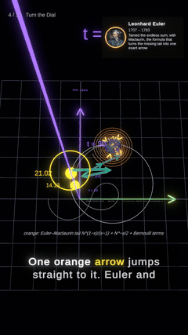

When enough non-trivial Zeta Zero values are provided to the Prime Counting function, prime numbers can be inferred from the large verticle steps in the graph.

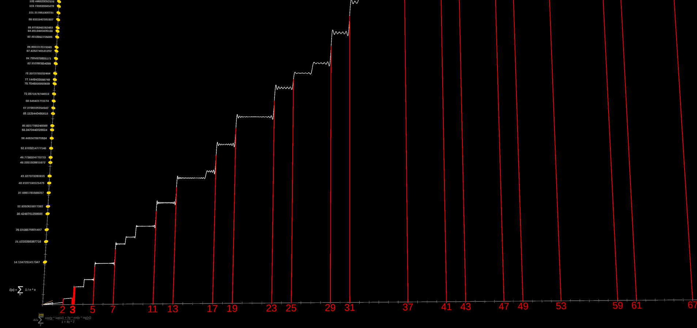

The Zeta function is a composite of line segments whose segment lengths are determined by the limit of the real component of `s`, and whose rotation values are determined by the limit of the imaginary component of `s`. In the animation below, each segment is graphed in a color-coded spiral to show how the values sum together. 

The plain series does not converge on the critical line, so the spiral alone never lands on ζ(s). The orange segment is the Euler–Maclaurin tail (`N^(1−s)/(s−1) + N^−s/2 + Bernoulli terms`, see `Assets/Math/ZetaMath.cs`) which closes the spiral onto the exact value to ~1e-13 — so the spiral now really does predict the zeros. The number of spiral segments grows with t (N ≈ t/2 + 4).

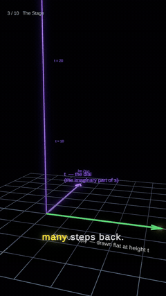

There are other tools built into this animation to help break down and visualize how these mysterious functions work.

The app opens on the Sacks spiral bent on its saddle, with the master wave of 10,000 zeros riding it and the zeta
trail (with its chain of arrows at the tip) growing out of the centre. The camera starts close to the centre, pulls
back and orbits; drag or W A S D to orbit and change altitude, wheel or Q E to zoom, Shift + drag to move the centre.
A side menu tucked into the left edge (the arrow, **M** or **Tab**) switches views (Saddle, XY graph), toggles layers
(saddle / flat, master wave, trail, chain, numbers, the k², k(k+1) and k² + k + 41 curves, trail height), picks the
format (16:9 or 9:16), plays the tour or any chapter, and records the whole tour or a single chapter.

Keys: **M** menu · **T** start/stop the narrated tour · **N** next line · **F9** record · **P** switch 16:9 / 9:16 ·
**F** frame rate.

## The guided tour, chapter by chapter

A narrated, chaptered camera fly-through explains the whole machine from first principles. It renders in
9:16 for Shorts, with karaoke captions that highlight the spoken word. Run it with **Zeta ▸ Play Tour** in
the editor (or press **T** in Play mode); see [docs/TOUR.md](docs/TOUR.md) for recording, narration and the
scripting vocabulary, and [docs/narration-script.md](docs/narration-script.md) for every caption.

| | | |
|---|---|---|
| 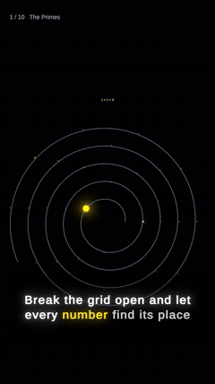 | 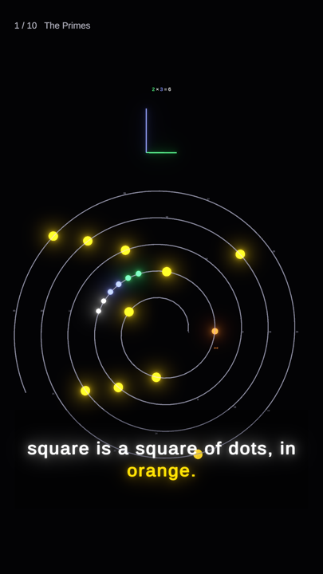 | **1. The Primes.** A grid of 1–30 lights its primes, breaks open into the Sacks spiral (n at distance √n, one turn per square), and the primes fade to leave only 2. Every composite is then built on the spiral: count p along the road, count q beside it, bend the q count to the side, fill the rectangle to p×q dots, roll them along the road past the numbers in between, and land on p×q. Whatever the counting skipped is a prime, and lights up. Squares land in orange. |
|  | 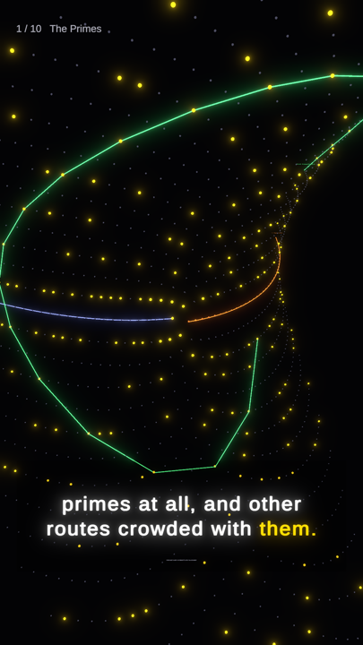 | **1b. The saddle.** The full spiral bends over a saddle. Composites fill the valleys, squares line one ridge, and routes from the centre appear: the squares and k(k+1) rays never hold a prime; Euler's k²+k+41 route holds forty in a row. The hook ends on the age of agentic AI discovery: humans carried the search for 23 centuries, the last lock will be opened together. |
| 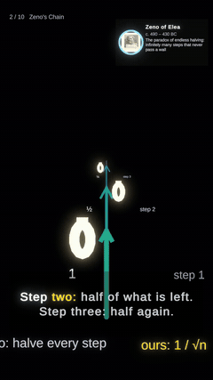 | 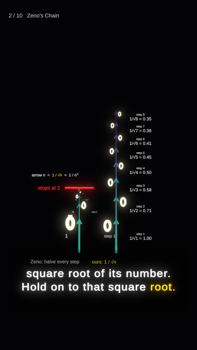 | **2. Zeno's Chain.** Zeno's halving steps, with footprints the camera follows at ever finer scale, stop dead at 2. The gentler rule, one over the square root of the step number, never stops. The exponent one half is named as the key the video returns to. |
|  | 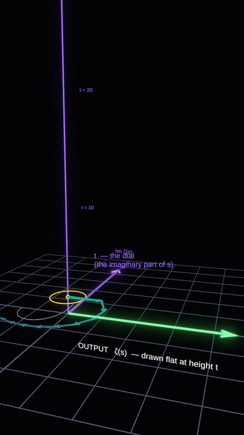 | **3. The Stage.** A floor with a grid, a pole, and a dial. The floor is the complex plane in plain words; the pole reading is t. As soon as the dial is introduced the chain starts to bend. |
|  | 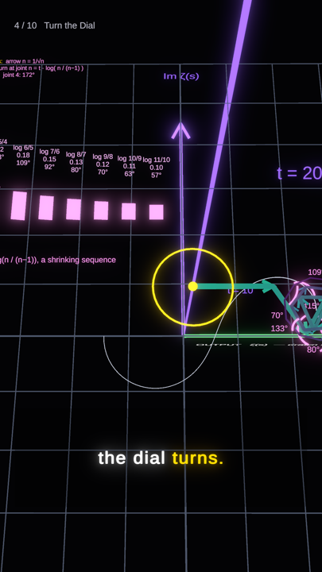 | **4. Turn the Dial.** Lengths follow square roots, bends follow logarithms. Every joint shows its angle as t·log(n/(n−1)) with the purple t climbing as the dial turns; a bar panel shows the shrinking log sequence. At t = 14.13 the turns add up so the chain closes on the centre: the first collision, with a callout explaining why. The next natural landing is 21.02. |
|  | 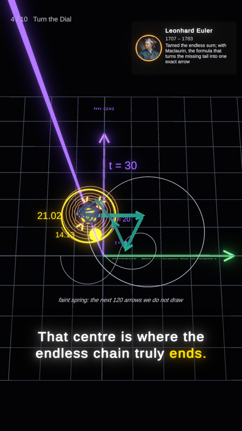 | **4b. The spring.** The arrows we skip wind up like a spring with arrows pointing to its centre; one orange arrow (the Euler–Maclaurin tail) jumps there exactly. Hardy and Riemann cards; the faint trail grows to full brightness as the zeros stack up. |
| 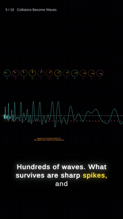 | 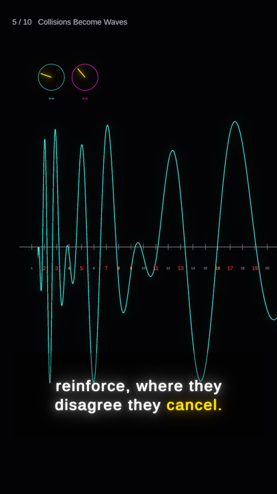 | **5. Collisions Become Waves.** An ordinary cosine with a γ dial, bent by a logarithm and dialled to 14.13. Each new collision is born as a plain cosine in its own colour, wound up by its dial, and absorbed into the master wave with the gap bars collapsing; its dial joins a shelf at the top. |
|  | 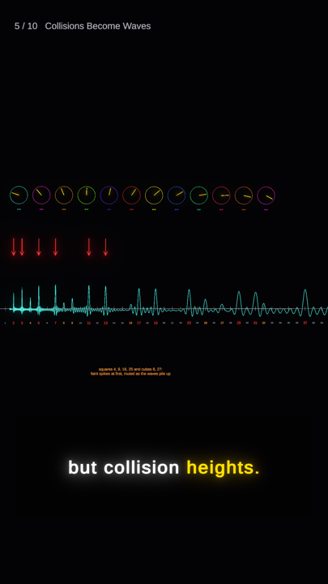 | **5b. The prime map.** Hundreds of waves cancel into spikes on 2, 3, 5, 7, 11, 13, with squares and cubes as faint, muted spikes. Red arrows and a sequential highlight mark the primes. |
| 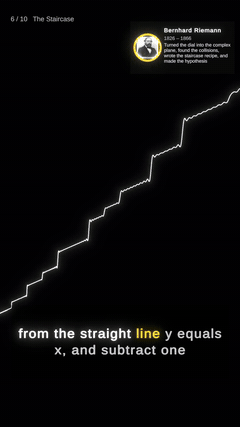 | 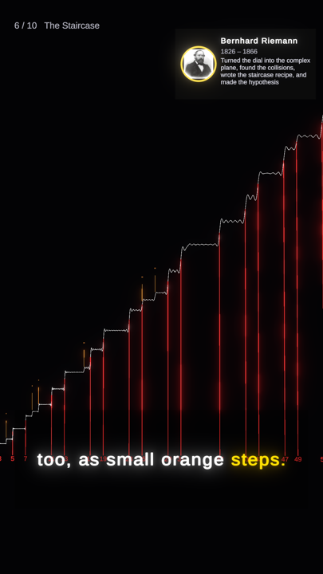 | **6. The Staircase.** Riemann's explicit formula: the line y = x visibly bends into steps as the weighted waves are subtracted. Red markers find the primes; orange ticks mark 4, 8, 9, 16, 25, 27. |
| 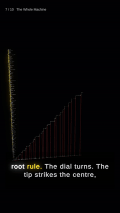 | 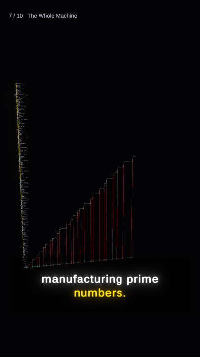 | **7. The Whole Machine.** Pole, markers, trail, chorus and staircase in one frame: a machine for manufacturing prime numbers. |
| 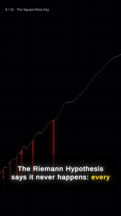 | 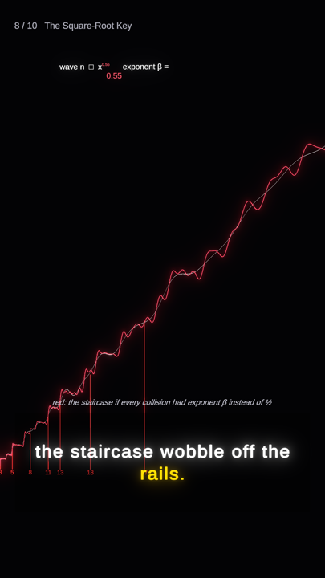 | **8. The Square-Root Key.** The shrink rule is written beside the spiral; at exponent 0.9 the tip never hits the centre. On the strip of all exponents the collisions sit on the one-half line; sweep the exponent toward 0.9 and the staircase wobbles off the rails. The Riemann Hypothesis, stated plainly. |
| 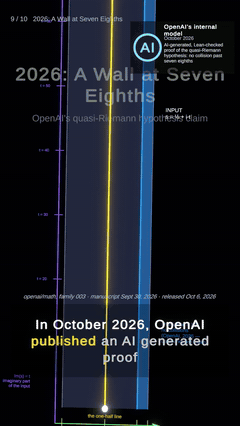 | 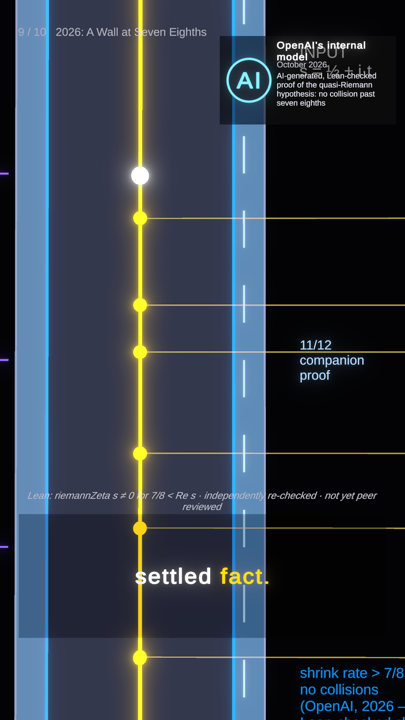 | **9. 2026: A Wall at Seven Eighths.** OpenAI's AI-generated, Lean-checked claim that no collision can stray past 7/8 (and by symmetry below 1/8), the 11/12 companion proof, the honest status (not peer reviewed), and the open gap from ½ to 7/8 where the hypothesis still lives. |
| 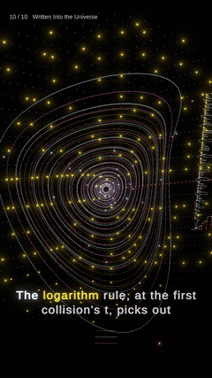 | 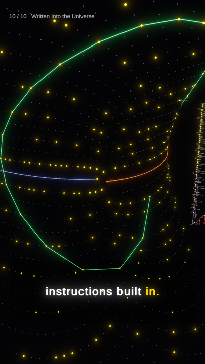 | **10. Written Into the Universe.** Back on the saddle, and a closing hypothesis (a guess, not a result): the square-root rule is the spiral itself (radius √n), and the logarithm rule at each collision's t picks out the numbers whose arrows point the same way, n = e^(2πk/t), tracing a curve on the saddle for t = 14.13 and for t = 21.02. Whether those curves know where the valleys are is an open question. |

## Meta Quest 2 (VR, hands only)

The same visualization runs on a Quest 2 with hand tracking only: passthrough is the default backdrop, one touch
turns it into a blackout, and the whole tour (narrated, captioned) and every math view are driven with big icon buttons
you push with a finger. Pinch to move the model, pinch with both hands to scale and turn it, turn your left palm toward
your face for a quick menu. See [docs/VR.md](docs/VR.md) for building, installing and using it.

Thumbnails for the video are in [docs/thumbnail](docs/thumbnail).

## Guided tour, bloom and recording

Everything glows through a built-in-pipeline bloom (`Assets/Rendering`), and a narrated, chaptered
camera fly-through explains the spiral, the two complex planes (where the imaginary axis is), the
zeros, the explicit formula, why Re(s) = ½ matters, and the October 2026 OpenAI "quasi-Riemann
hypothesis" claim (zero-free for Re s > 7/8). See [docs/TOUR.md](docs/TOUR.md) for running,
recording and generating the ElevenLabs narration, and [docs/narration-script.md](docs/narration-script.md)
for the full captions.

Hold right mouse button for freelook  

References:  
https://medium.com/cantors-paradise/the-riemann-hypothesis-explained-fa01c1f75d3f  
https://en.wikipedia.org/wiki/Explicit_formulae_for_L-functions  
https://github.com/danielhutama/Riemann-Explicit-Formula-for-Primes  
3Blue1Brown:  
https://youtu.be/sD0NjbwqlYw  