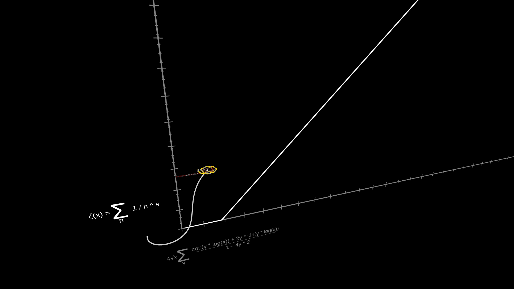

This is a Unity application for graphing the Riemann Zeta function along the critical strip at 1/2, and feeding the non-trivial Zeta Zero outputs into the Prime Counting function.

The Riemann Zeta function is given by:  
`ζ(x) = Σ 1 / n ^ s`

The Prime Counting function is approximated by Riemann's explicit formula:  
`ψ(x) = x − ln 2π − ½ ln(1 − x⁻²) − 4√x Σ (cos(γ log x) + 2γ sin(γ log x)) / (1 + 4γ²)`

An animation of the Zeta function is shown below. The Zeta curve spirals and intersects with the axis, resulting in Zeta Zeros (yellow dots). These values are fed into the Prime Counting function to the right. 

When enough non-trivial Zeta Zero values are provided to the Prime Counting function, prime numbers can be inferred from the large verticle steps in the graph.

The Zeta function is a composite of line segments whose segment lengths are determined by the limit of the real component of `s`, and whose rotation values are determined by the limit of the imaginary component of `s`. In the animation below, each segment is graphed in a color-coded spiral to show how the values sum together. 

The plain series does not converge on the critical line, so the spiral alone never lands on ζ(s). The orange segment is the Euler–Maclaurin tail (`N^(1−s)/(s−1) + N^−s/2 + Bernoulli terms`, see `Assets/Math/ZetaMath.cs`) which closes the spiral onto the exact value to ~1e-13 — so the spiral now really does predict the zeros. The number of spiral segments grows with t (N ≈ t/2 + 4).

There are other tools built into this animation to help break down and visualize how these mysterious functions work.

Keyboard Commands:  
- WASD QE: navigation  
- Spacebar: play/pause animation  
- Escape: reset animation  
- R key:  toggle additional limit curves  
- T: start/stop the narrated guided tour (N: next line, F9: record 1080×1920, P: toggle 9:16)  

## The guided tour, chapter by chapter

A narrated, chaptered camera fly-through explains the whole machine from first principles. It renders in
9:16 for Shorts, with karaoke captions that highlight the spoken word. Run it with **Zeta ▸ Play Tour** in
the editor (or press **T** in Play mode); see [docs/TOUR.md](docs/TOUR.md) for recording, narration and the
scripting vocabulary, and [docs/narration-script.md](docs/narration-script.md) for every caption.

| | |
|---|---|
|  | **1. The Primes.** A grid of 1–30 lights up its primes, then breaks open into the Sacks spiral (number n at distance √n, one turn per square). Every composite is built in front of you: p dots leave p along one axis, q dots leave q along the other, the rectangle fills to p×q dots, and the dots count along the spiral road to land on p×q. Squares land in orange. |
|  | **1b. The saddle.** The full spiral bends over a saddle. Composites fill the valleys, squares line one ridge, and routes from the centre appear: the squares and k(k+1) rays never hold a prime; Euler's k²+k+41 route holds forty in a row. The hook ends on the age of agentic AI discovery: humans carried the search for 23 centuries, the last lock will be opened together. |
|  | **2. Zeno's Chain.** Zeno's halving steps, with footprints the camera follows at ever finer scale, stop dead at 2. The gentler rule, one over the square root of the step number, never stops: sixty arrows reach fourteen, a million reach two thousand. The exponent one half is named as the key the video returns to. |
|  | **3. The Stage.** A floor with a grid, a pole, and a dial. The floor is the complex plane in plain words; the pole reading is t. As soon as the dial is introduced the chain starts to bend. |
|  | **4. Turn the Dial.** Two rules side by side: lengths follow square roots, bends follow logarithms. Arcs show the angle at every joint; a bar panel shows the shrinking sequence log(n/(n−1)) with live degrees; one line explains why (a complex power rotates, Riemann 1859). |
|  | **4b. The spring and the collisions.** The arrows we skip wind up like a spring with arrows pointing to its centre; one orange arrow (the Euler–Maclaurin tail) jumps there exactly. Turning on, the tip dives into the centre at t = 14.13: a collision, a marker on the pole. Hardy and Riemann cards; the faint trail grows to full brightness as the zeros stack up. |
|  | **5. Collisions Become Waves.** An ordinary cosine with a γ dial, bent by a logarithm and dialled to 14.13. Each new collision is born as a plain cosine in its own colour, wound up by its dial, and absorbed into the master wave with the gap bars collapsing; its dial joins a shelf at the top. |
|  | **5b. The prime map.** Hundreds of waves cancel into spikes on 2, 3, 5, 7, 11, 13, with squares and cubes as faint, muted spikes. Red arrows and a sequential highlight mark the primes. |
|  | **6. The Staircase.** Riemann's explicit formula: the line y = x visibly bends into steps as the weighted waves are subtracted. Red markers find the primes; orange ticks mark 4, 8, 9, 16, 25, 27. |
|  | **7. The Whole Machine.** Pole, markers, trail, chorus and staircase in one frame: a machine for manufacturing prime numbers. |
|  | **8. The Square-Root Key.** The shrink rule is written beside the spiral; at exponent 0.9 the tip never hits the centre. On the strip of all exponents the collisions sit on the one-half line; sweep the exponent toward 0.9 and the staircase wobbles off the rails. The Riemann Hypothesis, stated plainly. |
|  | **9. 2026: A Wall at Seven Eighths.** OpenAI's AI-generated, Lean-checked claim that no collision can stray past 7/8 (and by symmetry below 1/8), the 11/12 companion proof, the honest status (not peer reviewed), and the open gap from ½ to 7/8 where the hypothesis still lives. |
|  | **10. Written Into the Universe.** Back on the saddle: a square root, a dial, a spiral that keeps striking its centre, waves that cancel into a map of the primes, a rule written into the structure of numbers. |

Thumbnails for the video are in [docs/thumbnail](docs/thumbnail).

## Guided tour, bloom and recording

Everything glows through a built-in-pipeline bloom (`Assets/Rendering`), and a narrated, chaptered
camera fly-through explains the spiral, the two complex planes (where the imaginary axis is), the
zeros, the explicit formula, why Re(s) = ½ matters, and the October 2026 OpenAI "quasi-Riemann
hypothesis" claim (zero-free for Re s > 7/8). See [docs/TOUR.md](docs/TOUR.md) for running,
recording and generating the ElevenLabs narration, and [docs/narration-script.md](docs/narration-script.md)
for the full captions.

Hold right mouse button for freelook  

References:  
https://medium.com/cantors-paradise/the-riemann-hypothesis-explained-fa01c1f75d3f  
https://en.wikipedia.org/wiki/Explicit_formulae_for_L-functions  
https://github.com/danielhutama/Riemann-Explicit-Formula-for-Primes  
3Blue1Brown:  
https://youtu.be/sD0NjbwqlYw  