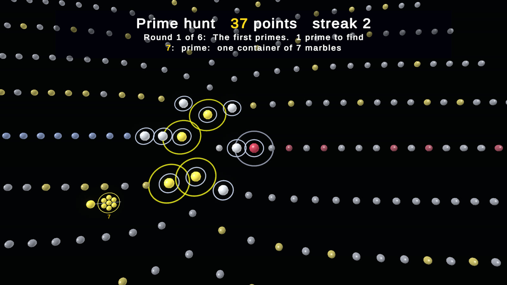
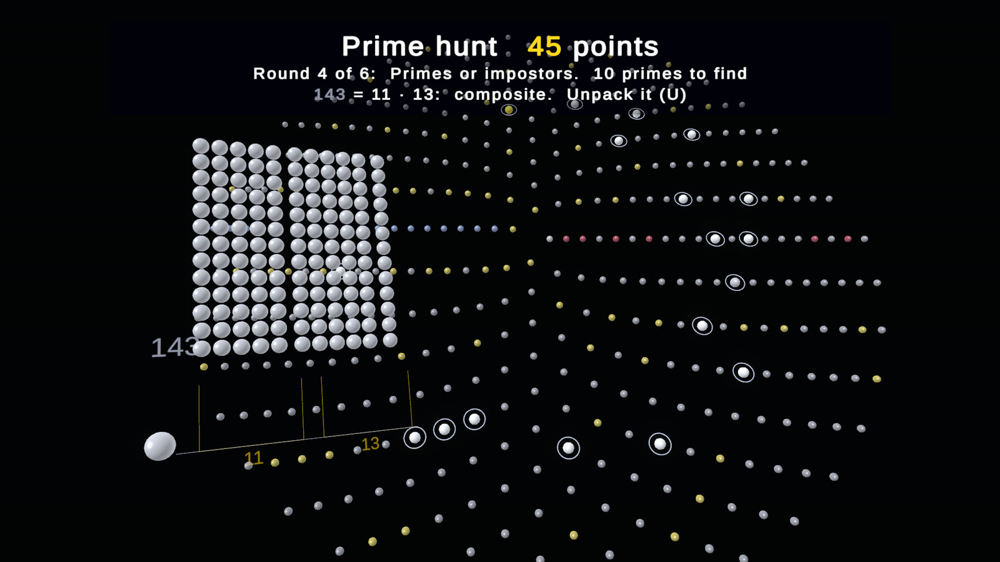
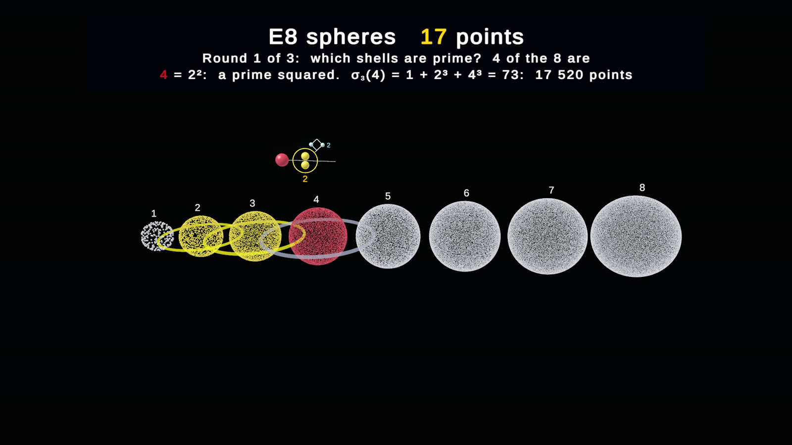
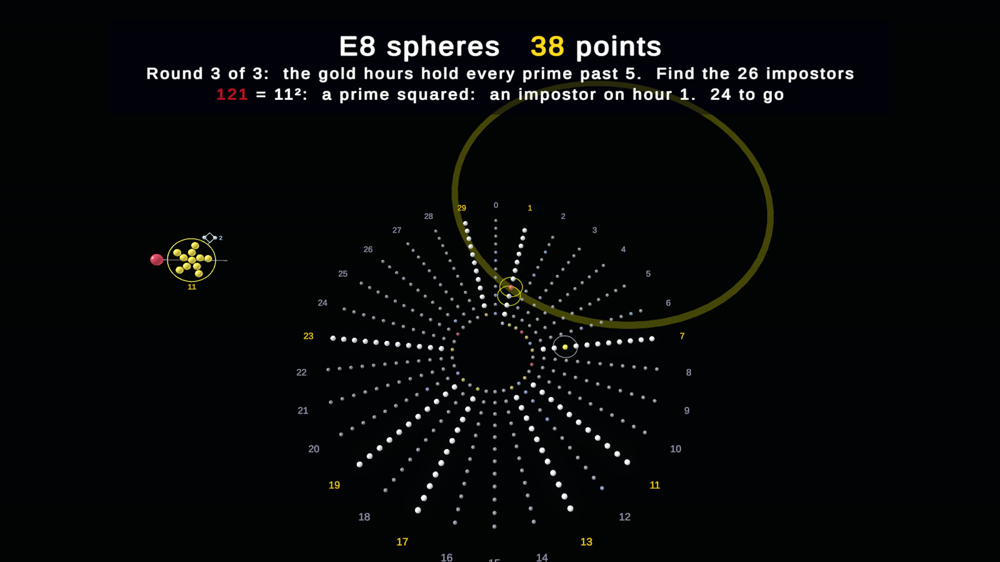
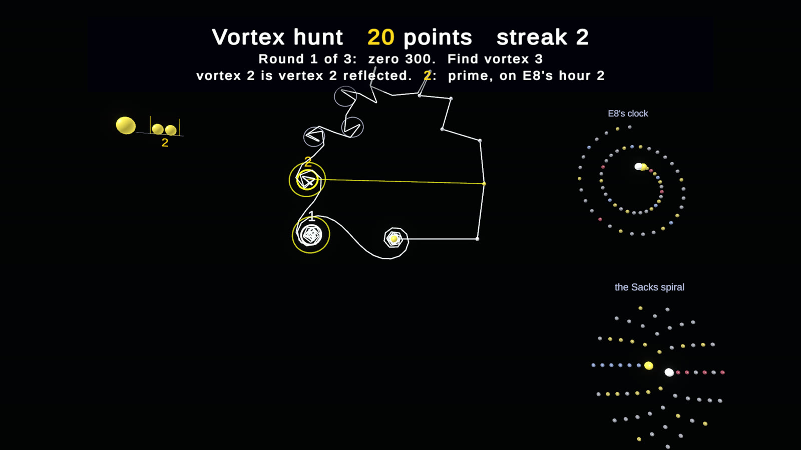
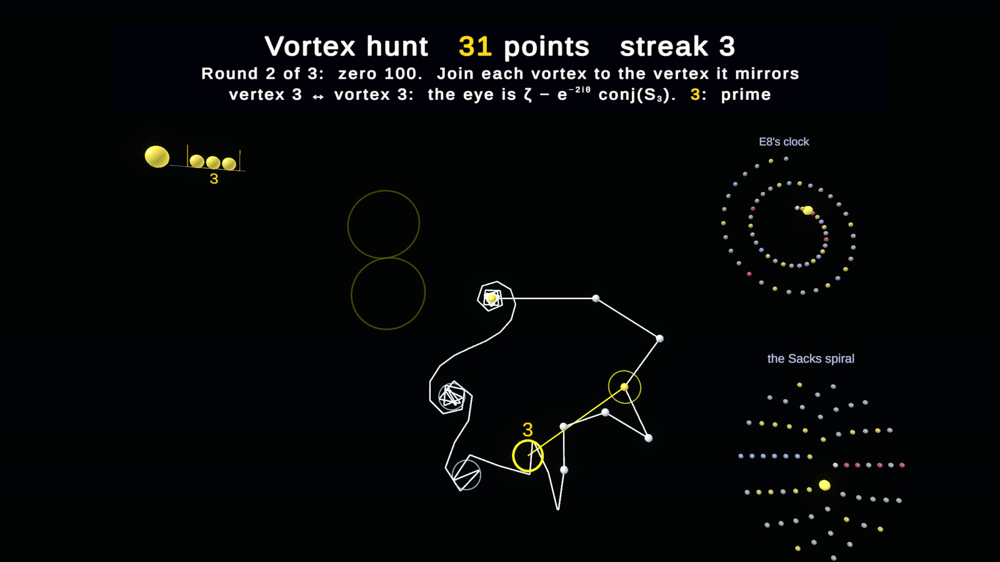

# Games: point at the numbers

Four games in the model lab ([`Assets/Games`](../Assets/Games)), on the desktop and in VR. You point at numbers to find
the primes, split composites into their prime building blocks, sort E8's lattice shells, and hunt the vortices of ζ's
chain. Every number can be shown as a **marble fingerprint**: its factors and exponents written in marbles instead of
digits. The fingerprint unpacks into the number's full volume and packs back into its shorthand.

Open them from the desktop side menu (**M**, row **GAMES**) or the lab panel's second row. In VR they are on the dock's
**Models** tab, second row (**Primes**, **Blocks**, **E8 game**, **Vortices**).

## The colour language

The same colours are used in every game, on the main Sacks spiral and in the lab's factor funnels (Paths, Unified, Zeros):

| colour | means | examples |
|---|---|---|
| **gold** | always a prime | 2, 3, 97, 7919 |
| **deep red** | a prime squared, p² | 4, 9, 49, 121, 169 |
| **blue** | pronic, k(k + 1): on the pronic curve (the blue route of the Sacks spiral) | 6, 12, 56, 90, 110 |
| **grey** | any other composite | 8, 16, 91, 360 |
| white | 1 | |

Gold wins over pronic, so 2 = 1 · 2 stays gold. `NumberKind` ([`NumberKind.cs`](../Assets/Games/NumberKind.cs)) does the
classifying, the factoring, the divisors and σ₃, and the shorthand (2³ · 3² · 5).

In the funnels every piece of a column is gold too, because each piece is a prime. A prime's column is one gold piece; a
composite's column is a stack of gold pieces under a top in the number's own colour. Which prime a piece is shows in its
length, log p, and in the labels: ÷p at each drop of a path back, p^k on the power spirals, and the prime written inside
each piece of the strip.

## Pointing

* **Desktop.** Hover a number to see its label; click to pick it (the lab's 22-pixel nearest-point pick, no colliders).
* **VR, near.** Touch the number with an index fingertip (within about a centimetre).
* **VR, from afar.** Point at the number with the index finger. A thin ray runs from the fingertip to the nearest number
  within 2.5° of the finger's line, and turns gold as you hold it. After 0.9 s it picks the number (once, until the ray
  leaves it). This works in every lab model, not only the games.

Keys (desktop): **N** next round or number, **Backspace** restart, **U** unpack or pack the fingerprint, **D** digits
on the fingerprint on or off, **Home** re-frame; in Vortex hunt's last round, **← →** steer t (**Shift** for fine steps).

## Marble fingerprints

A fingerprint reads left to right along a thin string, like a written number:

* a **badge** marble in the number's own colour (here grey 360, deep red 49, …);
* one **gold container per prime factor**, holding as many marbles as the prime: up to 7 in one row, larger primes in
  rows of five (so 13 is 5 + 5 + 3);
* the **exponent** as a short string of small pale marbles at the container's top right, where a written exponent sits,
  joined to the container by its raised wall: 360 = 2³ · 3² · 5 has three small marbles over the 2 and two over the 3.

**Unpack (U)** plays the multiplication. Each exponent opens into that many copies of its container. Then the
containers multiply a block one at a time, each in a new direction (right, up, deep, then right again a level larger),
until the block holds all n marbles: the number's full volume, in its own colour. **Pack** plays it back.

[`MarbleFingerprint.cs`](../Assets/Games/MarbleFingerprint.cs) draws it. The marbles are GPU-instanced spheres with a
small lit shader of their own ([`Marble.shader`](../Assets/Resources/Shaders/Marble.shader), single-pass stereo for VR),
drawn by [`MarbleBatch.cs`](../Assets/Games/MarbleBatch.cs).

### Can the marbles be read without digits? (TypeSafe)

[`Tools/jev_marbles.py`](../Tools/jev_marbles.py) asks TypeSafe's System One model Jev to read fingerprints that carry
no digits at all. For each picture Jev gets one Choice question: which product does it show? The options are the true
factorization and three near misses made in code (an exponent one off, a prime swapped for its neighbour, a factor
dropped or added), shuffled. Code keeps the score. The study ran three times while the design changed:

| round | change | read right | confident reads (≥ 0.6) that were right |
|---|---|---|---|
| 1 (20 numbers) | first design | 16 (80%) | 14 of 14 |
| 2 (32 numbers) | the string stops at the last container (it overran and suggested a missing factor) | 27 (84%) | 26 of 27 |
| 3 (32 numbers) | primes up to 7 in one row (7 had been read as 5 + 2), exponents joined to their container | 29 (91%) | 26 of 28 |

The misses left are a lone squared container read with a phantom extra factor (49 as 5 · 7², 121 as 7 · 11²), and
two adjacent exponent strings confused (360's 3² read as 3³). Two of the three (49 and 360) were read with confidence
just over 0.6, so confidence alone would not have flagged them. Run it with
`TYPESAFE_API_KEY=… python3 Tools/jev_marbles.py DIR` on the pictures `GamesTest.Fingerprints` writes.

## Prime hunt

The Sacks spiral of 1 … 400 lies flat; every number shows its colour, dimmed, except the round's candidates: silver
mystery marbles in rings. Point at the ones you think are prime. A prime turns gold and scores 10, with a streak bonus
from three in a row. Anything else shows its colour and its fingerprint, and costs 3. Six rounds, each framed on its own
candidates:

1. the first primes (2 … 12);
2. a prime gap (88 … 101);
3. Euler's arm k² + k + 41 and its neighbours;
4. primes or impostors: prime-looking composites such as 119 = 7 · 17, 133 = 7 · 19, 143 = 11 · 13 and 187 = 11 · 17;
5. twin primes near 300;
6. the squares and pronic numbers around 121 = 11² and 110, 132.

## Building blocks

A number stands as its raw volume, one marble per unit, in its own colour; below it, a tray of gold prime containers
(2 … 37). Point at a prime: if it divides what is left, the marbles regroup into that many equal groups, one stays, and
the prime joins the fingerprint string. If it does not, the marbles try to split and the leftover ones shine red. When
what is left is itself a prime past 37 (246 = 2 · 3 · 41), point at the block to say so. When nothing is left, the
fingerprint is the whole number; it unpacks into the full volume and packs back, and the next number comes up. Twenty
numbers: squares of primes (49, 121, 169), pronic numbers (12, 30, 56, 72, 90, 210), products of three primes (105, 1001),
powers of 2 (128, 1024), 360 and more.

## E8 spheres

E8's lattice points, shell by shell: shell n is a sphere of its 240 σ₃(n) points of norm 2n
([`E8Shells.cs`](../Assets/Games/E8Shells.cs) enumerates them exactly; the 3D picture projects each point to the Coxeter
plane and a third axis and pushes it out to the sphere). As many shells are drawn as the platform takes: shells 1–8,
340 320 points, on the desktop; shells 1–5, 56 880 points, in VR. The points are instanced icosahedra, one draw per
1023. Three rounds:

1. **Which shells are prime?** The spheres start silver; point at the shells whose n is prime. A prime shell holds just
   two cubes' worth, 240 (1 + p³).
2. **The building blocks of each shell.** Point at a shell and its divisors stand under it as cubes of marbles, d × d × d
   for each divisor d, adding up to σ₃(n) (6: 1 + 2³ + 3³ + 6³ = 252, × 240 = 60 480 points).
3. **Prime or impostor on E8's clock.** The numbers up to 360 at their hours n mod 30, the eight gold hours' numbers
   silver. Every prime past 5 is on a gold hour; find the 26 composites that are too (49, 77, 91, 119, 121, …).

## Vortex hunt

ζ's chain (the partial sums of n^(−½ − it), laid flat, its end at ζ(½ + it)) curls into vortices at a zero. Vortex k
belongs to the counting number k: its eye is the chain's own k-th vertex reflected through ζ's phase,
ζ − e^(−2iθ) conj(S_k). Each vortex found lights in k's colour, a line joins it to vertex k, and two small maps show where
k sits among the primes: on E8's clock (hour k mod 30) and on the Sacks spiral. Three rounds:

1. **Find vortex k** at zero 300 (t = 541.85): point at the eyes in order.
2. **Join each vortex to its vertex** at zero 100: point at a vortex, then at the vertex it mirrors.
3. **Land on a zero**: steer t (the slider, or ← →) until the chain's end lands on zero 1000 (|ζ| < 0.02).

## VR

The games use the lab's VR placement (each game's view becomes a placement of the model in front of you), the dock's
readout for the status and its controls page for the buttons. Only the desktop simulation of the headset has been tried
(`GamesTest.VRGames`: a scripted ray held on 11 picks it, a fingertip touch picks 4); nobody has played the games on a
headset yet.

## Tests

`Unity -batchmode -projectPath . -runTests -testPlatform PlayMode -testFilter GamesTest`
([`GamesTest.cs`](../Assets/Tests/GamesTest.cs)):

* `Arithmetic` checks the classification, the shorthand, σ₃, and every vector of E8's shells 1–4 (count 240 σ₃(n), norm
  2n, all integer or all half-integer, even coordinate sum);
* `DesktopGames` plays every game through scripted picks and asserts the scores, splits and readouts; with `ZETA_OUT` it
  writes the pictures above;
* `VRGames` picks by the finger's ray and by a touch in the headset simulation;
* `Fingerprints` (with `ZETA_FP_OUT`) draws the fingerprints alone for the legibility study, and one number's unpacking.
