# Games: numbers to take apart

Four games in the model lab ([`Assets/Games`](../Assets/Games)), on the desktop, on a touch screen and in VR. They are
for exploring, not for winning: nothing is scored, timed or locked, nothing is marked wrong, and every number can be
touched at any time. Touch a number and see what it is made of: its prime factors and their exponents, written as a
**marble fingerprint** (marbles instead of digits). Pull the fingerprint apart and it rebuilds the number's whole volume
from its primes; push it back and it packs into its shorthand. The marble language is symmetric: flat, every group of
marbles is a symmetric spiral; in 3D, a spiral sphere pack. Each exponent is one more ring round its prime, tilted into
a dimension of its own.

* **The number spiral**: the Sacks spiral of 1 … 400. Touch any number, step to its neighbours, light one family at a
  time.
* **Building blocks**: split any number from 2 to 1024 into its primes by hand, one prime at a time, from a tray.
* **E8's clock**: every number up to 600 as a stack of its prime factors on E8's wheel. Touch a column, and its path
  back steps down the staircase to its primes, every landing named in exponent notation.
* **Zeta's chain**: move t up and down (a drag, one finger, or a pinch in VR) and watch ζ's chain wind. At each zero it
  curls into vortices, one for each counting number.

Open them from the desktop side menu (**M**, row **GAMES**) or the lab panel's second row. In VR they are on the dock's
**Models** tab, second row (**Spiral**, **Blocks**, **E8 clock**, **Chain**).

## The colour language

The same colours are used in every game, on the main Sacks spiral and in the lab's factor funnels (Paths, Unified, Zeros):

| colour | means | examples |
|---|---|---|
| **gold** | always a prime | 2, 3, 97, 7919 |
| **deep red** | a prime squared, p² | 4, 9, 49, 121, 169 |
| **blue** | pronic, k(k + 1): on the pronic curve (the blue route of the Sacks spiral) | 6, 12, 56, 90, 110 |
| **grey** | any other composite | 8, 16, 91, 360 |
| white | 1 | |

Gold wins over pronic, so 2 = 1 · 2 stays gold. `NumberKind` ([`NumberKind.cs`](../Assets/Games/NumberKind.cs)) does the
classifying, the factoring, the divisors and σ₃, and the shorthand (2³ · 3² · 5).

In the funnels every piece of a column is gold too, because each piece is a prime. A prime's column is one gold piece; a
composite's column is a stack of gold pieces under a top in the number's own colour. Which prime a piece is shows in its
length, log p, and in the labels: ÷p at each drop of a path back, p^k on the power spirals, and the prime written inside
each piece of the strip.

## Touching, turning, pulling apart

* **Desktop.** Hover a number to see its label; click to touch it (the lab's 22-pixel nearest-point pick, no colliders).
  Drag to turn the model, right-drag or Shift-drag to slide it, and use the wheel to zoom. Drag a fingerprint to the right
  to pull it apart into its volume, and back to the left to pack it (hold Ctrl for fine steps). In Zeta's chain, a drag
  anywhere else moves t.
* **Touch screen.** A tap touches a number. One finger drags as the mouse does: it turns the model, pulls a fingerprint
  or moves t. Two fingers pinch to zoom, and slide together to move the model.
* **VR, near.** Touch the number with an index fingertip (within about a centimetre).
* **VR, from afar.** Point at the number with the index finger. A thin ray runs from the fingertip to the nearest number
  within 2.5° of the finger's line, and turns gold as you hold it. After 0.9 s it picks the number (once, until the ray
  leaves it). This works in every lab model, not only the games.
* **VR, pinch.** Pinch a fingerprint and draw your hand along it to pull it apart; in Zeta's chain, pinch the bead on the
  t rail and lift or lower it. A pinch anywhere else moves the model, and two pinching hands turn and scale it.

Keys (desktop): **U** unpack or pack the fingerprint, **F** flat or 3D, **D** digits on the fingerprint on or off,
**Home** re-frame. Each game's own keys are given below.

## Marble fingerprints

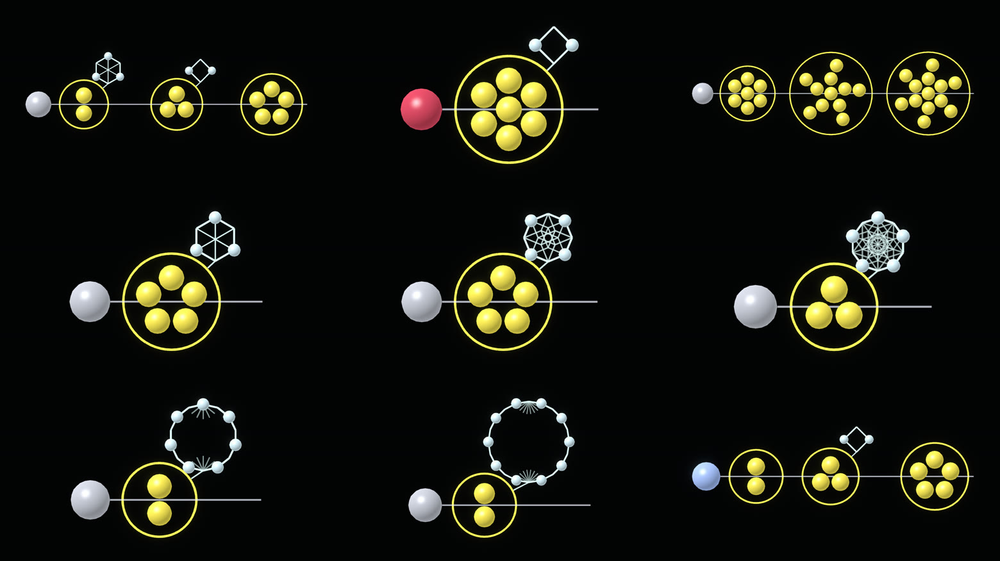

A fingerprint reads left to right along a thin string, like a written number:

* a **badge** marble in the number's own colour (here grey 360, deep red 49, …);
* one round **gold container per prime factor**, holding as many marbles as the prime in a **symmetric spiral**. Up to
  six marbles make a ring: a pair, a triangle, a pentagon. Past that, an odd count has one marble in the middle and
  equal arms winding out round it: 7 is one and six round it, 11 one and five arms of two, 13 one and six arms of two,
  97 one and six arms of sixteen.
* the **exponent** in the container itself, not as a superscript: **more rings round the container**, each tilted out of
  the picture into a plane of its own, one more dimension per ring, their tilts fanned by half a turn, like the rings
  of an armillary sphere. Flat, each is an ellipse through the container, its near half bright and its far half faint
  behind the marbles. Count all of a container's rings, its own flat ring included: that is how many times its prime
  is multiplied in. 360 = 2³ · 3² · 5 has two tilted rings round the 2 and one round the 3; 2¹⁰ is a pair of marbles
  inside nine. The rings precess slowly, and from the fourth ring on they rock, as a ring turning through a further
  dimension would look from here.

**Flat or 3D (F).** Flat, every group of marbles is a symmetric spiral. In 3D, every group is a **spiral sphere pack**:
shells round a centre, filled from the outside in so the outside is always a full round shell. A container's marbles
lie on a Fibonacci spiral round each shell (2 to 6 marbles as a pair, a triangle, a tetrahedron, a bipyramid, an
octahedron); the unpacked volume is wound with one coil per copy, pole to pole. The packs turn slowly round the
exponent's rings. The desktop starts flat, VR in 3D.

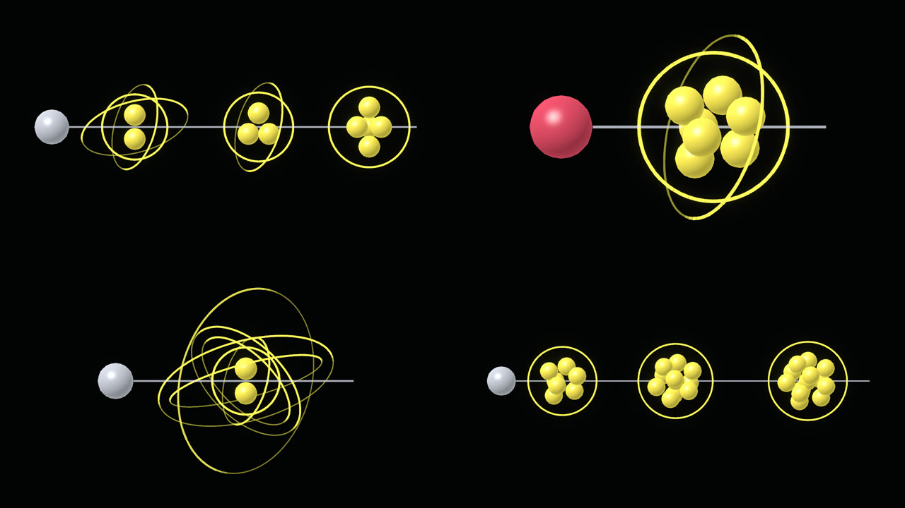

**Unpack (U)** plays the multiplication:

1. each container's tilted rings slide out along the string; each settles flat, closes onto the container's size and
   fills with marbles: that many copies of the container;
2. the first container pours its marbles into the volume;
3. every next container, a prime p, sends one marble to each of p spots round a ring, and a copy of the volume so far
   blooms at each spot (so a container's marbles really do count the copies);
4. the p copies swirl together into p spiral arms, the way the arms wind: copy c becomes arm c (in 3D, coil c). Past
   13 copies, the copies come in on the prime's own spiral and the volume takes arms of its own.

The volume ends with all n marbles in the number's own colour; alternate arms are a shade darker, so the last factor's
arms show (360's five). A volume wider than nine string marbles is drawn with smaller marbles. **Pack** plays it back.

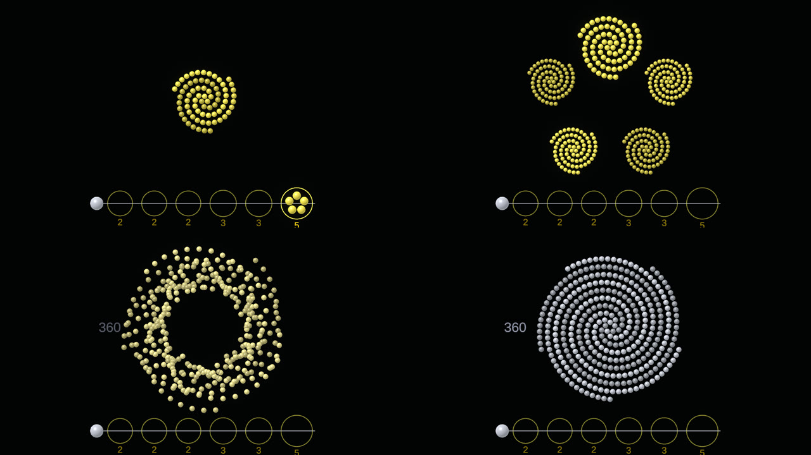
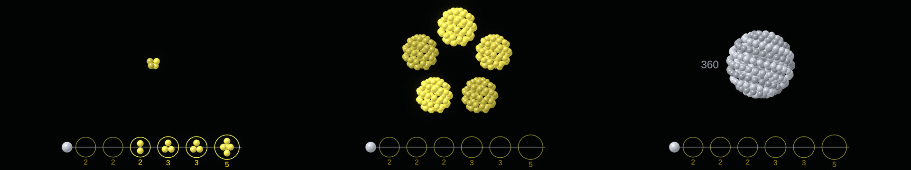

[`MarbleLayout.cs`](../Assets/Games/MarbleLayout.cs) lays the marbles out (flat: an m-start spiral, centre first, ring t
holding marble t of every arm, so p copies merging into p arms is just index t·p + c; deep: the shells and coils, cached
by count). [`MarbleFingerprint.cs`](../Assets/Games/MarbleFingerprint.cs) draws the fingerprint and plays the
multiplication. The marbles are GPU-instanced spheres with a small lit shader of their own
([`Marble.shader`](../Assets/Resources/Shaders/Marble.shader), single-pass stereo for VR), drawn by
[`MarbleBatch.cs`](../Assets/Games/MarbleBatch.cs); the rings and the string are one mesh of thin quads
([`LineBatch.cs`](../Assets/Games/LineBatch.cs)).

### Can the marbles be read without digits? (TypeSafe)

[`Tools/jev_marbles.py`](../Tools/jev_marbles.py) asks TypeSafe's System One model Jev to read fingerprints that carry
no digits at all. For each picture Jev gets one Choice question: which product does it show? The options are the true
factorization and three near misses made in code (an exponent one off, a prime swapped for its neighbour, a factor
dropped or added), shuffled. Code keeps the score. Rounds 1–3 read the first design (containers as cups, marbles in
rows, each exponent a short row of small marbles); rounds 4–5 the symmetric one with hypercube exponents; round 6 the
exponents as tilted rings:

| round | change | read right | confident reads (≥ 0.6) that were right |
|---|---|---|---|
| 1 (20 numbers) | first design | 16 (80%) | 14 of 14 |
| 2 (32 numbers) | the string stops at the last container (it overran and suggested a missing factor) | 27 (84%) | 26 of 27 |
| 3 (32 numbers) | primes up to 7 in one row (7 had been read as 5 + 2), exponents joined to their container | 29 (91%) | 26 of 28 |
| 4 (the same 32) | symmetric spirals in round containers; exponents as k-cube shadows with k pale marbles | 30 (94%) | 27 of 27 |
| 5 (the same 32) | each exponent moved over its own container's top right, the next container further off | 29 (91%) | 27 of 27 |
| 6 (the same 32) | the exponent as tilted rings round the container (no superscript) | 31 (97%) | 29 of 30 |

With the tilted rings, 100 = 2² · 5² and 3⁵ (which the superscript shapes lost) read right. The one miss left is 360 again,
its 3² read as 3³, this time with confidence (0.80): the single tilted ring's bright and faint halves may read as two
curves. With the superscript shapes every miss had come with low confidence (0.28 to 0.53). Run it with
`TYPESAFE_API_KEY=… python3 Tools/jev_marbles.py DIR` on the pictures `GamesTest.Fingerprints` writes.

## The number spiral

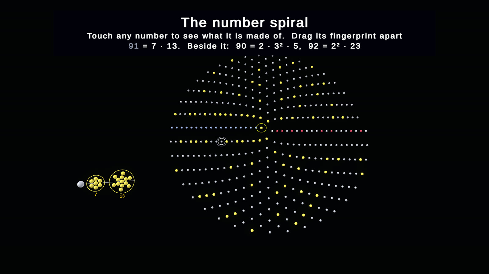

The Sacks spiral of 1 … 400 (n at radius √n and angle τ√n), every number in its colour. Touch any number: it lights, a
ring marks it, its fingerprint shows what it is made of, and the board names it and its neighbours (91 = 7 · 13, beside
90 = 2 · 3² · 5 and 92 = 2² · 23). Pull the fingerprint apart, and the number rebuilds itself from its primes: 91 as
thirteen arms of seven. Push it back, and it packs into its shorthand. **← →** (n − 1, n + 1) step along the spiral.
**Look at** (**L**) lights one family at a time, as places to look rather than answers to find: the primes, the twin
primes, Euler's k² + k + 41, the squares and the pronic numbers (each on a line of its own), and the multiples of the
number touched last.

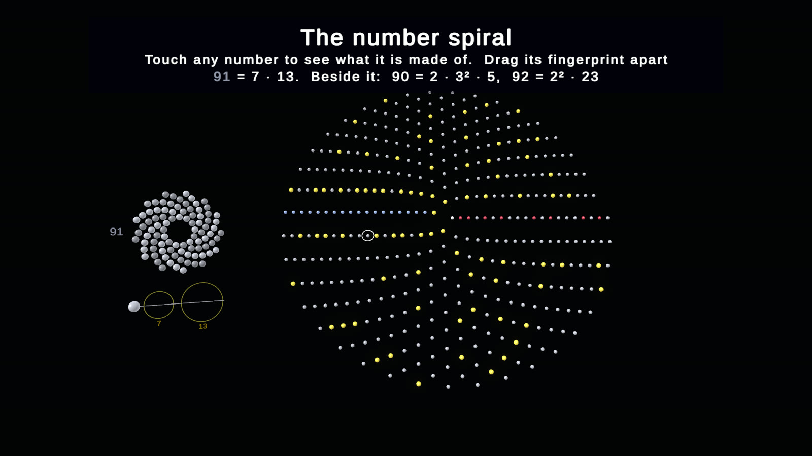
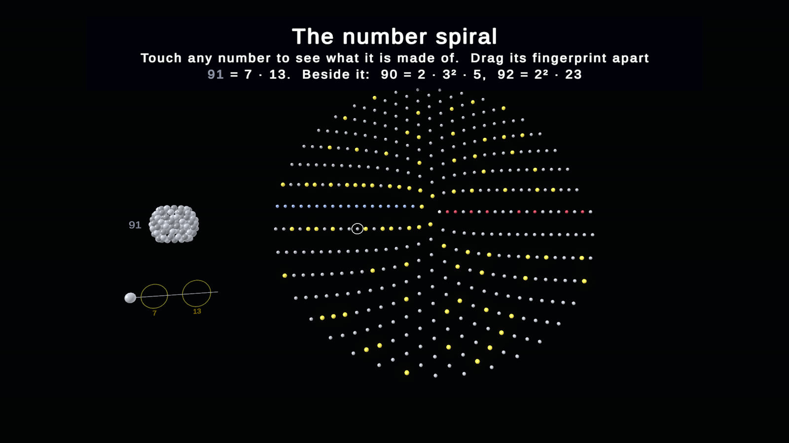
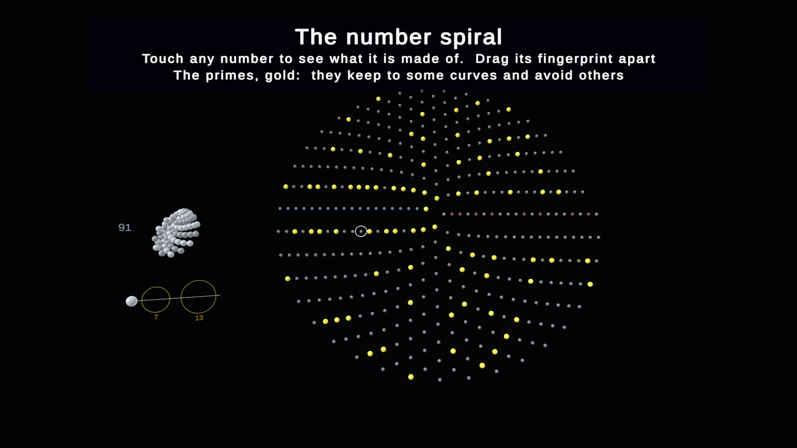

## Building blocks

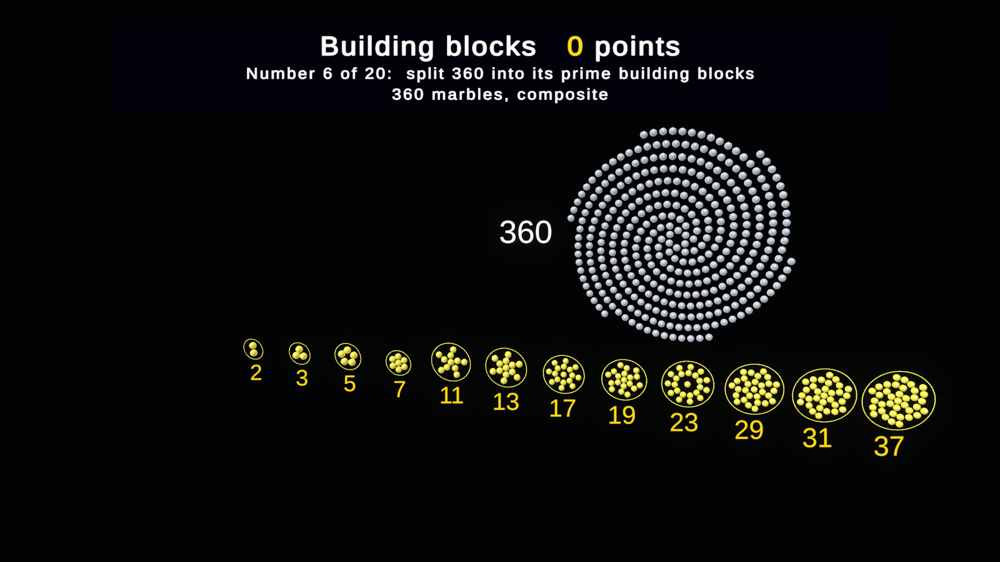

A number stands as its raw volume, one marble per unit, in its own colour, as a symmetric spiral (in 3D a spiral sphere
pack); below it, a tray of gold prime containers (2 … 37), each its prime's spiral in a ring. Point at a prime: if it
divides what is left, the marbles part into that many equal groups round a ring, one stays, and the others fly to the
fingerprint string. If it does not, the groups form round the ring with the leftover marbles in the middle, shining red
(seven groups of 51 leave 3 of 360 over), and everything goes back together, nothing lost. When what is left is itself
a prime past 37 (246 = 2 · 3 · 41), point at the block. When nothing is left, the fingerprint is the whole number: it
unpacks once by itself into the full volume beside its string, where the block stood, and then waits to be pulled apart
or packed again. Any number from 2 to 1024 can be split: **← →** (n − 1, n + 1) step to the next one, and **Example**
(**N**) brings up the next of twenty: squares of primes (49, 121, 169), pronic numbers (12, 30, 56, 72, 90, 210),
products of three primes (105, 1001), powers of 2 (128, 1024), 360 and more.

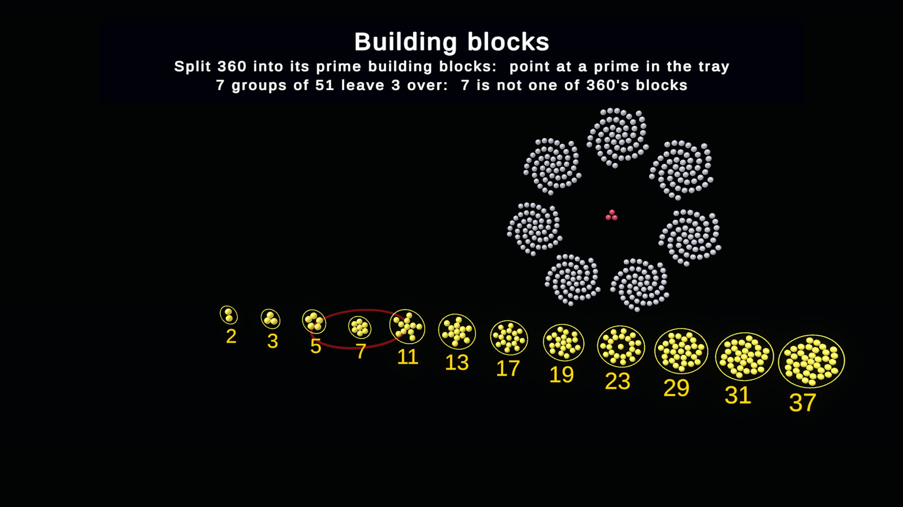
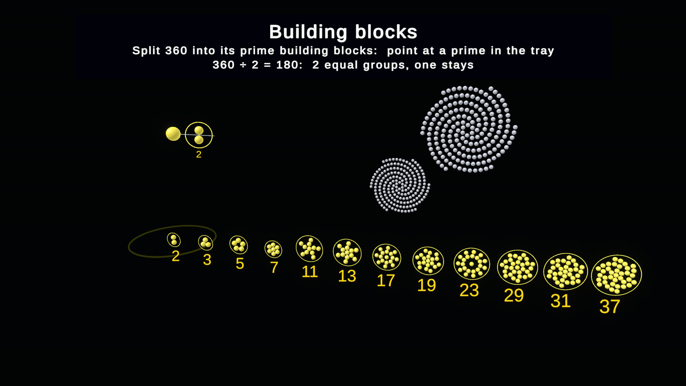
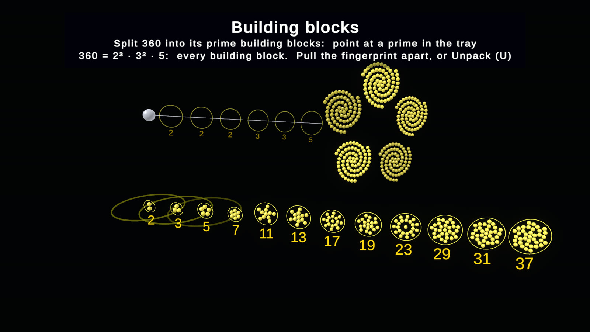
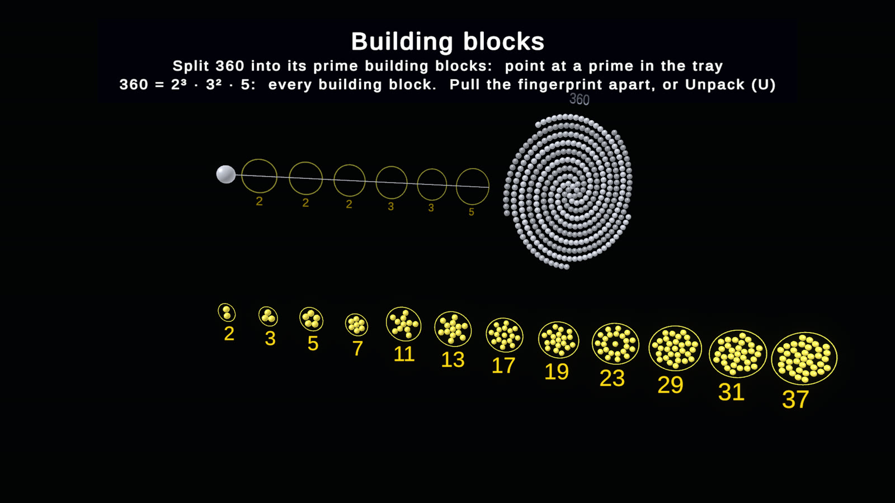
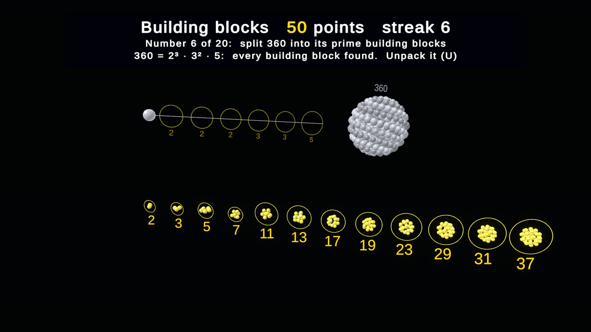

## E8's clock

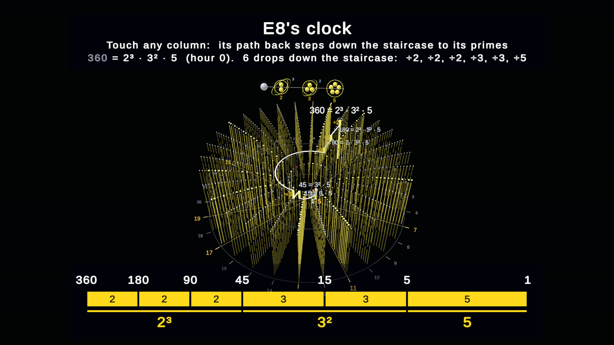

Every n ≤ 600 stands on E8's wheel at its hour n mod 30, its distance from the middle growing as √n, as a stack of its
prime factors: one gold piece, as tall as log p, for each ([`FunnelView.cs`](../Assets/Lab/FunnelView.cs), the factor
funnel of the lab's Paths model). The eight gold spokes are the hours of E8's exponents (1, 7, 11, 13, 17, 19, 23, 29),
and every prime past 5 stands on one. Touch any column, and its path back plays down the staircase: down its top piece
(÷ its smallest prime), across at that height to the column of what is left, and down again, to 1. Every landing is
named in exponent notation where that says more: 360 = 2³ · 3² · 5, then 180 = 2² · 3² · 5, 90 = 2 · 3² · 5,
45 = 3² · 5, 15 = 3 · 5, 5 and 1. Where the small numbers near the middle bunch up, their names stack down the screen in
the path's order ([`LabelStack.cs`](../Assets/Lab/LabelStack.cs)). The strip below tallies the pieces with their
exponents (2³, 3², 5), the board lists the drops (÷2, ÷2, ÷2, ÷3, ÷3, ÷5), and the fingerprint floats above the
stacks. **← →** step to n ± 1, **↑ ↓** to n ± 30 (the same hour, one turn further out or in), and **Space** replays the
path. Turn the model to look along the steps: drag it, use one finger, or pinch it in VR.

**Powers** (**K**) shows where the runs of each prime go: 2, 4, 8 … up the spiral of 2^k, each top labelled with its
exponent (2⁹, 3⁵, 5³, 7³, 11², 13²). 343 = 7³ drops three times by log 7.

**Shells** (**V**) switches to E8's lattice points, shell by shell: shell n is a sphere of its 240 σ₃(n) points of norm
2n ([`E8Shells.cs`](../Assets/Games/E8Shells.cs) enumerates them exactly; the 3D picture projects each point to the
Coxeter plane and a third axis and pushes it out to the sphere). As many shells are drawn as the platform takes: shells
1–8, 340 320 points, on the desktop; shells 1–5, 56 880 points, in VR. The points are instanced icosahedra, one draw per
1023. Touch a shell, and its divisors stand under it as cubes of marbles, d × d × d for each divisor d, adding up to
σ₃(n) (6: 1 + 2³ + 3³ + 6³ = 252, × 240 = 60 480 points). A prime shell holds just two cubes, 240 (1 + p³).

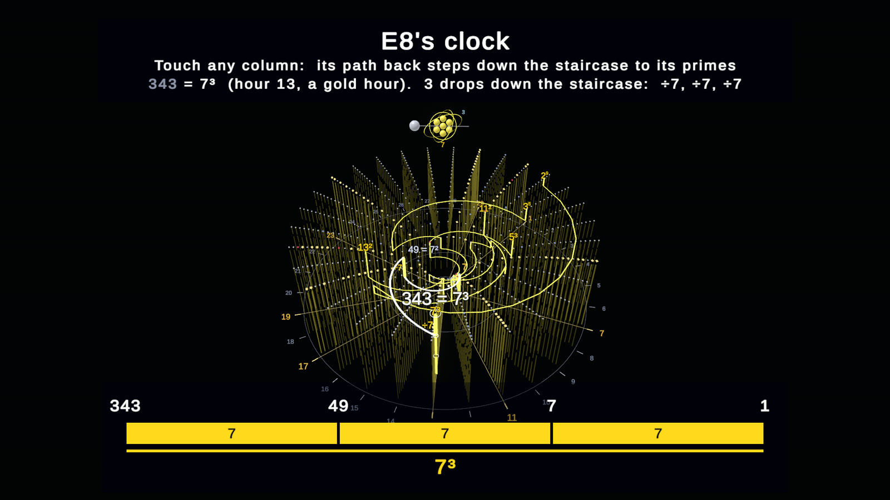
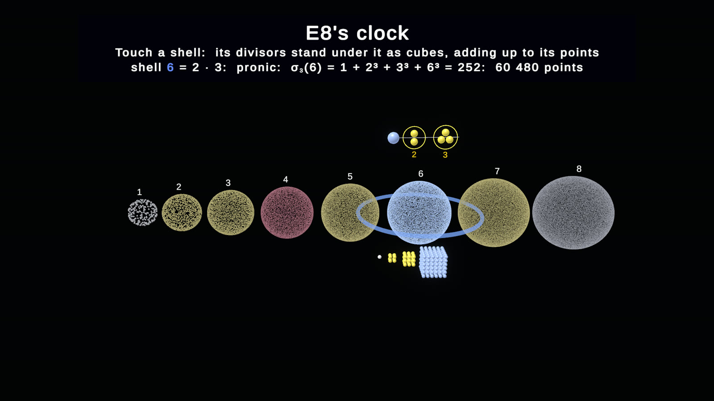

## Zeta's chain

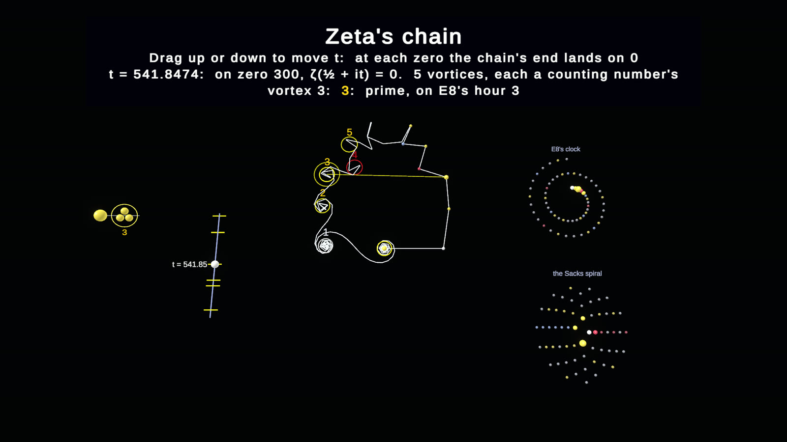

ζ's chain is the path of partial sums of n^(−½ − it), laid flat, its end at ζ(½ + it). Move t up and down and watch the
chain wind and unwind: drag up or down anywhere (the mouse, or one finger on a touch screen; 0.004 of t a pixel, Ctrl for
fine steps), pinch the bead on the t rail in VR and lift or lower it, or use **← →** (Shift for fine steps) or the t
slider. **,** and **.** glide to the previous or the next zero. The rail on the left spans 8 of t round the bead (it
re-centres when you let go), and its gold ticks are the zeros within reach (the first 1000, from the table the
visualization already loads). At a zero the chain's end lands on 0, inside a gold ring, and the chain curls into
vortices. Vortex k belongs to the counting number k: its eye is the chain's own k-th vertex reflected through ζ's phase,
ζ − e^(−2iθ) conj(S_k), and it is labelled k in k's colour. Touch a vortex or a vertex to see k's fingerprint, the
mirror line from vertex k to its eye, and where k sits on E8's clock (hour k mod 30) and on the Sacks spiral (the small
maps on the right).

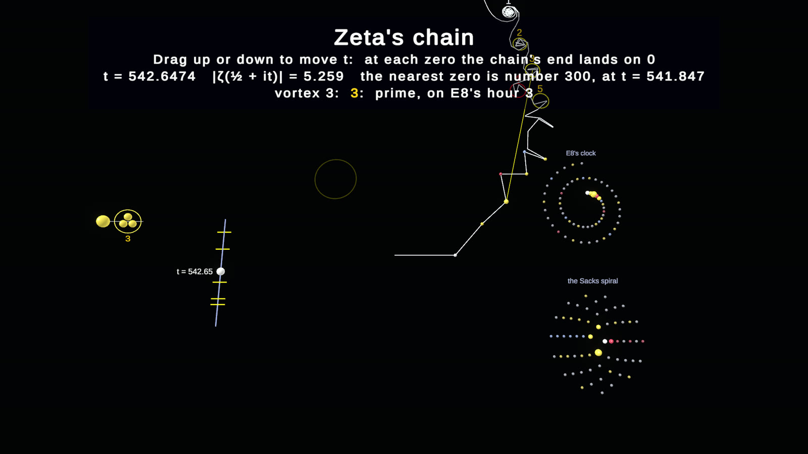
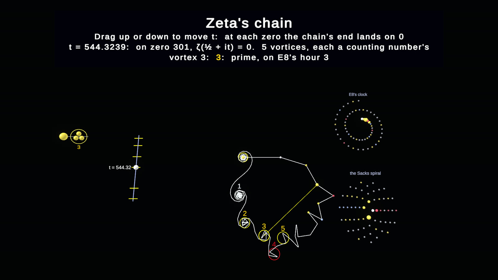

## Videos: the marble language, and a tutorial for each game

Five narrated videos are chapters of the experiments script ([`video_series_spec.py`](../Tools/video_series_spec.py),
built by [`video_series.py`](../Tools/video_series.py)):

* **`marbles`** (vertical, 9:16): numbers in marbles. 360's fingerprint builds itself (badge, containers, marbles, tilted
  rings), unpacks step by step into five arms, turns 3D and packs back; then a prime (97) and a prime power (5⁴ = 625).
  The scene is [`SacksMarbleWorld.cs`](../Assets/Tour/SacksMarbleWorld.cs): fingerprints on the experiments stage, each in
  a named slot whose reveal, phase, depth and fade are eased parameters (`exp:mwshow:SLOT:N:X,Y`, `mw.SLOT.phase`, …),
  with callouts to a container, its rings or the volume (`exp:callmw:SLOT/cup/G`).
* **`tutprime`, `tutblocks`, `tute8`, `tutvortex`** (16:9, as the games are played on the desktop): each opens its game
  in the model lab and plays it as the narrator explains, with the game's own views and status board. The chapter opens
  the lab in story mode (`exp:lab:enter:ID`: the tour keeps running and the mouse is left alone) and drives it as a
  player would, with `exp:lab:pick`, `point`, `pull` (the fingerprint pulled apart by hand), `unpack`, `deep`, `view`,
  `look`, `example`, `prime`, `rest`, `powers`, `shells`, `zero`, `steer` and `jump` (`GameModel.StoryCommand`); its
  lines' camera `lab` leaves the camera to the game. The captions hold the bottom quarter of the picture, so in a chapter
  each game frames itself a little smaller and higher (`GameModel.StoryFramed`) and the lab's strip stays hidden.

Render them with `Tools/render_chapters.py --script experiments --chapters marbles --shapes vertical` (and
`--chapters tutprime,tutblocks,tute8,tutvortex --shapes horizontal`).

## VR

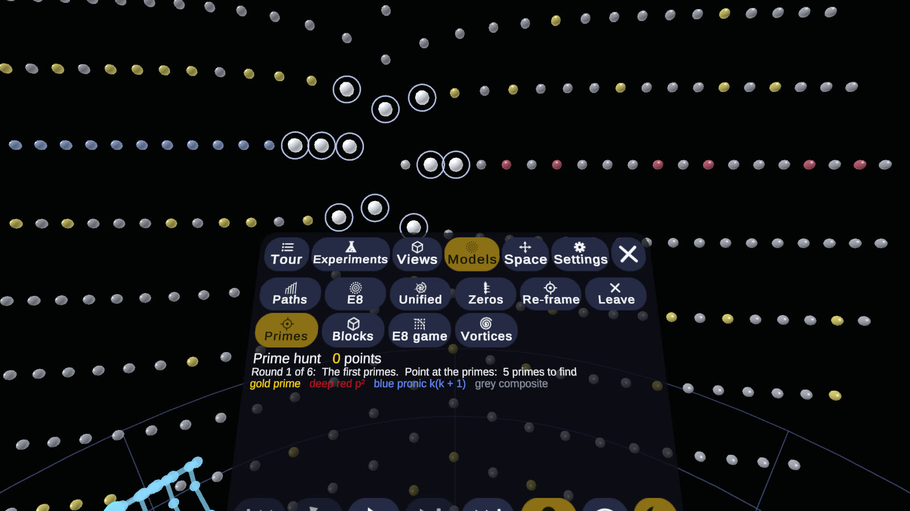
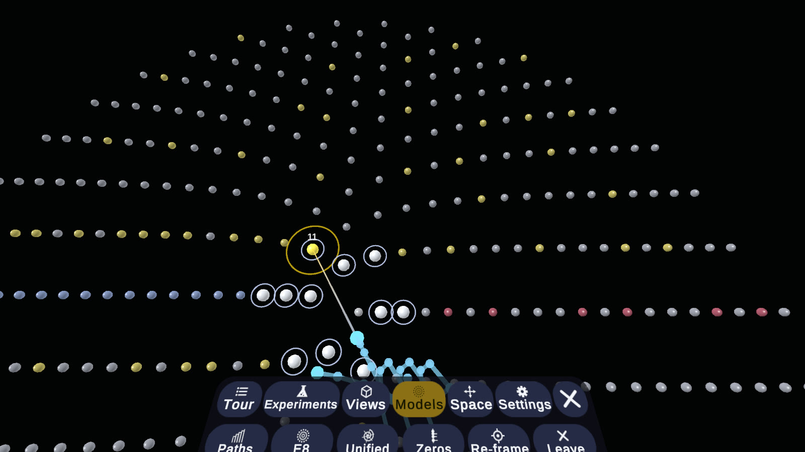

The games use the lab's VR placement (each game's view becomes a placement of the model in front of you), the dock's
readout for the status and its controls page for the buttons. A pinch goes to the game first: near a fingerprint it
pulls the fingerprint apart, on the chain's bead it holds t; anywhere else it moves the model, as in every lab model
(`VRWorldGrab` asks `ModelLab.ClaimsPinch` before it takes a pinch). In Zeta's chain the plane of the chain lies like a
table and the t rail stands straight up out of it, so lifting the pinched bead lifts t. Only the desktop simulation of
the headset has been tried (`GamesTest.VRGames`: a scripted ray held on 11 picks it, a fingertip touch picks 4, and a
pinch on the chain's bead raised 5 cm moves t up without moving the model); nobody has played the games on a headset
yet.

## Tests

`Unity -batchmode -projectPath . -runTests -testPlatform PlayMode -testFilter GamesTest`
([`GamesTest.cs`](../Assets/Tests/GamesTest.cs)):

* `Arithmetic` checks the classification, the shorthand, σ₃, and every vector of E8's shells 1–4 (count 240 σ₃(n), norm
  2n, all integer or all half-integer, even coordinate sum);
* `DesktopGames` explores every game through scripted touches, drags and story commands and checks what the board
  says (91 = 7 · 13 and its neighbours, 7's remainder on 360, 361 = 19², 360's six drops down E8's staircase, 343 = 7³,
  σ₃(6), the chain's vortices at zero 300, a 200-pixel drag moving t by 0.8, the glide on to zero 301). It also adds a
  simulated touch screen: a finger dragged up the screen moves t, and a tap on vortex 2 shows 2's fingerprint. With
  `ZETA_OUT` it writes the pictures above;
* `VRGames` picks by the finger's ray and by a touch, and lifts the chain's bead with a pinch, in the headset
  simulation;
* `Fingerprints` (with `ZETA_FP_OUT`) draws the fingerprints alone for the legibility study (`fp-N.png`), four of them in
  3D (`fp-N-3d.png`), and 360's whole unpacking, flat and in 3D (`unpack-360-…png`).
