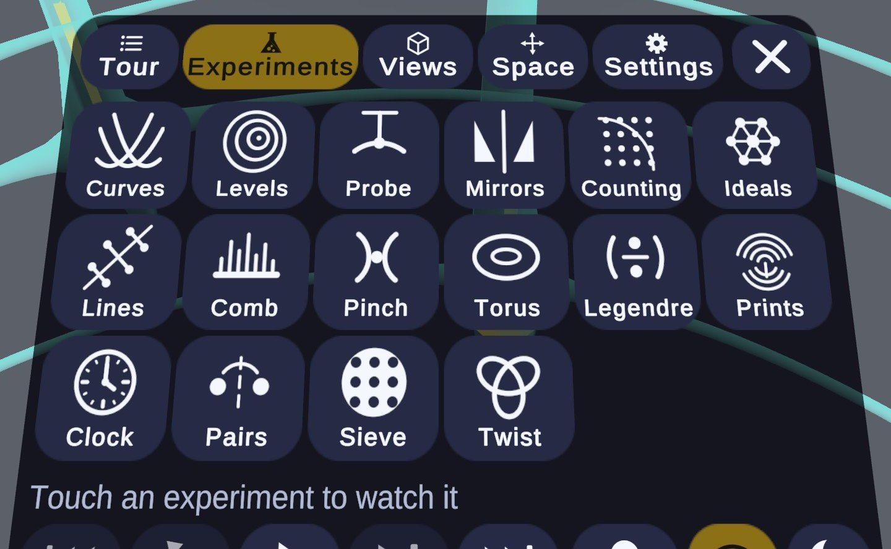
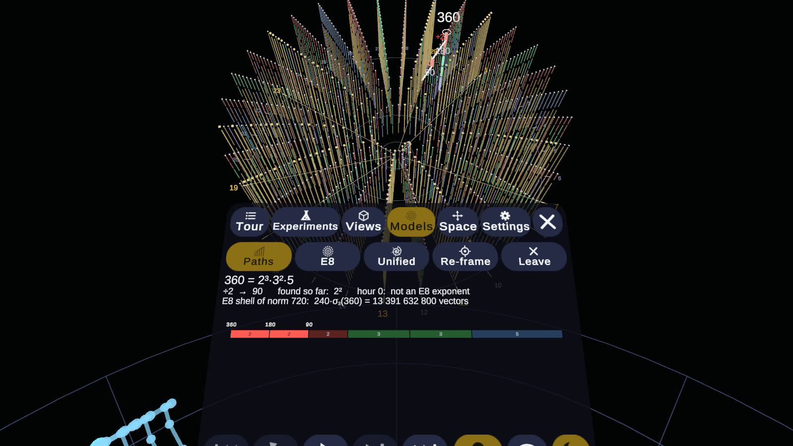

# Meta Quest 2 and 3 (VR, hands only)

The visualization runs on a Quest 2 or Quest 3 with **hand tracking only** (no controllers). The real room is the backdrop
(**passthrough**) and the model floats in front of you; one touch turns the room off for a **blackout**. The narrated
tour plays with its captions, and every control is a large icon you push with one finger.

On a Quest 2 the passthrough image is black and white; the Quest 3 and Pro show the room in colour. The frame-time numbers below were measured on a Quest 2.

## Quick start

1. In the headset: **Settings ▸ Movement tracking ▸ Hand tracking → on**. Turn on developer mode for your account
   and plug the headset in by USB (accept the prompt inside the headset).
2. Build and install. The Unity editor must not have the project open (build from a copy of the project, or close it);
   Unity 6000.6 with the Android Build Support module is needed.

   ```bash
   # in the editor: Zeta ▸ VR ▸ Build Quest APK, or headless:
   "C:/Program Files/Unity/Hub/Editor/6000.6.5f1/Editor/Unity.exe" -batchmode -projectPath . -buildTarget Android -executeMethod VRBuildSetup.BuildQuestApk -logFile build.log
   python Tools/quest.py install Builds/zeta-vr.apk
   python Tools/quest.py run
   ```

   `VRBuildSetup` first applies the Quest project settings (Android, IL2CPP, ARM64, Vulkan, API 32–36, GameActivity,
   OpenXR with the Meta Quest feature group, hand tracking, passthrough). The app is `com.metavirtuoso.zetaviewer`
   and appears under **Unknown Sources** in the headset's library.
3. Put the headset on. The menu is already in front of you.

`Tools/quest.py run --chapter turn --seconds 90` starts the app straight in a chapter and prints frame-time
statistics from the headset's log (`[VRPERF]` lines, one per narration line).
`Tools/quest.py run --experiment xtorus --seconds 120` does the same for an experiment module (`--experiment all` plays
every module one after the other).

## Using it

| You want to… | Do this |
|---|---|
| Press a button | Touch it with your index finger and push about 1 cm through its face. It clicks, lights up, and works again when you pull back. |
| Pick a chapter | **Tour** tab: one big button per chapter. Touch the playing one to restart it. |
| Watch an experiment | **Experiments** tab (the flask): one button per thought experiment on the saddle, with its own icon. A module plays alone, narrated, with its own camera moves; **Next** and **Back** in the footer go to the module after or before it, and a chapter on the Tour tab takes the story back. |
| Pause, replay, skip | Footer of the menu: **Back / Replay / Pause / Skip / Next** (for a chapter or an experiment module, whichever plays). |
| Move the model | **Pinch** (thumb and index) in the air, away from the menu, and drag. The model stays where you leave it. |
| Scale and turn the model | Pinch with **both hands** and move them apart, together or around each other. |
| Open the menu from anywhere | Turn your **left palm toward your face**: a small 2×3 pad floats over it (Menu, Pause, Skip, Follow, Room, Dark). |
| Go back to the story's view | **Follow** (pin icon) in the footer or on the palm menu. |
| See the room / go dark | **Room** and **Dark** in the footer or on the palm menu. In blackout a faint floor ring and your hand outlines appear. |
| Explore a model | **Models** tab: **Paths** (the factor funnel of *The paths back*), **E8** (the 240 roots), **Unified** (E8's wheel, the funnel, ζ and the Sacks spiral) and **Zeros** (the zeros of ζ and of E8's field inside the funnel). **Touch a column top or a root with your index fingertip** to pick it; the page shows what it says, and its controls are the two rows below. **Re-frame** brings the model back in front of you, **Leave** goes back to the standing view. |
| Look at one visualization | **Views** tab: Chain, Zeros, Strip, Waves, Staircase, Primes, Saddle, Machine. Below them, **Show or hide** toggles for the layers, a row for the curves on the Sacks spiral (Squares n = k², k(k+1), Euler's k² + k + 41 and Sacks's product curves k² + k + p), and a slider for how fast the dial turns. |
| Zoom, turn, tilt, raise, bring closer | **Space** tab. These keep working while the story moves on. |
| Reset | **Space ▸ Reset** (the story's view) or **Re-centre** (use where you stand and look now). |
| Captions, volume, hand outline, gentle motion, model distance | **Settings** tab. |

The menu follows you if you walk or turn away from it for a moment, and it never moves while a finger is near it.

### Experiments



The **Experiments** tab holds all 25 modules, 7 across and 4 down (`Assets/Resources/Narration/experiments.json`, the same
modules as the desktop side menu):

* the thought experiments on the saddle: cancellation curves, level contours, the bend as a probe, mirrors, the two
  counting problems, the primes of Euler's ring, mirror lines, the discriminant comb, the pinches;
* the 144 modules: the 12 × 12 torus, the Legendre symbol, base-12 fingerprints, the 144 clock;
* the twisted shapes: mirrors for prime pairs, the sieve machine, the twisted tori;
* the intersecting geometries: two norm surfaces, rings through lattices, the twelve-dimensional torus, the modular
  surface, the lattice race;
* E8: dropping onto E8, E5 to E8, the paths back, and the zeros inside E8's stack.

Each plays alone with its
narration and camera moves (there are no captions in VR); every shot places the model in front of you like a tour chapter, so
**Follow**, pinch and the Space tab work the same way.

Checked in the desktop simulation: every line of every module runs without an error in the headset's eye shape
(`VRExperimentsTest`). Frame times of the experiment modules have not been measured on a headset yet:
`python Tools/quest.py run --experiment all --seconds 1700` plays them all and prints a `[VRPERF]` line per narration line.

### Models

The **Models** tab opens the model lab ([`Assets/Lab`](../Assets/Lab)). These are interactive versions of what the
experiment videos show, and they stand in front of you like a tour shot. There are four models:

* **Paths.** Touch a column's top to watch its path back, with the factorization laid out as a strip on the page.
  * The colours are the games' ([GAMES.md](GAMES.md)): every piece is gold, because each piece is a prime, and the top
    is gold for a prime, deep red for p², blue for a pronic number, grey for any other composite. A piece's length,
    log p, tells which prime it is, and the strip writes the prime inside each piece.
  * n ± 1 and n ± 30 step to a neighbour or along the spoke.
  * **Tree** shows every number's first step, or only the drops by 2, 3, 5, 7, 11 or 13.
  * **Powers** draws the spirals of p^k, and **Sacks spiral** morphs the layout.
* **E8.** Touch a root to pick it: its 56, 126 and 56 neighbours are coloured by their angle to it.
  * **c step** and **Spin** turn the roots by the Coxeter element.
  * **Frobenius 7, 11, 13** carry the picture to the next Coxeter plane.
  * **Reflect** mirrors all 240 roots in the picked root.
  * **Edges** and **Norm 4** add the Gosset polytope and the next lattice shell.
* **Unified.** E8's roots under the funnel, and ζ(½ + it) rising beside it.
  * The **t** slider, **Prev/Next zero** and **Play t** move along ζ.
  * The 30 hour sums are chained at the level t, and at every zero they close in 8 groups (**By gcd**).
  * **Character** weights E8's 8 exponent hours by a Dirichlet character mod 30, so the trail becomes L(s, χ).
  * **View** cycles whole → ζ plane (seen from above, following t) → funnel.
* **Zeros.** The zeros of ζ inside the funnel (experiments README, sections JA–JF and HD).
  * **Coils** shows the first zeros as helices up the axis.
  * **Phases** shows where all 10 500 point at the picked column's height.
  * **Comb** and **Rings** show their sum, a tooth of log p at every prime power.
  * **E8 fans** shows the eight L-functions of E8's field putting each prime on its spoke, and **Spoke** picks one hour.
  * **Lamps** lights each column's top piece by the sum there.
  * **Zeros** lowers the number of zeros used, to show the teeth blur.

The second row holds the games ([GAMES.md](GAMES.md)): **Spiral**, **Blocks**, **E8 clock** and **Chain**. In every
model and game you can also pick from afar: point at a number with your index finger, and a thin ray runs to the
nearest point within 2.5° of the finger's line; hold it there for 0.9 s (the ray turns gold) to pick it. In VR the
games' marble fingerprints start in 3D, as spiral sphere packs; the controls' **3D** button lays them flat. A pinch
goes to the game first: pinch a fingerprint and draw your hand along it to pull it apart, or, in Zeta's chain, pinch the
bead on the t rail (it stands straight up) and lift or lower it to move t. A pinch anywhere else moves the model.



Picking needs the fingertip within about a centimetre of the point, and pushing in picks it once. At the default scale
the column tops are 1–2 cm apart, so spread two pinching hands to enlarge the model before picking in a dense spot.
Pinch-to-move, two-handed scaling, **Follow** and the Space tab work as for the tour.

Only the desktop simulation has been tried. `ModelLabTest.VRModelsPage` picks a column with a scripted fingertip and
renders the page, but no person has used the Models page on a headset yet. `-vrmodel paths|e8|unified|zeros|primehunt|blocks|e8spheres|vortex` opens a model
from the command line (`adb shell am start … -e unity "-vrmodel e8"`).

### Comfort

* The tour's camera moves are slowed down and limited to about 50° per second in passthrough and 30° per second in
  blackout, and zoom changes are rate-limited. **Settings ▸ Gentle motion** switches that off.
* When you grab the model yourself the guide stops moving it; **Follow** gives it back.
* The captions drift to your gaze direction only after you have looked 22° away from them.

## Desktop simulation (no headset)

`Zeta ▸ VR ▸ Desktop Simulation (mouse as hands)`, then Play. Move the mouse to move the fingertip, scroll to push it
nearer or farther, hold the left button to poke, **Shift + left button** to pinch, right button + WASD / QE to look and move.
`-vr` on the command line does the same for a standalone build.

`VRExperimentsTest` checks the experiment modules in the simulation: `ExperimentNavigation` (always runs) asserts that Next and
Back stay among the modules and that a tour chapter takes the script back; `PlayEveryExperiment` plays every line of every
module at a few times real speed in the headset's eye shape (1440 × 1584), writes one picture per line and fails on any
logged error:

```bash
ZETA_OUT=/tmp/vr-experiments [ZETA_EXP_ONLY=xtorus,xclock] [ZETA_SPEED=4] Unity -batchmode -projectPath . -runTests -testPlatform PlayMode -testFilter VRExperimentsTest.PlayEveryExperiment
```

`VRPreviewRenderTest` renders the interface to PNGs from scripted hands and asserts on the hover, press, palm menu and
one- and two-handed grab maths:

```bash
ZETA_OUT=/tmp/vr-preview Unity -batchmode -projectPath . -runTests -testPlatform PlayMode -testFilter VRPreviewRenderTest
```

## How it works

* **The rig moves, not the model.** Camera, hands, menus and captions live under `XR Rig`; to move, scale or turn the
  model the rig is moved, scaled and turned instead (a rig scaled by 20 makes the model look 20 times smaller; stereo
  separation scales with it). Everything about hands is measured in the user's own metres, whatever the scale.
* **Tour cues become placements.** `VRGuide` takes the 2D tour's camera cue (position, look-at, up) and places the model
  so that a camera at that position would see exactly that picture, with the looked-at point 1 m in front of you
  (Settings ▸ Model distance). Your own zoom / orbit / pan are offsets on top of the cue, so they survive cue changes.
* **Hands** come from the OpenXR hand tracking subsystem (XR Hands). Pinch is thumb-to-index tip distance with
  hysteresis; the palm normal is derived from the joint positions (not the joint rotations) and the left/right
  handedness is handled explicitly.
* **Passthrough** is the Meta OpenXR camera feature: an `ARCameraManager` that is enabled for the room and disabled for
  blackout, with the camera background cleared to alpha 0.
* **Performance.** Single-pass instanced stereo; no post-processing or HDR; 4x MSAA; the Sacks-spiral dots are 80-triangle
  spheres drawn with GPU instancing; the grid's ~1070 tick marks are one mesh. `VRPerf` logs frame times per narration line.

## Performance (measured on a Quest 2)

`VRPerf` writes frame statistics per narration line to the Android log; the numbers below are from running the whole
tour on the headset (`Tools/quest.py run --chapter hook --seconds 700`, Vulkan, single-pass instanced, 4x MSAA,
1440x1584 per eye, 72 Hz; chapters 1–4 were measured on an earlier build and later changes only reduced the work they do):

| Chapters | Average frame | Notes |
|---|---|---|
| every chapter except Machine (1 Primes, 2 Zeno, 3 Stage, 4 Dial, 5 Waves, 6 Steps, 8 Key, 9 2026, 10 Saddle) | 13.9–14.0 ms (72 fps) | GPU 3–10 ms |
| 7 Machine | 15.6 ms (about 64 fps) | a new collision arrives several times a second and redraws the staircase and the wave chorus |

What made the difference: the visualization recomputes 10,000-point curves whenever a collision joins, which a mobile CPU
cannot do four times a second, so in VR the curves use 4,000 samples, the exponent-sweep ghost curve is computed on a worker
thread, the red prime daggers are moved instead of rebuilt, the grid's ~1,070 tick marks are one mesh, and the 1,300 Sacks
dots are 80-triangle spheres drawn with GPU instancing. The desktop recordings are unchanged (10,000 samples).
`python Tools/quest.py log --seconds 60` shows the statistics for whatever is playing, including whether the hand-tracking
subsystem is up and how often each hand was seen (`hands subsystem-up L 35% R 60%`).

## What has been checked, and what has not

Checked on a Quest 2 (Meta Horizon OS, Android 14): the app installs and starts, OpenXR and Meta passthrough come up
(the room is visible behind the model; blackout hides it), the interface renders correctly in both eyes, the hand-tracking
subsystem initialises, the tour plays with narration and captions at the frame rates above.

Checked only in the desktop simulation (`VRPreviewRenderTest`, scripted hands): pressing buttons with a fingertip, the palm
menu, pinch to move the model with one hand and to scale it with two. The maths for these is asserted in the test, but the
real hand-tracking data has not been tried by a person: the first thing to do with the headset on is to poke the Tour
buttons, turn your left palm toward your face, and pinch-drag the model. If a threshold feels wrong, the numbers are
`VRHand.PinchStart/PinchEnd` (pinch) and `VRPoker.PressDepth/ReleaseDepth` (button press) in `Assets/VR`.

Everything is in `Assets/VR`; `Assets/Editor/VRBuildSetup.cs` configures OpenXR (Meta Quest feature group, hand tracking,
hand interaction profile, passthrough) and the Android player settings (IL2CPP, ARM64, Vulkan, API 32–36).

## Narration and recordings

* `Tools/generate_narration_chatterbox.py` renders all narration with this machine's `narrate` (John's voice,
  `--exaggeration 0.25`), aligns the words with Whisper for the karaoke captions and normalises the loudness.
  See [TOUR.md](TOUR.md).
* `Tools/render_chapters.py` renders every chapter as its own narrated video, vertical (1080×1920) and horizontal
  (1920×1080), from the 2D view.
