# Experiments on the Sacks saddle

Thought experiments drawn on the saddle-bent Sacks spiral, rendered headlessly from
[`SacksExperiments.cs`](../../Assets/Tour/SacksExperiments.cs) by
[`ExperimentsRenderTest.cs`](../../Assets/Tests/ExperimentsRenderTest.cs). Everything here lives on the
`experiments/sacks-cancellation` branch and touches nothing the tour or the VR build uses: `SacksSpiral` only
became a `partial` class so the experiments can reach its surface helpers.

Each section says what was drawn, what it shows, and what it does *not* show. The numbers were checked
independently in Python (mpmath / plain integer arithmetic) before being drawn.

## A. Cancellation curves and where they cut Euler's line

**Definition.** Every composite is a product `n = u · v` with `2 ≤ u ≤ v`. Write `v = u + d`. For a fixed gap `d`
the numbers `u(u + d)`, `u = 1, 2, 3, …` form one curve on the Sacks spiral, because the spiral puts `n` at
winding angle `2π√n` and `√(u(u + d)) ≈ u + d/2`: stepping `u → u + 1` advances the angle by almost exactly one
turn, so the points line up. These are the *cancellation curves* `C_d`:

* `C_0` is the squares (`u · u`), `C_1` the pronic numbers (`u(u + 1)`), the two routes already in the model.
* `C_d` is born at `u = 1`, i.e. at the number `d + 1` itself (small ring in the pictures), and every point after
  the birth is composite. A prime lies on exactly one cancellation curve, the one born at it.
* Even `d` curves straighten into lines `y = −π d²/4` just below the squares ray; odd `d` curves straighten into
  `y = +π d²/4` just above the pronic ray (in units of the spiral's radius constant). The depth of a composite is
  how many curves pass through it (section C).


**The crossing law for Euler's line.** The candidate line `E(k) = k² + k + 41` is prime for `k = 0 … 39`. Beyond
that it is cut by the curves, and the cuts come in two exact families (checked for every `k ≤ 120`):

| family | where | what the value is | first cases |
|---|---|---|---|
| I  | `k = 40 + j²` | `E(k) = E(j − 1) · E(j)` — two *neighbouring* values of the same line | 40 (41·41), 41 (41·43), 44 (43·47), 49 (47·53), 56, 65, 76, 89, 104 |
| II | `k = 2i² + i + 81` | `E(k) = E(i) · D(i)` with `D(j) = (2j)² + 163` the *sister line* | 81 (41·163), 84 (43·167), 91 (47·179), 102, 117 |
| II | `k = 2i² + 3i + 82` | `E(k) = E(i) · D(i + 1)` | 82 (41·167), 87 (43·179), 96 (47·199), 109 |

These 18 are *all* the composites with `k ≤ 120`; there is no third family that low. Family I sits on the
curve `C_2j`, family II on curves with `d ≥ 122`, which is why its cuts look like long straight chords coming in
from the sister line.

**Why those and nothing else.** `E(k)` is the norm of `(2k + 1 + √−163)/2` and `D(j)` is the norm of
`2j + √−163` in the ring `Z[(1 + √−163)/2]`, which has unique factorisation (class number one, the reason
Euler's polynomial works at all). A value is composite exactly when its element factors in the ring, and a
product of two elements lands back on Euler's row only when their rows add up to one: row 1 × row 1 with
conjugation (family I), or row 1 × row 2 (family II). So the "cancellation curves" that matter for a
prime-generating line are not arbitrary: they are the multiplication table of one quadratic ring, and the
sister line `D` is that ring's second row. The sister line is itself prime for `j = 0 … 19` (163, 167, 179, 199,
227, …, 1459), for the same reason the Euler line is.


**What this does and does not give you.** Intersections with the curves *are* the composites, by definition, so
"eliminate candidates at the intersections" is the sieve itself, restated geometrically. What is new in the
picture is the bookkeeping: on a line of discriminant `−D` the intersections are indexed by the divisors of
`D + (2j)²`, so the first composites after the initial prime run are predictable without factoring anything
(family I needs no factoring at all: it is a square-indexed rule). It does not give a prime test, because
deciding whether `(2k + 1 + √−163)/2` factors is exactly as hard as factoring `E(k)`.

## A2. The zeta wave along Euler's line

The master wave of the final chapter, `−Σ cos(γ · log n)` over all 10 000 zeros, evaluated along the line
`n = k² + k + 41` instead of along the spiral. The explicit formula says this sum spikes at prime powers and dips
between them; along Euler's line it should therefore be a comb of upward spikes for `k ≤ 39` and show holes at
the family I and II crossings.


It does: every prime value carries a spike and every composite a trough, with no extra structure. The zeros
know nothing about `√−163`; they simply mark primes, and the line's own algebra decides where the primes stop.
The two descriptions agree point by point, which is the honest content of "the zeros encode the primes".

## C. Composite depth, and whose clock the saddle is

**Depth bars.** A bar at every composite of height proportional to the number of cancellation curves through it
(number of divisors up to `√n`, minus one). Primes are flat. The tall bars collect on the squares ray and the
pronic ray and along the straightened curves, the familiar Sacks "composite lanes".


**Voronoi's formula.** Summing the depth over all `n ≤ x` gives the divisor staircase `Σ d(n)`, whose smooth part
is `x log x + (2γ − 1)x` and whose wobble `Δ(x)` has its own explicit formula (Voronoi, 1904):

    Δ(x) ≈ (x^¼ / π√2) · Σ_n d(n) n^(−3/4) cos(4π√(nx) − π/4)

The waves in this formula tick with `√x`, which is exactly the Sacks clock (`2π√n` per turn), the way the prime
staircase's waves `cos(γ log x)` tick with the log clock. The first harmonic alone is `cos(4π√x − π/4)`: two
oscillations per turn of the spiral. The saddle height is `z ∝ x² − y² = r² cos(2φ) = n · cos(4π√n)`: the same
two oscillations per turn, an eighth of a turn ahead in phase and with a steeper envelope. So the saddle the
spiral is bent on is not decoration: up to that phase and envelope it is the leading wave of the divisor
function's explicit formula, the `ζ²` analogue of the master cosine wave.


White: the exact `Δ(x)` for `9 ≤ x ≤ 400`. Cyan: 3 000 terms of the Voronoi sum. Orange: the first harmonic.
The second picture keeps only the first harmonic on the three outer turns, over a wire of the saddle, so the
ribbon's two oscillations per turn can be compared with the surface's own. The truncated sum tracks the sawtooth
closely but not exactly (it converges only conditionally; at `x = 400.3` it gives 7.09 against the exact 7.50),
so this is an illustration, not a proof of anything.

## D. The zeros on their own Sacks spiral

The Sacks spiral is an Archimedean spiral in the clock `√n`: whole clock values (the squares) line up on one
ray. The zeros have a clock too, `G = θ(γ)/π + 1` with `θ` the Riemann–Siegel phase; its whole values are the
Gram points. Plotting zero `j` at radius `√G` and angle `2πG` puts the Gram points on a ray, the analogue of the
squares ray.


For the first 1 600 zeros the ray is visibly thinner than its surroundings but not empty: the fractional part of
`G` has decile counts (first 4 000 zeros) of 278, 321, 397, 467, 538, 525, 513, 384, 315, 262. Zeros avoid Gram
points about as mildly as primes avoid the neighbourhood of squares, and the 277 Gram-law exceptions among the
first 4 000 zeros are the ones that stray onto the ray. The analogy is real but weak; it does not make the Gram
ray a "cancellation curve" for zeros.

## E. Anatomy of the chain at one dial value

The partial sums `Σ n^(−½−it)` at a fixed `t`, flat, with the structure the dial produces as `n` grows:

* the turn per link is `t/n`; where it is a multiple of `2π` consecutive links align into a straight **spoke**,
  at `n = t/2πk`; where it is an odd multiple of `π` they fold into a **knot**, at `n = t/(2k + 1)π`;
* the spokes are the mirror images of the integers `k` and the knots of the half-integers under the
  Riemann–Siegel reflection `n ↔ t/2πn`; vortex `k` (between spoke `k + 1` and spoke `k`) holds `t/2πk(k + 1)`
  links, an inverse-square count, and turns through `t · log(1 + 1/k)` radians, a logarithm;
* past the last spoke (`n > t/2π`) the links turn less than a full circle each and the chain spirals outward
  around `ζ(½ + it)` itself. At a zero that centre is the origin; between zeros it is off-centre; at a Gram point
  it lies on the real axis.


The "inverse squares, logarithms and number of turns" are therefore not three mysteries but one: the chain's
turn per link is `t / r²` where `r = √n` is the Sacks radius of that integer (Kepler's area law with angular
momentum `t`), and integrating `t/r²` over links is what produces the logarithm `t · log n`.

## F. One zero's crests on the spiral

The wave of a single zero, `cos(γ log n)`, crests at `n_k = e^{2πk/γ}`. On the spiral the winding angle of
crest `k` is `φ_k = 2π e^{πk/γ}`: a geometric progression, i.e. the crests are *equally spaced in the logarithm
of the winding angle*, with spacing `π/γ`. Between crests the ribbon makes `γ/(π√n)` oscillations per turn, so at
`n = (γ/πm)²` the crests line up into `m` radial arms (white rings). Those radii form an inverse-square ladder in
`m`, and between rungs the arms twist into spirals, the "vortices" visible in the full interference picture.


So each zero draws its own set of nested spiral arms on the saddle; the master wave is their superposition.
The arms are a moiré between the spiral's `√n` clock and the zero's `log n` clock. They are real geometry of the
drawing, not of the primes: the primes appear only when thousands of these patterns are added (section G).

## G. The truncated explicit formula on the number field

Every number coloured by `−Σ_{z≤K} cos(γ_z log n)` (gold up, blue down, each disc scaled to its own extreme),
for `K` = 1, 3, 10, 100, 1 000 and 10 000 zeros on the saddle, then nine such discs stacked (flat, so the
layers read as layers).


With one zero the field is the moiré of section F; with ten it is a tangle of arms; by a hundred the gold
begins to settle on the prime dots; by ten thousand almost nothing but primes and prime powers is gold. Looking
down the stack is watching the explicit formula converge: the vortex structure is what the first few zeros
know about the primes, and it is erased, arm by arm, by the next ones.

## H. Cross sections of the saddle

*Orientation.* Height is measured toward the trail, the tour's up (`−z`). Seen that way the saddle falls away along
`±x`, where the squares and pronic rays run, and rises along `±y`, where the one-to-four products climb. An earlier
version of this page called the x axis the ridge and the y axis the valley, which is how the surface looks from the
other side (`+z`, the side the tour's saddle wire is labelled from); the pictures here are taken from the trail's side.
The narrated Experiments modules keep the recorded ridge/valley wording, which is the `+z` reading.

The saddle is `z = b · K (x² − y²)` with the bend `b` (1 in the tour, 0 flat). Its sections by the three
coordinate planes are a parabola falling away from the trail (`y = 0`), a parabola rising toward it (`x = 0`), and hyperbolas
(`z = h`), with the two diagonals at `z = 0`. What each plane collects, exactly:

| plane | saddle section | numbers in it | product curves that run along it | zeta trail pierces it at |
|---|---|---|---|---|
| `y = 0` (x axis, falls away) | `z = bKx²` | the squares (`+x`), the pronic numbers (`−x`) | every 1:1 product `u(u + d)` (all the cancellation curves) | the **Gram points** (`ζ` real, `θ = mπ`) and the zeros |
| `x = 0` (y axis, rises) | `z = −bKy²` | `√n ≡ ¼` and `¾`: `u(4u + 1)` on `+y`, `u(4u + 3)` on `−y` | the 1:4 products with odd gap | the **half-Gram points** (`ζ` imaginary, `θ = (m + ½)π`) and the zeros |
| `z = 0` (level) | the diagonals `y = ±x` | `√n ≡ ⅛, ⅜, ⅝, ⅞` | the 1:16 products with odd gap, `u(16u + d)` | the trail's foot, `t = 0` |
| `z = h` (level) | hyperbola `x² − y² = h/bK` | all `n` with `n · cos(4π√n) = h / bKR²`: one contour of the Voronoi harmonic | cut once each, near `n ≈ h/bKR²` on the x axis | one dial value, `t = −4h` (planes above the centre only) |

The general rule behind the middle column: a product `u(q²u + d)` has `√n ≈ qu + d/2q`, so it straightens
along the ray at angle `2π · d/2q`. `q = 1` gives the two x-axis rays, `q = 2` the two y-axis rays, `q = 4` the
four diagonals. The bend does not move any of this (the planes `x = c`, `y = c` cut the same numbers at every
bend); it only decides how steeply the x-axis family falls away and the y-axis family rises, and which contour a level
plane picks: raising the bend from ¼ to 2 pulls the `z = −15` contour in from `n ≈ 1370` to `n ≈ 170`, so a
fixed plane sweeps inward through the one-to-four family and reads off where each curve crosses that height.


The trail column is the one worth keeping. `ζ(½ + it) = Z(t) e^{−iθ(t)}` with `Z` real, so the trail crosses
the x-axis plane exactly when `sin θ = 0` (the Gram points) and the y-axis plane exactly when `cos θ = 0`. The
coordinate planes of the saddle are therefore the Gram planes of the trail, and the correspondence

| Sacks spiral, clock `√n` | zeta trail, clock `θ/π` |
|---|---|
| squares and pronics: `√n ≡ 0, ½` (x-axis plane) | Gram points: `θ/π ≡ 0` (x-axis plane) |
| `u(4u + odd)`: `√n ≡ ¼, ¾` (y-axis plane) | half-Gram points: `θ/π ≡ ½` (y-axis plane) |
| `u(16u + odd)`: `√n ≡ odd/8` (diagonals) | `θ/π ≡ ±¼`: quarter-Gram points |

is exact, not a metaphor: both are "where the clock reads a whole or half value". Section D is the same
correspondence seen from above.


**Unconventional spatial readings that fall out of the sections.**

* *The two clocks as two axes.* Unroll the spiral into a chart with `√n` along `x` (turn count) and the position
  within the turn along `y`. The saddle depends only on `y` (falling away at 0 and ½, rising at ¼ and ¾, horizontal
  stripes); a zero's wave depends only on `x` (its crests are the log-spaced vertical lines); the cancellation
  curves are the `1/u` hyperbolas converging to the stripes at 0 and ½, and Euler's line converges to the pronic
  stripe from above. The primes are the gold points no hyperbola passes through. The chart makes "the √ clock
  and the log clock are orthogonal" literal.

  

* *The saddle is doubly ruled.* `z = K(x − y)(x + y)`, so every vertical plane `x − y = a` (or `x + y = a`) cuts the
  saddle in a straight line. The sections along the diagonal directions are the only straight ones.
* *The saddle height is a Lorentz invariant.* A hyperbolic rotation of the plane (`x, y → x cosh a + y sinh a,
  x sinh a + y cosh a`) preserves `x² − y²`, so it slides every number along its own level hyperbola without
  changing its height: the level sets of the saddle are boost orbits, and the Voronoi harmonic
  `n cos(4π√n)` is the invariant.
* *Inversion.* Inverting the plane in the unit circle (`r → 1/r`) sends the straightened cancellation curves
  `y = −πd²/4` to circles through the origin of diameter `4/πd²`: an inverse-square family of circles, all tangent
  at the origin, and it puts the integer `n` at radius `1/√n`, which is the length of the chain's `n`-th link. The
  chain's inverse-square-root link lengths and the Sacks radii are the same numbers seen from the two sides of
  the unit circle.

**Double cancellations.** A number on two cancellation curves is more composite, not less, so no intersection
of product curves ever reverts to a prime. But the *bookkeeping* of the sieve does flip sign at intersections,
and that sign is where the zeta function re-enters. Legendre's count of primes strikes every multiple of each
small prime, then restores every number struck twice (two distinct prime factors), strikes again those struck
three times, and so on. The net sign at `n` is the Möbius function `μ(n)`: `−1` on a prime, `+1` on a product of
two distinct primes (struck twice, restored once), `−1` on three, `0` whenever a prime factor repeats. On the
saddle that is a four-colour field (gold, cyan, magenta, dark), and its running total `M(x) = Σ μ(n)` is the
Mertens function, whose size is equivalent to the Riemann hypothesis (`M(x) = O(x^{½+ε})`). Its Dirichlet series
is `1/ζ`: the "restored" numbers are exactly the ones that make the inverse chain converge where the chain
itself diverges. Up to 1 601 the field has 252 primes, 450 cyan restorations (plus 34 numbers with four distinct primes, also
`+1`), 241 magenta triples and 623 dark numbers, and `|M(x)|` never exceeds `√x`.


## I. The vortex eyes of the chain, traced through the zero planes

**Detection.** At a dial value `t` the chain's `n`-th link turns by `−t · log(1 + 1/n)`, reduced to `(−π, π]`. The
detector uses nothing else: a *knot* is where that turn flips through `±π` (the chain folds back on itself), a
*spoke* where it flips through `0` (the chain runs straight). Each knot is the eye of one vortex; the vortex's
extent is the stretch between the spokes on either side; its certainty is `1 − e^{−L/6}` with `L` the number of
links in that stretch turning by more than half a radian. A vortex drawn by two links is faded to black, one
drawn by thirty is at full colour. The eye is the mean of the four vertices around the knot. Vortex `k` is the
one whose knot sits near `n = t/(2k + 1)π`; vortex 0 is the tail. This was run at all 10 000 zeros in the table
(199 096 vortices, `k ≤ 12`), and the detector's output is written to `vortices.csv` beside the frames.


**What the traces do.** Colour is the vortex index, brightness its certainty, each zero is a plane, the white
curve is `ζ(½ + it)` threading the planes through their centres. Vortex 1 (cyan) winds once around the axis per
zero on a circle of radius exactly one; vortex 2 (magenta) rides an epicycle on it; the higher vortices are
dimmer, more erratic, and farther out.

**The law behind it.** The eyes are not new information. At every zero, to the accuracy of the detector,

    eye_k(γ) = −e^{−2iθ(γ)} · conj(S_k(γ)),       S_k = Σ_{n≤k} n^{−½−iγ}

the eye of vortex `k` is the chain's own `k`-th vertex, reflected (conjugated and turned by twice the
Riemann–Siegel phase). Off a zero the same holds with `ζ(½ + it)` added. This is the approximate functional
equation `Σ_{n≤x} n^{−s} ≈ ζ(s) − χ(s) Σ_{m≤t/2πx} m^{s−1}` read at the knots, where the dual cutoff `t/2πx = k + ½`
falls exactly between integers and the equation is at its most accurate. The far end of the chain is the near
end in a mirror, vortex by vortex. Grey diamonds in the pictures are the mirror points; they sit inside the eyes.

| vortex `k` | zeros with `t < 1000`: median distance eye → mirror | zeros with `t ≥ 1000` |
|---|---|---|
| 1 | 0.001 | 0.000 |
| 2 | 0.005 | 0.000 |
| 5 | 0.036 | 0.001 |
| 8 | 0.127 | 0.003 |
| 12 | 0.193 | 0.009 |

The mismatch is entirely a matter of how many links draw the vortex: median 0.052 for vortices drawn by fewer
than three curling links, 0.017 for three to five, 0.002 for twelve to thirty, 0.000 beyond. The certainty
fade is therefore honest: faint eyes are the ones the mirror law places least well.


The three views down the axis are all 10 000 zeros at once: plain (every eye of vortices 1 to 12), with the Gram
phase taken out, and the same for vortices 1 to 4 only, where the point `−1`, the circle of radius `1/√2` and the
next epicycle stand out.

**Vortex 1 is the Gram clock.** With `S_1 = 1` the first eye sits at `−e^{−2iθ(γ)}`: on the unit circle (radius
1.000 ± 0.004 over 9 994 zeros, angle residual below 0.001 rad), at angle `π − 2θ(γ)`. Since `θ` advances by
about `π` per zero, the cyan trace is a helix with one turn per zero, and the amount by which its phase slips
from one zero plane to the next is the Gram offset of that zero: the eye angle reads the zero's position within
its Gram interval. Taking the Gram phase out (multiplying every eye by `e^{2iθ}`) collapses the whole tower onto
the chain's own first vertices: vortex 1 to the single point `−1`, vortex 2 to the circle of radius `1/√2` around
it, vortex 3 to an epicycle of radius `1/√3` on that, and so on.


**Predictive structure.** Over the 10 000 zeros:

| correlation | value |
|---|---|
| Gram offset of zero `j` with the offset of zero `j + 1` | +0.02 |
| Gram offset of zero `j` with the spacing to zero `j + 1` (in Gram units) | −0.28 |
| spacing `j` with spacing `j + 1` | −0.37 |

So the eye angle at one zero plane (its Gram offset) says a little about where the next plane is, a zero late in
its Gram interval being followed by a shorter gap, and consecutive gaps alternate, which is the repulsion of the
zeros that random-matrix statistics predict. It says nothing about the next zero's own offset. Everything the
vortex eyes carry is `θ(γ_j)` and the first dozen terms of the chain, which are the same functions of `γ_j` the
chain started from; the picture is a faithful mirror, not an oracle. What it does give is a clean geometric
object: the chain's far end is its near end reflected through the Gram phase, and the helix of the first eye is
the zeros' Gram clock drawn as a curve through the planes.

## J–O. Sections, second round: the discriminant law

**One law organises every section below.** A quadratic `n = q²k² + Bk + C` traces a curve on the Sacks spiral.
Far out, the curve straightens into a line pointing `B/2q` of a turn round, at perpendicular offset

    offset = −πR · Δ / (4q²),        Δ = B² − 4q²C   (the discriminant)

from that ray. Checked numerically at `k = 10⁶` (`R = 1.45`):

| quadratic | Δ | direction (turns) | measured offset | predicted |
|---|---|---|---|---|
| `k² + 1` | −4 | 0 | 4.5557 | 4.5553 |
| `k² − 4` | 16 | 0 | −18.2218 | −18.2212 |
| `k² + k + 41` | −163 | ½ | 185.6290 | 185.6289 |
| `k² + k − 2` (the curve `C₃`) | 9 | ½ | −10.2505 | −10.2494 |
| `4k² + k + 5` | −79 | ¼ | 22.4925 | 22.4918 |
| `9k² + 2k + 7` | −248 | ⅓ | 31.3816 | 31.3810 |

So the direction of a line is set by `B/2q` and its distance from its ray by its discriminant. Three kinds of line
follow:

* **cancellation curves**: `Δ` a perfect square. The quadratic factors over the integers, so every value past the
  birth is composite. These are exactly the product curves `u(q²u + d)`.
* **prime curves**: `Δ` not a square. They carry primes at a rate fixed by `Δ` (below). `Δ < 0` puts them on the
  far side of the ray from the cancellation curves; `Δ > 0` puts them on the same side, in between the cancellation
  curves.
* **un-cancellation curves**: the mirror images of the cancellation curves, section L.

## J. Planes through the centre, rotated

A vertical plane through the centre at angle `α` cuts the saddle in the parabola `z = bK·t²·cos 2α`. The parabola
falls away from the trail for `|α| < 45°`, is a straight line at 45° (one of the saddle's rulings), and rises
beyond. Turning the plane sweeps the parabola from falling to straight to rising.


A plane at a rational angle `a/b` of a turn holds, far out, the families of that direction: `q²k² + Bk + C` with
`B/2q ≡ a/b`. At 90° that is `4k² + k + C` (up) and `4k² + 3k + C` (down); at 45° it is `16k² + k + C` and
`16k² + 5k + C`, which lie along the straight section. An irrational angle holds no family at all.


Counting the numbers in a thin strip around each plane (perpendicular half-width `R/2`, all `n ≤ 2·10⁷`):

| direction (turns) | numbers in the strip | primes |
|---|---|---|
| 0 (squares ray) | 4 420 | 0 |
| ¼, ¾ | 2 210 each | 0 |
| ⅓, ⅔ | 1 473 each | 0 |
| ⅛ | 1 105 | 0 |
| ⅙ | 1 473 | 0 |
| ⅕ | 884 | 0 |
| ⅜ | 2 210 | 155 (7.0 %) |
| ⅖ | 884 | 119 (13.5 %) |
| √2 − 1, π − 3, φ − 1 (irrational) | about 1 405 each | 110, 95, 89 (6–8 %) |

The strip at a small-denominator angle holds only the product line `k(q²k + B)`, which sits almost exactly on the
ray, so it holds no primes. At ⅜ and ⅖ a prime curve of the same family also falls inside the strip. An irrational
angle samples the numbers at random and gets the average prime rate. Rotating the plane therefore finds no
prime-rich direction. It finds prime-free rational directions, set by the product lines, and that structure fades
as the strip is widened.


## K. Planes off the axis: the discriminant comb

Vertical planes parallel to the x axis, at `y = πR·C`, each hold **one** quadratic far out. On the `+x` side that is
`k² + C`. On the `−x` side, the plane at `y = −πR(c − ¼)` holds `k² + k + c`. Sliding the plane sideways steps
through the quadratics in order of discriminant. Each plane cuts the saddle in a parabola `z = bK(x² − y²)`
lowered by `bK·y²`, and its quadratic's values climb that parabola. In the pictures, red marks a curve that
factors, blue `Δ > 0`, and green `Δ < 0`.


**How many primes each plane holds.** The prime count on every line from `C = −30` to `60`, for `k ≤ 3 000`, is
drawn as a column of bars, one per plane. Each bar is compared with the Hardy–Littlewood constant
`Π_p (1 − w(p)/p)/(1 − 1/p)`, where `w(p)` is the number of roots mod `p`. That constant depends only on the
discriminant through the Legendre symbols `(Δ/p)`.


| line | Δ | primes, k ≤ 3 000 | Hardy–Littlewood |
|---|---|---|---|
| `k² + k + 41` (Euler) | −163 | 1 449 | 6.65 |
| `k² + k + 17` | −67 | 938 | 4.17 |
| `k² + k − 1` | +5 | 759 | 3.54 |
| `k² + k + 11` | −43 | 714 | 3.26 |
| `k² + k − 29` | +117 | 711 | 3.23 |
| `k² + 58` | −232 | 651 | 2.97 |
| `k² − 17` | +68 | 528 | 2.36 |
| `k² − 2` | +8 | 413 | 1.85 |
| `k² + 1` (Landau) | −4 | 303 | 1.37 |
| `k² + k + 2` | −7 | 1 (always even) | 0 |
| `k² − 1`, `k² − 4`, `k² + k`, `k² + k − 2`, … | squares | 0 or 1 (the birth) | 0 |

Over the 175 lines that do not factor, the counts and the constants correlate at 0.9995. Three findings,
honestly stated:

1. **Only the square discriminants are prime-free.** Every other plane carries primes, on either side of the ray.
2. **The side of the ray does not decide.** Lines with `Δ > 0` between the cancellation curves average 262–272
   primes, slightly *more* than the `Δ < 0` lines (221–224, whose values are larger). `k² + k − 1` (`Δ = 5`) beats
   Landau's `k² + 1` by 2.5 to 1.
3. **Euler's line is the record**, at the class-number-one discriminant −163. It is followed by −67, −43 and −19.
   This is Rabinowitsch's theorem made visible: `k² + k + c` is prime for all `k ≤ c − 2` exactly when `1 − 4c` is
   one of −3, −7, −11, −19, −43, −67, −163. The lines with an even `c` on the pronic side are always even, which
   is a second, 2-adic way to carry no primes.

## L. The mirror: un-cancellation curves

**Reflecting across the squares ray sends a line of discriminant `Δ` to the line of discriminant `−Δ`.** On the
`+x` side that maps `k² + C` to `k² − C`. The cancellation curves `k² − m² = (k − m)(k + m)` (`Δ = 4m²`) therefore
reflect into `k² + m²` (`Δ = −4m²`), the rows of the Gaussian integers. On the pronic side the mirror image of an
integer line falls between the integers, since an odd `−Δ` is not a discriminant. So only the squares side has
integer mirror images.

These mirror lines earn the name **un-cancellation curves**, because they turn the cancellation test inside out.
Every number has some pairs of them through it, one pair for each proper representation `n = x² + y²` with
`gcd(x, y) = 1`, lying on `k² + y²` at `k = x` and on `k² + x²` at `k = y`.

* **Exactly one pair ⟹ prime (power).** An odd number on exactly one pair is a prime power `pᵏ` with `p ≡ 1 (mod 4)`,
  and every prime `≡ 1 (mod 4)` is on exactly one pair. This is Euler's criterion. It held for every odd
  `n ≤ 200 000`, with no exception.
* **Two pairs ⟹ composite, and the factor falls out.** If `n = a² + b² = c² + d²`, then `gcd(n, ad − bc)` is a proper
  factor. Euler factored `1 000 009 = 1000² + 3² = 972² + 235² = 293 × 3413` this way. Below 1 601, 63 numbers sit on
  two or more pairs:

      1105 = 33² + 4² = 32² + 9² = 31² + 12² = 24² + 23²    gcd(1105, 33·9 − 4·32) = 13    1105 = 13 × 85
       221 = 14² + 5² = 11² + 10²                            gcd(221, 14·10 − 5·11) = 17    221 = 17 × 13
      1601 = 40² + 1²                                        one pair only                   prime


The same holds for the mirror images of `k² − N·m²`, the rows `k² + N·m²`, when `N` is one of Euler's 65 idoneal
numbers. It was checked for `N` = 1, 2, 3, 5, 6, 7 (odd `n ≤ 200 000`) and 1848 (`n ≤ 3 000 000`), with no
exception. It fails as soon as `N` is not idoneal: for `N = 11`, `15 = 2² + 11·1²` is composite with only one
representation, and there are 1 047 such failures below 20 000. Euler used `N = 1848` to prove `18 518 809 =
197² + 1848·100²` prime by finding it on exactly one line. The test is silent on primes that the form does not
represent, such as `p ≡ 3 (mod 4)` for `N = 1`.

**Fermat's method lives on the other side of the mirror.** Writing `n = u·v` puts `n` on the cancellation curve
`C_{v−u}`. Fermat's method starts at `⌈√n⌉` on the squares ray and steps outward until `m² − n` is a square, and
the number of steps is `(u + v)/2 − ⌈√n⌉ ≈ d²/8√n`. That is proportional to how far the curve through `n` sits from
the ray:

| n | factors | curve | Fermat steps |
|---|---|---|---|
| 1591 | 37 × 43 | `C₆` | 0 |
| 1003 | 17 × 59 | `C₄₂` | 6 |
| 1501 | 19 × 79 | `C₆₀` | 10 |


So the two classical factoring methods are the two sides of one mirror. Fermat looks for **one** cancellation curve
through `n`. Euler looks for **two** pairs of un-cancellation curves.

## M. The intersection atlas

Twenty-five curves were drawn: eight cancellation curves (`u ≥ 2`, so every value is composite), eleven prime curves
with `Δ < 0` (from `k² + 1` to Euler's) and six lines with `Δ > 0`. Every number that two of them share up to 1 601
is marked, gold if prime and red if composite.


| pair of curves | meetings | prime |
|---|---|---|
| two prime curves (`Δ < 0`) | 72 | 66 |
| one curve that factors | 78 | 0 |
| other pairs (involving `Δ > 0`) | 94 | 74 |

In all there are 118 meeting points, 34 of them where three or more curves meet. **The law for every meeting point:**
two monic curves `f`, `g` share a value once for each factorization

    (2k + B_f − 2m − B_g) · (2k + B_f + 2m + B_g) = Δ_f − Δ_g

so a pair meets only finitely often, at points fixed by the divisors of the difference of their discriminants.

* Euler's line and Landau's `k² + 1`: the difference is `−159 = −3 · 53`, so they meet at exactly **197 and 1601**,
  both prime. 1601 is the last prime of Euler's run and the edge of the tour's spiral.
* Euler and `k² + k + 17` (difference −96): 47 and 173. Euler and `k² + k − 1` (difference −168): 41, 71, 131, 461.
  All are prime, because they fall inside Euler's prime run.
* A cancellation curve `C_{2j}` meets `f(k) = k² + C` exactly where `(u + j − k)(u + j + k) = f(j)`. The composite
  values of a line are coded by factorizations of the line's own values. The trivial factorization gives the
  identity `f(x + f(x)) = f(x)·f(x + 1)`, which holds for every monic quadratic and is family I of section A. For
  Landau's line, the even case is Sophie Germain's `4i⁴ + 1 = (2i² + 2i + 1)(2i² − 2i + 1)`. For Euler's line the
  values factored are `4E(j − ½) = 4j² + 163`, the sister line of section A.

## N. Tilted planes: hyperbolas off the axis

A plane `z = px + qy + d` cuts the saddle in

    bK (x − p/2bK)² − bK (y + q/2bK)² = d + (p² − q²)/4bK

a hyperbola centred **off the axis** at `(p/2bK, −q/2bK)`, with its axes still along x and y. Turning a plane of fixed
slope `s` about the vertical slides that centre round a circle of radius `s/2bK` (14.4 units for `s = 0.6`), and the
hyperbola never turns.


When the right side is zero the plane is tangent, and the hyperbola collapses into **two straight lines**. These are
the two rulings through the point of tangency: the saddle is doubly ruled, with every point on one straight line
in each diagonal direction. At 1601 the two lines pass within 0.9 units of 44 numbers, 5 of them prime, which is
the ordinary rate and nothing special. Far out, the rulings parallel to the diagonals are the homes of the
one-to-sixteen families `16k² + k + C`, at offsets `−πR(1 − 64C)/64` from the diagonal. The saddle's straight lines
carry those quadratics the way the axis planes carry `k² + C`.


## O. Twisting and folding the saddle

The surface was generalised to `z = bK · r² · cos(F·θ − τ·r)`: `F` folds and a twist `τ` per unit of radius. On the
spiral (`r = R√n`, `θ = 2π√n`) this becomes

    z = bK R² · n · cos((2πF − τR) · √n)

so **on the spiral, a twist is a change in the number of folds**: a twist of `τR = 2π(F − F′)` turns an `F`-fold
saddle into the `F′`-fold pattern. A non-integer `F′ = 2√m` is Voronoi's `m`-th harmonic `cos(4π√(mn))`, so the
divisor function's wobble is a sum of twisted saddles. The pictures use half the tour's bend so the twisted
surfaces stay in frame.

* `τR = 2π` (one fold on the spiral): the squares sit on the crests (`cos = 1`) and fall away, while the pronic
  numbers sit in the troughs and rise. The twist pulls apart the two cancellation families that the plain saddle
  keeps together.
* `τR = 4π` (no folds): every number is on a crest, and the whole spiral lies on the single bowl `z = bKR²n`.
* `τR = 4π(1 − √2)`: Voronoi's second harmonic. Its exact crest numbers are `2t²`, and in general `m·t²` for
  squarefree `m`.
* Four folds put the squares, the pronics and both one-to-four families on crests together. Three folds put the
  squares and the one-to-nine products `k(9k + 2)`, `k(9k + 4)` there.


Twisting and folding change which product families share a crest. They do not gather the primes: no surface of this
kind puts the primes on its crests, because the primes are spread over every family at that family's
Hardy–Littlewood rate.

## P. Two counting problems: the saddle and its half-twist

Two classical lattice-point counts both wobble, and each wobble is a sum of waves that tick with the Sacks clock
`√x`. The waves run at different speeds, and that puts the two problems on two different surfaces.

* **Divisors.** `Σ_{n≤x} d(n)` counts the lattice points under the hyperbola `uv = x`, one for each point of a
  cancellation curve. Around `x log x + (2γ − 1)x` it wobbles by `Δ(x)`. Voronoi (1904) wrote `Δ(x)` as a sum of
  waves `d(n) n^(−3/4) cos(4π√(nx) − π/4)` (section C). Each wave goes up and down **twice** per turn of the spiral,
  and the first one is the saddle.
* **Circles.** `N(x) = #{a² + b² ≤ x}` counts the lattice points in a disk, one for each representation
  `n = a² + b²`, which is one for each point of the mirror lines `k² + m²` (section L). Around `πx` it wobbles by
  `P(x)`. Hardy (1915) wrote `P(x) ≈ (x^¼/π) Σ r₂(n) n^(−3/4) cos(2π√(nx) − 3π/4)`. Each wave goes up and down
  **once** per turn, and the first one lives on the saddle twisted half a turn per turn (section O's `τR = 2π`).

The charts plot `√x` from 3 to 20 along the bottom, with one faint line per turn of the spiral. White is the exact
wobble, cyan the sum of 3 000 waves, orange the first wave alone.


| problem | 3 000 waves, correlation with the wobble | first wave alone |
|---|---|---|
| divisors, `Δ(x)` | 0.968 | 0.194 |
| circles, `P(x)` | 0.988 | 0.589 |

The first wave of the circle problem carries much more of its wobble than the divisor problem's first wave does,
because `r₂(1) = 4` while `d(n)` keeps growing.


On the surfaces, the divisor problem's first wave rides the plain saddle, crossing each turn twice. The circle
problem's first wave rides the half-twisted surface, where the squares sit on the crests and the pronic numbers
in the troughs.


**What this is and is not.** It is a pairing of pictures resting on Voronoi's and Hardy's formulas. Divisors and
the cancellation curves go with the saddle; sums of two squares and the mirror lines go with its half-twist. Both
wobbles are conjectured to grow like `x^(¼ + ε)`, and for both problems the best proven exponent is still above
0.31. The pictures do not touch that gap.

## Q. A second set of zeros: the primes of Euler's ring

Euler's `E(k) = k² + k + 41` is the norm of `(2k + 1 + √−163)/2` in the ring `O = Z[(1 + √−163)/2]`, which has
unique factorization. In `O` an ordinary prime `p` **splits** into two primes of norm `p` when `(−163/p) = 1`,
**stays inert** as a prime of norm `p²` when `(−163/p) = −1`, and ramifies when `p = 163`. Only split primes and
163 can divide a value of `E`. Every prime below 41 is inert and 41 is the first that splits, which is why
`E(0) … E(39)` are all prime.

Split primes are counted by the zeros of the Dirichlet L-function `L(s, χ)` with `χ(n) = (n/163)`, just as all
primes are counted by the zeros of `ζ`. Its zeros were computed for this: **10 462 zeros below height 6 000**, the
first at `t = 0.2029`. The program and its checks are in `Tools/LZeros`: values below 1e-12 by mpmath's
independent evaluation, and the zero count within half a zero of `(T/2π) log(qT/2πe)` at every checkpoint.

The wave `−Σ (1 − γ/T) cos(γ log n)` over zeros below `T = 6 000` spikes at prime powers. Rescaled by `√n/log n`,
ζ's version stands at about 1 at every prime and `1/k` at `p^k`. The L-function's version stands at `+1` at split
primes, `−1` at inert primes and `+½` at their squares. Their sum is the explicit formula of the ring's zeta
function `ζ(s)·L(s, χ)`: it spikes at the norms of the ring's prime ideals.


| n ≤ 800 | count | ζ zeros | L zeros | both |
|---|---|---|---|---|
| split primes | 60 | 0.95 | 1.02 | **1.97** |
| inert primes | 78 | 0.96 | −1.02 | **−0.06** |
| 163 | 1 | 0.99 | 0.00 | 0.99 |
| even powers of inert primes (4, 9, 16, 25, 49, …) | 15 | 0.35 | 0.39 | 0.74 |
| odd powers of inert primes | 8 | 0.22 | −0.25 | −0.03 |
| not a prime power | 637 | −0.06 | 0.00 | −0.06 |

The separation is complete up to 800. The lowest split prime stands at 1.92, and every inert prime and every
non-prime-power stays below 0. Below 41 the only spikes left standing are 4, 9, 16 and 25: 4, 9 and 25 are the
norms of the inert primes 2, 3 and 5, and 16 is the norm of 2².


**What this is and is not.** The second set of zeros knows which primes can divide Euler's numbers, and every
crossing of a cancellation curve with his line is built from those spikes. That is exactly the information in one
Legendre symbol `(−163/p)`, written as a wave. It does not say which values `E(k)` are prime: that is the
Bunyakovsky and Hardy–Littlewood question of section K, still open for every quadratic.

## R–U. Pinching the spiral

A pinch brings different parts of the spiral together. It identifies points that were apart, so whatever the
identified points share piles up in one place. Four pinches were tried, each a map with a parameter `s` from 0 (the
Sacks spiral) to 1 (fully pinched). The white glows mark what needs attention. They are drawn with the experiment
modules' attention bloom (`Halo` on lines, persistent glow marks at points) far above the bloom threshold. Top views
are on the flat spiral, so the arms and slots read as straight lines; oblique views are on the saddle.

### R. The fold: one comb of all discriminants

Doubling the angle (`θ → 2θ`) folds the plane onto itself and lays the squares ray and the pronic ray on one ray.
Every monic quadratic `k² + Bk + C` then straightens at a distance from that ray set by its discriminant alone, for
both families (checked at `k = 10⁶`):

    offset after the fold = −πR · Δ / 2

| line | Δ | measured | predicted |
|---|---|---|---|
| `k² + 1` | −4 | 9.1113 | 9.1106 |
| `k² + k − 1` | 5 | −11.3884 | −11.3883 |
| `k² − 4` | 16 | −36.4437 | −36.4425 |
| `k² + k + 41` | −163 | 371.2581 | 371.2577 |

So the fold merges the squares-side comb (Δ ≡ 0 mod 4) and the pronic-side comb (Δ ≡ 1 mod 4) into **one comb of
all quadratic discriminants**. The cancellation curves (perfect squares Δ) all lie on one side of the ray and the
Euler-type lines (negative Δ) on the other. The merged comb shows the prime 2 as a period-8 stripe (|Δ| ≤ 120,
primes for `k ≤ 3 000`):

| lines with | count | mean primes |
|---|---|---|
| Δ ≡ 5 (mod 8): values never even | 30 | **438.3** |
| Δ ≡ 0 (mod 8) | 28 | 241.0 |
| Δ ≡ 4 (mod 8) | 27 | 244.2 |
| Δ ≡ 1 (mod 8), not a square: values always even | 25 | 0.2 |
| Δ a perfect square: the line factors | 11 | 0.5 |

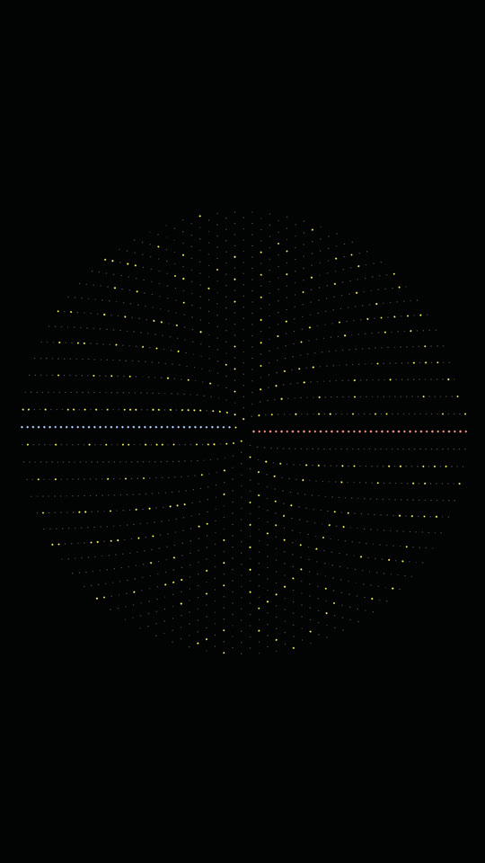
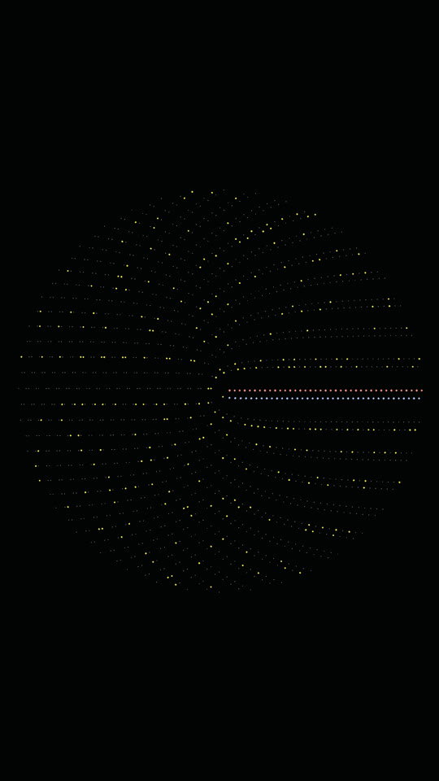
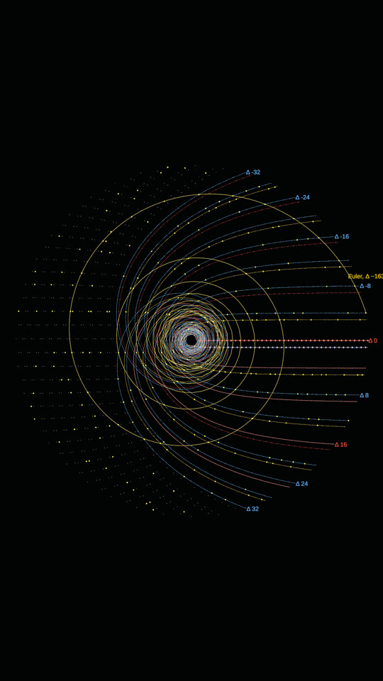
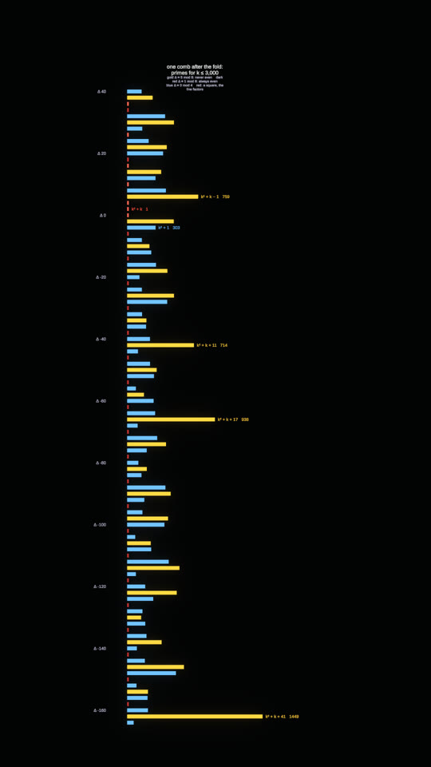
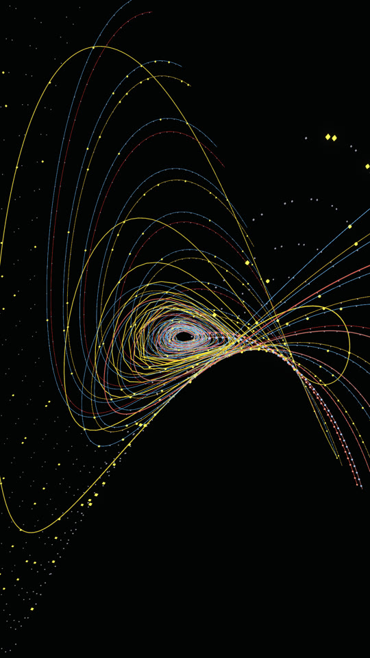

### S. The residue pinch: arms

Sliding every number around its own circle to the angle `2πn/m` collapses the spiral onto `m` arms, one per residue
class mod `m`. The primes ride the `φ(m)` arms of the classes coprime to `m`. The other arms are **cancellation
arms**: the only prime on each is the prime that divides `m` (glowing). Each prime arm is enriched by `m/φ(m)`:

| m | arms | prime arms | enrichment | numbers below 10⁷: arms that are squares mod m vs the rest |
|---|---|---|---|---|
| 4 | 4 | 2 | 2 | 1 mod 4: 332 180  ·  3 mod 4: 332 398 |
| 6 | 6 | 2 | 3 | 1 mod 6: 332 194  ·  5 mod 6: 332 383 |
| 30 | 30 | 8 | 3.75 | mean of 1, 19: 83 006.5  ·  others: 83 093.8 |
| 210 | 210 | 48 | 4.375 | mean of the 6 squares: 13 806.7  ·  others: 13 850.8 |

Pinched mod 4 on the saddle, the two prime arms (1 and 3 mod 4) are exactly the two rising lobes along ±y, and the
even numbers fall away along ±x. Within the tour's 1 601 numbers the 3-mod-4 arm leads 131 to 120. It first falls
behind at 26 861. The arms of quadratic residues lag in every row: that is Chebyshev's bias, which the zeros of the
Dirichlet L-functions control (section Q).

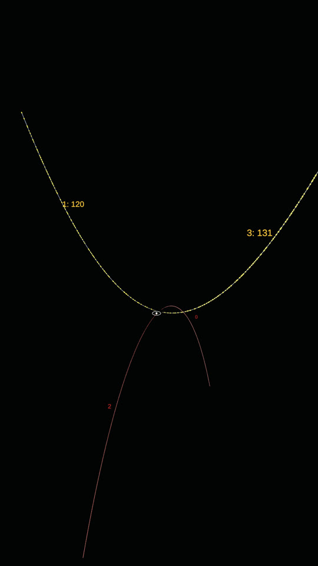
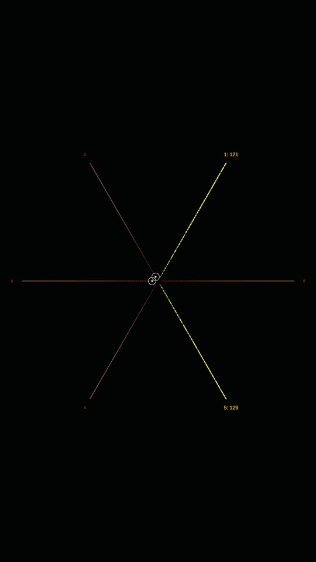
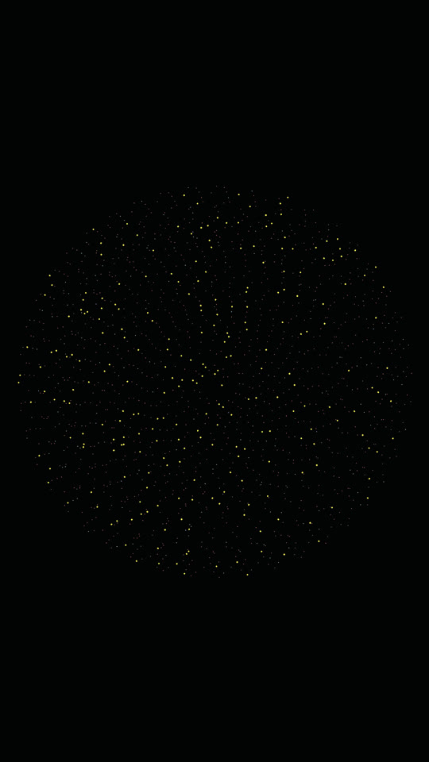
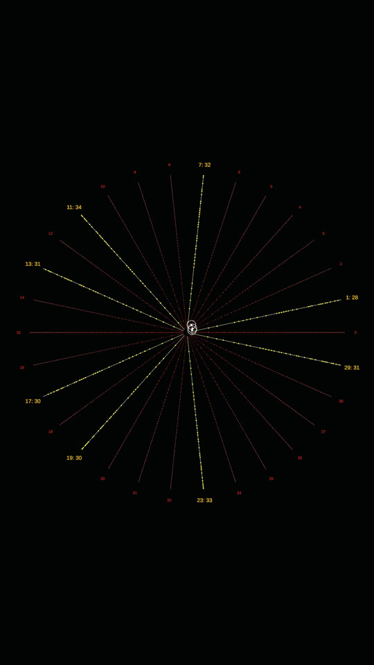
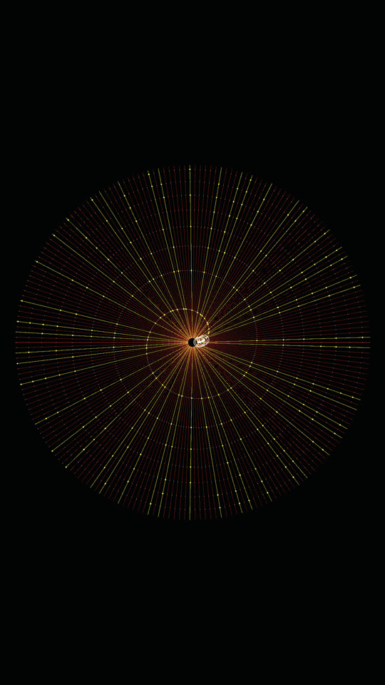
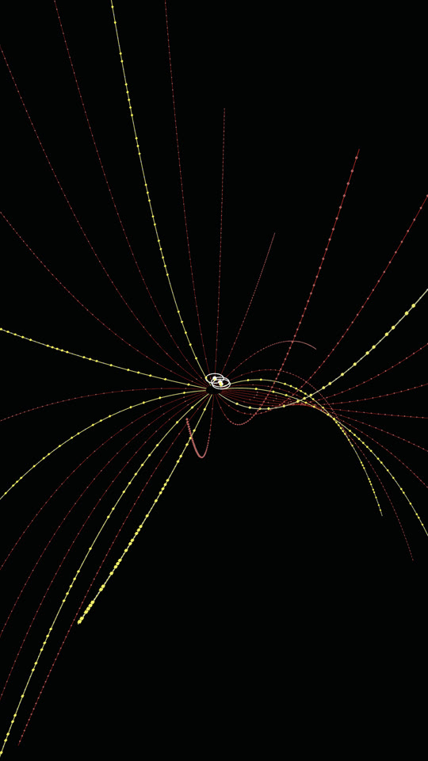

### T. The pleat: curves that gather primes

Write every number as `n = k(k + 1) + c` (`0 ≤ c ≤ 2k + 1`, counted from the pronic number before it) and slide it
back along its own turn to slot `c mod L`, stacking the folds along the surface normal. Each turn is pleated into `L`
slots after the pronic ray, and slot `j` becomes the curve `k² + k + j`. A slot curve can dodge a prime `p` only if
`k² + k + j` has no root mod `p`. The slots that dodge every prime dividing `L` are the **anti-cancellation curves**,
glowing gold. The even slots are cancellation curves, since `k² + k` is always even.

| L | anti-cancellation slots | enrichment, n ≤ 1 601 | n ≤ 10⁷ | predicted Π p/(p − 1) |
|---|---|---|---|---|
| 6 | 5 | 3.07 | 3.00 | 3.000 |
| 30 | 11, 17 | 4.41, 4.28 | 3.76, 3.74 | 3.750 |
| 210 | 11, 17, 41, 101, 137, 167 | (too few per slot) | 41: 4.54, 101: 4.46, 17: 4.37, 137: 4.33 | 4.375 |

The pleat mod 30 gathers the primes onto two curves named by Euler's lucky numbers, `k² + k + 11` and `k² + k + 17`;
`k² + k + 41` folds onto slot 11. The 14 even slots hold no primes at all. On the squares side (`n = k² + C`, slot
`C mod L`) the best slots reach only 1.50 (L = 6) and 1.88 (L = 30), half the pronic side. `k² + C` takes both
parities, so no squares-side curve can dodge 2. **This is why the prime-rich Euler lines all live on the pronic
side.**

The gold curves still carry composites, glowing white: 18 on slot 11 and 16 on slot 17 below 1 601. Examples are
`121 = 11²`, `143 = 11·13`, `221 = 13·17`, `289 = 17²`, `323 = 17·19` and `749 = 7·107`. Each is built from primes
larger than 5, which the pleat mod 30 cannot see.

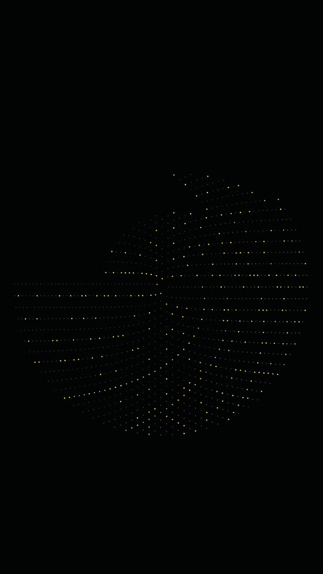
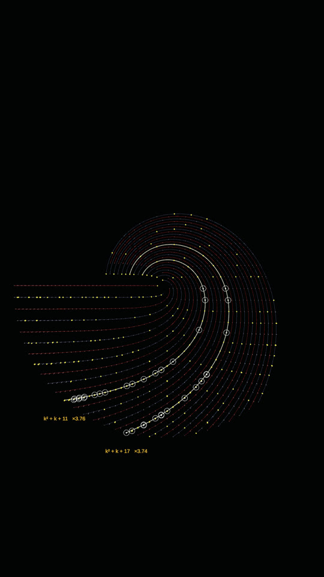
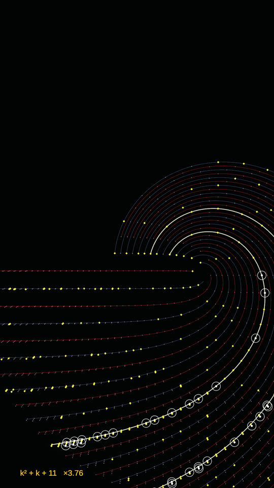
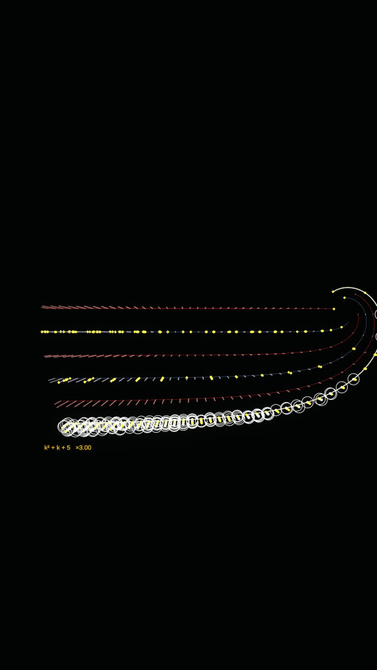
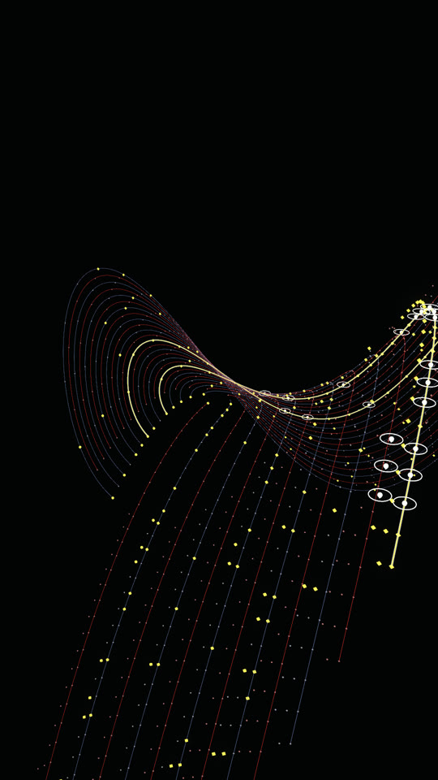
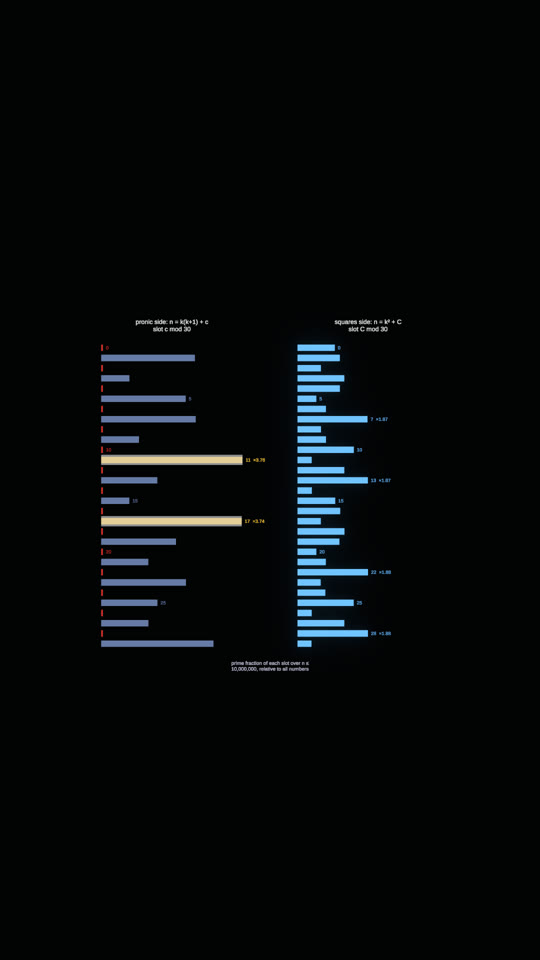

### U. Many dimensions: the residue lattice

Pinching modulo 3, 5 and 7 at once, as three axes, places every odd number in one cell of a 3 × 5 × 7 lattice. The
three zero planes (`n ≡ 0` mod 3, 5 or 7) are cancellation planes. Up to 10⁷ the primes fill exactly the `2·4·6 = 48`
cells off them, with between 13 757 and 13 922 primes per cell (a spread of 1.2 %). The only primes on the planes are
3, 5 and 7 themselves. Parity is a fourth axis: the even lattice beside it holds the single prime 2.

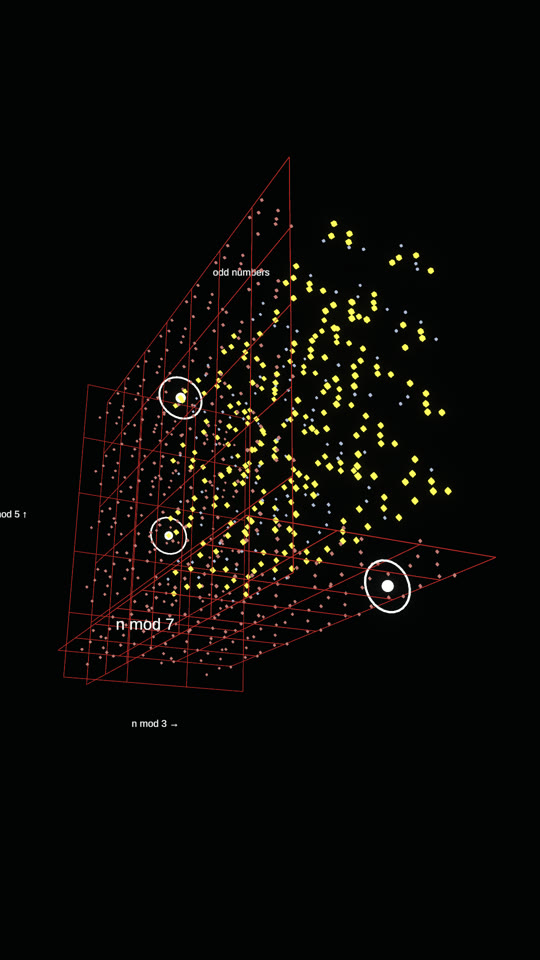
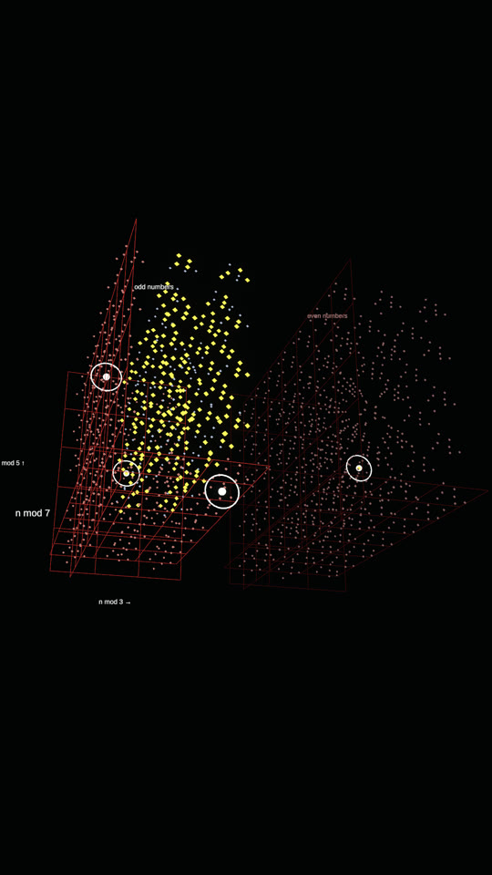

### What pinching can and cannot do

Every pinch that clusters primes does it the same way. It sorts numbers by their remainders modulo the primes it
sees, and it gathers the primes onto the curves, arms, slots or cells that never meet those primes. The enrichment
of the best curve is `Π p/(p − 1)` over the primes it sees, which grows only like `e^γ log P` (Mertens):

| primes seen, up to | 2 | 3 | 5 | 7 | 11 | 13 | 17 | 19 | 23 | 29 | 31 | 37 |
|---|---|---|---|---|---|---|---|---|---|---|---|---|
| enrichment of the best curve | 2.00 | 3.00 | 3.75 | 4.38 | 4.81 | 5.21 | 5.54 | 5.85 | 6.11 | 6.33 | 6.54 | 6.72 |

Euler's line is the anti-cancellation curve for every prime up to 37, and its Hardy–Littlewood constant, 6.648, is
that product (6.724) trimmed slightly by the primes above 41. The pinch pictures therefore show the sieve as
geometry. They cannot do better than the sieve: the brightest pinched curve always keeps the composites made of
primes it cannot see. Seeing more primes needs a finer pinch, and the gain grows only with the logarithm of the
largest prime used.

## V–Y. 144 = 12 × 12 as a basis

Twelve is the smallest number whose remainders decide divisibility by both 2 and 3, the two primes that do most of
the cancelling. 144 = 12 × 12 gives two independent copies of that clock. Four ways of grouping the spiral's curves
with it follow.

### V. The 12 × 12 torus: every curve becomes a straight line

Every number has a turn `k = ⌊√n⌋` (which ring of the spiral it sits on) and a step `n − k²` (how far it is round
that ring from the squares ray). Taken mod 12, both put `n` on a 12 × 12 board, and the board wraps into a torus:
the turn goes the long way round, the step the short way. On this board every curve `k² + Bk + C` is a **straight
line of slope B**. The squares-side curves `k² + C` are vertical lines, and the pronic-side curves `k² + k + c` are
diagonals.

A prime above 3 can sit only where `k² + step` is 1, 5, 7 or 11 mod 12. That happens in exactly 48 of the 144 cells,
4 per row, in a pattern that repeats every 6 rows. Up to 10⁷ each of those cells holds between 13 626 and 13 997
primes, and the other 96 hold only 2 and 3.

On average, a line's prime density is therefore **three times the share of rows it spends in allowed cells**. The diagonal of
`k² + k + c` depends only on `c mod 12`:

| c mod 12 | rows in allowed cells | predicted density | measured (50 lines each, k ≤ 3 000) |
|---|---|---|---|
| 5, 11 | 12 of 12 | 3 | 2.99, 3.00 |
| 1, 7 | 8 of 12 | 2 | 1.94, 2.03 |
| 3, 9 | 4 of 12 | 1 | 1.00, 0.99 |
| even | 0 | 0 | 0 |

Density is relative to `1/log n`. **The Euler lines are the two diagonals that never leave the allowed cells.**
41 ≡ 5, 17 ≡ 5 and 11 ≡ 11 (mod 12) all belong there. The vertical lines `k² + C` spend at most 6 rows of 12 in
allowed cells: C ≡ 1 (mod 3) gives 1.5 (measured 1.48 to 1.51), C ≡ 0 gives 1.0 and C ≡ 2 gives 0.5. So no
squares-side curve can match a pronic-side one, the same factor of 2 found in section T.

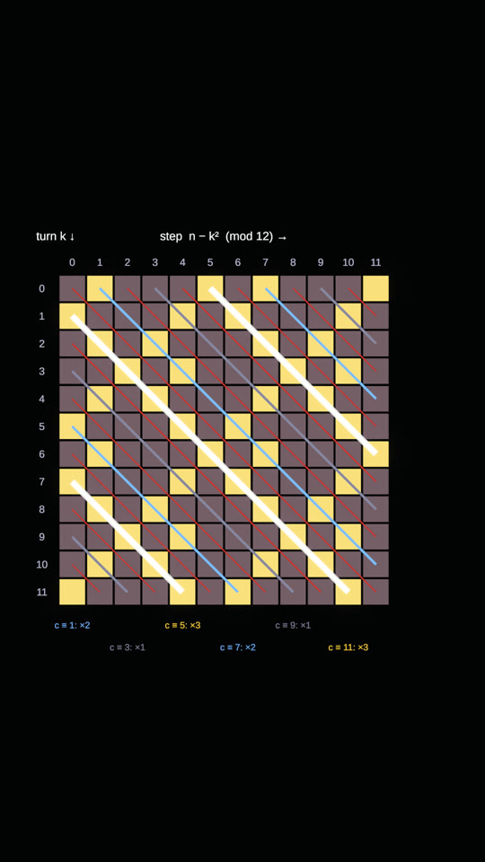
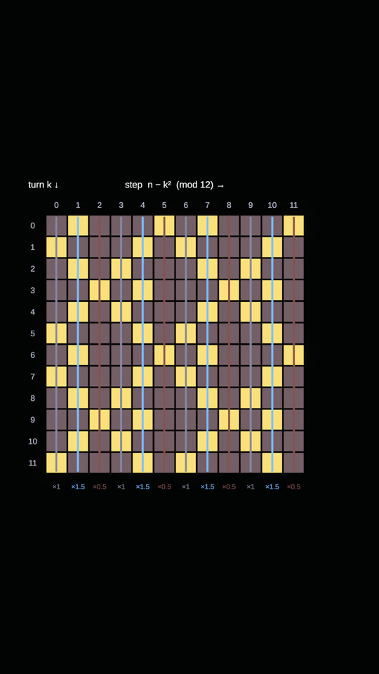
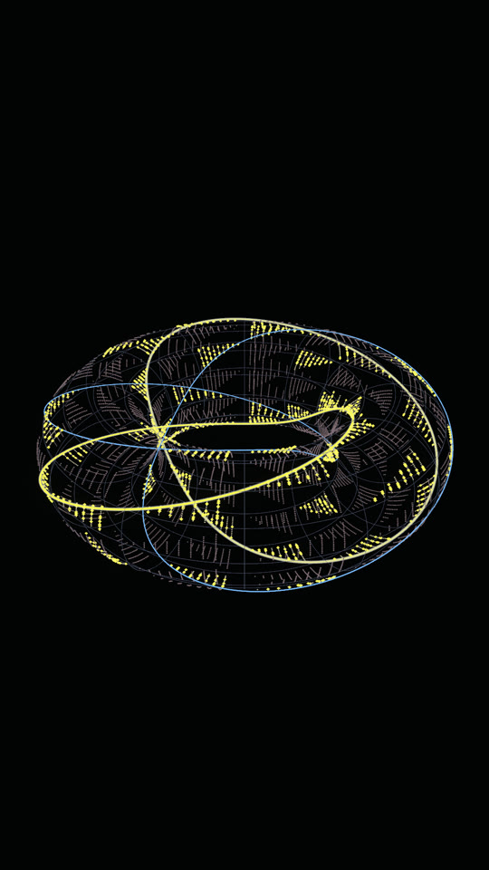
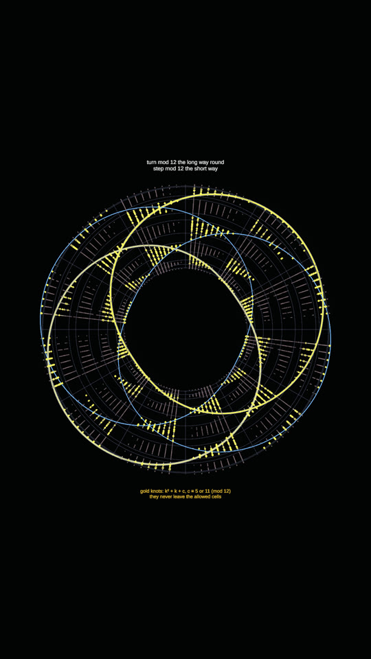
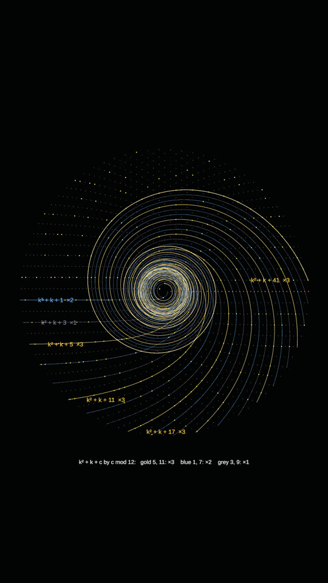
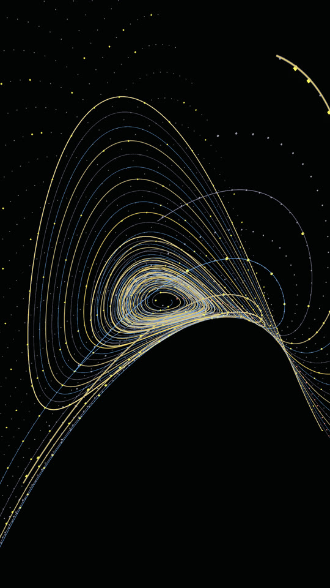

### W. The saddle computes Legendre symbols

The saddle's height is `K r² cos 2θ`. Pinch the spiral by residues (section S), so that `n` sits at angle `2πn/m`.
Then a number's height is `K r² cos(4πn/m)`, a twelfth-root-of-unity sum in disguise. For two moduli this cosine is
exactly a quadratic character:

* **m = 24:** `cos(πn/6) = ±0.866` with the sign of **(3/p)**, the Legendre symbol that says whether 3 is a square
  mod `p`. Primes `≡ ±1 (mod 12)` fall away from the trail; primes `≡ ±5 (mod 12)` rise.
* **m = 16:** `cos(πn/4) = ±0.707` with the sign of **(2/p)**. Primes `≡ ±1 (mod 8)` fall, `≡ ±3 (mod 8)` rise.
* On the saddle turned 45° (`z = 2Kxy`), m = 8 gives `(−1/p)` and m = 6 gives `(−3/p)`.

All four agree with the Legendre symbol for every prime up to 2 000 000, with no exception. The 144-hour pinch on a
12-fold saddle (`z = K r² cos 12θ`) computes the same cosine, `cos(πn/6)`: its 48 prime arms sit at exactly ±0.866 of
the height, by (3/p). Up to 10⁷ there are 332 225 primes with (3/p) = +1 and 332 352 with (3/p) = −1. By class, 1 mod 12 has
166 011, 5 has 166 169, 7 has 166 183 and 11 has 166 214: the residue class 1 lags, which is Chebyshev's bias again.

The identities behind this are `cos(πn/6) = (√3/2)·(3/n)` and `cos(πn/4) = (√2/2)·(2/n)` for n prime to 6 and to 2.
They hold because `√3 = 2 cos(π/6)` and `√2 = 2 cos(π/4)` are Gauss sums. A pinch to 10 arms computes `(5/p)` too,
but at two unequal heights, `(√5 − 1)/4 = 0.309` and `−(√5 + 1)/4 = −0.809`, since `cos(2π/5)` and `cos(4π/5)` are
the two halves of the Gauss sum `√5` (checked for every prime up to 2 000 000).

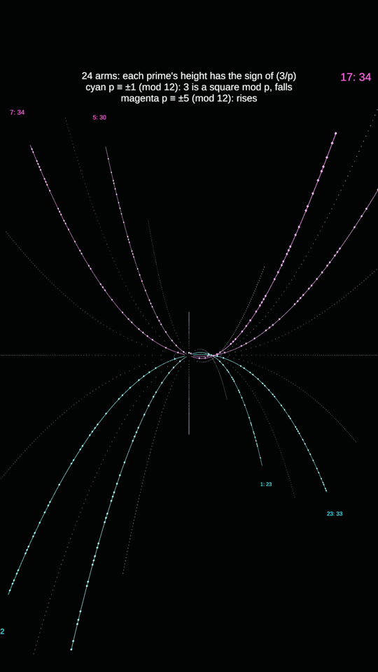
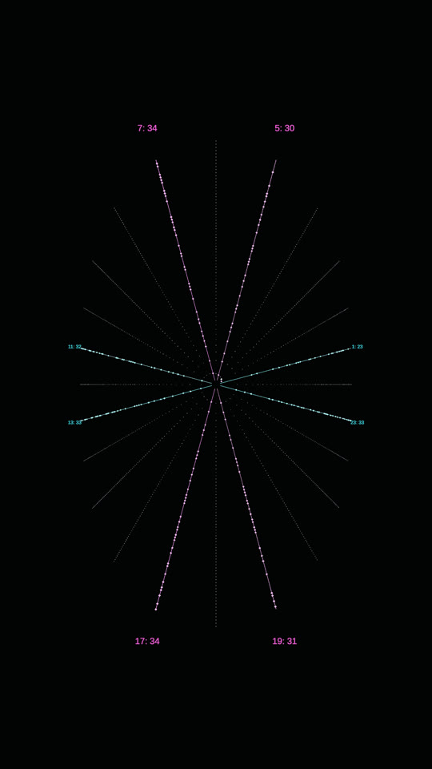
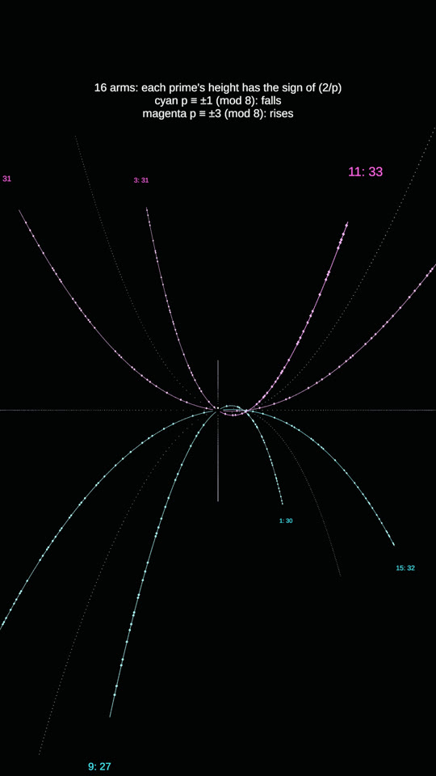
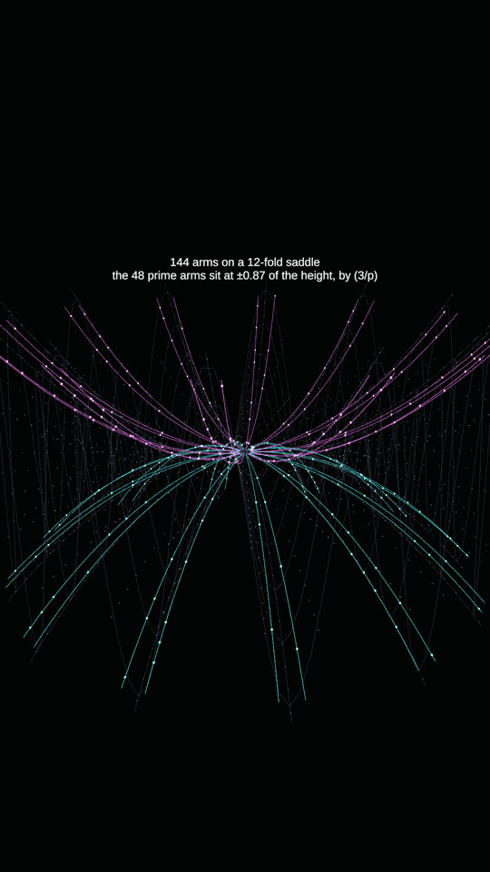

### X. Fingerprints mod 144: the last two base-12 digits

`n mod 144` is the last two digits of `n` written in base 12, the dozen digit and the unit digit. Laid out as a
12 × 12 board, every prime above 3 ends in 1, 5, 7 or b, so the primes fill exactly four columns: the 48 unit cells,
with 13 768 to 13 902 primes each up to 10⁷. A curve's fingerprint is the set of cells its values visit:

| curve | cells visited | of the 48 unit cells |
|---|---|---|
| squares `k²` | 16 | 6 (1, 25, 49, 73, 97, 121: every `p²` is 1 mod 24) |
| `k² + 1` | 16 | 8 |
| pronic `k(k + 1)` | 32 | 0 (always even) |
| Euler `k² + k + 41` | 32 | **32** |
| `k² + k + 17` | 32 | **32** (24 cells shared with Euler's) |
| `k² + k + 1` | 32 | 24 |
| product `u(4u + 1)` | 64 | 8 |

Euler's line only ever visits unit cells. It fills the columns 5 and b completely and the columns 1 and 7 in four
rows each: in base 12 its values end in 5 or b twice as often as in 1 or 7.

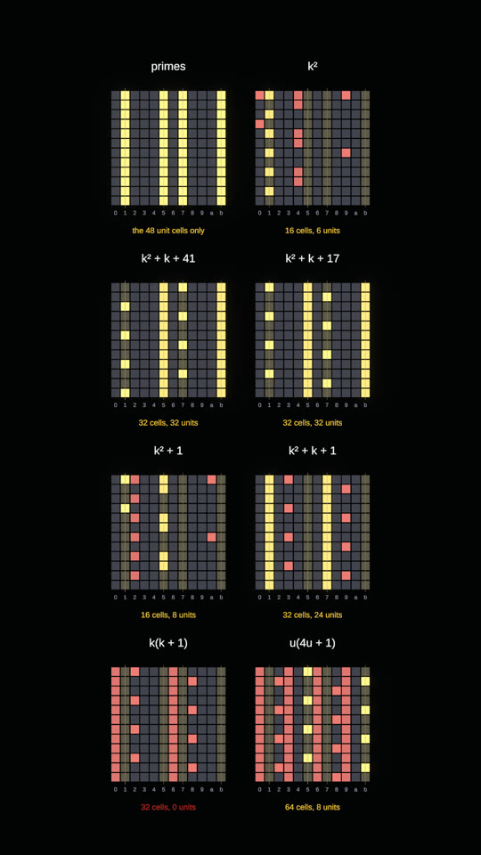
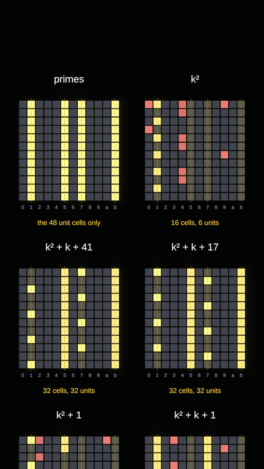

### Y. The 144 clock: product families on the 24 half-hours

A family `q²k² + Bk + C` straightens toward the direction `B/2q` of a turn. The directions that are multiples of
1/24 turn, the 24 half-hours of a clock, are exactly those with `q` dividing 12, so with `q²` dividing 144. On each
half-hour lies a product family `u(q²u + d)`:

| hours (24ths of a turn) | family |
|---|---|
| 0, 12 | squares `u·u`, pronic `u(u + 1)` |
| 6, 18 | `u(4u + 1)`, `u(4u + 3)` |
| 4, 8, 16, 20 | `u(9u + 1)`, `u(9u + 2)`, `u(9u + 4)`, `u(9u + 5)` |
| 3, 9, 15, 21 | `u(16u + 1)`, `u(16u + 3)`, `u(16u + 5)`, `u(16u + 7)` |
| 2, 10, 14, 22 | `u(36u + 1)`, `u(36u + 5)`, `u(36u + 7)`, `u(36u + 11)` |
| odd hours prime to 3 | `u(144u + d)`, d = 1, 5, 7, 11, 13, 17, 19, 23 |

In a strip of half-width `R/2` round each ray (n ≤ 4·10⁶), 14 rays hold no primes at all: the 12 even hours (`q`
dividing 6) and hours 3 and 21. The other ten strips hold 16 to 75 primes. Each of them also contains a prime-carrying family with a
small non-square discriminant: `16k² + 11k + 2` (Δ = −7) beside `u(16u + 3)` at hour 9, and `144k² − 23k + 1`
(Δ = −47) beside `u(144u + 1)` at hour 1.

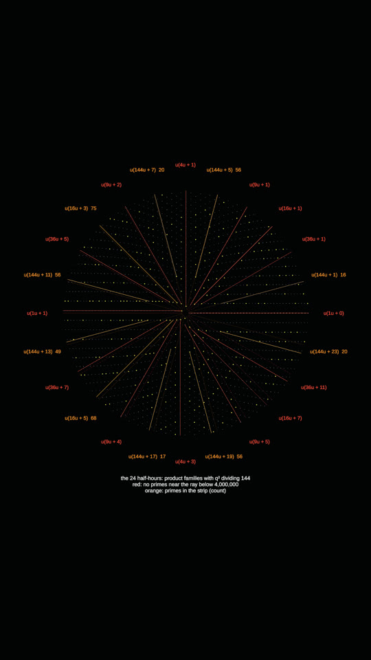
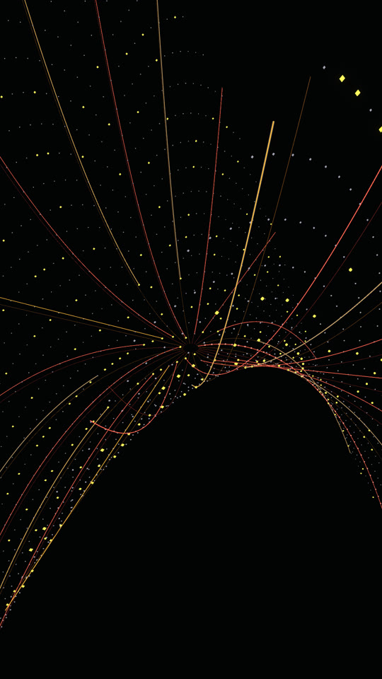

### What the 12 × 12 basis shows

144 is the natural size for these pictures. It holds two copies of the twelve-clock that decides divisibility by 2
and 3, and its square divisors are exactly the leading coefficients of the families on the 24 half-hours. In that
basis:

* the curves become straight lines on a torus;
* their prime densities become a count of allowed cells (3, 2, 1 or 0 for the pronic side, at most 1.5 for the squares side);
* the saddle's own height evaluates (3/p) and (2/p).

All of it is the local behaviour at 2 and 3. It explains why Euler's lines are three times as prime as an average line,
but no grouping by 144 can see a prime larger than 3.

## Z1–Z4. Mirrors, a sieve machine, and twisted tori

This round asked whether a toroidal, umbilic or Möbius transformation of the spiral can separate the primes, the
cancellation curves and the anti-cancellation curves well enough to find primes or to factor. Four constructions were
tried ([`SacksTwisted.cs`](../../Assets/Tour/SacksTwisted.cs)). The first gave a quantitative surprise, the second is a
factoring machine, and the last two sort numbers by residues and do nothing more.

### Z1. Every number is a mirror for prime pairs

Take a number `m` and step `j` to either side. Within one turn of the spiral, `m − j` and `m + j` sit symmetric
across the ray through `m`. When both are prime they are a Goldbach pair of `2m`, drawn as a chord across the ray.
Counting the pairs with `j ≤ k` on the mirrors of each curve gives the reverse of what the prime curves suggest.

| mirror curve | pairs per mirror, relative to Euler's line | Hardy–Littlewood prediction |
|---|---|---|
| `k(k + 1)` (pronic, a cancellation curve) | 2.152 | 2.125 |
| `u(u + 6)` | 1.723 | 1.700 |
| `u(u + 30)` | 1.610 | 1.600 |
| `k²` (squares) | 1.517 | 1.504 |
| `k² + 1` (Landau) | 1.179 | 1.161 |
| `k² + k − 1` | 1.100 | 1.098 |
| `k² + k + 17` | 1.028 | 1.021 |
| `k² + k + 41` (Euler) | 1.000 | 1.000 |

The counts run over `k` from 1 000 to 3 000 and are normalised by `k / log² m`. The pronic mirrors hold 48 726 pairs
and Euler's 22 638. The prediction is the singular series of Goldbach's conjecture in Hardy and Littlewood's form.
Every odd prime `p` that divides the mirror multiplies its pairs by `(p − 1)/(p − 2)`, because such a `p` spoils a pair
`m ± j` only when `p | j`, one residue class of `j` instead of two. Pronic numbers are always even, and divisible by 3
two times in three. Euler's values have no prime factor below 41. So **the cancellation curves are the best mirrors
for prime pairs, and the anti-cancellation curves are the worst.**

Inside the tour's spiral, over turns 10 to 39, the pronic mirrors reflect 54 pairs, the squares 37 and Euler's line 16.
Fifteen of Euler's thirty mirrors reflect none. The chords of the squares and pronic mirrors are all perpendicular to
the x axis, a barcode across the spiral. Euler's chords point every which way, because the direction of its ray swings
from turn to turn.

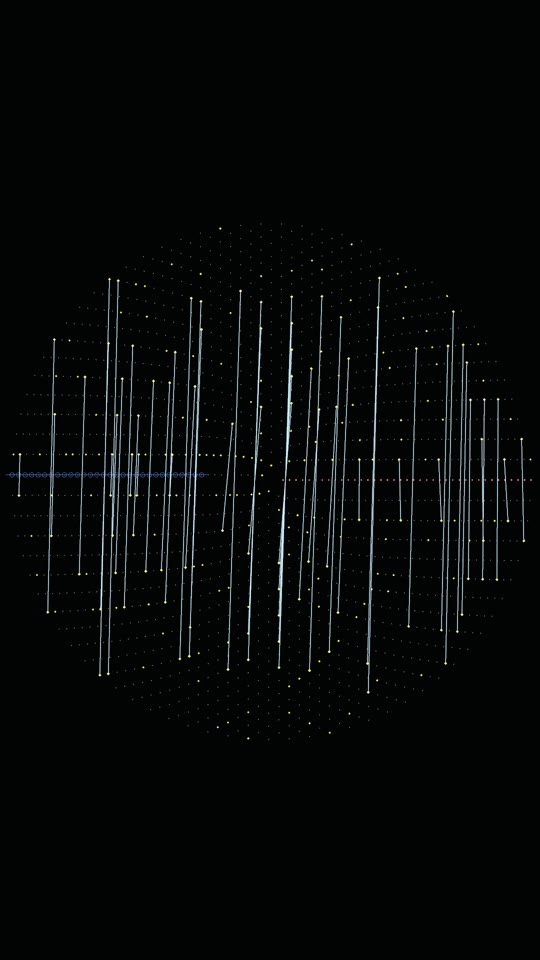
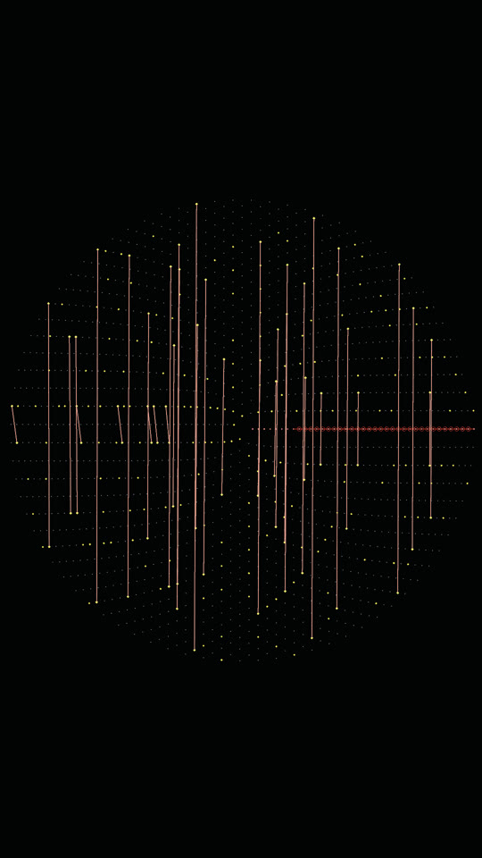
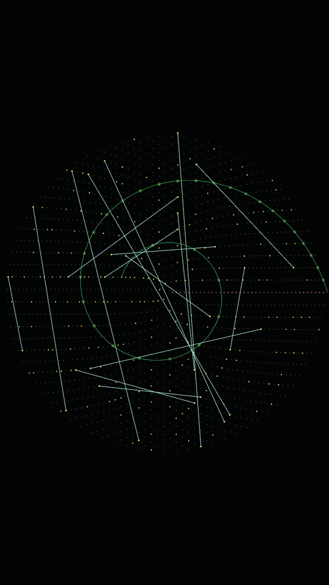
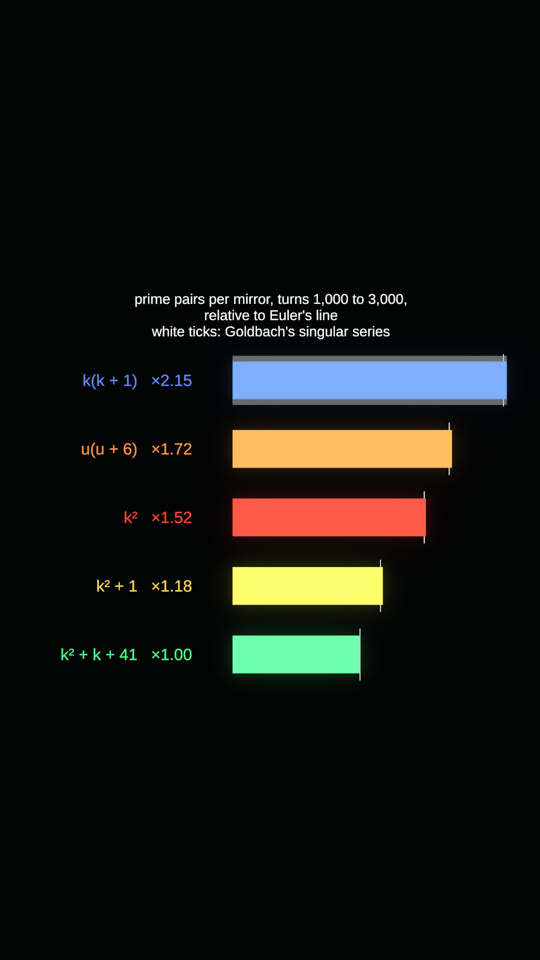

**The Möbius band of chords.** A chord is an unordered pair of angles `{θ₁, θ₂}`. The unordered pairs of points on a
circle form a Möbius band whose single edge is the diagonal `θ₁ = θ₂`. With centre `c = θ₁ + d/2` and half-width
`w = d/2`, where `d = θ₂ − θ₁ mod 2π`, the band is the strip `(c, w)` glued by `(c, w) ~ (c + π, π − w)`. Every chord
of the squares and pronic mirrors lands on one rung, `c ≡ 0 (mod π)`, which is the reflection across the x axis. For
`k` from 10 to 59 that is 61 squares chords and 95 pronic chords, entering the rung from opposite ends. Euler's 35
chords scatter over the band.

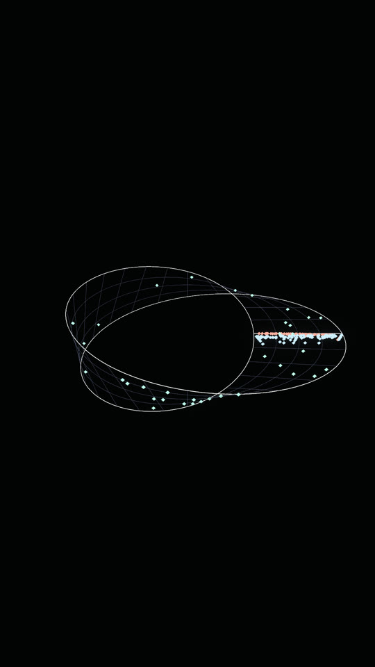
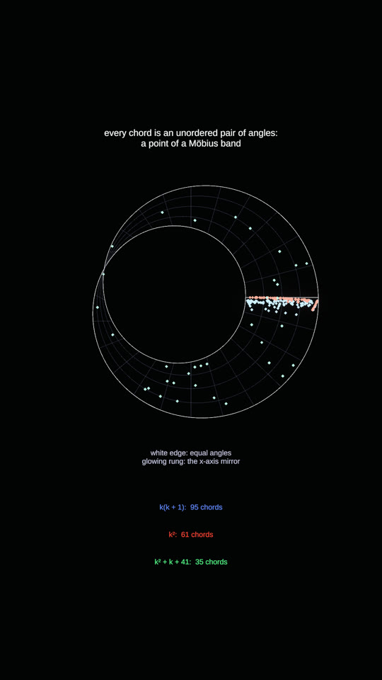

### Z2. The sieve machine

Fermat factors `n` by finding `a` with `a² − n = b²`, so that `n = (a − b)(a + b)`. Most candidates `a` can be thrown
out before any square root is taken, because `a² − n` must be a square modulo every `m`. The machine has one ring per
modulus (3, 4, 5, 7, 8, 9, 11, 13, 16, 17 and 19) with a hole at every residue of `a`, gold where `a² − n` can still be
a square. Stepping `a` turns every ring by one hole. Light from the centre runs out through the window at twelve
o'clock until a closed ring stops it.

| n | candidates `a` | left after each ring | first `a` through | factors |
|---|---|---|---|---|
| 1 501 | 39–60 (22) | 14, 7, 4, 1, 1, 1, 1, 1, 1, 1, 1 | 49, with 49² − 1 501 = 30² | 19 × 79 |
| 50 399 | 225–320 (96) | 32, 16, 10, 4, 3, 3, 2, 2, 2, 2, 1 | 300, with 300² − 50 399 = 199² | 101 × 499 |

For 1 501 the ring for 19 is gold all the way round. When a prime `p` divides `n`, `a² − n ≡ a²` is always a square
mod `p`. When it does not, at most `(p + 1)/2` of the `p` holes are open. A prime ring with no dark holes names a
factor by itself.

This is D. H. Lehmer's sieve, which he built from bicycle chains and, in 1932, from gears and a photocell. Its rings
are the circles of a torus (Z3), and turning them together walks a torus knot through the cells. It is fast when the
factors are close to `√n`. When they are far apart, `a` has to climb about `(p + q)/2 − √n` steps, and the rings shorten
the climb only by a constant factor.

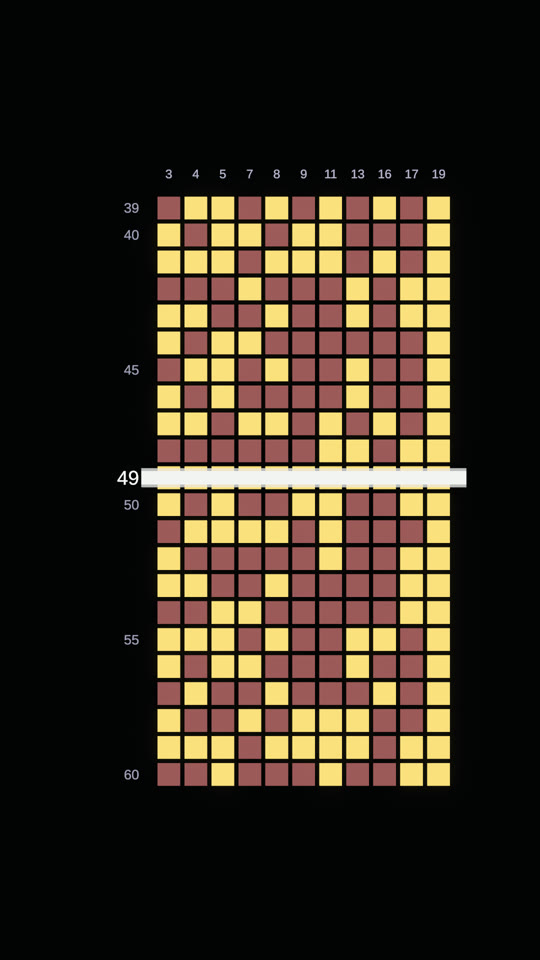
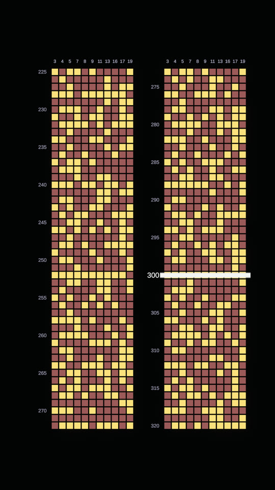
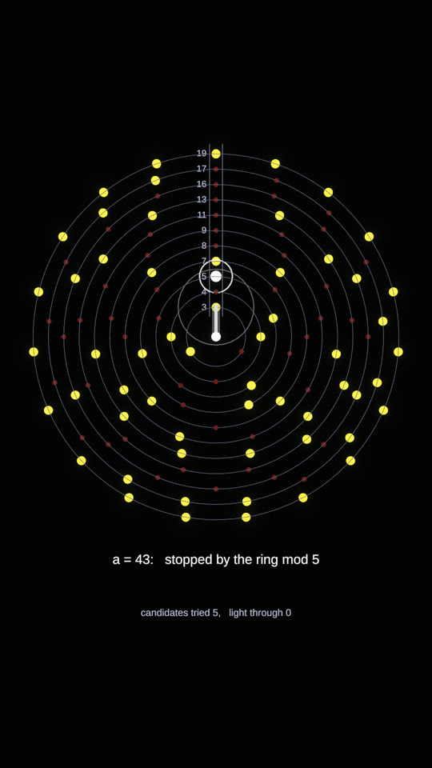
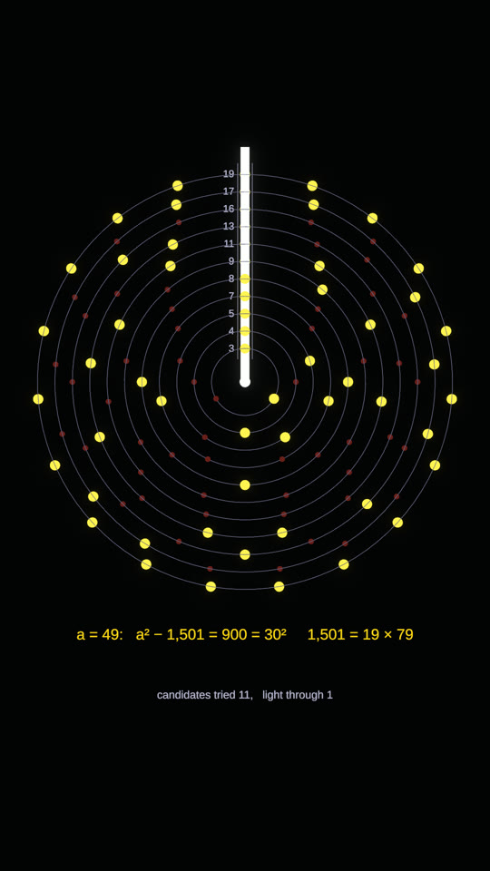
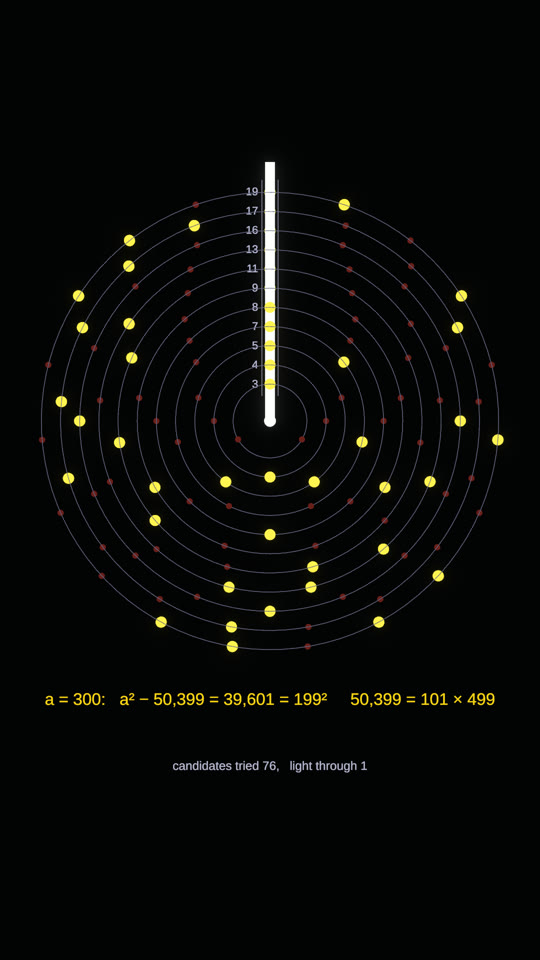

### Z3. The torus knot of residues

Put `n` at angle `2πn/7` around a torus and `2πn/5` around its tube. The integers wind the (5, 7) torus knot through 35
beads, one for each residue mod 35. Every prime other than 5 and 7 lies on one of the 24 beads coprime to 35, with
3 250 to 3 293 primes on each up to 10⁶. The other 11 beads lie on two circles, the multiples of 5 on a parallel and
the multiples of 7 on a meridian, and hold only 5 and 7 themselves. Euler's `k² + k + 41` visits 12 of the 24 beads and
never touches either circle, since its discriminant −163 is not a square mod 5 or mod 7.

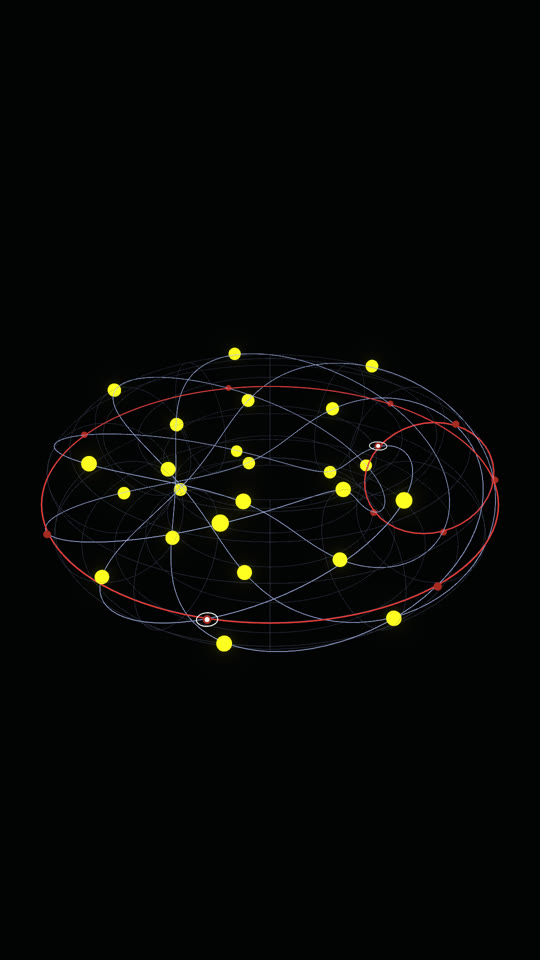
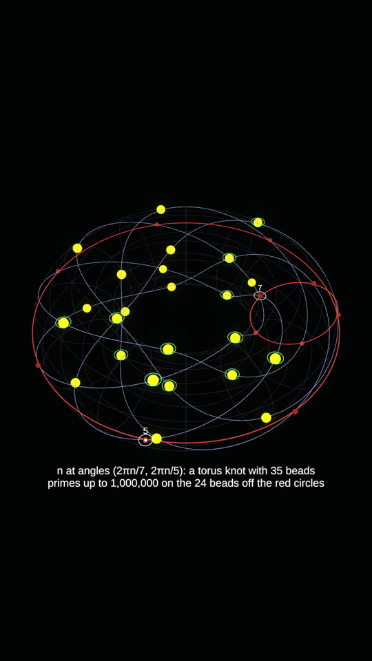
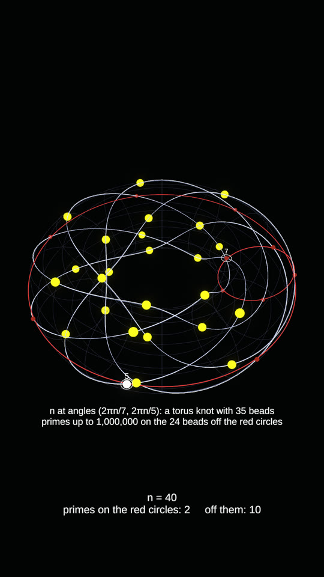

### Z4. The umbilic torus sorts the turns mod 3

Ferguson's umbilic torus, `x = sin u (7 + cos(u/3 − 2v) + 2 cos(u/3 + v))`, `y = cos u (…)`,
`z = sin(u/3 − 2v) + 2 sin(u/3 + v)`, has a deltoid cross-section that turns a third of a turn per lap. Its single cusp
edge runs around three times before it closes. Wind the spiral onto it, one lap per turn (`u = 2π√n`), just off the
cusp edge and drifting across the face so that the turns stack. Cut at the squares ray, every cross-section has three
positions, and turn `k` lies in position `k mod 3`. The colours of the three stacks trade places at the cut, because the
surface has only one face.

On this surface every curve meets 3 on whole stacks. For the values that lie on their own turn (`k ≥ C`):

| curve | multiples of 3 | primes |
|---|---|---|
| `k² + k + 1` | all 14 values in position 1 | 8 in position 0, 7 in position 2 |
| `k² + k + 3` | all 25 values in positions 0 and 2 | all 8 in position 1 |
| `k² + k + C` with `C ≡ 2 (mod 3)`, such as 17 and 41 | none | in all three |

Without the twist, every turn lies on the same face and the multiples of 3 mix with the primes. A half twist of a flat
strip is a Möbius band, which sorts the turns by parity, and a tube with `q` cusps twisting by `1/q` sorts them mod `q`.
The sorting is the residue lattice of section U, drawn on a surface.

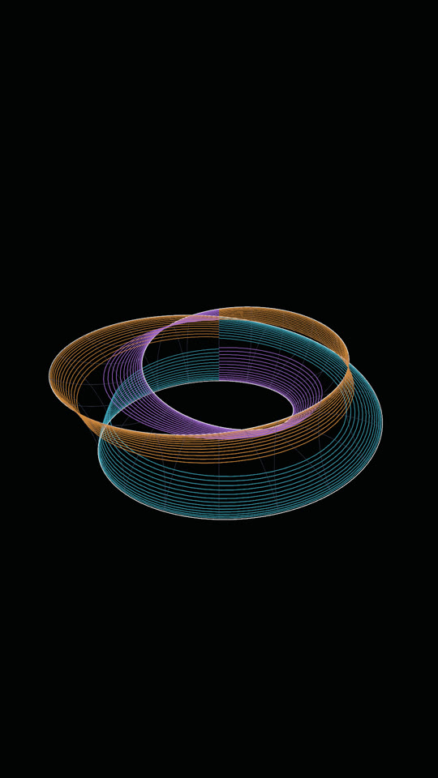
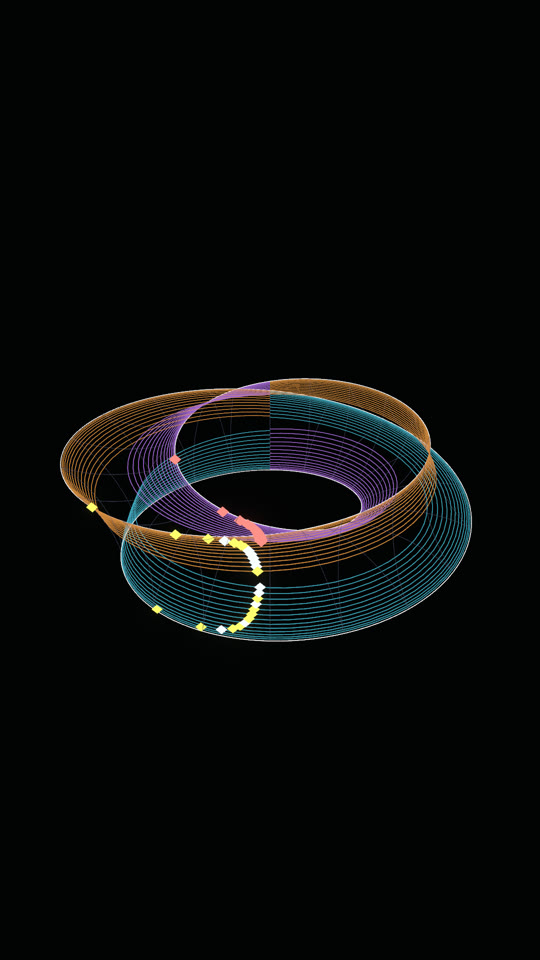
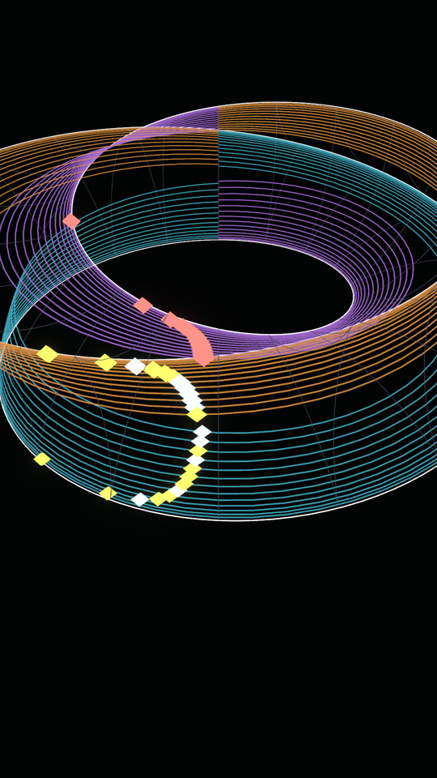


### What the twisted shapes do

* **The mirrors are new as a picture, and quantitative.** The pronic ray reflects 2.15 times as many Goldbach pairs as
  Euler's line. The singular series predicts every curve's mirror strength to within 1.5 %. For pairs of primes,
  cancellation and anti-cancellation trade places.
* **The sieve machine factors, but it is classical.** It is Fermat's method with Lehmer's residue filter, and its cost
  still grows like the distance between the factors.
* **The torus knot and the umbilic torus make residue classes visible.** The knot shows `n mod 35`, and the umbilic
  torus shows the turn mod 3 as the three stacks of a twisted tube. Neither can find a prime that the residues have not
  already allowed.

## AA–AE. Intersecting geometries

This round crossed the spiral's curves with other geometries: two quadric surfaces, two lattices, a 12-dimensional
torus, the modular surface, and the cosine waves of L-function zeros. The question was where the intersections carry
the prime, cancellation and anti-cancellation curves ([`SacksIntersect.cs`](../../Assets/Tour/SacksIntersect.cs)). The
frames are 1920 × 1080 (`ZETA_EXP_WIDE=1`).

### AA. The paraboloid and the saddle

Every curve `k² + Bk + C` equals `x² − Δ/4` at `x = k + B/2`. Put `y = √|Δ|/2`: that is `x² + y²` when `Δ < 0` and
`x² − y²` when `Δ > 0`. So **every curve is a vertical slice of the paraboloid `z = x² + y²` or of the saddle
`z = x² − y²`**, read at half-integer steps. The two surfaces meet along `y = 0`, where both are `x²`: the squares.

| slice | Δ | surface, y | prime, k = 0 … 9 or 10 |
|---|---|---|---|
| `k² + k + 41` | −163 | paraboloid, 6.38 | 10/10 (40/40 for k < 40) |
| `k² + k + 17` | −67 | paraboloid, 4.09 | 10/10 |
| `k² + 1` | −4 | paraboloid, 1 | 5/11 |
| `k(k + 1)` | 1 | saddle, ½ | 1/10 |
| `k² + k − 1` | 5 | saddle, 1.12 | 7/10 |
| `u(u + 4)` | 16 | saddle, 2 | 1/11 |
| `k² + k − 3` | 13 | saddle, 1.80 | 3/10 |
| `u(u + 6)` | 36 | saddle, 3 | 1/11 |

The cancellation curves are the saddle's slices at half-integer `y = d/2`, where `x² − d²/4 = u(u + d)` factors; each is
prime only at its birth `d + 1`. The saddle's slices at irrational `y` and all the paraboloid's slices are irreducible, so
they carry primes unless a fixed prime divides every value (`k² + k + C` with `C` even is always even).

The level sets carry factorizations. On the saddle, `x² − y² = n` passes through `((a + b)/2, (b − a)/2)` for every
factorization `n = a·b`: `2·d(n)` points, four for a prime. On the paraboloid, `x² + y² = n` is the Sacks ring of `n`, and
it passes through `r₂(n)` integer points (sums of two squares).

| n | factor points | square points |
|---|---|---|
| 13 | 4 | 8 |
| 23 | 4 | 0 |
| 25 | 6 | 12 (5·5 lies on both, where the surfaces meet) |
| 65 | 8 | 16 |

The two lattice-point problems of section P live on these surfaces. Counting the integer points under the paraboloid's
level sets is the circle problem, and under the saddle's is the divisor problem.


### AB. Sacks rings through two lattices

The ring of `n` meets the square lattice in `r₂(n) = 4 Σ χ₋₄(d)` points and the triangular lattice in
`r₃(n) = 6 Σ χ₋₃(d)` points, summed over the divisors `d` of `n`. For a prime the four classes mod 12 are four intersection
patterns:

| p mod 12 | square points | triangular points | primes ≤ 1601 |
|---|---|---|---|
| 1 | 8 | 12 | 56 |
| 5 | 8 | 0 | 64 |
| 7 | 0 | 12 | 65 |
| 11 | 0 | 0 | 65 |

The ring of a prime `p ≡ 11 (mod 12)` threads between every point of both lattices. Composite counts multiply: 65 has
16 square points, 91 has 24 triangular, 1105 = 5·13·17 is the first number with 32 square points, and
1729 = 7·13·19 = 12³ + 1 is the first with 48 triangular points (and has no square points). The Sacks point of `n` lies on
the same ring.

**Euler's line is the first row of its lattice.** In the lattice `Z[(1 + √−163)/2]` the norm of `a + bτ` is
`a² + ab + 41b²`. Row 0 holds the squares, and row 1 holds Euler's values: the ring of `k² + k + 41` passes through
the lattice point `(k + ½, √163/2)`. All forty rings for `k < 40` are prime, and the forty-first, 1681 = 41², is the
first composite.


### AC. The 12-dimensional residue torus and its 144 shadows

`n ↦ (n mod 2, n mod 3, …, n mod 37)` is a point of a 12-dimensional torus. Primes above 37 avoid every hyperplane
"≡ 0". Below 41² = 1681 that is exactly primality, so for the tour's spiral, which stops at 1601, this torus decides it.

The 144 pairwise shadows `Z/pᵢ × Z/pⱼ` show it panel by panel. Primes up to 10⁶ fill the unit cells evenly: the 5 × 7
panel's 24 cells hold 6 171 to 6 241 each. Each panel's cancellation cross holds only `pᵢ` and `pⱼ`. The curves differ
sharply:

* `k² + k + 41` never lands on a cross, because −163 is a non-residue modulo every prime up to 37 (checked for k < 10⁵).
* `k(k + 1)` lands on both arms of every cross.
* `k² + 1` lands only on the crosses of 2, 5, 13, 17, 29 and 37, that is 2 and the primes ≡ 1 (mod 4).


### AD. The curves on the modular surface

Send `k² + Bk + C` to the roots of `x² + Bx + C` in the upper half-plane. For `Δ < 0` that is the point
`τ = (−B + i√|Δ|)/2`, at the paraboloid slice's height. For `Δ > 0` it is the geodesic semicircle of radius `√Δ/2`
about `−B/2`, at the saddle slice's height. The squares side (`B = 0`) lives on `Re τ = 0`, and the pronic side
(`B = 1`) on `Re τ = −½`, the left edge of the modular fundamental domain. The curves fall into three kinds:

* **Points**, for definite forms: the anti-cancellation side.
* **Closed geodesics**, for `Δ > 0` not a square, of length `2 log ε`. Examples: `k² + k − 1` has length 1.92
  (`2 log φ²`), `k² − 2` has 3.53, and `k² − 3` has 2.63.
* **Geodesics that run into the cusps**, for `Δ` a square, where both roots are integers. These are the cancellation
  curves: `k(k + 1)` runs from cusp −1 to cusp 0.

The floor of the fundamental domain, `|τ| = 1`, is the cancellation geodesic of `k² − 1 = (k − 1)(k + 1)`. Landau's point
`i` and the point `ρ` of `k² + k + 1` stand on it.

| curve | j at its point | prime yield |
|---|---|---|
| `k² + k + 1` | 0 | 2.25 |
| `k² + 1` | 1728 = 12³ | 1.37 |
| `k² + 2` | 20³ | 0.70 |
| `k² + k + 11` | −960³ | 3.23 |
| `k² + k + 17` | −5280³ | 4.24 |
| `k² + k + 41` | −640320³ | 6.57 |

Prime yield is primes per `Σ 1/log value` over 3 000 values, that is relative to random numbers of the same size.
Euler's `j` is why `e^{π√163}` = 262 537 412 640 768 743.99999999999925 is almost an integer. The curves `k² + k + C`
with `C` even are always even (grey).


### AE. The prime race between the lattice classes

The four classes of AB race. Each chart plots `(log x/√x)·φ(q)·(π(x; q, a) − π(x; q, 1))`. The prediction has two parts:

* **A bias from prime squares**, `((N₁ − N_a)/2)·π(√x)·log x/√x`. Mod 12 all four units square to 1, so the bias is
  about `4·(1 + 2/log x)`.
* **A sum of cosine waves `2 S_χ(x)`**, one for each character that separates `a` from 1, where
  `S_χ(x) = Σ_γ x^{iγ}/(½ + iγ)` runs over the zeros of `L(s, χ)`. Class 5 needs `χ₋₃` and `χ₁₂`, class 7 needs
  `χ₋₄` and `χ₁₂`, and class 11 needs `χ₋₄` and `χ₋₃`.

The zeros below height 500 come from mpmath, and their counts match N(T): 379 for `L(s, χ₋₄)` (Dirichlet's beta), 356
for `L(s, χ₋₃)` and 466 for `L(s, χ₁₂)` ([`Tools/lzeros12.py`](../../Tools/lzeros12.py),
[`Tools/race12.py`](../../Tools/race12.py)).

| race, to 10⁸ | result | wave fit, rms |
|---|---|---|
| mod 12, class 1 ("both lattices") against 5, 7, 11 | class 1 never leads | 0.28, 0.25, 0.26 |
| mod 4, class 1 ("hits the square lattice") against 3 | 128 lead intervals | 0.16 |

The closest mod-12 call is class 7 against class 1 at 48 231 785, measured at 0.56. The waves put their lowest point,
0.49, at the same x. Mod 4, class 1 first leads at 26 861, then in clusters at 616 841–633 797 and
12 306 137–12 382 313. The waves of the 379 zeros of β(s) dip to 0.07 at 26 861.

Read geometrically: primes whose rings miss a lattice stay ahead of primes whose rings hit it. The lead changes happen
where the cosine waves of that lattice's L-function zeros overpower the bias from prime squares.


### What did not intersect

* **The zeta phase against the Sacks angle.** I took the numbers with `γ log n ≡ 2π√n (mod 2π)` within ±0.15, for the
  first 30 zeros and n up to 10⁶: 1.43 million pairs. Primes came out at 0.997 of the expected count, against 0.995 for a
  shifted control.
* **A 12-fold saddle crossing the 2-fold one.** They cross along rays at tenths and fourteenths of a turn. The prime
  density along those rays is 0.96 to 1.06 of `1/log n`, the same as at a generic angle (1.00).

### What the intersections give

* **Exact restatements.** The quadratic curves are slices of the two norm surfaces. Lattice points on the rings are
  representation numbers, and they multiply. The 12-dimensional torus is the sieve. The modular picture sorts the curves
  into points, closed geodesics and cusp geodesics. The race is set by L-function zeros.
* **New as pictures.** Euler's line is the first row of its lattice. The cancellation curves are the geodesics that end
  in cusps. The floor of the fundamental domain is the geodesic of `k² − 1`. The race mod 12 is a race between lattice
  classes, and the cosine waves locate its near-miss at 48 231 785.
* **No faster prime-finding.** None of it finds primes faster than a sieve.

## BA–BD. The Sacks spiral wound into a ball of yarn

The flat Sacks spiral puts n at radius R√n and turns once per square. The numbers fill the disc evenly, and the squares
line up on one ray. This round wound the counting numbers in three dimensions in two ways
([`SacksYarn.cs`](../../Assets/Tour/SacksYarn.cs)). In each, I looked for the pronic curves and for Euler's line, and for
the intersections that carry prime, cancellation and anti-cancellation curves. The frames are 1920 × 1080
(`ZETA_EXP_WIDE=1`).

### BA. The Sacks yarn ball: every quadratic family becomes a helix

Wind each turn of the spiral (k² to (k + 1)²) as one wrap. A wrap is a loop in a plane through the squares axis, and
each turn's plane is rotated 24° further about that axis. The yarn is continuous, because every wrap starts and ends on
the axis, at a square. The pronic numbers `k(k + 1)` sit half a turn round, at the other end of the axis.

A quadratic family keeps the offset it has in the flat spiral, `πR|Δ|/4` from its ray, but the plane it lives in turns
about the axis. So **every family `k² + Bk + C` becomes a helix round the axis, of radius `πR|Δ|/4`**, and the families
with equal `|Δ|` share one cylinder. On the squares side, `k² + m` and `k² − m` (`Δ = ∓4m`) wind round the cylinder of
radius `πRm` as a double helix, half a turn apart. When m is a square the second strand factors: `k² − 1 = (k − 1)(k + 1)`
and `k² − 4 = (k − 2)(k + 2)` are cancellation helices beside the prime-rich `k² + 1` and `k² + 4`. The distances
measured from the axis, against `πRm`:

| cylinder (R = 1.45) | strands | distance from the axis | primes for k ≤ 1000 |
|---|---|---|---|
| `πR` = 4.555 | `k² + 1` / `k² − 1` | 4.553 / 4.553 at k = 59 | 112 / 1 (only 3) |
| `2πR` = 9.111 | `k² + 2` / `k² − 2` | 9.095 / 9.092 at k = 59 | 68 / 157 |
| `4πR` = 18.22 | `k² + 4` / `k² − 4` | 18.210 / 18.209 at k = 200 | 125 / 1 (only 5) |

**Euler's line is not a helix inside this ball.** Its `Δ = −163` gives a radius of `πR·163/4` = 185.6, wider than the
whole 60-turn ball (radius 87). Inside the ball its values still jump from wrap to wrap: they sit 4.6 from the axis at
k = 39, where `1601 = 40² + 1` lies on Landau's helix (the meeting point of the two lines, see
*Surprises* below), then 72.8 at k = 59. They reach 152.8 at k = 120 and 182.5 at
k = 400.


### BB. The cube yarn ball: three corners of a tetrahedron

To fill a ball evenly, the radius has to grow like the cube root, so put n at radius `R∛n`. Layer k holds the numbers
from k³ to (k + 1)³, that is 3k² + 3k + 1 of them. They are wound on the layer's sphere like yarn: down from the north
pole to the south pole and back up, going round `3k + 1` times. The height runs `z = 1 − 4t`, then `−3 + 4t`, with
`t = (n − k³)/(3k² + 3k + 1)`, which covers the sphere at even area. Near height −⅓ each unit of n then moves the same
distance along the yarn on every layer, `2πR·√8/3 ≈ 5.92R`. The cubes sit on the polar axis, as the squares sit on the
flat spiral's ray. The down pass and the up pass cross each other everywhere, as in a real ball of yarn.

Put a cubic family `k³ + Ak² + Bk + C` in the ball. Its place along the yarn tends to `t = A/3`, and its longitude
settles at `120°·A`. So **every monic cubic converges on one of three corners of a regular tetrahedron inscribed in the
ball, sorted by A mod 3**:

* the north pole (A ≡ 0);
* corner 1, at height −⅓ (19.5° below the equator) and longitude 120° (A ≡ 1);
* corner 2, at height −⅓ and longitude 240° (A ≡ 2).

The fourth corner, at longitude 0°, collects no monic cubic. Near corners 1 and 2 the families do more than converge in
direction. They run as parallel strands at fixed offsets, affine in (B, C):

* across the windings: `5.924R · (C − 2B/3 + A/3)`;
* down the windings: `R√2 · (B − A)`.

I checked these at k = 200 to 1600. At corner 1, `k³ + k² + C` moves 5.92R across per unit of C. Each unit of B moves
it 3.95R the other way and 1.41R down. Near the pole the families spread out like √k instead (their angle from the pole
halves each time k grows fourfold), so the pole is a fan, not a comb.

**The 3D pronic numbers** are the cubic products of consecutive numbers, and they are the cancellation strands:

* `(k − 1)k(k + 1) = k³ − k` goes to the pole, with 0 primes for k ≤ 400.
* `k²(k + 1) = k³ + k²` goes to corner 1, with one prime (2).
* `k(k + 1)² = k³ + 2k² + k` goes to corner 2, with 0 primes.

**Euler's quadratic makes no strand.** A quadratic is too slow for the cube clock. Successive values of `k² + k + 41`
are 2k + 2 apart. On their layer, about k^⅔, that is roughly 2∛k windings, so they land at effectively random longitudes
(green).


**Seen down a corner, the ball is a comb.** This view looks along the axis of corner 1 at layers 60 to 120, on the
yarn's down pass. Each strand `k³ + k² + Bk + C` is seen end-on as one spot, and the spots form a lattice. Its columns
are 5.92R apart, its rows R√2 apart, and each row is shifted ⅔ of a column from the last.

* Strands with an integer root stay dark: `k²(k + 1)` and `k(k² + k + 1)`, ringed red.
* The always-odd strands carry the primes: `k²(k + 1) ± 1`, ringed gold.
* Spots further out are short arcs, because their offsets have not settled yet.

The up pass crosses the same corner and makes a second, finer lattice, which is left out of this picture.


**Euler's lines of the cube ball.** Seen from below, the cone at height −⅓ through the two corners shows the flat
spiral's picture again. The 3D pronic strands run straight out along the corner rays. The richest cubics curl in from
the centre and straighten into lines parallel to them, just as Euler's line straightens beside the pronic ray. Offsets
are in columns of 5.92R, and the yield is the number of primes divided by `Σ 1/log f(k)`, the count for random numbers of
the same size:

| strand | corner | offset | primes, k ≤ 400 | yield | first values prime |
|---|---|---|---|---|---|
| `k²(k + 1) + 17` | 1 | +17⅓ | 165 | 5.80 | 11: 17, 19, 29, 53, 97, …, 1117 |
| `k²(k + 1) − 13` | 1 | −12⅔ | 126 | 4.51 | |
| `k(k + 1)² + 13` | 2 | +13 | 126 | 4.44 | 9: 13, 17, 31, 61, …, 661 |
| `k(k + 1)² − 17` | 2 | −17 | 161 | 5.79 | |
| `k² + k + 41` (Euler, for comparison) | none | | 270 | 6.47 | 40 |

`k²(k + 1) + 17` is to corner 1 what Euler's `k(k + 1) + 41` is to the pronic ray: the richest strand, and the one
with the longest run of primes. A wider scan found two further records. It covered every cubic without an integer root
with A = 0, 1, 2, |B| ≤ 15, |C| ≤ 60, for k ≤ 400.

* The best yield is at the pole: `k³ − 13k − 41` (6.19).
* The longest run is `k³ − 13k + 41`: 41, 29, 23, 29, 53, 101, …, 2069 for k = 0 to 13, so 41 turns up again.


### BC. The comb at corner 1: cancellation lines and anti-cancellation spots

The chart puts every strand `k³ + k² + Bk + C` with |B| ≤ 6 and |C| ≤ 24 at its offset, 637 strands in all: across at
`u = C − (2B − 1)/3` columns, down at `v = B − 1` rows. The rows are drawn farther apart than in the ball, for legibility.
The strands fall into three kinds:

* **Cancellation lines.** A strand with an integer root `k = −r` factors as `(k + r)·(quadratic)`, so it is composite
  for every k beyond the first few. Its coefficients satisfy `C = r³ − r² + rB`, which is a straight line through the
  chart for each r (red). 69 of the 637 strands lie on these lines. Where two lines cross, the cubic has two integer
  roots and splits into three linear factors.
* **Parity.** `k³ + k²` is always even, so the strands with B and C both even are always even: 139 strands, drawn dark.
* **Anti-cancellation.** Off the lines the yield over k ≤ 120 varies more than tenfold. The brightest strands are:
  * `k²(k + 1) + 17` (6.03)
  * `k²(k + 1) − 13` (4.95)
  * `k³ + k² − 6k − 19` (4.41)
  * `k³ + k² + 4k + 11` (4.11)
  * `k³ + k² + 4k − 7` (4.10)


### BD. One shell: the multiples cross the windings

One layer, k₀ = 30, holds the numbers 27 000 to 29 790. Near corner 1 its windings are the comb's rows. A winding holds
about k₀ numbers, so the multiples of `m = k₀ + r` step about one winding at a time. Each step also drifts sideways by a
fixed angle, about `(360°/k₀)(r − ⅔)`: −7.9° for 30, +3.9° for 31, +15.6° for 32. So the multiples of each m run in
straight lines across the windings, one slope per m. These are the cancellation lines of a single shell. The steep ones
drift all the way round the sphere and come back into the window as parallel runs.

Where three lines cross sits a number with three divisors near k₀:

* 27 621 = 27·1023 = 31·891 = 33·837
* 27 776 = 28·992 = 31·896 = 32·868
* 27 840 = 29·960 = 30·928 = 32·870
* 28 050 = 30·935 = 33·850 = 34·825

The 3D pronic number 27 900 = 30²·31 lies on two lines, and 27 917 = 30²·31 + 17 is prime.


### What the yarn balls give

* **The flat discriminant law survives in 3D, in two forms.** In the Sacks ball it becomes a helix radius. In the cube
  ball it becomes an affine comb of parallel strands at three corners of a tetrahedron.
* **New as pictures.**
  * Landau's `k² + 1` has a cancellation twin, `k² − 1`, on the same cylinder.
  * The 3D pronic numbers mark three corners of a tetrahedron.
  * Euler's line has cubic analogues that straighten beside the 3D pronic strands, the best being `k²(k + 1) + 17`.
* **No faster prime-finding.** A strand's richness is set by its residues mod small primes, the same Hardy–Littlewood
  count as in the plane, and every strand contains composites.

## CA–CE. The divisor spiral, lifted into a funnel and cut by spheres

The picture *Sacks spiral divisors* (Wikimedia Commons) draws every number up to 100 000 with a dot sized by its
number of divisors d(n). Its bright lines are the factorizations. This round lifted that picture into 3D, cut it with
planes, cones and spheres, and did the same with the cube yarn ball (BB) seen flat
([`SacksFunnel.cs`](../../Assets/Tour/SacksFunnel.cs)). The frames are 1920 × 1080 (`ZETA_EXP_WIDE=1`).

### CA. The divisor spiral: bright product lines, dark prime lanes

A product of two linear factors `(ak + b)(ck + e)` with `ac = q²` has `√n ≈ qk + (ae + bc)/2q`. It therefore runs at
a fixed direction, `(ae + bc)/2q` of a turn, and these are the bright lines of the picture:

| factor ratio | directions | examples |
|---|---|---|
| 1 : 1 | 0, ½ | squares, `u(u + 2)` (right); pronic `u(u + 1)`, `u(u + 3)` (left) |
| 1 : 4 | ¼, ¾ | `k(4k + 1)` at the top, `k(4k + 3)` at the bottom |
| 1 : 9 | ⅙, ⅓, ⅔, ⅚ | `k(9k + 1)` at 60°, `k(9k + 2)` at 120° |
| 1 : 16 | eighths | `k(16k + 1)` at 45° |

(measured at k = 3000: 90.00°, 269.98°, 60.00°, 120.00°, 45.00°.)


**The prime curves are the dark lanes.** Up to 100 000 the mean of d(n) is 11.7, close to log N = 11.5. Along the
curves:

| curve | mean d(n) | kind |
|---|---|---|
| `k² + k + 41` (Euler) | 2.6 | prime curve |
| `k² + k + 17` | 3.3 | prime curve |
| `k² + k − 1` | 3.8 | prime curve |
| `k² + 1` (Landau) | 6.4 | prime curve, even for odd k |
| `k² + k + 2` | 9.4 | always even, but not a product |
| squares | 16.9 | cancellation |
| `k(4k + 1)` | 20.2 | cancellation, ratio 4 |
| `k(9k + 1)` | 22.5 | cancellation, ratio 9 |
| `u(u + 6)` | 24.1 | cancellation |
| `u(u + 2)` | 26.3 | cancellation |
| `k(k + 1)` (pronic) | 28.8 | cancellation |

So the cancellation curves are two to three times as dense in divisors as an average number, and the prime curves a
quarter to a third. Euler's line and `k² + k + 17` run beside the pronic bundle, between its bright lines.


### CB. The factorization funnel: parabolic coordinates

Lift each factor pair `n = u·v` (u ≤ v) above n's Sacks point, to the height `R(v − u)/2`. Then for every pair:

* its distance from the axis is `R√(uv)`, the **geometric mean** of the factors (the Sacks radius);
* its distance from the centre is `R(u + v)/2`, the **arithmetic mean**;
* its height is half the **difference**, so AM² = GM² + (half the difference)²: the AM–GM inequality is Pythagoras.

These are parabolic coordinates (σ² = Ru, τ² = Rv), checked to 10⁻¹³ for all pairs with u < 60, v < 200. Every
classical surface cuts out an arithmetic set:

| surface | holds the pairs with | what it shows |
|---|---|---|
| floor (z = 0) | u = v | the squares |
| horizontal plane z = Rd/2 | v − u = d | the cancellation curve `u(u + d)` |
| sphere about the centre, radius Rs/2 | u + v = s | the factorizations `(x − y)(x + y)`, x = s/2 |
| cone about the axis | v/u fixed | one factor ratio: one bundle of CA |
| paraboloid opening up, focus at the centre | u fixed | the multiples of u |
| paraboloid opening down, focus at the centre | v fixed | the numbers with a divisor v |
| vertical line above n | uv = n | the factor pairs of n |

**Each bundle of the divisor spiral is the shadow of rays on its own cone.** A family `(k + b)(q²k + e)` climbs at
slope `(q² − 1)/2q` in a straight line, at half-angle `atan(2q/(q² − 1))` from the axis:

| ratio | slope | half-angle |
|---|---|---|
| 1 : 1 | flat | (the floor) |
| 1 : 4 | 3/4 | 53.13° |
| 1 : 9 | 4/3 | 36.87° |
| 1 : 16 | 15/8 | 28.07° |

These were measured at k = 5000 to four decimals. So the funnels nest by how unequal the factors are, and the bright
lines of the flat picture separate in height.


**Factorization by intersection.** The vertical line above n pierces the funnel once for each factor pair, at height
`R(v − u)/2`. A number where k bright lines cross in the flat picture has k pairs, and in the funnel those lines pass
over one another at k different heights. The three needles above 5039, 5040 and 5041, neighbours on the spiral, show
this:

* 5040 = 7! has 30 factor pairs, 14 of them below the frame's top: 70·72, 63·80, 60·84, …, 21·240.
* 5041 = 71² has a single point, on the floor.
* The prime 5039 is empty: its only pair, 1·5039, is 3653 units up.

The lowest point on a needle is the most balanced factorization, which is the first one Fermat's method finds.


### CC. Spheres find the factors

The sphere of radius `Rx` about the centre crosses the needle above n at height `R√(x² − n)`. That height is a whole
number of R exactly when `x² − n = y²`, and then the crossing is the factor pair `(x − y, x + y)`: **Fermat's method as
spheres crossing a needle.** For 1105, the spheres x = 34 … 40 cross between the ticks:

* x = 41 lands on the tick y = 24 (1105 = 17·65).
* x = 49 lands on y = 36 (1105 = 13·85).
* x = 113 gives 5·221, out of the frame.
* x = 553 gives the trivial 1·1105, also out of the frame.

Each sphere carries the factor points of every `x² − y²`, from the square x² on the floor up to `1·(2x − 1)` at the
top. A prime p appears on a single sphere, x = (p + 1)/2, at its topmost point.


### CD. Spheres through the cubic lattice: Euler's prime curves are the loneliest spheres

The Sacks ring of n has radius √n, and it is the equator of the sphere of radius √n. That sphere meets the cubic
lattice Z³ in `r₃(n)` points, the ways to write `n = a² + b² + c²`. For squarefree `n ≡ 3 (mod 8)`, Gauss's formula
gives `r₃(n) = 24·h(−n)`, where h is the class number. I checked every such n up to 3000 by direct count:

* **n is prime exactly when r₃(n)/24 is odd.** This held for all 507 squarefree n ≡ 3 (mod 8) up to 5000, of which
  167 are prime. By genus theory, 2^(ω − 1) divides h(−n) when n has ω prime factors, so the point count gives a lower
  bound on the number of prime factors:
  * 35 = 5·7 has 48 points;
  * 195 = 3·5·13 has 96;
  * 1155 = 3·5·7·11 has 192.
* **The sphere holds only 24 points** (a single orbit of `(±a, ±b, ±c)` permutations) **exactly for the Heegner primes
  11, 19, 43, 67 and 163.** These are the discriminants of Euler's prime curves `k² + k + 3, 5, 11, 17, 41`, prime for
  k < (p − 3)/4. For example, 163 = 1² + 9² + 9², and nothing else.
* **Primes p ≡ 7 (mod 8) miss the lattice entirely**, for example 23.

Because n ≡ 3 (mod 4), the equators of these spheres, the Sacks rings, also miss the square lattice (section AB). The
sphere finds the points the ring cannot.


### CE. The cube ball flattened looks like the divisor spiral

Seen straight down its axis, the cube yarn ball of section BB looks like the divisor spiral. Bright lines leave the
centre along the horizontal axis, with dark lanes between them. Both poles project onto the centre.

* **North pole.** The families converging on it, `k³ + Bk + C`, open out to the right, at distance `R√(8|B|k/3)` from
  the centre. Their angle closes in on 0° like 1/k: −6° at k = 39 and −0.6° at k = 400 for `k³ + k`. The two red
  strands are `k³ + k` and `(k − 1)k(k + 1)`.
* **South pole.** The south pole of layer k is the midpoint `(k³ + (k + 1)³)/2 = (2k + 1)(k² + k + 1)/2`, which is never
  an integer. The two integers beside it factor, as `k(2k² + 3k + 3)/2` and `(k + 1)(2k² + k + 2)/2`, and are composite
  apart from 17 and 5 (checked for k < 400).
  * In the flat view they sit on a ring of radius `2R/√3` ≈ 1.674 around the centre at every layer (measured 1.674 to
    1.675 for k = 10 to 39).
  * They fall on the left for even k and on the right for odd k.
  * They are the cube ball's pronic numbers: the integers just beside the pole, as `k(k + 1)` sits just beside
    `(k + ½)²` on the flat spiral.

The two corners at 120° and 240°, where the comb of section BB lives, are buried under the layers projected on top of
them.


### What the funnel and the spheres give

* **Exact statements, new as pictures.**
  * The divisor spiral is the shadow of the factor pairs in parabolic coordinates.
  * Planes, spheres, cones, paraboloids and vertical lines each cut out a classical set: equal gaps, equal sums,
    equal ratios, multiples, and the factor pairs of one number.
* **Factorization by intersection is Fermat's method.** It finds the most balanced pair first and is fast only when
  the factors are close.
* **Spheres through the lattice see class numbers.** That gives a parity test for primality of squarefree n ≡ 3
  (mod 8), and the Heegner primes behind Euler's curves are the spheres with the fewest points. Counting lattice
  points on a sphere costs about n steps, so none of this finds primes faster than a sieve.

## DA–DD. Exponential walks, centroids and cardioids; the Fermat spiral; the spiral on a cone

This round looked at exponential sequences drawn on circles, at the centroids of their points, and at where
cancellation (composites) and anti-cancellation (primes) overlap exactly. It also wrapped the Sacks spiral round a cone
([`SacksCardioid.cs`](../../Assets/Tour/SacksCardioid.cs)). The frames are 1920 × 1080 (`ZETA_EXP_WIDE=1`), and every
number was checked in Python first.

### DA. The doubling cardioid, and a centroid that solves Euler's polynomial

Put p points round a circle and join each k to 2k mod p. These chords envelop a cardioid, the classic times table.
The exponential sequence 1, 2, 4, 8, … mod p walks along these chords. For p = 163, 2 is a primitive root, so the walk
passes through all 162 nonzero residues before it returns to 1. Its even steps 2^(2j) are exactly the squares mod 163,
and its odd steps are the non-squares.

**The centroid of the even steps is a root of Euler's polynomial, scaled.** For a prime p ≡ 3 (mod 4), Gauss's sum
over the squares is `s = Σ e^(2πi a/p) = (−1 + i√p)/2`. It satisfies `s² + s + (p + 1)/4 = 0`. The centroid of the 81
even steps is s/81, so for 163:

* the even steps' centroid is (−1 + i√163)/162;
* the odd steps' centroid is (−1 − i√163)/162;
* multiplied by 81, the two centroids are the roots of x² + x + 41.

This was checked to 10⁻¹³ for p = 3, 7, 11, 19, 23, 31, 43, 67 and 163. The centroid's distance from the centre is
√(p + 1)/(p − 1) (0.07905 for 163).

The small multiples (DA2) show the same for other primes. For p ≡ 3 (mod 8), (p + 1)/4 is odd: 11, 19, 43 and 67 give
x² + x + 3, 5, 11 and 17. These are Euler's prime curves, the Heegner list of sections CD and AB. For p ≡ 7 (mod 8),
(p + 1)/4 is even: 23 and 31 give x² + x + 6 and x² + x + 8, which are always even, so they are cancellation curves.

A composite's walk is not of this form. 2^k mod 341 returns to 1 after only 10 steps, and 10 divides 340, so 341
passes Fermat's test. The Carmichael number 561 returns after 40 steps, which divide 560. Their centroids follow no
Gauss formula: for 341 it is 0.445 + 0.174i, for 175 exactly 0.


### DB. The Fermat spiral: where cancellation and anti-cancellation coincide

Put n at the Sacks radius R√n, but at the angle where the exponential walk ends: 2π·(2^(n−1) mod n)/n. Each n stands at
the end of the walk on its own ring.

* **Every prime lands at residue 1** (Fermat's little theorem), on the curve r²θ = 2πR², a lituus that hugs the
  positive x-axis. The primes form one bright line, as the squares do in the Sacks spiral.
* **The composites on that line are the base-2 pseudoprimes:** 341, 561, 645, 1105, 1387, 1729, 1905, 2047, 2465,
  2701, … (36 below 20 000, 40 below 30 000). This is the exact overlap of cancellation and anti-cancellation: numbers
  that factor but sit on the prime curve.
* **Composites with a small cofactor m have their own curves.** For n = m·p, the residue is 2^(m−1) mod p. It equals
  2^(m−1) for every prime p when m = 2, 3, 4, 6, 8, 9 or 10. For m = 5 it does so only when p ≡ 1 (mod 4), and for m = 7
  only when p ≡ 1 (mod 3) (checked for all 426 primes up to 3000). Those numbers lie on the lituuses r²θ = 2πR²·2^(m−1),
  just above the prime curve:
  * residue 2 holds the numbers 2p;
  * residue 4 holds 3p;
  * residue 8 holds 4p;
  * and so on.

  These are the cancellation curves of the Fermat spiral. The other composites mp follow lituuses that bend into the
  rays at j/m of a turn: the remaining 5p at multiples of 72°, the remaining 7p at multiples of 51.4°. These are the
  faint lines across DB1.


### DC. The Fermat test in four bases, stacked

Stack the Fermat spirals of bases 2, 3, 5 and 7 as shelves. Each shelf is drawn as the fan within 40° of the prime line.
The primes stand on the same line in every base, so they form one wall. The pseudoprimes differ from base to base:

| base | composites at residue 1 below 30 000 | first |
|---|---|---|
| 2 | 40 | 341, 561, 645, 1105, 1387, … |
| 3 | 41 | 91, 121, 286, 671, 703, … |
| 5 | 39 | 4, 124, 217, 561, 781, … |
| 7 | 38 | 6, 25, 325, 561, 703, … |

Only a composite that passes in every base stands on the wall all the way up. Up to 120 000 there are just four:

* 29 341 = 13·37·61
* 46 657 = 13·37·97
* 75 361 = 11·13·17·31
* 115 921 = 13·37·241

All four are Carmichael numbers with no factor below 11. A Carmichael number that shares a prime with a base drops off
the wall at that shelf only:

* 561 = 3·11·17 drops off in base 3.
* 2465 = 5·17·29 drops off in base 5.
* 8911 = 7·19·67 drops off in base 7.

This is why the Miller–Rabin test, which also checks square roots of 1, is used instead.


### DD. The Sacks spiral wrapped round a cone: one comb, ordered by discriminant

Wrap the plane round a cone of half-angle 30° (sin α = ½). A full turn of the cone uses only half a turn of the plane,
so the plane wraps twice, and the map preserves lengths everywhere except at the apex. The Sacks spiral's squares ray (angle 0)
and its pronic ray (angle π) then land on the same generator of the cone.

Each quadratic family keeps its flat offset −πRΔ/4 from its ray. So on the cone **every k² + Bk + C runs beside that
one generator at offset −πRΔ/4, whichever side of the flat spiral it came from.** Measured at k = 200 and 2000 against
the prediction:

| strand | Δ | offset (R = 1.45) |
|---|---|---|
| k² | 0 | 0.000 |
| k(k + 1) | 1 | −1.139 |
| k² − 1 | 4 | −4.555 |
| k² + k − 1 | 5 | −5.694 |
| k² − 2 | 8 | −9.111 |
| k(k + 3) | 9 | −10.249 |
| k² + 1 | −4 | +4.555 |
| k² + k + 1 | −3 | +3.416 |
| k² + k + 17 | −67 | +76.30 |
| k² + k + 41 | −163 | +185.63 |

On a cone of half-angle 14.48° (sin α = ¼) the ratio-4 families 4k² + Bk + C join the same generator, at −πRΔ/16.

**Where cancellation and anti-cancellation overlap.** The comb on the cone interleaves the two families:

* Δ ≡ 0 (mod 4): the squares side, k² + C.
* Δ ≡ 1 (mod 4): the pronic side, k² + k + C.

A strand factors exactly when Δ is a square, at Δ = 0, 1, 4, 9, 16, 25, …. So the cancellation strands sit among the
prime-rich ones, only 1.14 apart. Prime counts among the 69 values in DD2's window (n from 4756 to 19 025):

| Δ | strand | primes |
|---|---|---|
| 4 | (k − 1)(k + 1) | 0 |
| 5 | k² + k − 1 | 20, the most in the window |
| 8 | k² − 2 | 14 |
| 9 | (k − 1)(k + 2) | 0 |
| −19 | k² + k + 5 | 17 |
| −3 | k² + k + 1 | 16 |
| 13 | k² + k − 3 | 16 |
| 16 | (k − 2)(k + 2) | 0 |
| 25 | (k − 2)(k + 3) | 0 |
| −23, −15, −7, 17 | k² + k + even | 0, always even |

In the flat spiral these strands sit on opposite rays. The cone puts them in one row, ordered by discriminant alone.


### What the exponential walks and the cone give

* **Exact links.**
  * The exponential walk's centroid solves Euler's polynomial (Gauss sums).
  * Fermat's test turns the primes into one curve and the small-cofactor composites into a family of parallel
    lituuses.
  * Wrapping the plane on a cone merges the two sides of the discriminant comb.
* **Overlap, made visible.** Pseudoprimes are composites on the prime curve. Carmichael numbers stay on it in every
  base coprime to them. The perfect-square discriminants put cancellation strands right beside the richest prime strand.
* **No faster prime-finding.** Fermat's test is already fast (log n multiplications), but it is fooled by exactly the
  overlap shown here. Gauss sums cost p steps. The cone only rearranges the comb.

## EA–EI. The circularity of ζ, and the symmetries behind the primes

**The objection is right.** The zeta chain adds arrows of length 1/n^σ at angles t·log n, so both its lengths and its
angles are built from the counting numbers. Its zeros are computed from the same chain, so they are built from the
counting numbers too.

Euler's product ζ(s) = Π (1 − p^(−s))^(−1) restates unique factorization. The explicit formula is an exact transform in
both directions: earlier sections rebuilt the prime staircase and the prime races from the zeros. The zeros and the
primes are one object seen two ways, so nothing about the primes can come out of the zeros that the integers did not
put in.

The better question is whether some structure, defined without multiplication or divisibility, produces the primes.
This round tried five candidates, from the most elementary to the deepest
([`SacksSymmetry.cs`](../../Assets/Tour/SacksSymmetry.cs)). The frames are 1920 × 1080 (`ZETA_EXP_WIDE=1`), and every
number below was checked in Python first, with mpmath for the 60- and 80-digit values.

### EA. Cyclic symmetry: the primes are the rotations with nothing smaller inside

Place n points on a circle and join every k-th one. This star polygon {n/k} is one closed path when gcd(n, k) = 1;
otherwise it falls into gcd(n, k) separate copies. For example, {6/2} is two triangles and {12/3} is three squares. **A
prime n is exactly an n for which every star is one path.** In group language, every nonzero step generates the
rotations Z/n, so Z/n has no proper subgroup: the primes are the orders of the simple abelian groups. The
Jordan–Hölder theorem makes this a factorization. Every chain of subgroups of Z/12 has the steps Z/2, Z/2 and Z/3 in
some order, so the uniqueness of composition factors is unique factorization.

Fermat's little theorem is the same symmetry acting on strings. Rotation acts freely on the 2^p − 2 non-constant binary
strings of length p, so they fall into orbits of exactly p, and p divides 2^p − 2. For n = 6 the 64 strings fall into
orbits of sizes 1, 1, 2, 3, 3 and nine of 6. These are the divisors of 6. The pseudoprimes of section DB satisfy the
arithmetic consequence without the symmetry: rotations of 341-long strings are not free, because there are strings of
period 11 and 31, yet 341 still divides 2^341 − 2.

This restates primality rather than explaining it ("no proper subgroup" is "no proper divisor"). It does show that
primality is a statement about symmetry: the primes are the atoms of cyclic symmetry, as the simple groups are the
atoms of all finite symmetry.


### EB. E8: a lattice made of symmetry alone, whose shells count divisors

E8 is the set of points in 8 dimensions whose coordinates are all integers or all half-integers, with an even
coordinate sum. Up to rotation it is the only even lattice in 8 dimensions with one point per unit of volume. That
definition uses symmetry only; primes and divisibility never appear. Its 240 shortest vectors are the roots of the
exceptional Lie group E8. In the Coxeter plane they lie on 8 rings of 30, joined by the 6720 edges of the polytope 4₂₁
(EB1).

**Counting its points shell by shell gives the divisor sums.** I counted the shells straight from the definition, by
multiplying one-coordinate series, with no divisors anywhere. The shell of norm 2n holds 240, 2160, 6720, 17 520,
30 240, 60 480, 82 560, 140 400, … points, and for every n ≤ 60 that is exactly 240·σ₃(n), where
σ₃(n) = Σ_{d|n} d³.

Since σ₃(n) ≥ 1 + n³ with equality only when n has no divisors but 1 and itself, **the primes are the thinnest shells**:

* Between 2 and 60, the shells holding exactly 240(1 + n³) points are the 17 primes and nothing else.
* In EB2 the primes sit on the floor 1 + 1/n³.
* The even n sit above 1 + 1/2³, and the odd multiples of 3 above 1 + 1/3³.
* Nothing goes past ζ(3) = 1.202.

The reason is symmetry. Because the lattice is even and self-dual, Poisson summation makes its theta series a modular
form of weight 4. That space has only one form, so θ_E8 = E4 = 1 + 240 Σ σ₃(n) qⁿ. The Hecke operators come from the
modular symmetry acting on sublattices, and they make the coefficients multiplicative. The lattice's Dirichlet series
then has an Euler product, Σ σ₃(n) n^(−s) = ζ(s)·ζ(s − 3). **The Riemann zeta function, with its product over the
primes, comes out of the E8 lattice.**

The shells are still numbered by n, so the counting numbers remain as additive labels. What the symmetry derives is the
multiplicative structure: the divisors, multiplicativity and the Euler product. That structure is what defines the
primes. ζ's chain puts it in by hand, through n^(−s); the lattice produces it.

E8 is not itself a supersymmetry group, since supersymmetry algebras are graded. It does appear in the supersymmetric
heterotic string, as the gauge group E8 × E8, whose partition function contains the theta series of E8. The link to
the primes is through the lattice and its modular form.


### EC. From E8 to Euler's 41: the j-function

The j-function is j(τ) = E4(τ)³ / Δ(τ), with E4 the theta series of E8 and Δ = q Π (1 − qⁿ)²⁴. It is also a comparison
of two 24-dimensional lattices. E4³ − 720Δ reproduces the shells of the Leech lattice: 1, 0, 196 560, 16 773 120,
398 034 000, 4 629 381 120, all checked. So j = 720·θ(E8⊕E8⊕E8) / (θ(E8⊕E8⊕E8) − θ(Leech)).

Its phase portrait (EC1) is the modular symmetry made visible: every tile is a copy of the fundamental domain under
τ → τ + 1 and τ → −1/τ. Hue is the argument of j, and the brightness steps every factor of 12 in |j|. Around ρ the hue
turns three times, because j has a triple zero there; at i, j = 1728 = 12³.

**Where j is an integer.** For every discriminant −D down to −170 I evaluated j at τ_D = (1 + i√D)/2 (or i√D/2) to 80
digits (EC2).

* j is an integer for exactly the 13 discriminants of class number 1: D = 3, 4, 7, 8, 11, 12, 16, 19, 27, 28, 43, 67
  and 163.
* Everywhere else it is irrational, up to 0.498 from the nearest integer. The nearest misses are 0.001 at D = 148 and
  0.002 at D = 103.

The odd fundamental ones are the discriminants of Euler's prime curves:

| D | j(τ_D) | curve |
|---|---|---|
| 7 | −15³ | k² + k + 2 |
| 11 | −32³ | k² + k + 3 |
| 19 | −96³ | k² + k + 5 |
| 43 | −960³ | k² + k + 11 |
| 67 | −5280³ | k² + k + 17 |
| 163 | −640 320³ | k² + k + 41 |

By Rabinowitsch's theorem, k² + k + A is prime for every k = 0, …, A − 2 exactly when 4A − 1 has class number 1. So one
symmetry fact, that the ideal class group of Q(√−163) is trivial, both makes j(τ_163) an integer and makes Euler's
polynomial prime forty times running. It has two side effects, both checked:

* e^(π√163) = 640 320³ + 744 − 7.4993·10⁻¹³ (to 40 digits).
* The Chudnovsky series for π, which gives 13, 27, 41 and 55 correct digits from 1 to 4 terms, is built on 640 320.

Of everything here, this is the closest to a symmetry that defines a prime curve. It explains why Euler's line is so
rich, but not where the primes on it fall.


### ED. Supersymmetry: the primon gas, and Möbius inversion as cancellation

Julia and Spector turned the Euler product into a gas.

* **The bosonic gas.** There is one boson mode per prime p, with energy log p. Its states are the integers
  n = Π p^(a_p), with energy log n, and its partition function is Σ n^(−β) = ζ(β).
* **The fermionic gas.** Each prime mode can be occupied at most once, so its states are the squarefree n. Weighted by
  (−1)^F, the parity of the fermion number, the sum is Σ μ(n) n^(−β) = 1/ζ(β).
* **The supersymmetric gas.** Each prime carries both a boson and a fermion. Its states at level N are the splits
  N = m·d with d squarefree: the primes of d are fermions, those of m bosons.

The supercharge moves N's smallest prime between m and d. For every N up to 100 000 I checked that this is an
involution with no fixed point that flips (−1)^F. So each level holds 2^(ω(N)−1) bosonic states and as many fermionic
ones, and only the vacuum N = 1 is left unpaired.

That is **Möbius inversion as supersymmetric cancellation**: Σ_{d|N} μ(d) = 0 for every N > 1, the Witten index is 1,
and ζ·(1/ζ) = 1. The primes and prime powers are the levels with one pair, and the number of pairs counts the distinct
prime factors. The cancellation curves of the earlier sections are the levels where many pairs cancel.

Here the primes are the input, the particle species. The gas is the Euler product written as physics, so it does not
escape the circle. Its fermionic Witten index up to energy log x is Mertens' M(x), the sieve's running sign from
section H ("Double cancellations"). The Riemann hypothesis says it grows no faster than x^(½+ε); it stays below 0.9√x for 2 ≤ x ≤ 10⁵.


### EE. The zeros' symmetry class

The zeros are computed from the integers, but their local statistics belong to a symmetry class. Unfolded to a mean
spacing of 1, the gaps between the first 10 000 zeros follow the eigenvalues of large random Hermitian matrices with
unitary symmetry (GUE), not random points:

* Only 0.96% of the gaps are below 0.25, against 22% for random (Poisson) points and 4.8% for the orthogonal ensemble.
* The pair correlation follows Montgomery's 1 − (sin πu / πu)².

This is the Hilbert–Pólya idea: the zeros might be the eigenvalues of a self-adjoint operator without time-reversal
symmetry. No such operator is known; Berry and Keating's H = xp and Connes' adelic flow are the best-known proposals. If
one were found, and defined without the integers, it would be the non-circular symmetry asked for. It is the main open
question.


### EF. Dropping onto E8: prime or not prime, by position and by intersection

The goal here is a place in space where you can drop a number and read off "prime" or "not prime" from where it lands
or what it hits ([`SacksE8Drop.cs`](../../Assets/Tour/SacksE8Drop.cs), and the narrated module *Dropping onto E8*).
E8 offers two such tests: one by position, one by intersection.

**By position: the Coxeter wheel.**

* E8's Coxeter element c (the product of its eight simple reflections) has order 30. It turns the Coxeter plane by a
  thirtieth of a circle, so the 240 roots lie on 8 rings of 30 and each turn moves every ring one step.
* c satisfies the 30th cyclotomic polynomial: x⁸ + x⁷ − x⁵ − x⁴ − x³ + x + 1 = 0, checked exactly in rational arithmetic.
* So cᵏ has the same eigenvalues as c exactly when gcd(k, 30) = 1, for k = 1, 7, 11, 13, 17, 19, 23, 29. These are E8's
  exponents. Springer's theorem says the cᵏ are then conjugate to c: the same rotation of E8, seen from another side.
* Drop the numbers onto the wheel at their hour n mod 30. Every prime above 5 lands on one of those eight spokes, so a
  number off them is divisible by 2, 3 or 5. Position alone has told you.
* The test stops there. 49, 77, 91, 119, 121 and 133 land on the spokes too. E8's wheel is the sieve of 2, 3 and 5,
  which is 30 = 2·3·5 and nothing more. Another lattice gives another wheel: the Coxeter number of E7 is 18, of E6 12,
  and of A_{p−1} it is p.


**By intersection: the tower of spheres.** The sphere of norm 2n (radius √(2n)) around the origin passes through
exactly 240·σ₃(n) points of E8. The tower stacks these spheres. Each floor is the sphere's points projected to the
Coxeter plane, enumerated point by point (82 560 at n = 7) and counted directly from the definition of the lattice:

| n | points | = 240 × | |
|---|---|---|---|
| 1 | 240 | 1 | the roots |
| 2 | 2 160 | 1 + 2³ | prime: the floor |
| 3 | 6 720 | 1 + 3³ | prime |
| 4 | 17 520 | 1 + 2³ + 4³ | 1 920 above the floor: the divisor 2 |
| 5 | 30 240 | 1 + 5³ | prime |
| 6 | 60 480 | 1 + 2³ + 3³ + 6³ | 8 400 above the floor: the divisors 2 and 3 |
| 7 | 82 560 | 1 + 7³ | prime |

For n > 1 the count is at least 240(1 + n³), and it equals that floor exactly when n is prime. **One intersection, a
sphere with the lattice, decides primality**, and the lattice was defined by symmetry alone.

The intersection also factors. Each proper divisor d adds 240·d³ points, a cube of points for each divisor. For n = pq
the excess over the floor is 240(p³ + q³), and p + q is the root t > √n of t³ − 3nt − (p³ + q³) = 0. For 35 the excess is
240 × 468, the root is 12, and 35 = 5 × 7. This gave the factors back for all 5081 products of two primes up to 20 000.

Under the sphere the floors split further into orbits of E8's symmetry group, and here the primes are not special.
Enumerating the shells for n ≤ 12 gives:

* one orbit for n = 1, 2, 3, 5 and 6;
* two orbits for the rest, including the primes 7 and 11 (82 560 = 13 440 + 69 120).

**The cost.** A sphere of norm 2n holds about 240n³ points, so counting them is far slower than trial division. E8 knows
every prime but gives no shortcut to them. The same is true of every exact geometric test found in these experiments: the
geometry encodes divisibility exactly, and reading it costs at least as much as dividing.


### EG. The wheels of E6, E7 and E8, stacked

E6, E7 and E8 have Coxeter numbers 12, 18 and 30. Each Coxeter element turns its plane by one hour of a wheel with that
many hours ([`SacksE8Stack.cs`](../../Assets/Tour/SacksE8Stack.cs)). I checked the characteristic polynomials exactly:

| lattice | roots | hours | characteristic polynomial |
|---|---|---|---|
| E6 | 72 | 12 | Φ12·Φ3 |
| E7 | 126 | 18 | Φ18·Φ2 |
| E8 | 240 | 30 | Φ30 |

So the hours where c^k turns the lattice the way c does are the units mod h:

| lattice | spokes (units mod h) |
|---|---|
| E6 | 1, 5, 7, 11 |
| E7 | 1, 5, 7, 11, 13, 17 |
| E8 | 1, 7, 11, 13, 17, 19, 23, 29 |

**Why these three wheels are clean at first.** 12, 18 and 30 are three of the ten numbers whose units are all prime
(1, 2, 3, 4, 6, 8, 12, 18, 24 and 30, a theorem of Schatunowsky, checked to 5000). **30 is the largest of them, and it
is E8's Coxeter number.** So the first loop of each wheel holds only primes.

The first composite to land on a spoke is the square of the smallest prime that does not divide h:

* 25 = 5·5 on E6 and E7, which do not sieve out 5;
* 49 = 7·7 on E8.

In the stack, a thread joins each number's three positions:

* The primes stay on spokes in all three wheels.
* 49, 77 and 91 are on spokes in all three.
* 25 and 35 are on spokes in E6 and E7 but off E8's, because only E8 also sieves out 5.

The ladder of sieve wheels is 2, 6, 30, 210, 2310, with 1, 2, 8, 48 and 480 spokes. Two of its rungs are Coxeter
numbers of exceptional groups: 6 = h(G2) and 30 = h(E8). The next rung, 210, would need the classical type A₂₀₉.


### EH. The double overlap: the spokes multiply

The first composites on E8's spokes are 49 = 7·7, 77 = 7·11 and 91 = 7·13. They come from 7 multiplying the spokes 7,
11 and 13. Because 7 is a unit, ×7 sends every spoke to another: (1 → 7 → 19 → 13)(11 → 17 → 29 → 23).

* 49 = 7·7 sits on spoke 19 (7·7 ≡ 19 mod 30).
* 77 = 7·11 sits on spoke 17.
* 91 = 7·13 sits on spoke 1.

The full multiplication table of the eight spokes is EH1: they form the group of units mod 30, Z/2 × Z/4.

So every composite on a spoke is a product of two or more spoke primes, and its spoke is the product of their spokes
mod 30. EH2 rings every composite on a spoke once per prime factor, one colour per prime:

* 49 = 7·7 is a double overlap of 7 with itself;
* 77 = 7·11 overlaps 7 and 11;
* 539 = 7·7·11 carries three rings.

Up to 1200, the 126 composites on spokes are 9 prime squares and cubes, 116 products of two distinct primes and one of
three (1001 = 7·11·13). The primes are exactly the points with no ring: nothing overlaps there. This is the cancellation
idea in its exact form. The spokes are where 2, 3 and 5 do not cancel, and inside them the composites are the overlaps
of the spoke primes' own multiples.

**The spokes bent into conics (EH3, EH4).** Put each number at the Sacks radius s√n on its spoke. Then lift each
composite n = a·b (7 ≤ a ≤ b) to the height s(b − a)/2, as in section CB.

* In each spoke's plane, the points with a common factor a lie on one parabola, z = (r² − s²a²)/(2sa).
* All these parabolas share their focus at the centre: a confocal family, one for each factor.
* A number with several factorizations sits on several parabolas at once, one for each way of splitting it.
* The primes have no such pair and stay on the floor.
* So do the squares a², where their parabola crosses the floor. On the floor they carry their factor's colour instead
  of gold.

The profile EH4 folds all the spokes into one plane.


### EI. The three-fold saddle with ridges at 0, 12 and 18: twin primes

**The ridges at 0, 12 and 18 are exactly the hours where twin primes straddle on E8's wheel.** A twin pair (p, p + 2)
above (5, 7) has both members on spokes, so p ≡ 11, 17 or 29 (mod 30), and the pair is centred on hour 12, 18 or 0.
Up to a million:

| centre (mod 30) | twin pairs |
|---|---|
| 0 | 2697 |
| 12 | 2736 |
| 18 | 2734 |
| any other hour | 0 (apart from (5, 7) at hour 6) |

The valleys at 6, 15 and 24 lie between the ridges:

* Spoke 7 sits just past valley 6, and spoke 23 just before valley 24.
* Their primes can never have a twin: 7 ± 2 gives 5 and 9 ≡ 0 (mod 3); 23 ± 2 gives 21 ≡ 0 (mod 3) and 25 ≡ 0 (mod 5).
* Of the 19 652 primes ≡ 7 or 23 (mod 30) below a million, only 7 itself has a twin (5).

The other two wheels give the regular saddles:

| wheel | twin centres | saddle |
|---|---|---|
| E6 (12 hours) | 0 and 6 | ordinary saddle (two-fold) |
| E7 (18 hours) | 0, 6 and 12 | monkey saddle (three-fold) |
| E8 (30 hours) | 0, 12 and 18 | three-fold saddle, warped |

E8's saddle is warped because the prime 5 removes hour 6: a pair centred there would need p ≡ 5 (mod 30).

As with every wheel, this sorts by residue only. It says where twin primes can sit, not whether there are infinitely
many.


### What the symmetries give

* **The circularity is real.** ζ, its chain and its zeros are one object, and the explicit formula only translates
  between them.
* **Restatements.** The primes are the simple cyclic groups (EA). This is exact and fundamental, but equivalent to
  the definition.
* **Derivations.**
  * E8, defined by symmetry alone, produces the divisor sums, multiplicativity and the Euler product of ζ (EB).
  * The modular symmetry produces Euler's prime curves through class number one (EC).
  * In both, the multiplicative structure is an output, though the counting numbers stay on as labels.
* **Physics.** Supersymmetric cancellation is Möbius inversion (ED). The zeros sit in the unitary symmetry class (EE),
  and the operator behind them is the missing piece.
* **Position and intersection (EF).**
  * E8's Coxeter wheel sieves out 2, 3 and 5 by position alone: every prime above 5 lands on one of eight spokes.
  * The sphere of norm 2n holds the fewest possible E8 points exactly when n is prime, and the extra points of n = pq
    give p and q back.
* **The wheels stacked, multiplied and bent (EG–EI).**
  * E6, E7 and E8 give the wheels of 12, 18 and 30. 30 is the largest number whose units are all prime.
  * The composites on the spokes are the overlaps of spoke primes, placed by the multiplication table of the units.
  * Bent into confocal parabolas, the factor pairs rise and the primes stay on the floor.
  * The saddle ridges at 0, 12 and 18 are exactly where twin primes sit.
* **No faster prime-finding.** Counting an E8 shell point by point (about 240n³ points) is far slower than trial
  division. j needs high precision.
  GUE statistics describe the zeros only on average.

## FA–FE. The curves that land on products: unique factorization as geometry

The fact behind this round is the **fundamental theorem of arithmetic**: every n > 1 is a product of primes in exactly one
way, n = Π p^(a_p). (The prime number theorem is a different statement; it counts how many primes there are.)

Unique factorization means each n is one point of a lattice with **one axis per prime**: its exponent vector
(a₂, a₃, a₅, a₇, …). In that lattice:

* multiplying is adding vectors, so multiplying by p is one step along p's axis;
* d divides n exactly when each of d's exponents is at most n's;
* gcd and lcm are the coordinatewise minimum and maximum;
* n has Π(a_p + 1) divisors, the lattice points of a box.

So the curves that "go from p and q and land on pq" exist exactly in the pictures where multiplication becomes addition.
This round drew five of them ([`SacksFactorLattice.cs`](../../Assets/Tour/SacksFactorLattice.cs)). Every number below was
checked in Python, PSLQ with mpmath. The frames are 1920 × 1080 (`ZETA_EXP_WIDE=1`).

### FA. The factor lattice, and the number line as its shadow

For the primes 2, 3, 5 the lattice is three-dimensional. Each n = 2^a·3^b·5^c is the point (a, b, c):

* 2 and 3 complete a square at 6, and 2, 3, 5 a cube at 30.
* The 24 divisors of 360 = 2³·3²·5 fill a 4 × 3 × 2 box.
* There are 6!/(3!·2!·1!) = 60 orders of its six prime factors, each an edge path from 1 to 360. White in FA1 is one of
  them.

**The number line is this lattice's shadow.** Project each point (a, b, c) onto the direction (log 2, log 3, log 5): it
lands at a·log 2 + b·log 3 + c·log 5 = log n. FA2 views that projection face-on. Every divisor of 360 drops straight
down onto the line, and the shadows come out in the order 1, 2, 3, 4, 5, 6, 8, 9, 10, 12, …, 360.

No two points ever share a shadow. Two would collide only if some integers a, b, c, not all zero, gave
a·log 2 + b·log 3 + c·log 5 = 0, which would mean 2^a·3^b·5^c = 1. **Unique factorization is exactly the statement that
the logarithms of the primes are linearly independent over the rationals**, so the shadow loses no information. What
the shadow hides is the direction each number came from. The Sacks spiral, the Ulam spiral and every wheel in these
experiments are pictures of the number line, so they are pictures of this shadow.


### FB. Two factors: the hyperbola that lands on the product

In the plane of pairs (x, y), the hyperbola xy = n passes through every factor pair of n. It reaches the number line
y = 1 at n, and it contains exactly d(n) lattice points:

| n | lattice points on xy = n |
|---|---|
| 12 | 6 |
| 35 | 4: (1, 35), (5, 7), (7, 5), (35, 1) |
| 23 (prime) | 2: its two ends |

**Starting at (p, q) and following xy = pq lands on pq.** In log–log coordinates (u, v) = (log x, log y) every hyperbola
becomes the straight line u + v = log n, and the landing is a straight slide. This is the slide rule: shift a log scale
by log 5, and its 7 stands over 35.

For k factors the same holds one dimension up. The hypersurface x₁x₂⋯x_k = n carries the ordered factorizations, and in
logarithms it is the flat hyperplane u₁ + ⋯ + u_k = log n.


### FC. n factors: zonotopes

Give each prime its own direction in the plane and a length of log p. Then each n sits at the sum of its prime vectors,
so every multiplication d → d·p is an edge of length log p in p's direction. **The divisors of n are the corners of a
zonotope, a projected box, and every order of n's prime factors is an edge path from 1 that lands on n:**

| n | divisors | shape | paths from 1 |
|---|---|---|---|
| 1001 = 7·11·13 | 8 | a cube | 6 |
| 2310 = 2·3·5·7·11 | 32 | the shadow of a 5-cube | 120 |
| 360 = 2³·3²·5 | 24 | a 4 × 3 × 2 box | 60 |

The repeated factors of 360 show up as repeated steps along the same edge direction.


### FD. A multiplicative wheel

E8's wheel puts n at its hour n mod 30, where hours add when the numbers add. For a wheel where hours add when the
numbers multiply, take the hours from a discrete logarithm.

* Modulo 31, 3 is a primitive root, so the 30 hours can hold 3⁰, 3¹, …, 3²⁹ mod 31.
* Then ind₃(ab) = ind₃(a) + ind₃(b). For example ind(7) + ind(11) = 28 + 23 ≡ 21 = ind(77).
* With the radius set to log n, multiplying by p turns ind₃(p) hours and moves out by log p.
* The two paths for 1001 pass through the partial products (7 then 77, or 13 then 143) and land on the same point,
  as do the two paths for 35.

The zeta chain is built the same way. Its arrows n^(−s) are a multiplicative map, (pq)^(−s) = p^(−s)·q^(−s), so the arrow
of every composite is the product of its primes' arrows. The Euler product ζ(s) = Π_p (1 − p^(−s))^(−1) says that
summing over the whole lattice equals multiplying over its axes, one factor per prime.


### FE. Reading the lattice backwards is factoring

Going forward is easy: multiplying is a straight step. Going backward means recovering a number's lattice point from its
shadow, and that is factoring. Two exact ways to do it:

**From the single coordinate log n, by integer relations.** Given log n and the logs of a candidate list of primes, PSLQ
finds integers with log n = Σ a_p log p:

* For 360 it returns (3, 2, 1).
* For 2310 it returns (1, 1, 1, 1, 1).
* For 2¹⁰·3⁷·5³·7²·11·13 it returns (10, 7, 3, 2, 1, 1).

The precision needed grows with the size of the prime list. Five random smooth numbers per row, with exponents up to e:

| primes in the list | e | digits needed | n up to |
|---|---|---|---|
| 6 (up to 13) | 3 | at most 16 | 10⁵ |
| 6 (up to 13) | 9 | at most 16 | 10²⁹ |
| 10 (up to 29) | 3 | at most 16 | 10²⁰ |
| 10 (up to 29) | 9 | 20 | 10⁵⁹ |
| 16 (up to 53) | 3 | 32 | 10³³ |
| 16 (up to 53) | 9 | 40 | 10¹¹⁴ |
| 25 (up to 97) | 3 | 52 | 10⁶² |
| 25 (up to 97) | 9 | 64 | 10¹⁵⁹ |

It finds nothing when a prime factor is missing from the list (6120 = 2³·3²·5·17, 2018 = 2·1009). And computing log n to
that precision already needs n exactly, at which point dividing by the same primes is just as quick.

**The quadratic sieve** is the practical form of the same idea, in the lattice mod 2. It collects values x² − N that
factor over a small base, writes their exponent vectors, and looks for a set of rows that add to an all-even vector.
That set's product is a square Y², while the product of the x's is X, so X² ≡ Y² (mod N) and gcd(X − Y, N) is a factor
of N.

FE1 is the sieve on N = 773 203:

* 12 values of x² − N, for x from 880 to 1020, factor over {2, 3, 7, 17, 19, 23, 29, 31, 41, 47}.
* The rows for x = 880, 881, 887 and 888 add to the even vector (2, 4, 2, 2, 2, 2, 2, 0, 0, 0).
* X = 880·881·887·888 ≡ 637 167 and Y = 2·3²·7·17·19·23·29 ≡ 83 461 (mod N).
* gcd(X − Y, N) = 1103, so 773 203 = 701 × 1103.

The classic small example is 1649: 41² − 1649 = 2⁵ and 43² − 1649 = 2³·5², which gives 1649 = 17 × 97. The number field
sieve, the fastest known classical method, works the same way in a larger lattice. Its cost grows faster than any power
of log N, so it is not polynomial.


### What the factor lattice gives

* **The architecture is real and exact.** It is the exponent lattice, with one axis per prime. It is the integers' own
  multiplicative structure, not a pattern found in it.
* **Curves that land on products** exist in every picture that turns multiplication into addition: the log scale and
  the slide rule, the hyperbolas xy = n, the prime star, the discrete-log wheels, and the arrows of the zeta chain.
* **The number line and every spiral drawn from it are its shadow.** Unique factorization says the shadow is faithful,
  but it hides which direction each number came from.
* **Going backwards is factoring.** The lattice gives exact methods (PSLQ over a known base, the quadratic and number
  field sieves), but none of them is polynomial in the number of digits.

## GA–GE. Searching the geometry for a prime and factor locator

The goal was a single structure that does three things:

1. **A position test.** Drop n into space and its position says prime or not.
2. **A path back.** For a composite, a vector to follow back through its prime factors.
3. **The exponents.** Along that path, read each factor's exponent, for instance as the steepness of a wave above or
   below the curve.

This round searched every structure built so far for those three things, and added the missing pieces
([`SacksFactorSearch.cs`](../../Assets/Tour/SacksFactorSearch.cs)). Every number was checked in Python first. The frames
are 1920 × 1080 (`ZETA_EXP_WIDE=1`). The result is in one table (GE1), and it splits cleanly:

* **The position test exists, and it is cheap.**
* **The path back and the exponents exist exactly.** But every structure that carries them costs as much as factoring,
  and no known method makes that cheap.

### GA. The E-series wheels stacked: E5, E6, E7, E8

The E-series continues below E6:

| lattice | also called | Coxeter number h |
|---|---|---|
| E5 | D5 | 8 |
| E4 | A4 | 5 |
| E3 | A2 × A1 | 6 |

(E3 is reducible, and its Coxeter element has no eigenvalue e^(2πi/6), so it has no Coxeter plane to draw.)

The stack of E5 to E8 has wheels of 8, 12, 18 and 30 hours, checked from their Coxeter elements, with exponents
{1, 3, 4, 5, 7}, {1, 4, 5, 7, 8, 11}, {1, 5, 7, 9, 11, 13, 17} and {1, 7, 11, 13, 17, 19, 23, 29}. **Of the four, only E8
has exponents that are exactly the units mod h**, and those are 1 and the primes 7 to 29.

All four hour counts are built from 2, 3 and 5 alone (lcm = 360), so the stack still removes only the multiples of 2, 3
and 5. Threads through the four wheels show where each composite falls off:

* 9 and 15 drop off at E6 (a factor 3).
* 25 and 35 drop off at E8 (a factor 5).
* 49, 77 and 91 never drop off.

To remove 7 a wheel needs a Coxeter number divisible by 7, such as A6 (h = 7) or D8 (h = 14). No exceptional group has
one.

**No fixed wheel can do better.** By Dirichlet's theorem every spoke coprime to h carries infinitely many primes, and it
also carries infinitely many composites: for any prime p on the spoke, p·(h + 1) is on the same spoke. So any geometry
whose position depends only on n mod h, for a fixed h, cannot separate primes from composites. A test that works has to
use a wheel that grows with n. The tests in GD use the wheel of n hours itself.


### GB. The factor columns and the paths back

**This is the structure imagined above, built exactly.** Put each n on E8's wheel, at hour n mod 30 and radius s√n, and
raise a column to the height log n. Every column reaches the same funnel surface, z = log n. Cut each column into one
segment of height log p per prime factor, counted with multiplicity (log n = Σ a_p log p). Then:

* **A prime's column is a single segment.**
* **A composite's column is striped by its factors.** The number of segments of one colour is that prime's exponent.
* **The path back** starts at the top of n's column. It drops one segment (÷ smallest prime p) and then moves across at
  that height to the top of the column of n/p, which is exactly as tall. It repeats until it reaches 1 at the centre.

For example:

* 360 = 2³·3²·5 drops ÷2, ÷2, ÷2, ÷3, ÷3, ÷5.
* 1024 = 2¹⁰ drops ten times by log 2.
* 343 = 7³ drops three times by log 7.
* A prime drops straight to 1.

**Equal drops in a row are an exponent, and a larger prime makes a steeper drop.** GB2 unrolls the paths into
staircases.

The catch: to draw a column you must already know its factors. The column is the factorization, drawn.


### GC. Exponent waves

The same exponents can be drawn as waves. For each prime p, add the non-negative cosine waves (Fejér kernels) of periods
p, p², p³, …:

  y_p(x) = Σ_k F_{p^k}(x), with F_q(x) = (1/q²)·(sin πx / sin(πx/q))².

At every integer n, y_p(n) is exactly the exponent of p in n (checked for p = 2, 3, 5, 7 and n ≤ 96, with no mismatch).
So the crest above n is as high as the exponent, and its sides are steeper the higher it is. GC1 reads off
64 = 2⁶, 72 = 2³·3², 49 = 7² and 90 = 2·3²·5 from the columns. Weighted by log p, the waves add up to log n at every
integer, which is the identity log n = Σ_{d|n} Λ(d) behind the tour's prime staircase.

Where every wave for p ≤ √n is zero, n is prime: in 2 … 96 the waves of 2, 3, 5, 7 all vanish at exactly the primes 11
to 89. That is trial division, written as waves. It needs one wave per prime up to √n, which is far too many for large n.


### GD. Square-root paths: the cheap test, and where it leaks a factor

The Fermat spiral (DB) placed n at the angle of 2^(n−1) mod n. Miller and Rabin refine this into a short path. Write
n − 1 = 2^s·d, then square repeatedly: a^d, a^(2d), …, a^(n−1) mod n.

* **For a prime**, 1 has only two square roots, ±1. So the path reaches 1 either at the start or through −1. On the
  index circle of 97 (GD1, top left), squaring doubles the angle, and the path 8 → 64 → 22 → −1 → 1 must pass through
  the antipode −1.
* **For a composite** n = A·B, the residues form an A × B grid (CRT), and 1 has at least four square roots: (±1, ±1).
  * **341 = 11·31.** The path for 2 reaches 1 through 32 = (1, −1), a mixed corner. Then gcd(31, 341) = 31 and
    gcd(33, 341) = 11: the path has handed over the factors.
  * **561 = 3·11·17 (Carmichael).** The path reaches 1 through 67 = (1, −1) on the 33 × 17 grid. Then gcd(66, 561) = 33
    and gcd(68, 561) = 17.
  * **817 = 19·43.** The path never reaches 1, so 817 is certainly composite. But the path never touches the red lines
    x ≡ ±1 of either coordinate, so no factor appears.

**Prime or not prime, from a position, exists and is fast.** The path costs about log n multiplications per base.

* Its first impostors (strong pseudoprimes) are 2047 for base 2, 1 373 653 = 829·1657 for bases 2 and 3, and
  25 326 001 = 2251·11 251 for bases 2, 3 and 5, all checked by brute force.
* 3 215 031 751 = 151·751·28351 passes bases 2, 3, 5 and 7 (checked).
* The first 13 prime bases decide every n below 3.3·10²⁴ (Sorenson and Webster).
* The AKS test (2002) decides primality deterministically in polynomial time for every n.

**The path back to the factors appears only by luck.** A factor appears exactly when a path point lands on a red line,
that is x ≡ ±1 modulo one prime factor but not the other. I measured how often that happens for bases 2 and 3:

| composites | path hands over a factor |
|---|---|
| coprime to 30, up to 10⁶ | 31% |
| two primes of 3 digits | 5.5% |
| two primes of 4 digits | 1.0% |
| two primes of 5 digits | 0.1% |
| two primes of 7, 10, 15 or 20 digits | none of 600 to 2000 tried |

The pseudoprimes, the composites that sit on the prime curve, are the ones whose path reaches 1. For them a factor
appears whenever the path arrives through a mixed corner, as for 341 and 561. Every other composite leaks a factor only
when a path point happens to land on a red line. To force every composite's path to 1 you would need a multiple of λ(n)
(Carmichael's function), and finding one is as hard as factoring (Miller, 1976).


### GE. The search

GE1 rates every structure on the four questions:

* how much it costs to place n;
* whether the position says prime or not;
* whether it gives a path back to the factors;
* whether it gives the exponents.

The table splits into two groups.

* **Cheap positions decide primality but carry no factors.**
  * The Sacks spiral, the E-wheels and the Fermat spiral place n instantly or in log n steps.
  * Only the square-root paths decide primality, exactly below 3.3·10²⁴, and they reach the factors only by luck.
* **Structures that carry the factors and exponents cost at least as much as factoring.**
  * The factor lattice, the factor columns and the exponent waves all carry the factors and exponents exactly.
  * The funnel needles and the E8 sphere tower carry them only after a long search or count.
  * The quadratic sieve finds factors in subexponential time.
  * No polynomial method is known.

Even the simplest exponent question, "are all the exponents 1?" (is n squarefree?), has no known method faster than
factoring.

So the intersecting curve lattice exists: it is the factor lattice. In it, primality is cheap to read (Miller–Rabin and
AKS), while the path back and the exponents are exactly the factorization. Every geometry tried so far splits the
problem the same way, and a fast route from n to its factors would be a fast factoring algorithm.


## HA–HD. The model lab: E8, the primes and ζ in one interactive model

Video 24 (*The paths back*) is now a model you can walk around, in VR or on the desktop, together with E8 itself and a
unified model that puts E8's wheel, the factor funnel, the Sacks spiral and ζ(½ + it) into one scene
([`Assets/Lab`](../../Assets/Lab)). It has four models:

* **Paths:** pick any n ≤ 720 and watch its path back.
* **E8:** turn the 240 roots, reflect them, and apply a Frobenius.
* **Unified:** E8's wheel, the factor funnel, the Sacks layout and ζ(½ + it) in one scene.
* **Zeros:** the zeros of sections JA–JF inside the funnel: coils, the comb and its rings, E8's eight fans, the lamps.

**The arithmetic is checked twice.** Every identity below was first checked in Python (mpmath), then again inside Unity
by `ModelLabTest`. The test also drives every control and writes the pictures in this section.

**The headset was not used.** VR was tested only in the desktop simulation: a scripted fingertip picks a column and the
Models page is rendered in the headset's eye shape.

### HA. The paths back, interactive

The funnel of GB for n ≤ 720.

* **Picking:** pick a column (click it, or touch its top in VR) and its path back plays, one drop per prime factor.
* **Strip:** under the model, the number's column is laid on its side: the pieces, the values at the cuts, and the
  exponent under each run.
* **Readout:** it gives n's hour on E8's wheel and the E8 lattice shell of norm 2n. That shell has 240·σ₃(n) vectors,
  and a prime p has the fewest any number can have, 240·(1 + p³).

What the model shows:

* **The tree of first steps (HA2).** Each n is joined to n/p, with p its smallest prime. All the paths back together form one
  tree rooted at 1.
* **Drops by 7 seen from above (HA3).** A drop by a prime p ≥ 7 moves the column from hour h to hour h·p⁻¹ mod 30. That
  is the same permutation of the spokes for every prime in p's class mod 30. For p ≡ 7 the inverse is 13 (7·13 = 91 ≡ 1),
  and on E8's exponent hours the arcs run in two 4-cycles: 1 → 13 → 19 → 7 → 1 and 11 → 23 → 29 → 17 → 11.
* **Prime-power spirals (HA4).** The hours of p, p², p³, … repeat with the order of p mod 30, so each run of equal
  factors climbs the funnel as a discrete spiral that rises log p per step:

  | p | period | hours |
  |---|---|---|
  | 2 | 4 | 2, 4, 8, 16 |
  | 3 | 4 | 3, 9, 27, 21 |
  | 5 | 2 | 5, 25 |
  | 7 | 4 | 7, 19, 13, 1 |
  | 11 | 2 | 11, 1 |
  | 13 | 4 | 13, 19, 7, 1 |

  An exponent is the number of steps taken along one of these spirals.


### HB. E8: the Coxeter element, the Galois action, reflections

The 240 roots, exact (integer coordinates).

**The Coxeter element.** c = s₁s₂…s₈ (Bourbaki's simple roots) has order 30. It splits the roots into 8 orbits of 30.
Its characteristic polynomial is exactly Φ₃₀(x) = x⁸ + x⁷ − x⁵ − x⁴ − x³ + x + 1.

**Four planes, one set of radii.** On the eigenplanes of the exponents m = 1, 7, 11, 13 (paired with 29, 23, 19, 17),
c turns by 12m°. The four planes are orthogonal to 10⁻¹⁵, and in every one of them the 8 orbits lie on rings with
the same eight radii: 0.2382, 0.3855, 0.4739, 0.5729, 0.7043, 0.7667, 0.9270, 1.1396.

**The rings are permuted, not changed.** Each orbit's ring, numbered from the inside, in the four planes:

| orbit | m = 1 | m = 7 | m = 11 | m = 13 |
|---|---|---|---|---|
| a | 0 | 5 | 4 | 6 |
| b | 1 | 2 | 7 | 3 |
| c | 2 | 7 | 3 | 1 |
| d | 3 | 1 | 2 | 7 |
| e | 4 | 6 | 0 | 5 |
| f | 5 | 4 | 6 | 0 |
| g | 6 | 0 | 5 | 4 |
| h | 7 | 3 | 1 | 2 |

**The Frobenius of a prime acts on these planes.** The Galois symmetry ζ₃₀ ↦ ζ₃₀^p of a prime p carries plane m to
plane ±pm:

| p mod 30 | planes | rings |
|---|---|---|
| ±1 | all fixed | all fixed |
| ±7 | cycled 1 → 7 → 11 → 13 | (0 5 4 6)(1 2 7 3) |
| ±11 | swapped in pairs | (0 4)(5 6)(1 7)(2 3) |
| ±13 | cycled the other way | the inverse of the ±7 cycles |

The 8 rings are two Galois families of four. The model colours them warm and cool.

**The model's picture (the lantern).** Each root sits at its projection onto one plane, raised by its radius in the next
plane of the cycle. So the 8 orbits stand as 8 horizontal rings, and c turns the lantern one notch.

**Reflections and the other shells.**

* Reflecting in a root fixes the 126 roots orthogonal to it (an E7), swaps the 56 at 60° with the 56 at 120°, and swaps α
  with −α.
* The 2160 lattice vectors of norm 4 (240·σ₃(2)) can be shown as a second, larger lantern.
* The 6720 edges between roots at 60° draw the Gosset polytope 4₂₁ (HB5).


### HC. One model for E8, the primes, the Sacks spiral and ζ

The unified model stands the funnel on a plate of E8's roots and puts a ζ tower beside it.

* **The plate:** E8's roots in the Coxeter plane, turned so the 30 root directions fall on the 30 hours.
* **The tower:** ζ(½ + it) as a trail rising with t, with the zeros marked.
* **The level t:** at the height t sit the 30 hour sums, chained head to tail.

What it puts together, all checked:

1. **+1 and ×p both act on E8's wheel.** E8's Coxeter element turns its plane by one hour (12°), as n → n + 1 turns the
   wheel. The Frobenius of a prime p (ζ ↦ ζ^p on the Coxeter eigenvalues e^(2πim/30)) acts on the hours as n → p·n.
   The additive structure of the integers is the Coxeter element; the multiplicative structure is Galois.
2. **ζ splits into 30 hour sums, and at every zero they cancel in 8 separate groups (HC1–HC4).** Write
   ζ(s) = Σ_h S_h(s), with S_h(s) = Σ n⁻ˢ over n ≡ h (mod 30), which equals 30⁻ˢ ζ(s, h/30).
   * Grouped by d = gcd(h, 30), each group sums to d⁻ˢ ∏_{p | 30/d} (1 − p⁻ˢ) ζ(s).
   * So at every zero of ζ, each of the 8 groups sums to zero on its own. The arrows on hours 15 and 30 vanish by
     themselves (S₃₀ = 30⁻ˢ ζ(s)).
   * Checked to 30 digits at the first three zeros: the group sums are about 10⁻³⁰ while the arrows are 0.3 to 1.0. At
     t = 17, which is not a zero, the groups stay open.
   * In the model, the chain ordered by group returns to the axis eight times at a zero.
3. **E8's 8 exponent hours carry the 8 Dirichlet characters mod 30, and through them the zeta function of E8's own
   number field (HC6).**
   * The group of E8's exponents is (Z/30)* = ⟨7⟩ × ⟨11⟩. Its 8 characters χ are named by χ(7) ∈ {1, i, −1, −i} and
     χ(11) = ±1.
   * Turning each gold arrow by χ(h) gives Σ χ(h) S_h = L(s, χ). This was checked to 10⁻²⁵ for all 8 characters.
   * So the 8 gold arrows close up again at every zero of each L(s, χ). The first zeros are 8.0397 (mod 3), 6.6485
     (mod 5, real), 3.0570 (mod 15, real), 6.1836 and 4.1329 (mod 5, complex), and 2.7346 and 4.4067 (mod 15, complex).
   * The model has 26 to 43 zeros of each up to t = 66.
   * Up to the Euler factors at 2, 3 and 5 (which do not vanish on the critical line), the product of the 8 L-functions
     is the Dedekind zeta function of Q(ζ₁₅) = Q(ζ₃₀), the field generated by E8's Coxeter eigenvalues.
4. **The path back is a spiral in the plane of ζ.** n ↦ n⁻ˢ turns multiplication into spiral similarities. Each drop by
   p turns n⁻ˢ by t·log p and stretches it by √p, so the path of 360 is a discrete spiral from 360⁻ˢ out to 1. Its
   steps are the primes, and its runs are the exponents.
5. **E8's lattice zeta is two copies of ζ.** Σ′ |v|⁻²ˢ over E8 = Σ 240 σ₃(n) (2n)⁻ˢ = 240·2⁻ˢ ζ(s) ζ(s − 3). Summing
   the shells numerically matches this to 15 digits at s = 8. The zeros of ζ are zeros of E8's lattice zeta, and each
   shell count 240·σ₃(n) is multiplicative along the path back.
6. **E8 leads to Euler's 41 on the Sacks spiral (HC5).** The theta series of E8 is E₄, and j = E₄³/Δ =
   −640320³ exactly at (1 + √−163)/2 (checked to 25 digits). That is the class-number-one fact that makes k² + k + 41
   prime for k = 0 … 39. On the Sacks layout of the funnel those primes lie on one curve, Sacks's angle 2π(√n − k).

What this does not give: a new way to test or factor. Every piece is classical algebra:

* cyclotomic fields and Frobenius;
* Dirichlet characters and Hurwitz sums;
* Eisenstein series and the j-function.

The model shows how these pieces fit around one wheel of 30 hours. As in GE, reading a number's path still needs its
factors.


### HD. The zeros in the stack, interactive

Sections JA–JF as a model ([`ZerosModel.cs`](../../Assets/Lab/ZerosModel.cs)). The funnel holds n ≤ 600, and each layer
is a control:

* **Coils (C):** the first three zeros of ζ as helices up the axis.
* **Phases (P):** at the picked column's height, 48 bars show where all of ζ's zeros point, and an arrow shows their mean.
  The readout compares the mean with Landau's prediction.
* **Comb (Z) and Rings (R):** the sum of ζ's zeros at every height, and each tooth spun into a ring.
* **E8 fans (F) and Spoke (S):** the eight L-functions of Q(ζ₃₀), turned back by χ(h), as one fan per gold hour.
  **Spoke** shows one hour at a time.
* **Lamps (L):** the sum at every column, lit as its top piece.
* **Zeros (T):** 10 500, 1 000, 100 or 30 of ζ's zeros. With fewer zeros the teeth blur together, and the composites
  light up too.

**Picking a column** plays its path back, as in Paths. The readout gives the sum of the zeros there, the coils' mean
against Landau's prediction, and whether its spoke's fan reaches it.

**The sums run on worker threads.** The math is shared with the stills ([`ZeroSums.cs`](../../Assets/Lab/ZeroSums.cs)).

**`ModelLabTest` checks the values against log p:**

* the comb gives log 7 at 7, log 2 at 8, and 0 at 6 and at 360;
* the fans reach 7, 49 = 7² (at log 7) and 397;
* 77 gets no tooth.


### Using the models

**Desktop.** Open MODELS in the side menu.

* **Moving around:** drag to orbit, use the wheel to zoom, right-drag (or Shift + drag) to move, and click a point to
  pick it.
* **The panel:** it lists each model's controls with their keys.
* **Unified's View control** cycles whole → ζ plane → funnel. The ζ-plane view looks straight down at the level t and
  follows it.

**VR.** Use the dock's Models tab (see [VR.md](../VR.md)).

* **Picking:** touch a column top or a root with a fingertip. The tops are 1–2 cm apart at the default scale, so spread
  two pinching hands to enlarge the model first.
* **Moving:** pinch moves the model as everywhere else.
* **From the command line:** `-vrmodel paths|e8|unified|zeros` opens a model.

`ModelLabTest` runs the checks:

```bash
ZETA_OUT=/tmp/lab Unity -batchmode -projectPath . -runTests -testPlatform PlayMode -testFilter ModelLabTest
```

## IA–ID. Inside the Lie group: where the symmetry of the counting numbers comes from

Two questions:

1. Are the vortices of the zeta chain related to the prime-factor sequences on E8?
2. Can the Lie groups themselves supply the foundations, given that ζ is built from the counting numbers?

The answers are below. Every number was checked in Python (mpmath and exact rationals) before it was drawn.
[`Tools/lie_guts_data.py`](../../Tools/lie_guts_data.py) writes the measured data into
[`LieGutsData.cs`](../../Assets/Tour/LieGutsData.cs), and [`SacksLieGuts.cs`](../../Assets/Tour/SacksLieGuts.cs) draws the
stills (1920 × 1080, `ZETA_EXP_ONLY='#' ZETA_EXP_WIDE=1`).

### IA. The vortices are counting numbers, and on E8's hours their charges are E8's Coxeter traces

Sections E and I set up the anatomy of the chain Σ n⁻ˢ at s = ½ + it:

* **Spokes.** Consecutive links align into a straight run where t/n is a multiple of 2π, at n = t/2πk.
* **Vortices.** Vortex k curls between spokes k + 1 and k.
* **Mirror law.** The eye of vortex k is the chain's own k-th vertex, mirrored.

**Each spoke is one counting number on the other side of the functional equation.** Crossing spoke k, the chain moves
by χ(s)·k^(s−1), the k-th term of the reflected series. At t = 600 the measured step across spokes 1 to 4 matches it to
3, 6, 10 and 4 %.

**The steps carry the prime factorisation of k.** k^(s−1) is completely multiplicative, so the step at spoke 2k is the
step at k turned by t·log 2 and shrunk by √2. Spokes k, 2k, 4k, 8k, … step along one discrete logarithmic spiral, and the
steps of any k are built from its prime factors exactly as the links n⁻ˢ are, turning the other way.

**Restricted to E8's 8 exponent hours, the vortices carry E8's Coxeter element.** Take the chain over the n prime to 30
only (the gold hours). Poisson summation over each residue class gives a spoke at n = 30t/2πk for every k, not only at
multiples of 30. Its charge is the sum of e^(2πikh/30) over the 8 gold hours h. That sum is the Ramanujan sum c₃₀(k), and
it equals tr(Cᵏ), the trace of the k-th power of E8's Coxeter element (checked exactly from the 8 × 8 matrix,
k = 1 … 30).

The charge depends only on gcd(k, 30):

| gcd(k, 30) | 1 | 2 | 3 | 5 | 6 | 10 | 15 | 30 |
|---|---|---|---|---|---|---|---|---|
| tr(Cᵏ) | −1 | 1 | 2 | 4 | −2 | −4 | −8 | 8 |

Measured at t = 5000 (the jump across spoke k, divided by the predicted unit
Γ(1−s) e^(iπ(1−s)/2) (2πk/30)^(s−1)/30):

| spoke k | 1 | 2 | 3 | 4 | 5 | 6 | 7 | 8 | 9 | 10 | 11 | 12 |
|---|---|---|---|---|---|---|---|---|---|---|---|---|
| measured (real part) | −0.99 | 1.04 | 1.94 | 1.05 | 4.19 | −2.24 | −1.00 | 1.11 | 1.86 | −3.75 | −1.12 | −1.87 |
| tr(Cᵏ) | −1 | 1 | 2 | 1 | 4 | −2 | −1 | 1 | 2 | −4 | −1 | −2 |

Beyond k ≈ 12 the spokes are only 30t/2πk(k+1) links apart, their neighbourhoods overlap, and the measurement drifts.
Spoke 15 reads −9.5 against −8. A larger t pushes that limit out.

So the trace of E8's Coxeter element is the 2-3-5 sieve in spectral form:

1_{gcd(n,30)=1} = (1/30) Σ_k tr(Cᵏ) e^(2πikn/30).

It decides the strength and sign of every vortex of the gold chain.

**Only a few Lie groups do this.** The groups whose Coxeter element has a single cyclotomic polynomial as its
characteristic polynomial (exponents = all units mod h) are A_{p−1}, B_{2^k} and C_{2^k}, G2, F4 and E8. Checked: A4,
A6, B2, B4, G2, F4 and E8 have one; B3, D4, E6 and E7 do not. (D_n never can: its rank exceeds φ(h).) E8 is the one with h = 30 = 2·3·5, the product of the first three
primes.


### IB. The counting numbers are SU(2)'s dimensions, and E8 is made of SU(2)s

**ζ is the representation zeta function of SU(2).** The counting numbers are exactly the dimensions of SU(2)'s
irreducible representations (spin j gives 2j + 1), so ζ(s) = Σ (dim V)⁻ˢ over SU(2)'s irreducibles. The same sum over
another group is Witten's zeta function. For SU(3) it is Σ (ab(a+b)/2)⁻² = 4π⁶/2835, checked to 11 digits.

**Kostant: E8 contains a principal SU(2).** Under it, E8's 248 dimensions split into SU(2) pieces of dimension 2m + 1,
one for each exponent m:

248 = 3 + 15 + 23 + 27 + 35 + 39 + 47 + 59

Checked: the multiplicities of the root heights (8 roots of height 1, then 7, 7, …, down to 1 of height 29) are exactly
those of these eight SU(2) strings. E8's Coxeter element is conjugate to this SU(2)'s rotation by 1/30 of a turn, which
is why its eigenvalues are e^(2πim/30). The gold hours of E8's wheel are the spins of E8's SU(2) pieces.

**Macdonald's identity builds η²⁴⁸ from E8's roots.** It reads ∏(1 − qⁿ)²⁴⁸ = Σ_{v∈E8} d(ρ + 30v) q^(15 v·v + v·ρ), with
d Weyl's dimension formula. The left side is η(q)²⁴⁸ with its q^(248/24) taken off (248/24 = |ρ|²/60 = 31/3). Below q¹⁴
only v = 0 and v = −β for the 120 positive roots β contribute: β adds d(ρ − 30β) to the power q^(30 − height β). The 2160
vectors of norm 4 first enter at q¹⁴. Checked exactly, term by term, through q¹³:

| q^K | 1 | 2 | 3 | 4 | 5 | 6 |
|---|---|---|---|---|---|---|
| coefficient | −248 | 30 380 | −2 450 240 | 146 325 270 | −6 899 079 264 | 267 413 986 840 |

Heights 29 down to 24 hold one root each, so each of these six coefficients is a single signed dimension of an irreducible
representation of E8 (248 is the adjoint; 30 380, 2 450 240, 146 325 270, … are irreducibles too). From q⁷ on, two,
three, then four roots share a height and their terms add: q⁷ = −5 006 235 840 320 − 3 754 721 200 320
= −8 760 957 040 640.


### IC. E8's symmetry is counted by ζ at negative integers

The Weyl group of E8 has 2·8·12·14·18·20·24·30 = 696 729 600 elements. Those are E8's exponents + 1.

**The mass formula.** By Smith–Minkowski–Siegel, E8 is the only even unimodular lattice in 8 dimensions, its
automorphism group is W(E8), and its mass is a product of Bernoulli numbers. Checked exactly:

1/696 729 600 = |B₄|/8 · |B₂|/4 · |B₄|/8 · |B₆|/12, so #W(E8) = 16 / |ζ(−1) ζ(−3)² ζ(−5)|.

**In 16 dimensions.** The two even unimodular lattices are E8² and D16⁺, the two lattices of the heterotic string.
Checked exactly:

1/#Aut(E8²) + 1/#Aut(D16⁺) = 691 / 277 667 181 515 243 520 000

The 691 is the numerator of ζ(−11) = 691/32760, and the prime of Ramanujan's congruence τ(n) ≡ σ₁₁(n) (mod 691),
checked for n ≤ 1000.

**From the literature (not re-derived here).** Harder's Gauss–Bonnet theorem makes the Euler characteristic of the
arithmetic group E8(Z) a rational multiple of the product of ζ(−m) over E8's exponents m. Langlands' volume formula puts
the product of ζ(m + 1) into the volume of E8(Z)\E8(R) (Gross's "motive of E8"). The exact values are in IC1:

* ζ(−1) = −1/12 and ζ(−13) = −1/12;
* ζ(−7) = 1/240;
* ζ(−11) = 691/32760;
* ζ(−17) = −43867/14364 and ζ(−19) = 174611/6600;
* ζ(−23) = 236364091/65520 and ζ(−29) = −1723168255201/85932.


### ID. From E8's theta series back to SU(2): Sato–Tate

The chain from E8's theta series to Δ, all checked:

* **The theta series:** θ_E8 = E₄.
* **Δ from lattices alone:** Δ = (θ_E8³ − θ_Leech)/720 = Σ τ(n) qⁿ (section EC checked the Leech shells). So τ(n) is
  the number of vectors of norm 2n in E8⊕E8⊕E8 minus the number in the Leech lattice, divided by 720:
  τ(2) = (179 280 − 196 560)/720 = −24 and τ(3) = (16 954 560 − 16 773 120)/720 = 252.
* **The same Δ from E₆:** (E₄³ − E₆²)/1728, coefficient by coefficient.
* **Deligne's bound:** |τ(p)| ≤ 2p^(11/2) holds for all 2262 primes p ≤ 20 000, so τ(p) = 2p^(11/2) cos θ_p.

**The angles are random SU(2) angles.** The Sato–Tate theorem for Δ (Barnet-Lamb, Geraghty, Harris, Taylor 2011) says
θ_p is distributed as (2/π) sin²θ dθ, the conjugacy classes of SU(2) under Haar measure. Measured over the 2262 primes,
the mean of (2cos θ_p)^(2k) for k = 1 … 5 is 0.985, 1.960, 4.872, 13.54, 40.29. The Catalan numbers 1, 2, 5, 14, 42 are
the dimensions of the SU(2)-invariants of V^(⊗2k).

**The law holds on each of E8's eight spokes separately** (ID2: 275 to 288 primes per hour, second moments 0.89 to 1.05).


### What the Lie group gives

* **SU(2) is the symmetry behind the counting numbers.** Its dimensions are the counting numbers, so ζ is its
  representation zeta function. Its Haar measure is the law of the primes' angles in Δ, and its invariants are the
  Catalan numbers that law's moments converge to.
* **E8 is made of eight SU(2)s,** of spins 1, 7, 11, 13, 17, 19, 23, 29: the gold hours. Its Coxeter element is the
  sieve of 2, 3, 5 written as traces, and those traces are the charges of the vortices of the gold chain.
* **E8's symmetry is counted by ζ at negative integers** (the mass formula), and its theta series leads through Δ to
  Ramanujan's 691 and to the SU(2) law of Sato–Tate.
* **The general form is the Langlands programme (context, not computed here).** Each automorphic representation of a
  Lie group has an L-function whose factor at each prime p is the characteristic polynomial of a conjugacy class in the
  dual group. ζ is the case of the trivial representation of GL(1). The Dirichlet L-functions mod 30 are the characters
  of the Galois group of E8's Coxeter eigenvalues (HC). Δ is a GL(2) form whose classes fill SU(2).

**What it does not give.** As in GE, none of this locates primes or factors numbers faster. The Lie groups explain why
the multiplicative structure has the symmetries it has, and how its statistics are distributed. They do not shortcut
reading it.

## JA–JF. The zeros inside E8's stack: where the zeros of ζ sit in the factor funnel

The question: where do the zeros of ζ appear in the E8 logarithmic prime-factor stack of "The paths back" (n at hour
n mod 30 and radius s·√n, its column rising to log n in one piece of log p per prime factor), and do the paths back
cross them? The answers below were computed and checked in Python first:
[`Tools/zero_stack_data.py`](../../Tools/zero_stack_data.py) finds the zeros, runs the checks, and writes
[`ZeroStackData.cs`](../../Assets/Tour/ZeroStackData.cs). [`SacksZeroStack.cs`](../../Assets/Tour/SacksZeroStack.cs)
draws the stills (1920 × 1080, `ZETA_EXP_ONLY='@' ZETA_EXP_WIDE=1`).

**The zeros used.**

* **ζ:** the first 10 500 zeros, from mpmath's `zetazero`. It uses Gram blocks and Rosser's rule, so none are skipped.
  The last is at t = 10 303.
* **The other seven L-functions of E8's field (JC):** every zero 0 < t ≤ 1000, 6 771 in all.
  * They are the sign changes of the real Hardy function Z<sub>χ</sub>(t) = ε<sup>−1/2</sup> e<sup>iθ(t)</sup> L(½ + it, χ).
  * Im Z<sub>χ</sub> stays below 10⁻¹¹, which confirms the root numbers ε.
  * The zero count follows θ(t)/π without drift, so no pair was skipped.
  * The first 26 to 43 zeros of each match the model lab's earlier table to its rounding.

### JA. A zero is a coil up the axis

**A zero is not a point of the stack; it is a frequency along its height.** The funnel's height is z = log n. At
s = ½ + iγ the term n<sup>−s</sup> = n<sup>−1/2</sup>·e<sup>−iγ log n</sup> points at the angle γ·z: the height times γ. So
each zero is a coil (a helix) up the funnel's axis, one turn every 2π/γ of log n:

| zero | γ | one turn every (log n) | n grows per turn by |
|---|---|---|---|
| 1st | 14.13 | 0.445 | ×1.56 |
| 2nd | 21.02 | 0.299 | ×1.35 |
| 3rd | 25.01 | 0.251 | ×1.29 |

**A path back turns the coils.** A drop ÷p lowers the height by log p and turns every coil by γ·log p. This is the
Euler factor p<sup>−s</sup> written in the stack's coordinates.

**At the height of a prime power, the coils lean toward −1; everywhere else they cancel.** Landau (1911):

Σ<sub>0 < γ ≤ T</sub> x<sup>iγ</sup> = −(T/2π)·Λ(x)/√x + O(log T)

Λ is von Mangoldt's function: log p at x = p<sup>j</sup>, 0 otherwise. Measured with all 10 500 zeros:

* **At the height of 7:** the mean of 7<sup>iγ</sup> is −0.115. Landau predicts −0.115.
* **At the height of 6:** the mean is +0.000, and Landau predicts 0.


### JB. Added up, the coils light every prime power and nothing else

The explicit formula, with a Gaussian weight e<sup>−γ²/2σ²</sup> on the zeros:

Σ<sub>n</sub> Λ(n)/√n · G(log n − z) = e<sup>z/2</sup> − e<sup>−5z/2</sup>/(1 − e<sup>−2z</sup>) − Σ<sub>ρ</sub> e<sup>−γ²/2σ²</sup> e<sup>iγz</sup>

* G is a Gaussian of width 1/σ.
* The first two terms are ζ's pole and its trivial zeros.
* Multiplied by e<sup>z/2</sup>√(2π)/σ, the sum has a tooth of exactly log p at the height of each prime power p<sup>j</sup>.

**Checked.**

* **ζ alone (10 500 zeros, σ = 2576), n ≤ 720:** the sum is log p at every prime power, to within 0.001. At every
  other n it is 0, to within 0.011.
* **The same formula for all eight characters of JC:** it matches direct prime sums to 0.008, where the teeth reach 73.

**In the funnel.** The sum is drawn out to one side, scaled so that a tooth of log p reaches the funnel.

* The tips trace the funnel's own profile, at the height of every prime.
* A tooth at p<sup>j</sup> reaches 1/j of the way: one piece of the j pieces of its column.
* Spun round the axis, each tooth is a ring at its height. The ring passes through the top of that number's column and
  through no other column top.

So ζ's zeros fix how high every prime power sits, but they are the same in every direction: they cannot tell its hour.


### JC. E8's field: eight L-functions, each turning the primes by its character

**E8 is a lattice over Z[ζ₃₀].** The characteristic polynomial of E8's Coxeter element C is the cyclotomic polynomial
Φ₃₀: its eigenvalues are the eight primitive 30th roots of unity. So Z[C] ≅ Z[ζ₃₀], and E8 is a module of rank 1 over
the cyclotomic integers Z[ζ₃₀]. Q(ζ₃₀) = Q(ζ₁₅) has class number 1, so E8 ≅ Z[ζ₃₀] as a module.

**The Galois group is E8's exponent group.** The Galois group of Q(ζ₃₀), ζ ↦ ζ<sup>a</sup> for a in (Z/30)*, is E8's
exponent group: the gold hours under multiplication. It permutes C's eight eigen-directions as multiplying by a prime
permutes the hours (the model lab's Frobenius buttons).

**The field's zeta function splits over the eight characters of (Z/30)*.**

ζ<sub>Q(ζ30)</sub>(s) = ζ(s) · L(s, χ<sub>3</sub>) · L(s, χ<sub>5</sub>) · L(s, χ<sub>15</sub>) · L(s, ψ)·L(s, ψ̄) · L(s, ψ′)·L(s, ψ̄′)

* χ<sub>3</sub>, χ<sub>5</sub> and χ<sub>15</sub> are the real characters of conductor 3, 5 and 15.
* ψ and ψ′ are the quartic characters, of conductor 5 and 15.

So "the zeros inside E8" are ζ's zeros together with the zeros of seven Dirichlet L-functions. Up to t = 1000 there are:

| L-function | ζ | mod 3 | mod 5, real | mod 15, real | mod 5, χ(7) = i | mod 5, χ(7) = −i | mod 15, χ(7) = i | mod 15, χ(7) = −i |
|---|---|---|---|---|---|---|---|---|
| zeros, 0 < t ≤ 1000 | 649 | 823 | 904 | 1079 | 904 | 904 | 1079 | 1078 |

**Each L-function's zeros light the same prime powers, turned by its character.** The explicit formula for L(s, χ)
gives teeth of χ(p)·log p: ±1 for the real characters, and ±1 or ±i for the quartic ones. Measured: the sum over each
L-function's zeros at the height of 7 is χ(7)·log 7 for all eight characters:

1.946, 1.946, −1.946, −1.946, 1.946i, −1.946i, 1.946i, −1.946i

In JC1 each tree is one L-function. Teeth of the same colour (the same hour mod 30) always point the same way.

**The field files 2 under hour 17.** Its conductor is 15, so 2 is unramified, and its Frobenius is 2 mod 15. Among E8's
hours that is 17: χ(2) = χ(17) for every character. 3 and 5 divide the conductor.


### JD. Turned back and added, the zeros sort the primes onto E8's spokes

**The sorting rule.** The characters are orthogonal: (1/8) Σ<sub>χ</sub> χ(h)* χ(n) is 1 when n ≡ h (mod 15) and 0
otherwise. So, for each gold hour h,

(1/8) Σ<sub>χ</sub> χ(h)* · [the zeros of L(s, χ), summed]

lights only the prime powers on spoke h.

**Checked, with zeros only up to t = 1000 (σ = 250).** For n ≤ 720:

* every prime power on a gold spoke reads log p, to within 0.023;
* every composite on the spoke reads 0.000.

**Three primes are removed exactly.** Their terms are known in closed form, and E8's wheel has no spoke for them:

* **2:** its powers go to hours 17, 19, 23, 1, by their class mod 15.
* **3:** it lands at half strength on hours 13 and 23.
* **5:** it lands at a quarter strength on hours 11, 17, 23, 29.

**In the funnel.** Each spoke's sum is drawn in the vertical half-plane of that spoke, scaled as in JB. It becomes a fan
of rays from the axis, each ending at the top of a prime's column on that spoke: eight fans, one per gold hour. ζ's zeros
fix the height of a prime; the other seven L-functions' zeros fix its hour.

**ζ alone cannot do this.** On its own it gives every spoke the same sum: each prime at 1/8 strength on all eight spokes.

**Resolution.**

* **One L-function alone:** to separate neighbours near n it needs zeros up to about t = 14·n (σ ≈ 3.5·n, with the
  zeros used to 4σ). ζ's 10 500 zeros reach t = 10 303, which resolves every column up to 720. With zeros only to
  t = 1000, ζ's teeth blur together above n ≈ 70.
* **On a spoke:** neighbours are 30 apart, so t ≈ n/2 suffices. The zeros of the eight L-functions up to t = 1000 sort
  every prime up to 720.


### JE. Every drop of a path back is a lamp the zeros light

**The identity.** log n = Σ<sub>d | n</sub> Λ(d). The pieces of n's column are the prime powers dividing n, each worth
log p.

**Each drop removes one prime power.** The path back drops one piece at a time, dividing by the smallest prime p. The
drop taken while p<sup>j</sup> divides the number removes p<sup>j</sup> from its divisors. The zeros' sum at p<sup>j</sup>
is log p, as tall as the drop. The stops in between are where the zeros cancel, unless the stop is itself a prime power.

| path | drops remove | zeros' sum there | stops | zeros' sum at the stops |
|---|---|---|---|---|
| 360 = 2³·3²·5 | 2³, 2², 2, 3², 3, 5 | 0.693, 0.693, 0.693, 1.099, 1.099, 1.609 | 360, 180, 90, 45, 15, 5, 1 | 0, 0, 0, 0, 0, 1.609, 0 |
| 343 = 7³ | 7³, 7², 7 | 1.946, 1.946, 1.946 | 343, 49, 7, 1 | 1.946, 1.946, 1.946, 0 |
| 397, prime | 397 | 5.984 | 397, 1 | 5.984, 0 |

**So the paths do cross the zeros, at every step.** Each drop is a place where the coils of all the zeros line up. Each
stop between drops, unless it is a prime power, is a place where they cancel.


### JF. The zeros among themselves

**Within one L-function, the zeros repel like the eigenvalues of a random unitary matrix.** This is the GUE law of
Montgomery and Dyson, which Odlyzko checked numerically.

* **ζ's zeros 1000 … 10 500, unfolded:** their pair correlation follows 1 − (sin πu/πu)². The first bins, in steps of
  0.1, read 0.01, 0.04, 0.13, 0.28, 0.45, 0.64, 0.80, against GUE 0.01, 0.07, 0.19, 0.34, 0.51, 0.67, 0.81.
* **Gaps under ¼ of the mean:** 0.98% (GUE 1.17%, Poisson 22%).
* **The other seven L-functions, at t ≤ 1000:** the same hole, with the extra wiggles of low height.

**Between different L-functions of E8's field, the zeros do not repel.** The correlation between a zero of one and a
zero of another is flat, 0.96 to 1.03, with no hole. Merged, the 7 420 zeros of ζ<sub>Q(ζ30)</sub> up to t = 1000 have
no hole at zero: 18% of their gaps are under ¼.

**Read with the Lie groups of IA–ID.** Each L-function's zeros look like the spectrum of a random unitary matrix. The
field's zeros look like eight independent such spectra, one per character: the same splitting as E8's eight
eigen-directions.


### What this answers

* **The zeros are not points in the stack.** They are frequencies of its height axis: coils, turning γ·log n at the
  height of n.
* **Summed, ζ's zeros rebuild the stack's pieces:** a tooth of log p at every prime power, nothing at composites. This
  is the explicit formula, checked here to 10⁻³.
* **ζ's zeros fix a prime's height but not its hour.** The hour comes from the zeros of the other seven L-functions of
  E8's Coxeter field Q(ζ₃₀), through the characters of E8's exponent group (Z/30)*. Together the eight sets of zeros put
  every prime at its height and on its spoke.
* **The paths back walk through the lamps.** Every drop is a prime power where the zeros line up. Every composite stop
  is a number where they cancel.
* **Limits.**
  * This reconstructs the primes from the zeros; it does not predict them. Resolving primes near n takes ζ's zeros up
    to t ≈ 14·n (about 10 000 zeros for n ≤ 720), or zeros up to t ≈ n/2 for each of the eight L-functions on E8's
    spokes. That is far more work than a sieve.
  * Plotting the zeros on Re s = ½ uses that every zero computed here lies on the line, which the sign-change counts
    confirm. That is not a proof of RH.
  * No new geometry of the zeros appears beyond two known facts: the duality with the prime powers and the random-matrix
    statistics. What E8 adds is which L-functions to use and how to combine them (its eight characters).

## KA–KD. E8's own zeta function: lattice zetas and where they keep their zeros

**Every lattice has a zeta function.** It is Z_L(s) = Σ<sub>v ≠ 0</sub> (v·v/2)<sup>−s</sup> = Σ<sub>n</sub> r(n) n<sup>−s</sup>,
where r(n) counts the vectors of norm 2n. Riemann's own argument works for it: the theta series θ_L(τ) = Σ q<sup>v·v/2</sup>
turns under τ → −1/τ, and so the completed function Λ_L(s) = (2π)<sup>−s</sup> Γ(s) Z_L(s) is symmetric about the line
Re s = d/4. That line is the lattice's own critical line (d is the dimension).

So "where are ζ's zeros in E8?" has a literal answer: they are the zeros of E8's own zeta function.
[`Tools/lattice_zeta_data.py`](../../Tools/lattice_zeta_data.py) checks everything below against direct counts of lattice
points and writes [`LatticeZetaData.cs`](../../Assets/Tour/LatticeZetaData.cs).
[`SacksLatticeZeta.cs`](../../Assets/Tour/SacksLatticeZeta.cs) draws the stills (key `%`).

### KA. E8's shells are its zeta function

E8 has 240 vectors of norm 2, 2 160 of norm 4, 6 720 of norm 6 and 17 520 of norm 8. These were counted directly, and in
general there are 240·σ₃(n) of norm 2n. Since Σ σ₃(n) n<sup>−s</sup> = ζ(s) ζ(s − 3):

**Z_E8(s) = 240 ζ(s) ζ(s − 3)**

At s = 6 the shells up to n = 3 000 give 293.4970057, against 240 ζ(6) ζ(3) = 293.4970201. The difference is the part of
the sum beyond n = 3 000. So E8's zeta function vanishes exactly at Riemann's zeros ρ, and again at ρ + 3.

In KA1 each shell is seen from E8's Coxeter plane. Every shell is a union of Coxeter orbits of 30 points, so each shows as
concentric 30-gons.


### KB. Off its own critical line

**The functional equation.** Λ_E8(s) = Λ_E8(4 − s) holds to 10⁻²⁰, so E8's critical line is Re s = 2.

**Nothing vanishes on that line.** On it, Λ_E8(2 + it) is real and negative for every t checked (0.5 to 60), because
ζ(2 + it) and ζ(−1 + it) are never 0. So all of E8's zeros lie off its own critical line: on Re s = ½ and on Re s = 7/2,
one mirror image of the other.

**The landscape.** KB1 is the landscape log of the size of Λ_E8(s)/Λ_E8(2 + it). It is 0 along the gold line, the same on
both sides of it, and has craters only at ζ's zeros, ½ and 7/2.


### KC. Five lattices

| lattice | d | its zeta function | critical line | where its zeros are (t ≤ 50) |
|---|---|---|---|---|
| Z² | 2 | 4 ζ(s) L(s, χ₋₄) | Re s = ½ | all on it: ζ's and L(s, χ₋₄)'s |
| A2 (hexagonal) | 2 | 6 ζ(s) L(s, χ₋₃) | Re s = ½ | all on it |
| D4 | 4 | 24 (1 − 2<sup>1−s</sup>) ζ(s) ζ(s − 1) | Re s = 1 | 1 − 2<sup>1−s</sup>'s zeros (t = 2πk/log 2) on it; ζ's on Re s = ½ and 3/2 |
| E8 | 8 | 240 ζ(s) ζ(s − 3) | Re s = 2 | none on it: ζ's on Re s = ½ and 7/2 |
| Leech | 24 | (65520/691)(ζ(s) ζ(s − 11) − L(Δ, s)) | Re s = 6 | none on it; 10 zeros, not ζ's |

**How each row was checked.**

* **Z², A2, D4:** the shell counts against direct counts of lattice points for n ≤ 12.
* **D4:** it is not unimodular, so its completed function is symmetric only after a factor 2<sup>s/2</sup>, which adds no
  zeros.
* **Z²:** the zeros of L(s, χ₋₄) were computed from the sign changes of its Hardy function: 25 up to t = 60, starting
  6.0209, 10.2438, 12.9881.

**The Leech lattice's zeta.**

* **The shells:** r(n) = (65520/691)(σ₁₁(n) − τ(n)) gives 0, 196 560, 16 773 120, 398 034 000, 4 629 381 120. Its theta
  series has a cusp-form part (Ramanujan's Δ), so its zeta function is not a product of copies of ζ.
* **No zeros on its critical line.** Its functional equation holds to 10⁻²¹. On Re s = 6 it never changes sign up to
  t = 50: there the Δ part is 10⁻⁷ to 10⁻⁵ of the Eisenstein part ζ(s)ζ(s − 11).
* **Its zeros sit near Re s ≈ 0 and their mirrors near Re s ≈ 12.** The argument principle counts exactly 5 in
  −4 ≤ Re s ≤ 6, 0.3 ≤ t ≤ 50, and Newton finds all five:

  −0.384 + 23.330i,  0.598 + 31.715i,  −0.350 + 38.415i,  0.412 + 42.406i,  0.759 + 48.769i

  The first is at t = 23.3, while ζ's first zero is at 14.13.
* **These needed 45 digits.** At 25 digits the series for L(Δ, s) loses everything above t ≈ 50: it showed false sign
  changes on the line, and an argument-principle count of 18. At 40 digits the error is 4·10⁻¹¹.


### KD. E8's theta function on the hyperbolic plane

θ_E8(τ) = E₄(τ) = 1 + 240 Σ σ₃(n) qⁿ lives on the upper half plane, shown here as the Poincaré disk. τ = i is at the
centre, the cusp i∞ is on the right, and 0 is on the left.

* **How it is drawn.** Each point is moved into the fundamental domain, using E₄(γτ) = (cτ + d)⁴ E₄(τ), and summed there.
  The colour is the argument of θ_E8. The light is y²·(size of θ_E8), which is the same at every image of τ.
* **One zero.** θ_E8's only zero is at ρ = e<sup>2πi/3</sup> (the valence formula: weight 4 gives 4/12 = 1/3, the weight
  of ρ). Its images are the white dots.
* **The imaginary axis (gold):** along it, ∫₀^∞ (θ_E8(iy) − 1) y<sup>s−1</sup> dy = (2π)<sup>−s</sup> Γ(s) · 240 ζ(s) ζ(s − 3).
* **The functional equation is a half-turn.** The half-turn of the disk is τ → −1/τ. Since θ_E8(−1/τ) = τ⁴ θ_E8(τ), it is
  the functional equation s ↔ 4 − s.


**What this adds to JA–JF.**

* **In the funnel (JA–JF):** ζ's zeros live as frequencies.
* **In E8 itself:** they are the zeros of E8's own zeta function, twice, and they sit off E8's critical line. Only a theta
  series with a cusp-form part, like the Leech lattice's, moves the zeros away from ζ's.

## LA–LF. The class group as families: three families of curves for −23, and five for −47

This was the third "worth exploring" item below: draw all h families of curves for a discriminant of class number h.

Discriminant −23 has class number 3. Its reduced forms are:

* x² + xy + 6y², the principal form;
* 2x² + xy + 3y² and 2x² − xy + 3y², a form and its mirror image.

These are three families of mirror lines, three lattices and three points of the modular surface.
[`Tools/class_group_data.py`](../../Tools/class_group_data.py) checks everything below and writes
[`ClassGroupData.cs`](../../Assets/Tour/ClassGroupData.cs). [`SacksClassGroup.cs`](../../Assets/Tour/SacksClassGroup.cs)
draws the stills (key `+`).

### LA. Three families, three lattices

Each form is a lattice, with |v|² = f(x, y). LA1 draws the rings of norm 59, 13 and 6 = 2·3 through all three:

| norm | on x² + xy + 6y² | on 2x² ± xy + 3y² | representations |
|---|---|---|---|
| 59, a prime | 4 points | none | one |
| 13, a prime | none | 2 + 2 points | one |
| 6 = 2·3 | 4 points | 2 + 2 points | two |

A representation is a pair ±(x, y). x² + xy + 6y² has one more symmetry, (x, y) → (x + y, −y), so each of its
representations shows as 4 points.

* **A prime lies on one family.**
* **A composite lies on several.**
* **Euler's test reads only the principal family.** So it sees 6 once and calls it prime.


### LB. Euler's test needs every family

Euler's test for x² + xy + 6y² asks: does n have exactly one representation? Below 20 000, among the numbers prime to 23:

* **with the principal form alone,** 2 174 composites pass;
* **counting the representations by all three forms,** none pass.

The same holds for x² + 11y² (D = −44, also class number 3). There, the 1 047 failures that surprise 1 below records go
to 0.

The rule behind it: Euler's test works with one form exactly when each genus holds a single class, which happens for
his 65 idoneal numbers. −23 has one genus and three classes.


**Which family a prime lies on is decided by a cubic.** For each prime p ≠ 23:

| p lies on | x³ − x − 1 mod p has | coefficient a_p of η(z)η(23z) | primes below 3 000 |
|---|---|---|---|
| x² + xy + 6y² | three roots | 2 | 67: 59, 101, 167, 173, 211, … |
| 2x² ± xy + 3y² | no root | −1 | 145: 2, 3, 13, 29, 31, … |
| neither ((−23/p) = −1) | one root | 0 | 217: 5, 7, 11, 17, 19, … |

* **Checked:** all 429 primes below 3 000. η(z)η(23z) = q ∏ (1 − qⁿ)(1 − q²³ⁿ).
* **Why a cubic:** the splitting field of x³ − x − 1 is the Hilbert class field of Q(√−23), and its Galois group over
  Q(√−23) is the class group. The shares tend to 1/6, 1/3 and 1/2 (Chebotarev).

### LC. Where each family keeps its zeros

Each family has its own zeta function Z_f(s) = Σ f(x, y)<sup>−s</sup>, over (x, y) ≠ (0, 0).

* **Computed by the Chowla–Selberg formula.** It matches direct lattice sums at s = 3 to 10⁻⁹.
* **Completed:** Λ_f(s) = (√23/2π)<sup>s</sup> Γ(s) Z_f(s) = Λ_f(1 − s).
* **The class group's characters combine the families into L-functions,** checked at s = 2.3 + 1.7i:
  * (Z₁ + 2Z₂)/2 = ζ(s) L(s, χ₋₂₃), to 10 digits;
  * (Z₁ − Z₂)/2 = L(η(z)η(23z), s), to 7 digits with 2 000 terms.

**How the zeros were found (t ≤ 50).**

* **On the line:** from the sign changes of the real function Λ along Re s = ½.
* **Right of the line:** counted by the argument principle on the box 0.55 < Re s < 2.2. Its left edge is sampled every
  0.01, so zeros on the line cannot fool the count. Newton then finds each one from the minima of |Λ| on a grid.

| function | zeros on Re s = ½ | zeros right of it (each with a mirror at 1 − s̄) |
|---|---|---|
| Z for x² + xy + 6y² | 33 | 5: 0.953 + 16.290i, 0.798 + 29.552i, 0.664 + 33.650i, 0.810 + 43.859i, 0.782 + 46.961i |
| Z for 2x² ± xy + 3y² | 28 | 2: **1.007 + 22.569i**, 0.820 + 39.065i |
| ζ(s) L(s, χ₋₂₃) | 44 | none |
| L(η(z)η(23z), s) | 42 | none |

**The families' zeta functions break the Riemann hypothesis.** 10 of the 43 zeros of the first family's zeta function sit
off the line, and 4 of the 32 of the second's. Davenport and Heilbronn proved that such functions must have zeros off the
line.

One zero of 2x² ± xy + 3y² is even at Re s = 1.007. That is right of Re s = 1, where the series converges absolutely, and
no function with an Euler product can vanish there.

The second family has fewer zeros because its series starts at n = 2, with the two vectors of norm 2. That costs it
(T/π)·log 2 ≈ 11 zeros below T = 50.

**The class group's L-functions keep every zero on the line.**

The control is D = −20 (class number 2: x² + 5y² and 2x² + 2xy + 3y²). There the two combinations are ζ(s) L(s, χ₋₂₀)
and L(s, χ₋₄) L(s, χ₅). They keep all 43 and 41 of their zeros on the line, while the two families' own zeta functions
have 5 and 4 pairs off it (one at Re s = 2.08).


### LD. Three points of the modular surface

A form's root τ = (−b + i√23)/2a is a point of the upper half plane. The three reduced forms give the three points of
discriminant −23 in the fundamental domain. LD1 marks them, and all their images, on section KD's disk.

| form | τ | j(τ) |
|---|---|---|
| x² + xy + 6y² | (−1 + i√23)/2 | −3 493 225.70 |
| 2x² + xy + 3y² | (−1 + i√23)/4 | 737.85 + 1 764.02 i |
| 2x² − xy + 3y² | (1 + i√23)/4 | 737.85 − 1 764.02 i |

* **The class polynomial.** The three values of j are the roots of x³ + 3 491 750 x² − 5 151 296 875 x +
  12 771 880 859 375 (mpmath, 40 digits; the coefficients come out as integers).
* **The same field as x³ − x − 1.** The real root, j of x² + xy + 6y², generates the cubic field of discriminant −23,
  and so does a root of x³ − x − 1 (its discriminant is −23). That is why the cubic in LB's table decides which family
  a prime lies on.

So the class number is a count of points on the modular surface, and the j-values of those points build the field
whose primes the families sort.


### LE. Every mixture of the two families

Any mixture Λ₁ + λΛ₂ of the two families' completed zeta functions has the same functional equation, Λ(s) = Λ(1 − s).
So for real λ it is real on the critical line, and its zeros there are exactly the t where

**the curve λ = −Λ₁/Λ₂(½ + it) meets the height λ.**

One curve thus holds the critical-line zeros of every mixture. The curve's poles are the zeros of the second family on
the line.

A mixture's zeros on the line are not all of its zeros. Each mixture's zeros up to t = 50 were also counted in full, by
the argument principle on the right half of the box (the change in argument of Λ along Re s = 2.2 and back along
t = 50, divided by π). The difference is the number of zeros off the line.

| λ | the mixture | on the line | off it (t ≤ 50) |
|---|---|---|---|
| 2 | ζ(s) L(s, χ₋₂₃) | 44 | none |
| −1 | L(η(z)η(23z), s) | 42 | none |
| 0 | the first family alone | 33 | 10 |
| 1.95, 2.01 | | 42, 42 | 2, 2 |
| −0.8, −1.05 | | 41, 40 | 2, 2 |
| 10 | close to the second family alone | 28 | 4 |

Counted for every λ from −3 to 4 in steps of 0.01, the mixtures with every zero on the line form two small windows round
the class group's two L-functions: λ from 1.99 to 2, and λ from −1.02 to −0.88. A zero off the line stays off it as
more height is counted, so these windows can only shrink.

Away from them, some of the curve's wiggles turn back before reaching the height λ: there two zeros have met on the line
and left it as a pair.


### LF. Five families: the plane of mixtures

This was item 4 of the list below. Discriminant −47 has class number 5. Its reduced forms are:

* x² + xy + 12y², the principal class;
* 2x² ± xy + 6y², the classes g and g⁻¹;
* 3x² ± xy + 4y², the classes g² and g⁻² (2 lies on 2x² + xy + 6y², and 4 = 2² on 3x² + xy + 4y²).

That gives three distinct zeta functions Λ₁, Λ₂, Λ₃, and a whole plane of mixtures Λ₁ + λ₂Λ₂ + λ₃Λ₃. The class group C₅
picks three points of the plane: (2, 2), which is ζ(s) L(s, χ₋₄₇), and (2 cos 72°, 2 cos 144°) and
(2 cos 144°, 2 cos 72°), two L-functions of weight-1 forms. [`Tools/class_five_data.py`](../../Tools/class_five_data.py)
checks and writes [`ClassFiveData.cs`](../../Assets/Tour/ClassFiveData.cs):

* **Chowla–Selberg** against direct lattice sums at s = 3, to 10⁻⁹, for all three forms.
* **(Z₁ + 2Z₂ + 2Z₃)/2 = ζ(s) L(s, χ₋₄₇)** at s = 2.3 + 1.7i, to 10 digits.
* **The other two have Euler products:** their coefficients are multiplicative for all coprime m, n with mn ≤ 400, to
  2·10⁻¹⁵.
* **A quintic decides a prime's family.** x⁵ − 2x⁴ + x³ + x² − x + 1, the smallest quintic with discriminant 47², has
  five roots mod p when p lies on the principal family, none when p lies on another family, and one when (−47/p) = −1.
  This was checked for every prime below 3 000:

| p lies on | primes below 3 000 | the first ones |
|---|---|---|
| x² + xy + 12y² | 40 | 83, 191, 197, 269, 439, 487 |
| 2x² ± xy + 6y² | 86 | 2, 7, 53, 59, 61, 89 |
| 3x² ± xy + 4y² | 86 | 3, 17, 37, 71, 79, 101 |
| neither | 217 | 5, 11, 13, 19, 23, 29 |

**Every mixture counted.** For every mixture, the zeros on the line come from its sign changes along Re s = ½. All of its
zeros come from the argument principle round the box, as in LE. In LF1 each point of the plane is coloured by the
difference: its zeros up to t = 50 that lie off the critical line.

| mixture | zeros up to t = 50 | on the line | off it |
|---|---|---|---|
| ζ(s) L(s, χ₋₄₇), at (2, 2) | 50 | 50 | none |
| L₁, at (0.618, −1.618) | 47 | 47 | none |
| L₂, at (−1.618, 0.618) | 48 | 48 | none |
| x² + xy + 12y² alone, at (0, 0) | 49 | 41 | 8 |

**What the map shows.**

* **Gold islands.** Mixtures with no zero off the line appear only in small islands: round each of the three
  L-functions, and one more island near (1.65, 1.2) with no L-function in it. That island lies on the straight line from
  ζ(s) L(s, χ₋₄₇) to L₁, and its mixtures have no zero off the line below t = 50. On a grid of 961 mixtures with step 0.2,
  6 have none.
* **Low ground between the L-functions.** On the straight line from L₁ to L₂ (the mixtures of just those two
  L-functions), 2.6 zeros on average are off the line. On the line from L₁ to ζ(s) L(s, χ₋₄₇) it is 3.2, and on the
  third line it is 9.9. Inside the triangle the average is 7.2, and over the whole square 14.6. Bombieri and Hejhal
  (1995) proved that such mixtures keep almost all their zeros on the line, assuming the Riemann hypothesis for each
  L-function and a hypothesis on how their zeros are spaced.


**What this answers.**

* **The question:** the "worth exploring" item asked to draw all h families of curves.
* **On the saddle and in the lattices:** there are h families. A prime sits on at most one of them, and a composite
  can sit on several.
* **Euler's test:** it fails exactly when it reads only one family.
* **The zeros:** each family's own zeta function keeps zeros off the critical line. Up to t = 50, the mixtures that keep
  them all on it lie in small windows round the class group's combinations, the L-functions with Euler products (two
  windows for −23, and for −47 three islands plus one more on a line between two of them).

## MA–MC. The prime race on E8's eight spokes, and between the families of −23

Every prime above 5 lies on one of the eight gold spokes of the clock of 30: the hours 1, 7, 11, 13, 17, 19, 23, 29,
which are E8's exponents. Section AE raced the classes mod 12. Here all eight spokes race, up to 10⁷.

[`Tools/race_data.py`](../../Tools/race_data.py) counts the primes with a sieve. It rebuilds the race from the zeros of
the seven L-functions mod 30 that section JC computed, and writes [`RaceData.cs`](../../Assets/Tour/RaceData.cs).
[`SacksSpokeRace.cs`](../../Assets/Tour/SacksSpokeRace.cs) and [`SacksFamilyRace.cs`](../../Assets/Tour/SacksFamilyRace.cs)
draw the stills (key `&`).

### MA. Two spokes run behind

The race is E_h(x) = (log x/√x)·(8 π(x; 30, h) − π*(x)), where π* counts the primes on all eight spokes. It is above 0
when spoke h holds more than its eighth of the primes up to x. "Of the way" below means the share of log x between 10²
and 10⁷.

| spoke | 1 | 7 | 11 | 13 | 17 | 19 | 23 | 29 |
|---|---|---|---|---|---|---|---|---|
| primes up to 10⁷ | 83 003 | 83 104 | 83 101 | 83 077 | 83 107 | 83 010 | 83 152 | 83 022 |
| mean of E_h | −3.48 | 1.57 | 1.39 | 1.24 | 1.01 | −3.29 | 0.93 | 0.62 |
| ahead of its share | 0.3 % | 84 % | 83 % | 80 % | 74 % | 1.4 % | 73 % | 62 % |
| predicted from the zeros | 1.4 % | 76 % | 76 % | 77 % | 76 % | 1.3 % | 75 % | 77 % |
| in the lead | never | 36 % | 14 % | 14 % | 14 % | never | 12 % | 10 % |

**The explicit formula predicts the bias.** It gives

E_h(x) ≈ −(c(h) − 1) − Σ<sub>χ ≠ 1</sub> χ̄(h) Σ<sub>γ</sub> x<sup>iγ</sup>/(½ + iγ),

where c(h) is the number of square roots of h mod 30 and γ runs over the zeros of L(s, χ). The units mod 30 form
C₂ × C₄. Its only squares are 1 and 19, and each has four square roots. So c = 4 on spokes 1 and 19 and 0 on the other
six, and the means are −3 and +1.

The measured means are a little larger in size: −3.4 on the squares and +1.1 on the rest, on average. Section AE already
met the reason: the squares' term is really −(c − 1)(1 + 2/log x + …).

**The zeros rebuild the race.** The lower panel of MA1 uses the 6 771 zeros of the seven L-functions below height 1000.
Spoke by spoke, it correlates with the count at 0.92 to 0.99.

**How often the squares get ahead.** Rubinstein and Sarnak's model treats the zeros' phases as independent random
angles. With these zeros, 3 000 draws predict that spokes 1 and 19 are ahead of their share 1.4 % and 1.3 % of the way.
Between 10² and 10⁷ they were ahead 0.3 % and 1.4 % of the way, and never in the lead.


### MB. Why: every prime's square lands on spoke 1 or 19

**The zeros count prime powers.** Riemann's explicit formula does not count primes. It counts each prime power p<sup>k</sup>
as 1/k of a prime:

Π(x) = π(x) + ½ π(√x) + ⅓ π(∛x) + …

Raced this way, the spokes are even, and the zeros alone set the race.

**Squaring folds the spokes onto two.** The k = 2 term is the prime squares, and squaring sends every spoke to 1 or 19:

* 1, 11, 19, 29 → 1
* 7, 13, 17, 23 → 19

There are 443 primes from 7 to 3 137, and their squares are the prime squares up to 10⁷. Of these, 218 land on spoke 1,
225 on spoke 19 and none on the other six. A count of primes alone leaves out half a prime for each of them.

The other powers do not matter here:

* cubes and fifth powers permute the spokes, because 3 and 5 are prime to 8;
* fourth powers all land on spoke 1, but there are only π(x<sup>1/4</sup>) of them.

**MB1 draws this on a logarithmic clock of 30.** Each n sits in the direction of its hour, at radius log n. Squaring
doubles the radius and folds the hours, and an arc runs from each prime p to p².

**Put the squares back and the race is fair** (right panel). The eight means become −0.79 to +0.60, and spokes 1 and 19
are ahead of their share 32 % and 50 % of the way. The offsets that remain are lower-order terms of the explicit
formula, and they fade as x grows. Spoke 1's is −2.0 in the first decade and −0.1 in the last.


**What this adds to JA–JF.**

* **In JA–JF:** the zeros of the L-functions mod 30 sort the primes onto E8's spokes.
* **Here:** the same zeros drive the race between the spokes, and the bias comes from the group of units. Its two
  squares, 1 and 19, are two of E8's eight exponents.

### MC. The same fold in a race between the families of −23

The list below suggested item 5: the three families of −23 should race with no bias from prime squares, because
squaring permutes a class group of odd order. **That prediction was wrong.** The group that decides the race is not
the class group C₃ but S₃: the Galois group of x³ − x − 1, whose splitting field is the Hilbert class field of Q(√−23).

**A prime's family is how it acts on the three roots of x³ − x − 1:**

* as the identity (three roots mod p): the principal family x² + xy + 6y², one prime in six;
* as a rotation of the triangle of roots (no root): the second family 2x² ± xy + 3y², one in three;
* as a reflection (one root): neither family, one in two.

**Squaring folds S₃.** Every reflection squares to the identity, and the two rotations square to each other. So the
squares of the inert primes, half of all primes, land on the principal family, together with the squares of its own
primes. Four elements of S₃ square to the identity, exactly as four units mod 30 square to 1 (and four to 19). The
explicit formula then gives the same bias as on E8's spokes. For a class C, with r(C) the number of group elements whose
square lies in C, the mean is −(r(C)/|C| − 1): −3 for the principal family, 0 for the second, +1 for the inert primes.

[`Tools/family_race_data.py`](../../Tools/family_race_data.py) sorts the primes up to 10⁷ by the coefficients of
η(z)η(23z) (2, −1 or 0, from Euler's pentagonal series), races them, and writes
[`FamilyRaceData.cs`](../../Assets/Tour/FamilyRaceData.cs). The race is E_C(x) = (log x/√x)·((6/|C|) π(x; C) − π*(x)).

| class | primes up to 10⁷ | mean of E_C (predicted) | mean, 10⁶ to 10⁷ | ahead of its share | in the lead |
|---|---|---|---|---|---|
| the principal family | 110 567 | −4.73 (−3) | −3.73 | never | never |
| the second family | 221 545 | +0.49 (0) | +0.09 | 65 % | 35 % |
| the inert primes | 332 466 | +1.25 (+1) | +1.18 | 93 % | 65 % |

* **The principal family never leads.** Between 10² and 10⁷ it is never even ahead of its share. Its overall mean is
  below −3 because the squares' term is really −3(1 + 2/log x + …) and the low zeros of L(s, χ₋₂₃) and of
  L(η(z)η(23z), s) pull the same way over this range.
* **Where the squares land.** MC1 draws the fold on a logarithmic clock of S₃: one sector per class, sized by its share,
  and an arc from each prime p ≤ √10⁷ to p². Of the 445 prime squares, 293 land in the identity's sector.
* **The fair race.** Counting each prime power p<sup>k</sup> as 1/k in the class of the k-th power of its symmetry closes
  most of the gap. The means become −1.06, +0.66 and −0.09, and the principal family is ahead of its share 27 % of the
  way.


**What this adds.** Chebyshev's bias in a Galois group is classical: Rubinstein and Sarnak's framework, extended to
Chebotarev's density theorem. What the fold adds is one picture for E8's wheel and for the families of −23. In both, the
identity's class receives the squares of four elements and runs three behind.

## NA–ND. Symmetry, frequency and space: E8's ceiling, the families' curve, and how the race is won

Exploration, October 2026 (τ = 2π, one turn, from here on). The questions: is there structure inside the convergence of E8's
shells toward their ceiling that shows primality and the way to the prime factors as space rather than counting; and how
the valleys of the families' landscape (section LF) connect to the race between the families (MA–MC), E8's clock and the
zeta curve.

### NA. The ceiling of E8's shells

Shell n of E8 holds 240 σ<sub>3</sub>(n) points, and σ<sub>3</sub>(n)/n³ = Σ<sub>d | n</sub> 1/d³ lies between 1 and the
ceiling ζ(3) = 1.2021 (its average over n is ζ(4) = 1.0823). Plotted as log(σ<sub>3</sub>(n)/n³ − 1) against log n
(n ≤ 200 000):


* every prime lies exactly on the line of slope −3 (σ<sub>3</sub>(p) = 1 + p³; the largest deviation is 2·10⁻¹⁵);
* every composite lies on or above the line of slope −3/2, touching it only at the squares of primes: its smallest factor
  p is at most √n, so the excess is at least p⁻³ ≥ n<sup>−3/2</sup>. The wedge between the two lines is empty;
* the composites stand in horizontal bands by their smallest prime factor, each band starting at p² on the −3/2 line:
  2: [0.125, 0.2007], 3: [0.0370, 0.0511], 5: [0.0080, 0.0124], 7: [0.0029, 0.0043] (each within 1 … 2.1 times p⁻³).
  The fullest shell below 200 000 is n = 166 320, at 1.2007 of its cube.

Read as space: σ<sub>3</sub>(n) = Σ (n/d)³, the cubes of the divisors (xz5), and the band is the size of the shell's
second-largest cube, the cube of n's largest proper divisor n/p, against its largest. A prime's shell has no second cube but
the unit cube. The −3/2 boundary is the critical line's ½ once more: a composite has a divisor no larger than n<sup>½</sup>.


The way to the factors: dividing out the smallest factor moves a composite to its cofactor's place, so the descent visits
the bands of its prime factors in increasing order (a prime of multiplicity k takes k steps along its band) and drops onto
the prime line at the largest factor: 997 997 = 7·11·13·997 steps through the bands of 7, 11 and 13 and lands on 997.

As frequency: σ<sub>3</sub>(n)/n³ − 1 = Σ<sub>d > 1</sub> d⁻³ [d | n] is a sum of combs, one of period d and height d⁻³
for every d, and Ramanujan's expansion σ<sub>3</sub>(n) = n³ ζ(4) Σ<sub>q</sub> c<sub>q</sub>(n)/q⁴ (checked: 252.000 for
6, 344.000 for 7, 2044.000 for 12) builds every shell from the sums c<sub>q</sub>(n) = Σ<sub>a ⊥ q</sub> e<sup>iτan/q</sup>:
the trace of turning n hours on the clock of the primitive q-th roots of unity, of which E8's own clock is q = 30
(c<sub>30</sub>(k) = tr C<sup>k</sup>, discovery two).

What it is not is a test: to place n on this chart one needs σ<sub>3</sub>(n), and counting a shell's points is no easier
than finding the divisors. The chart is a picture of the factorization, held by the geometry, not a shortcut to it.

### NB. The way to the factors in a lattice that multiplies

In a lattice whose points multiply (norms multiply), the factorization is a path through the shells. In the Hurwitz
quaternions (the 4-dimensional cousin of E8's octavians; its 24 units are the 24-cell) the shell of norm n holds 24 σ(n)
points for odd n: 576 for 15, 2304 for 77, 6048 for 221. A primitive point of norm p·q has, among the 24(p + 1) points of
norm p, exactly 24 that divide it on the left: one direction of the p + 1 the shell offers, times the units, and likewise
one of the q + 1 directions of norm q (Q = P·R, unique up to the units for each order of the primes; Conway and Smith).
So the way down to the prime factors exists and is unique, a fact of the lattice; what makes factoring hard is the choice:
the right shell, and the one direction of its p + 1. E8's octavians are the 8-dimensional version (240 units; the shell of
norm p holds 240(1 + p³) points, 1 + p³ directions); their factorization, which is not associative, is the next thing to
compute.

### NC. The families' curve, and why the valleys are where they are

On the critical line each family's completed zeta function is real, so the families form one real curve V(t): in the plane
for −23 (two zeta functions), in space for −47 (three). A mixture vanishes on the line exactly when V(t) crosses that
mixture's line (or plane) through the origin, so the landscape of section LF is a count of crossings.


For −23 the two most-crossed lines are exactly the two L-functions: ζ(s)L(s, χ₋₂₃) (at 153.4°, crossed 44 times up to
t = 50) and L(s, χ₃) (at 45°, 42 times); the least-crossed, Λ₂ alone, 28. The direction of V(t) climbs as a staircase:
plateaus at the L-functions' directions, quick jumps between them (V turns 2.3 times round in all, and turns back 25 times).

Why: written in L-functions, V = Σ<sub>j</sub> L<sub>j</sub>(t) b<sub>j</sub>, with b<sub>j</sub> the direction where all the
other L-functions vanish. Euler products swing enormously in size (log |L(½ + it)| is roughly Gaussian, variance ½ log log t,
Selberg), so most of the time one of them dominates and V lies along its b<sub>j</sub>, inside the zero planes of all the
others, which it then crosses at every one of their zeros. A generic mixture's plane contains no b<sub>j</sub> and is crossed
only in the jumps. For −47 V lies within 10° of one of the three b<sub>j</sub> 31 % of the time (a random direction: 5 %), one
L-function carries over 80 % of it 85 % of the time, and the hugging grows with height (26 % below t = 25, 36 % above): the
mechanism behind Bombieri and Hejhal's theorem that almost all zeros of a combination of L-functions lie on the line.


−47's landscape over the whole sphere of mixtures (equal area, centred on equal parts of the three L-functions, t ≤ 50):
three gold valleys at the L-functions, joined by low troughs, with ridges between. Beyond the old window there are more
zero-free patches, all among mixtures with almost none of the principal family; one of them is an artifact (its mixtures
have zeros right of Re s = 2.2, outside the counting box). Along the great circle through L(χ₁) and L(χ₂) the count rises
from 0 at the ends to 16 between: their zeros do not alternate (24 breaks by t = 50), so no whole circle is zero-free.

Counted again to t = 100 (the three functions extended with `Tools/class_five_extend.py`, 3170 more values), every
L-function keeps all its zeros on the line (ζ·L(χ₋₄₇) 118, L(χ₁) 118, L(χ₂) 117), while Λ₁, Λ₂ and Λ₃ alone have 24, 10
and 12 off. Of the 111 zero-free directions at t = 50, 11 survive, every one within 4° of an L-function; the other 100,
the accidental valleys, have filled in with 2 to 16 zeros off the line each:


So the valleys that last are the class group's characters: the directions the symmetry picks out. How wide each one stays
is decided by frequency, by how close that L-function's zeros come to one another. When a mixture is tilted away from an
L-function, it is a pair of neighbouring zeros that leaves the line (they meet and become a complex pair), and the closer the
pair, the smaller the tilt that does it. The zeros of one Euler product repel each other: up to t = 100 the closest pairs
of L(χ₁) and L(χ₂) are 0.24 and 0.29 mean spacings apart. ζ·L(χ₋₄₇), the Dedekind zeta function of Q(√−47) (all five
classes together), is two Euler products whose zeros ignore each other: a zero of ζ at t = 84.7355 and one of L(χ₋₄₇) at
84.7260 are 0.015 mean spacings apart, and six pairs are closer than 0.2. (That pair is closer than the 0.02 step of the
samples, so their sign changes cancelled and ζ·L(χ₋₄₇) first counted 116 of 118 on the line; the window t = 84.70 … 84.78
was resampled every 0.001.) Tilted by a quarter of a degree, the mixtures round ζ·L(χ₋₄₇) already have 2 to 6 zeros off
the line, exactly at its close pairs (near t = 48.0, 49.8, 56.5, 82.9, 84.7 and 95.9): its valley has shrunk to the
point itself, while the two primitive valleys still reach 4° and 5° out (on the finer grid of the Unity dome below, 13 of
13 140 directions are zero-free: the three corners and ten neighbours of L(χ₁) and L(χ₂)).

The same in Unity (`ExperimentsRenderTest`, key `!`; data from `Tools/family_sphere_data.py`):


Left, the families' curve up to t = 100 on the dome of directions (taken up to sign, centred on equal parts of the three
L-functions), in the L-functions' own coordinates W = (ζ·L(χ₋₄₇), L(χ₁), L(χ₂)). The three coordinate planes, the zero
sets, are great circles making a triangle whose corners are the L-functions; each L-function's arc is the side opposite
its own corner. The curve is bright in the colour of the L-function that carries it (within 12° of that corner) and faint
in the jumps between corners; there is a bead wherever it crosses an arc, one for each of the 118 + 118 + 117 zeros, and
the beads crowd the corners, because a function's zeros come while another one carries the curve. Right, the landscape
over the same dome to t = 100: gold only at the corners (the dots are the zero-free directions), troughs along the
triangle's sides (mixtures of two L-functions), ridges between.


One visit to the corner of L(χ₁), t = 64.98 … 66.02. L(χ₁) is large there and the other two are small and change sign;
each change of sign is a crossing of that function's arc, so a zero on the line: ζ·L(χ₋₄₇) at 65.11 (a zero of ζ itself),
65.47 and 65.84, L(χ₂) at 65.52 and 66.00.

### ND. How the race is won

For any system of families (the classes C of a Galois group G), the race is one formula:
E<sub>C</sub>(x) = (log x/√x)(|G|/|C|·π(x; C) − π(x)) = −χ(C)·(ν + S(x)). Here χ(C) is the family's vector of character
values; ν holds the Frobenius–Schur indicators (1 for each real representation: what squaring a prime adds); and
S(x) = Σ<sub>γ</sub> 2(½ cos(γ log x) + γ sin(γ log x))/(¼ + γ²), one coordinate per L-function, from its zeros ½ + iγ.

For −47 (G = D₅; representations sign, ρ₁, ρ₂, whose L-functions are L(s, χ₋₄₇), L(s, χ₁) and L(s, χ₂): the three valleys):
χ = (1, 2, 2) for the principal family, (1, 0.618, −1.618) and (1, −1.618, 0.618) for the two pairs, (−1, 0, 0) for the
primes on no family; ν = (1, 1, 1); the offsets are −5, 0, 0 and +1.


Counted to 10⁷ (664 578 primes, each by the reduced form of (p, b, (b² + 47)/4p)): shares 0.1000, 0.2001, 0.2001, 0.4999;
log-means −6.86, +0.26, +0.21, +1.18. The principal family is last of the three 99.9 % of the time; the two pairs race fairly
(2x² ± xy + 6y² ahead 48.2 % of the time). Rebuilt from only 40 + 47 + 48 zeros (t ≤ 50), the swings correlate 0.84 … 0.97
with the counts, and the pairs' race 0.94 with −√5 (S₁ − S₂): it is decided by the interference of the zeros of L(χ₁) and
L(χ₂) alone.

So the race is a single point −(ν + S(x)) moving in the space of the characters, seen from each family's direction χ(C):
the fold (squaring, ν) fixes where it sits, and the zeros of the valleys move it. ζ's own zeros belong to the trivial
representation and cancel out of every race: they pace all the primes together. E8's spokes are the abelian case (eight
characters mod 30, ν = 1 for the four real ones): offsets −3 for the squares 1 and 19, +1 for the rest (section MA).


The race between the three families in Unity. Their leads χ(C)·u differ only in the pair-characters' coordinates (the
sign's coordinate is 1 for all three), so the floor is the plane of (ρ₁, ρ₂), cut into the three wedges where each
family is ahead; up is log x from 10³ to 10⁷; the curve is the race point −(ν + S(x)) rebuilt from the zeros of L(χ₁)
and L(χ₂) up to t = 100, coloured by the family ahead. The fold puts the point at (−1, −1): on the ray where the two
pairs tie, and opposite the principal family's wedge, whose nearest point (the axis where all three tie) is √2 away. The
zeros swing it round the fold by about one unit, across the pairs' tie line all the time (rebuilt, 2x² ± xy + 6y² is
ahead 47.6 % of the time and 3x² ± xy + 4y² 52.2 %; counted, 48.2 % and 47.7 %, with the two counts exactly level the
other 4.1 %) and into the principal family's wedge almost never (0.2 % rebuilt, never counted). With the zeros up to
t = 100 the rebuilt races follow the counts more closely than with those up to t = 50: correlations 0.86, 0.96, 0.97
and 0.98 for the principal family, the two pairs and the primes on no family (were 0.84, 0.94, 0.95 and 0.97), and 0.96
for the race between the pairs (was 0.94).

### What NA–ND give

* **Is it prime, as space.** A prime's shell is the one with no second cube: in the chart of E8's shells against their
  ceiling the primes are exactly the line of slope −3, every composite stands on or above the line of slope −3/2, and the
  wedge between is empty. Space holds the answer, but reading it needs the shell's size σ<sub>3</sub>(n), which is as hard
  to know as the divisors themselves.
* **The prime factors, as a path.** Dividing out the smallest factor walks a composite down through the bands of its prime
  factors, in order, onto the prime line. In a lattice that multiplies (the Hurwitz quaternions here, E8's octavians next),
  a number's point has exactly one way down to the shell of each prime factor, unique up to the units. The path is a fact
  of the geometry; choosing it (the right shell, and one direction of its p + 1) is the whole work of factoring.
* **The families.** The valleys of the landscape that survive as t grows are exactly the class group's characters, the
  directions the symmetry picks; how wide each stays is set by the spacing of its zeros, which repel within one Euler
  product and ignore each other between two.
* **The race.** One point in the characters' space, placed by the fold (what the squares of primes add) and swung by the
  zeros of the valleys. The principal family is last because the fold puts the point opposite its wedge, and the zeros'
  swings are too small to carry it across.

## OA–OD. The square at the fold, the bend as an angle, the loop back, and how far the zeros see

Exploration, October 2026 (τ = 2π). Four ideas to test:
* a square root is a square: two sides of length √n holding the area n, and the chain's link 1/√n is the unit over that side;
* the chain's bend is a logarithm, and should be seen as an angle;
* the trivial zeros are where the curve loops back, so the start of the chain and its end are the same zero;
* more zeros give more certainty about the primes, and with finitely many zeros the number line is only known so far.

### OA. The square at the fold

On the critical line the n-th link is 1/√n long: the unit over the side of the square whose area is n. √n is the geometric
mean of 1 and n, halfway between them in logarithm. The functional equation pairs each term n<sup>−s</sup> with a mirror term
n<sup>s−1</sup>. Their lengths, n<sup>−σ</sup> and n<sup>σ−1</sup>, are the reciprocal sides of a rectangle of area n,
n<sup>σ</sup> × n<sup>1−σ</sup>, which is a square exactly when σ = ½.

The chain folds where that square is. At height t the Riemann–Siegel formula writes ζ(½ + it) as the first N = ⌊√(t/τ)⌋ links,
the same links mirrored, and a small hinge:

ζ(s) = Σ<sub>n≤N</sub> n<sup>−s</sup> + χ(s) Σ<sub>n≤N</sub> n<sup>s−1</sup> + R

√(t/τ) is the side of a square of area t/τ, and t/τ is where section E's last vortex sits. Section I showed that the far end
of the chain is the near end seen in a mirror, vortex by vortex. On the critical line |χ| = 1 and χ = e<sup>−2iθ(t)</sup>, so
the second half is the first half reflected across a line through the start, at the angle −θ(t). The hinge is what is left
of the square's side: √(t/τ) = N + p falls between two whole numbers, and the leftover fraction p gives the first
Riemann–Siegel term, (−1)<sup>N−1</sup> (t/τ)<sup>−1/4</sup> C<sub>0</sub>(p), laid along the mirror line.

So at a zero the folded chain is a closed loop, symmetric across the axis through the start:


The loop closes to 0.002 at the first zero, 0.0004 at zero 300 and 0.00003 at zero 10 000; the small gap is the next
Riemann–Siegel term. At the first zero there is a single link each way, so the chain is an isosceles triangle: two unit
sides (the square of 1 and its mirror image) and a hinge of 0.312.

Off the line the mirror is no longer a reflection. |χ(σ + it)| = (t/τ)<sup>½−σ</sup> (checked to four digits at t = 236.5 and
1419.4), so the mirror half is that much larger or smaller than the forward half, and the two halves cannot be mirror images:


At t = 541.85 (zero 300) the loop closes for σ = ½. It stays open by |ζ(s)| = 0.96 at σ = 0.35 and by 0.49 at σ = 0.65.

What this shows, and what it does not. The critical line is the one line on which every chain folds into two congruent
halves, so a zero there is the natural shape: a symmetric loop. The symmetry alone does not put the zeros there. The
families of −47 (section NC) all share one mirror of this kind (one χ for every mixture of them and for their L-functions),
and their mixtures have zeros off the line: Λ₁ alone has 24 of its 118 off the line up to t = 100. What sets ζ and the
L-functions apart is the Euler product: the primes.

### OB. The bend as a logarithm, seen as an angle

The link n<sup>−s</sup> = e<sup>−s log n</sup> is one curve sampled at the logarithms of the counting numbers. The curve is the
logarithmic spiral z(u) = e<sup>−su</sup>, of radius e<sup>−σu</sup> and angle −tu, taken at u = log 1, log 2, log 3, …; these
points crowd together, 1/n apart. Section E read the turn per link, t/n, as Kepler's area law. The same logarithm is an area
in another way: log n is the area under the hyperbola xy = 1 from 1 to n. The hyperbola xy = n holds every rectangle of area
n, with the square at its vertex:


So the complex exponent does two things to each n, both in proportion to log n.
- **A squeeze.** σ − ½ turns the square of area n into the rectangle n<sup>σ</sup> × n<sup>1−σ</sup>, sliding it along its
  hyperbola by the hyperbolic angle (σ − ½) log n.
- **A turn.** t turns it by the circular angle t log n.

On the critical line nothing is squeezed: every term is a square, only turned. The real part acts on the numbers like a
boost, the imaginary part like a rotation, and the critical line is the frame in which every number is at rest.

In three dimensions, with link n at the height log n:


- **The two spirals.** The links (gold spokes round the axis) narrow as 1/√n. Past the last vortex, their running sum climbs
  the outward horn ζ(s) + n<sup>1−s</sup>/(1 − s), of radius √n/|1 − s| (9.999 against 9.999 at n = 20 000, at the first
  zero). Both turn by t per unit of height.
- **One rectangle at every height.** The two radii multiply to 1/|1 − s|: they are the sides of one rectangle again.
- **The axis.** At a zero the horn's axis stands on the chain's own start: run backwards from infinity, down the horn, the
  chain winds onto its beginning. Between zeros (right, t = 17.84) the axis stands ζ(s) = 2.34 away.

### OC. The loop back: where the trivial zeros are

At s = −m the chain does not turn (t = 0): it is a straight ray of links n<sup>m</sup> out to infinity. Its partial sums
S<sub>m</sub>(N) = 1<sup>m</sup> + … + N<sup>m</sup> form a polynomial in N, and the polynomial runs on backwards past the
start: S<sub>m</sub>(0) = S<sub>m</sub>(−1) = 0. ζ(−m) is the area under it over the unit just before the start,
−1 ≤ N ≤ 0 (Ramanujan's constant of the series):


For odd m the area is −1/12, 1/120 and −1/252. For even m the curve on that unit is an upside-down copy of itself:
S<sub>m</sub>(−1 − N) = −S<sub>m</sub>(N), a point symmetry about N = −½. The two lobes cancel and ζ(−m) = 0. The trivial
zeros are where the ray, run back from infinity through its start, comes home with nothing left over.

The same zeros sit in the mirror. ζ(s) = χ(s) ζ(1 − s), with χ(s) = 2<sup>s</sup> π<sup>s−1</sup> sin(τs/4) Γ(1 − s). The
factor sin(τs/4) turns a quarter of a turn per unit of s and vanishes at s = −2, −4, …. There the chain it mirrors, at
1 + 2k, converges to a number just above 1, so at a trivial zero the mirror itself is zero.

And they sit at the start of the number line. Before the first prime ψ(x) = 0, so the explicit formula is an identity for
1 < x < 2:

Σ<sub>ρ</sub> x<sup>ρ</sup>/ρ = x − log τ − ½ log(1 − 1/x²)

The last term is the trivial zeros'. As x → 1 it rises like ½ log(1/log x), and the sum over the nontrivial zeros must
climb with it:


The first K zeros climb with it, wobbling about it, and meet it for the last time at log x ≈ 1.8/t<sub>K</sub>, where
t<sub>K</sub> is the height of the K-th zero; then they fall back. That last meeting is at log x = 0.031 for 10 zeros,
0.0072 for 100, 0.0013 for 1 000 and 0.00019 for 10 000. Only the infinite end of the nontrivial zeros reaches the trivial
zeros at x = 1: run the zeros out to infinity and they come back to the start.

### OD. How far the zeros see

Section JB rebuilt Λ(n) from 10 500 zeros for n ≤ 720. Here it is done systematically: the first K zeros (up to the height
t = γ<sub>K</sub>) with a Gaussian taper of width t/4. Every integer up to a horizon x* comes out exact, to within 0.3
(log 2 = 0.69 separates a prime power's tooth from no tooth):


| zeros | height t | every n ≤ x* exact | x* / (t/τ) |
|---|---|---|---|
| 10 | 50 | 5 | 0.63 |
| 100 | 237 | 27 | 0.72 |
| 1 000 | 1 419 | 137 | 0.61 |
| 10 000 | 9 878 | 989 | 0.63 |


The horizon grows in proportion to the height, x* ≈ 0.62 · t/τ, over more than two decades of t.

**Why: an uncertainty principle between t and log x.** The zero at height t is the wave cos(t log x), whose wavelength in
log x is τ/t. Neighbouring integers near x are 1/x apart in log x. The zeros up to t separate them while τ/t is below about
1/x. The same condition marks the chain's last vortex at height t, x = t/τ (section E): below it consecutive links differ
by more than a full turn, and past it the chain blurs into its smooth horn. So the zeros up to t see the integers about as
far as the area of the square at their own fold.

**The price.** There are about (t/τ) log(t/τe) zeros up to t, so each integer of horizon costs about 1.5 · log x zeros
(10 near x = 1 000), and each prime about 1.5 · (log x)² (70 near x = 1 000).


In the landscape each row is one value of K, from 10 000 zeros at the front to 10 at the back, drawn a little past its own
horizon (to 1.6 x* + 12). Gold teeth are exact inside the horizon, white ones exact past it, red ones wrong.

So the zeros are building blocks, and each one pushes the horizon of certainty out by about 1/(1.5 · log x) of an integer.
No finite set of zeros settles the whole line: past its horizon the integers blur into their average. Both ends of the
line, x → ∞ here and x → 1 in OC2, need the zeros' infinite end.

### What OA–OD give

* **The critical line, as space.** It is the one line on which the chain folds at the square √(t/τ) into two congruent
  halves, and a zero on it is a closed loop, symmetric about the start. That symmetry is the functional equation's. The
  line is the natural place for zeros; whether it is the only place is the Riemann hypothesis, which nothing here proves.
  Functions that share such a mirror but have no Euler product do have zeros off their line, so if anything keeps ζ's
  zeros on it, it is the primes.
* **The logarithm, as an angle.** σ − ½ squeezes each square along its hyperbola by (σ − ½) log n, and t turns it by
  t log n. On the critical line nothing is squeezed.
* **The loop back.** At every zero the chain's far end comes back to its start: at the nontrivial zeros the horn's axis
  stands on the start, and at the trivial zeros the unit before the start cancels. In the explicit formula the nontrivial
  zeros' infinite end meets the trivial zeros at x = 1.
* **Certainty.** The zeros up to t settle the integers up to about 0.6 · t/τ, at a cost of a logarithm's worth of zeros per
  integer. No finite set of zeros settles them all.

The pictures OB2 and OD3 are drawn by `ExperimentsRenderTest` with key `^` (`SacksZeroHorizon.cs`; data from
`python3 Tools/zero_horizon_data.py`, seconds). The others are plots from the zeros in `Assets/Resources/zetazeros.txt`.

## PA–PC. The prime squares, the critical line in more dimensions, and primality as space

Exploration, October 2026 (τ = 2π). The questions:
* If the Euler product is what keeps ζ's zeros on the critical line, what does it look like on each side of the line?
* Are the prime squares special there?
* Does the square's symmetry (the factor 2) have a counterpart in 3 and 4 dimensions, in hypercubes and in E8, and does
  that widen the critical line's problem?

### PA. The prime squares are the critical line's own layer of the Euler product

The logarithm of the Euler product sorts the prime powers into layers:

log ζ(s) = Σ<sub>p</sub> p<sup>−s</sup> + ½ Σ<sub>p</sub> p<sup>−2s</sup> + ⅓ Σ<sub>p</sub> p<sup>−3s</sup> + …

Layer k, the prime k-th powers, converges absolutely exactly when σ > 1/k. The primes' edge is at σ = 1, the pole of ζ.
The prime squares' edge is at σ = ½, the critical line. The cubes' edge is at ⅓, and so on. The prime squares' sum is also
the sum of the squared sizes of the primes' own terms, |p<sup>−s</sup>|² = p<sup>−2σ</sup>:


With the primes up to 10⁸, Σ p<sup>−2σ</sup> settles for σ > ½: 0.85 at σ = 0.75 and 2.05 at σ = 0.55. At σ = ½ it is
Euler's Σ 1/p, which keeps growing like log log X: 3.175 against log log 10⁸ + 0.2615 = 3.175 (Mertens). Below ½ it runs
away: 6.2 at σ = 0.45, and 16.7 and still climbing fast at σ = 0.4.

**Each side of the line.** That sum is the size of the primes' randomness. Give every prime an independent random phase in
the Euler product, Π<sub>p≤X</sub> (1 − e<sup>iθ<sub>p</sub></sup> p<sup>−σ</sup>)<sup>−1</sup>, and log |product| has variance
½ Σ<sub>p≤X</sub> Σ<sub>k</sub> p<sup>−2kσ</sup>/k², about half the prime squares' sum. Right of the line this stays finite as X
grows, so log ζ has a limiting distribution there (Bohr and Jessen). On the line it grows without end (Selberg: like
½ log log t):


Over t from 5 000 to 13 000:

| σ | variance of log \|ζ\| | random primes to 10² | random primes to 10⁴ |
|---|---|---|---|
| 1 | 0.23 | 0.24 | 0.24 |
| 0.75 | 0.44 | 0.43 | 0.46 |
| 0.6 | 0.76 | 0.68 | 0.78 |
| ½ | 1.60 | 0.97 | 1.30 |

At σ = 1 and 0.75 ζ behaves like the primes with random phases, and adding primes no longer changes the picture. At σ = ½ the
model keeps widening, and the data is wider still, with a long tail where the zeros are. So the critical line is the edge
where the Euler product's randomness stops adding up to a finite total, and that total is the prime squares' sum. The zeros
live exactly on that edge.

**The prime squares in the count of the primes.** ψ(x) counts every prime power with weight log p, while θ(x) counts the
primes alone. Their difference is θ(√x) + θ(∛x) + … ≈ √x:


Up to 10⁷, (ψ(x) − x)/√x wanders about 0 (mean −0.004), and (θ(x) − x)/√x wanders about −1 (mean −1.16). The prime squares
shift the primes' count by one unit of √x. That is the same scale as the waves of the zeros on the critical line, and it is
why π(x) < li(x) almost always (Chebyshev's bias). It is also the fold ν that set the races on E8's spokes and between −47's
families (sections MA–ND).

**On the Sacks spiral.** The squares ray holds k² at radius k, a copy of the number line, and Λ(k²) = Λ(k): the prime squares
are the primes, heard an octave up (log p² = 2 log p).

### PB. Squares, cubes, hypercubes: where the critical line goes in more dimensions

In the cube lattice Z<sup>d</sup>, a counting number n is a sphere of radius √n, holding r<sub>d</sub>(n) lattice points:
n written as a sum of d squares. Its zeta function Z<sub>d</sub>(s) = Σ r<sub>d</sub>(n) n<sup>−s</sup> has the same kind of
mirror in every dimension:

π<sup>−s</sup> Γ(s) Z<sub>d</sub>(s) = π<sup>−(d/2−s)</sup> Γ(d/2 − s) Z<sub>d</sub>(d/2 − s), centred on Re s = d/4.

So the square's symmetry has a counterpart in 3, 4 and 8 dimensions. The Euler product does not. The sphere counts are
multiplicative, r<sub>d</sub>(mn) r<sub>d</sub>(1) = r<sub>d</sub>(m) r<sub>d</sub>(n) for coprime m and n, in exactly four
dimensions. Checked for d = 1 … 12 on all 805 coprime pairs with mn ≤ 600:

| d | 1 | 2 | 3 | 4 | 5 | 6 | 7 | 8 | 9 – 12 |
|---|---|---|---|---|---|---|---|---|---|
| failing pairs | 0 | 0 | 622 | 0 | 751 | 378 | 725 | 0 | all 805 |

1, 2, 4 and 8 are the dimensions of the four number systems in which lengths multiply: the reals, the complex numbers, the
quaternions and the octonions (Hurwitz, 1898). E8 is the integral octonions. Where the zeros lie, up to t = 60:


* **d = 1:** 2 ζ(2s); every zero is on the centre line ¼.
* **d = 2:** 4 ζ(s) L(s, χ₋₄); every zero is on ½: ζ's 13 and the 25 of L(s, χ₋₄).
* **d = 3: no Euler product.** 38 zeros, 16 on the centre line ¾ (at t = 5.22, 9.64, 15.64, 18.31, …) and 22 off it, in 11
  mirror pairs between Re s = −0.07 and 1.57. Each was checked: |Z₃| is about 10⁻¹⁴ at the zero and 0.2 to 0.9 at 0.05 away.
  One pair, 1.5671 + 32.4587i and its mirror −0.0671 + 32.4587i, reaches beyond Re s = 3/2, where the cube lattice's series
  converges absolutely. A function with an Euler product can never vanish where its product converges absolutely; this one
  does.
* **d = 4:** 8(1 − 4<sup>1−s</sup>) ζ(s) ζ(s − 1). ζ's zeros are on ½ and their mirror images on 3/2. The centre line 1 holds
  only the zeros of the factor at 2, s = 1 + iπk/log 2, evenly spaced 4.53 apart.
* **d = 8:** 16(1 − 2<sup>1−s</sup> + 2<sup>4−2s</sup>) ζ(s) ζ(s − 3). The zeros are on ½ and 7/2; the centre line 2 again holds
  only the factor at 2's zeros.
* **E8:** 240 ζ(s) ζ(s − 3). The zeros are on ½ and 7/2, and the centre line 2 is empty.

The off-line zeros of Z₃ right of its centre line (each with its mirror at 3/2 − σ):

| σ | t | σ | t |
|---|---|---|---|
| 1.4444 | 13.5139 | 1.4255 | 41.1363 |
| 0.9515 | 22.2500 | 0.9642 | 43.6873 |
| 1.1321 | 25.2040 | 0.9581 | 48.8962 |
| 1.4363 | 30.1629 | 1.1133 | 52.9450 |
| 1.5671 | 32.4587 | 1.0754 | 56.5493 |
| | | 1.4721 | 58.6887 |

So the symmetry is there in every dimension, but it holds the zeros only in dimensions 1 and 2. In 4 and 8 the Euler
product puts the zeros on ζ's own line ½ and on its mirror image d/2 − ½, at the same distance either side of the centre. In
3, without an Euler product, the zeros leave the line, as the mixtures of −47's families did (section NC). Going up in
dimension does not open a new critical line. The only line that holds zeros is ζ's ½ and its mirror images.

### PC. Primality as space: the emptiest sphere

Jacobi's four-square theorem: the sphere of radius √n in Z⁴ holds r₄(n) = 8 σ(n) points for odd n. Since σ(n) ≥ n + 1, with
equality exactly when n is prime, an odd n is prime exactly when its sphere is the emptiest one possible, 8(n + 1) points.
E8 says the same with 240 σ₃(n) ≥ 240 (1 + n³) (section NA). Neither the plane nor three dimensions can do this:


For the odd n ≤ 1 000:
* **4D and E8:** all 167 primes sit on the floor, and no composite does.
* **The plane:** only 80 of the 167 primes have the floor's 8 points (those that are 1 mod 4; the others have none), and 18
  composites have 8 too (45, 117, 153, …).
* **3D:** a prime's sphere is as full or as empty as anyone's.

In 4 and 8 dimensions the sphere's count is a divisor sum with positive weights. In the plane, the character χ₋₄ cancels
some divisors. In three dimensions there is no multiplication at all.

In the Hurwitz quaternions (the 4D lattice with 24 units, the 24-cell) the sphere of norm n holds 24 σ(n) points. The units
sort them, by left multiplication, into σ(n) rotated copies of the 24-cell, so a prime p's sphere is exactly p + 1 copies:


The 3-sphere is projected stereographically from its deepest hole. Every point is drawn in the colour of its copy, and one
copy in each sphere is drawn with its edges: 13 has 14 copies, 15 = 3 × 5 has 24 = (3 + 1)(5 + 1), and 17 has 18.

Cut by the hyperplanes a = const, the 3-sphere comes apart into ordinary spheres of radius √(n − a²):


For 13 the slices a = 0, ½, …, 7/2 hold 24, 48, 8, 24, 30, 32, 6 and 8 points. With their mirror images at −a that is
336 = 24 × 14 in all.

### What PA–PC give

* **The Euler product on each side of the line.** The critical line is the edge of the prime squares. Right of it, the
  primes' randomness adds up to a finite total and ζ is distributed like a product of independent primes. On it the total
  diverges and the zeros appear. In the count of the primes, the prime squares contribute √x, the same size as the zeros'
  waves.
* **The square's symmetry in more dimensions.** Every cube lattice Z<sup>d</sup> has a mirror about Re s = d/4. Only in
  dimensions 1, 2, 4 and 8, the dimensions where lengths multiply (ending with E8's octonions), does it come with an Euler
  product. There the zeros sit on ζ's line ½ and its mirror image; in three dimensions, without one, they leave the line. The
  critical line does not widen with the dimension: it is always ζ's ½, mirrored.
* **Primality as space.** In four and eight dimensions a prime is the number with the emptiest sphere: p + 1 copies of the
  24-cell, or 1 + p³ times E8's 240 roots. In two and three dimensions space cannot tell. Reading the sphere still means
  counting its points, which is as hard as finding the divisors. Space holds the answer; it does not hand it over faster.
* **What the conjecture says.** None of this proves that the zeros stay on the line. The pattern is the one the grand
  Riemann hypothesis expects of every L-function, a mirror symmetry together with an Euler product. A mirror alone (Z₃,
  −47's mixtures) lets the zeros wander, and two Euler products multiplied (Z⁴, E8) put them on two lines.

PA1–PA3, PB1 and PC1 are plots computed in Python (mpmath for ζ); `python3 Tools/cube_lattice_zeta.py` recounts and relocates
the zeros of Z₃ (about 10 minutes on 8 cores). PC2 and PC3 are drawn by `ExperimentsRenderTest` with key `~`
(`SacksHurwitzShell.cs`, computed at run time).

## QA–QC. The twist on the twist: squares that orbit their links

Exploration, October 2026 (τ = 2π). Each link of the zeta chain is a square root, so it comes with a perpendicular of the
same length, and link and perpendicular are two sides of one square. As the links turn clockwise by t · log n, let each
perpendicular, its fin, also turn about its own link by α · log n, so that it orbits the joint: a second rotation on top of
the chain's. What does that do to the vortices, to the coils of E8's logarithmic axis, and to the Sacks spiral?

### QA. The chain with orbiting squares

The chain at zero 300 (t = 541.85; the fold at √(t/τ) = 9.29, the spokes at n = t/τk), first with every square flat
(α = 0), then with the fins orbiting:


**The fins add up to two chains.** As vectors, fin<sub>n</sub> = n<sup>−½</sup>(cos φ<sub>n</sub> · w(θ<sub>n</sub>) +
sin φ<sub>n</sub> · ẑ), with θ<sub>n</sub> = −t log n, φ<sub>n</sub> = −α log n and w the in-plane perpendicular. Summed:

* in the plane, (i/2)(S(t − α) + S(t + α));
* out of it, Im S(α),

where S(h) = Σ n<sup>−½−ih</sup> is the chain at height h. This was checked to every printed digit at zero 300 for α = 0,
t/2, t and 2t. So the twist on the twist is a beat. The fins carry two zeta chains, at the difference and the sum of the two
rates, and the fins' vortices are those of the chains at t ± α, at n = (t ± α)/τk.

**α = t, the chain's own rate.** The difference chain is at height 0: Σ n<sup>−½</sup>/2, a straight road that never turns
(after 400 links the fins' sum in the plane is −0.17 + 19.40i). The sum chain is the octave, 2t. Its vortices,
n = 2t/τm, fall on the chain's vortices (m even, n = t/τk) and on its knots (m odd, n = t/(2k + 1)π). At zero 300 they are at
172.5 (knot 0), 86.2 (spoke 1), 57.5 (knot 1), 43.1 (spoke 2), and so on. The twist on the twist turns the chain's knots into
spokes:


**How the fins line up in the vortices.** In spoke k a link turns the chain by k whole turns and its fin by (α/t) · k turns.
Where that is a whole number the fins line up; where it is half a number they flip from link to link. The coherence
|mean e<sup>iφ</sup>| of the fins over each spoke's links at zero 300:

| α | spoke 1 (36 links) | spoke 2 (8) | spoke 3 (4) | spoke 4 (2) |
|---|---|---|---|---|
| t/2 | 0.03 | 0.94 | 0.05 | 1.00 |
| t | 0.30 | 0.78 | 0.93 | 1.00 |
| 3t/2 | 0.03 | 0.56 | 0.17 | 1.00 |
| 2t | 0.18 | 0.36 | 0.72 | 1.00 |

At α = t/2 and 3t/2 the odd spokes cancel and the even ones line up. At α = t a fin's tilt is its own link's angle, so the
fins line up exactly as much as the links do, and the wide first spoke holds only 0.30.

### QB. A coil on the coil

E8's logarithmic axis (sections JA–JF): every n's hand stands at the height log n, one unit long, turned γ · log n, and the
coil runs through the hands' tips. Now at each tip a fin perpendicular to the hand turns about it by α · log n. The curve
through the fins' tips is a second coil wound on the first. Its distance from the axis, √(1 + ρ² cos² φ), breathes once per
turn of the coil when α = γ and twice when α = 2γ:


### QC. The Sacks spiral with twisted squares

On the Sacks spiral the radius is √n, the square root itself, so the radius and a perpendicular of the same length make the
square of area n. Turn that fin about the radius by a zero's phase, γ log n minus a quarter turn, and its height is
−√n cos(γ log n). For the first zero the fins point down in rings on the zero's crests, n = e<sup>τk/γ</sup> (section F), and
up between them:


**Summed over the zeros, the squares stand on the primes.** Landau: Σ<sub>γ≤T</sub> x<sup>iγ</sup> =
−(T/τ) Λ(x)/√x + O(log T). The fin's length √n cancels the 1/√n exactly. Added up over the zeros, every prime power's fin
stands at log p (times T/τ), and every other number's fins cancel. With a Gaussian taper on the first 10 000 zeros, and the
pole's share removed, this is section OD's rebuilt Λ̂(n), exact for every n ≤ 989:


This is the explicit formula again, read as geometry: the side √n of each number's square is exactly the weight that makes
the zeros' waves stand up straight on the prime powers.

### What QA–QC give

* **The twist on the twist is a beat.** Two rotations at rates t and α give zeta chains at t ± α. Nothing new is created and
  ζ's zeros stay where they are: the fins re-sort the chain's vortices. At α = t the knots become spokes of the octave, and
  in spoke k the fins line up exactly when (α/t) · k is a whole number.
* **On E8's logarithmic axis** the fins wind a second coil on the coil, breathing once or twice per turn.
* **On the Sacks spiral** the square's side √n is Landau's normalization. The twisted squares, summed over the zeros, stand
  on the prime powers and nowhere else.

**Checks by TypeSafe.** Every screenshot of this round was screened first by Jev, TypeSafe's System One model
(`Tools/jev_check.py`), for clipped text, colliding labels, mostly empty frames, clarity, and whether it shows what it should.
The flagged shots were then reviewed by eye and fixed. On known cases it caught a cropped caption (0.84) and a shrunken frame
(0.99), and it missed one clipped caption that the review caught. The numeric claims above were checked against the scripts'
printed evidence with `Tools/jev_claims.py` (the citation-check pattern). It accepted the correct ones, caught a planted false
number and an unsupported claim, and sent three ambiguous wordings to review, all three correct.

QA–QC's pictures are drawn by `ExperimentsRenderTest` with key `=` (`SacksTwistChain.cs`; QC2 uses `ZeroHorizonData.cs`).

## What the sections give, as algorithms

Everything that came out of the sections as an *algorithm* is classical. The saddle draws each one as geometry:

1. **Primality by counting mirror lines (Euler).** An odd number on exactly one pair of the un-cancellation curves
   `k² + N·m²` (`N` idoneal) is a prime power, and one on two pairs is composite and factored by a gcd. This is
   exact but costs about `√n` steps.
2. **Factoring by finding the cancellation curve (Fermat).** It is fast exactly when the curve through `n` is near
   the squares ray, at a cost of about `d²/8√n` steps.
3. **Sieving a line.** Along a quadratic of discriminant `Δ`, the crossings with cancellation curves repeat with
   period `p` at the roots of the quadratic mod `p`, and only for primes with `(Δ/p) = 1`. Marking them is the
   sieve for prime values of the quadratic. How many primes survive on each plane is the Hardy–Littlewood constant
   of `Δ` (correlation 0.9995).
4. **Long prime runs need class number one (Rabinowitsch).** `k² + k + c` is prime for all `k ≤ c − 2` only for
   `c` = 2, 3, 5, 11, 17, 41, a finite list (Heegner, Stark).
5. **Fermat's walk through residue rings (Lehmer).** Keeping only the `a` for which `a² − n` is a square modulo 3, 4,
   5, …, 19 leaves one candidate of 22 for 1 501 and one of 96 for 50 399, and that candidate is the factorization. A
   prime modulus all of whose residues survive divides `n`. The filter shortens Fermat's walk by a constant factor and
   does not change how it grows.

A purely algebraic description of all primes does exist. Jones, Sato, Wada and Wiens (1976) wrote down a polynomial
of degree 25 in 26 variables whose positive values are exactly the primes. It re-encodes Wilson's theorem, and it is
useless for finding primes. None of the five methods above beats a modern primality test or factoring algorithm (Miller–Rabin, ECPP, AKS).
What the saddle sections add is a single picture in which the sieve, Fermat's and Euler's methods, and the
Hardy–Littlewood constants are all one statement about quadratic curves and their discriminants.

## What I would take from this

1. The cancellation curves are the product curves `n = u(u + d)`. For a prime-generating line they are indexed
   by a quadratic ring, and the first composites after the prime run obey the closed rules in section A.
2. The saddle is the first harmonic of Voronoi's formula for the divisor function: the Sacks spiral's `√n` clock
   is the clock of `ζ²`, the spiral's log clock is the clock of `ζ`. The two live together on this surface.
3. The chain's vortices are inverse-square link counts and logarithmic turning, mirror images of the integers
   and half-integers; a zero's wave makes an inverse-square ladder of spiral arms on the saddle.
4. The saddle's coordinate planes are the trail's Gram planes: the x-axis plane holds the squares, the pronics
   and every cancellation curve, and is pierced by the trail at the Gram points; the y-axis plane holds the
   1:4 products and the half-Gram points. The bend is a probe, not a parameter of the arithmetic.
5. Double intersections do not restore primes, but the sieve's sign at them is the Möbius function, whose running
   total is the Mertens function and whose series is `1/ζ`: that is the honest form of "double cancellation".
6. The vortex eyes of the chain at a zero are the chain's first vertices reflected through twice the Gram
   phase; the first eye's helix through the zero planes is the Gram clock, and its phase slips carry only the
   weak next-gap correlation of zero repulsion (−0.28).
7. Every curve on the spiral is a quadratic, and far out it is a straight line whose direction is `B/2q` and whose
   distance from its ray is `−πRΔ/4q²`. Off-axis planes read the quadratics in order of discriminant. Their prime
   yield is the Hardy–Littlewood constant of `Δ` (correlation 0.9995): zero exactly when `Δ` is a square, highest
   at the class-number-one discriminants, and just as high for `Δ > 0` between the cancellation curves as beyond
   them.
8. The mirror across the squares ray turns the cancellation curves into un-cancellation curves. One pair through a
   number certifies a prime power (Euler's criterion), and two pairs factor it. On the cancellation side, Fermat's
   method finds the one curve through a composite, in steps that grow with that curve's distance from the ray.
9. Any two curves meet once per factorization of the difference of their discriminants. Euler's line and
   `k² + 1` meet only at the primes 197 and 1601.
10. Tilted sections are hyperbolas whose centres circle the axis; tangent sections are the saddle's straight lines,
    the homes of the one-to-sixteen quadratics. Twisting the saddle is folding it, as far as the spiral can tell, and
    the divisor function's wobble is a sum of twisted saddles.
11. Pinching the spiral clusters the primes onto curves exactly as a sieve by the primes the pinch sees: residue
    arms, pleated slot curves and lattice cells all reach the same ceiling, Π p/(p − 1), which grows like
    `e^γ log P`. The fold merges the two half-combs into one comb of discriminants with a period-8 stripe from the
    prime 2, and the pleat shows why the Euler lines live on the pronic side. The brightest pinched curve always
    keeps composites built from primes it cannot see.
12. With 144 = 12 × 12 as a basis, every curve becomes a straight line on a 12 × 12 torus, and its prime density is a
    count of allowed cells: 3, 2, 1 or 0 for the pronic side by `c mod 12`, at most 1.5 for the squares side. Pinched
    to 24 or 16 arms, the saddle's height computes the Legendre symbols (3/p) and (2/p) exactly. All of this is the
    local behaviour at 2 and 3, and no grouping by 144 can see a larger prime.
13. Mirrors reverse the roles of the curves. The pronic ray reflects 2.15 times as many Goldbach pairs as Euler's
    line, as Hardy and Littlewood's singular series predicts to within 1.5 %. The twisted tori (a torus knot of the
    residues mod 35, the umbilic torus sorting the turns mod 3) sort numbers by residues and add no sieving power. Lehmer's
    ring sieve factors 1 501 and 50 399 at the first candidate that passes every ring.
14. Every curve is a slice of the paraboloid `x² + y²` (definite: anti-cancellation side) or the saddle `x² − y²`
    (indefinite: cancellation side and the prime-carrying Δ > 0 curves), and the two meet along the squares. On the
    modular surface the same curves are points, closed geodesics and geodesics into the cusps. The Sacks ring of a prime
    meets the square and triangular lattices in a pattern fixed by p mod 12, and the prime race between those patterns
    is driven by the zeros of three L-functions.
15. None of this predicts a prime or a zero that the sieve, the explicit formula or the functional equation does
    not already predict. The algorithms that do come out of the sections (Euler's criterion, Fermat's method, the
    sieve along a line) are classical. What the sections add is one geometry in which they are all the same
    statement about quadratics and their discriminants.

## Surprises, and what is worth exploring next

**What was surprising.**

1. *The un-cancellation idea has an exact classical form, with the logic inverted.* On the mirror side of the
   squares ray a **single** pair of lines through a number proves it prime, and a **second** pair proves it composite
   and hands over a factor (Euler). The test works only for Euler's 65 idoneal numbers: for `N = 11` it fails 1 047
   times below 20 000. Whether intersections decide primality is a question about class groups.
2. *Which side of the ray a line lies on says nothing about its primes.* The visual split into a composite side and
   a prime side is wrong. Lines between the cancellation curves (`Δ > 0`, not a square) are as prime-rich as those
   beyond the ray: `k² + k − 1` beats Landau's `k² + 1` by 2.5 to 1. Only a square discriminant, or a fixed prime
   divisor such as 2, empties a line. At only `k ≤ 3 000` the Hardy–Littlewood constant already predicts each line's
   count with correlation 0.9995.
3. *1601 is a meeting point.* The tour's spiral stops at 1601, chosen as the last prime of Euler's run. Euler's line
   and Landau's `k² + 1` share exactly two values, 197 and 1601.
4. *The curves without primes are the best mirrors for pairs of primes.* Mirrors on the pronic ray reflect 2.15 times
   as many Goldbach pairs as mirrors on Euler's line (section Z1). The prime-free curves are built from small factors,
   and a small factor of the mirror can spoil a pair in only one way.
5. *The floor of the modular fundamental domain is a cancellation curve.* The arc `|τ| = 1` is the geodesic of
   `k² − 1 = (k − 1)(k + 1)`, and Landau's point `i` and the point `ρ` of `k² + k + 1` stand on it (section AD).

**Worth exploring.** All five items below have now been drawn: the first two are P and Q above, the third is LA–LE,
the fourth is LF, and the fifth is MC.

1. **The circle problem lives on the half-twisted saddle.** The number of lattice points in a circle of radius `√x`
   wobbles around `πx`. Hardy's formula writes that wobble as `(x^¼/π) Σ r₂(n) n^(−3/4) cos(2π√(nx) − 3π/4)`, which
   reproduces it with correlation 0.987 at 3 000 terms. Its first harmonic runs at **one** wave per turn of the Sacks
   spiral, the half-twisted surface of section O, against the divisor problem's two. So two pairings appear. The
   cancellation curves count divisors and go with the plain saddle. The mirror lines count sums of two squares and
   go with the half-twist. Rendering both Voronoi sums as stacks of twisted surfaces would put the two lattice-point
   problems side by side.
2. **L-function zeros along a single line.** The crossings of the cancellation curves with a line of discriminant
   `Δ` happen at the primes that split in `Q(√Δ)`. Those primes are governed by the zeros of the Dirichlet
   L-function `L(s, χ_Δ)`, as the primes are by the zeros of `ζ`. A master wave built from the zeros of `L(s, χ_{−163})`
   and run along Euler's line should spike at its crossings. That would join the zeta half of the project to the
   quadratic half.
3. **The class group as families of curves.** For a discriminant with class number `h` there are `h` reduced forms,
   and so `h` families of mirror lines. Drawing all of them would show why Euler's one-pair test works only when each
   genus holds one class, and the class number would appear as a count of curve families on the saddle.
4. **Five families and a landscape of mixtures.** D = −47 has class number 5: the principal form and two pairs of mirror
   images, so three distinct zeta functions and a two-parameter family of mixtures. Section LE's single curve becomes a
   surface, and the count of zeros on the critical line becomes a landscape over the plane of mixtures. Its peaks should
   sit exactly at the three L-functions of the class group.
5. **A race between the families.** The squares 1 and 19 lose E8's race (MA–MB) because squaring folds (Z/30)* onto two
   classes. Squaring permutes a class group of odd order, so the three families of −23 should race with no bias from
   prime squares. (Section MC found the opposite: the group that decides the race is S₃, where every reflection squares
   to the identity, and the principal family runs three behind.)

## Explainer modules

The side menu's **Experiments** section plays four directed modules built from these experiments: *Cancellation
curves* (section A), *Level contours* (H10), *The bend as a probe* (H11, with the bend animated from flat to twice
the tour's while a plane at height ±15 sweeps the curves) and *Mirrors, not oracles* (section I). Their lines live
in [`experiments.json`](../../Assets/Resources/Narration/experiments.json); the actions and camera cues are in
[`ExperimentTour.cs`](../../Assets/Tour/ExperimentTour.cs) and `CameraRig.cs`. They are narrated with the tour's
ElevenLabs voice (JohnV4) and record as one vertical video each with
`Tools/render_chapters.py --script experiments --shapes vertical`.

Four more modules, now narrated as well, cover the second round: *Two counting problems*
(section P: the divisor and circle wobbles as charts, their waves added one by one, then the saddle twisting from two
waves per turn to one while the squares slide onto the crests), *Primes of Euler's ring* (section Q: needles built
from ζ's zeros, then the L-function's zeros joining so the inert primes sink and the split primes double), *Mirror
lines* (section L: `k² − m²` swinging into `k² + m²`, 1601 proved prime by one pair, 221 and 1105 factored by two,
Fermat's walk out to 1501) and *The discriminant comb* (section K: a plane sliding across the comb with its prime
count, the yield of every plane, Euler's and Landau's lines meeting at 197 and 1601). Their shots use `fit`, so they
frame the same subject in 16:9 and 9:16.

The four 144 modules are scripted, directed, animated and narrated with the same voice.
*The 12 × 12 torus* (section V) marks numbers with their turn and step, fills the board as the primes up to ten
million arrive (only 2 and 3 land off the 48 gold cells, glowing), sweeps the diagonals across it cell by cell (white
flares on gold cells, red rings on the others) and rolls the board into a torus. *The saddle computes (3/p)*
(section W) pinches the spiral to 24 arms and raises the saddle so every prime falls or rises by (3/p), then repeats
it for (2/p), (5/p) and 144 arms on a 12-fold saddle. *Base-12 fingerprints* (section X) stamps curves onto the board
of last two base-12 digits one value at a time, with each value written in base 12. *The 144 clock* (section Y)
reveals the 24 half-hours with their product families, pulses the prime-free hours and lights `16k² + 11k + 2`
beside hour 9.

Three modules cover the twisted shapes, narrated with the same voice. *Mirrors for prime pairs* (section Z1) draws the
Goldbach chords mirror by mirror on the pronic ray and then on Euler's line, with the running count on the caption
board. It then shows the mirror strength of five curves against their predictions and the chords arriving on the
Möbius band. *The sieve machine* (section Z2) turns the dial for 1 501 and for 50 399, lays a white ring over the ring
for 19 that never closes, and ends on the record of every candidate. *Twisted tori* (sections Z3 and Z4) walks the
torus knot with a flare at every prime, winds the spiral onto the umbilic torus turn by turn, lights the multiples of 3
of `k² + k + 1` and `k² + k + 3` on whole stacks, and unwinds the twist for contrast. Their counts and status lines are
on the caption board at the top of the screen, so they read at any camera angle.

Five modules cover the intersecting geometries (sections AA–AE), narrated with the same voice.

* *Two norm surfaces* (AA) draws the bowl and the saddle meeting along the squares, then lays each curve on as a slice,
  with its discriminant and prime count on the caption board: Euler's line, `k² + k + 17` and Landau's `k² + 1` on the
  bowl, the factoring half-integer slices and `k² + k − 1` on the saddle. It ends on the level sets of 13 and 65, with
  four and eight factor points on the saddle and eight and sixteen square points on the bowl.
* *Rings through lattices* (AB) lays the square and triangular lattices under the rings of 13, 17, 19 and 23 (one prime
  for each class mod 12), then under 1105 and 1729. It then draws Euler's lattice one ring at a time: forty primes, then
  `41²`.
* *A twelve-dimensional torus* (AC) recolours the 144 shadows panel by panel while Euler's line, then the pronic
  numbers, pass through them, with the count of cancellation crosses hit on the board. It closes up on the 36 shadows
  of 2 to 13.
* *The modular surface* (AD) brings in the points, then their names and j-invariants, then the geodesics. It zooms to
  the fundamental domain for the closed geodesic of `k² + k − 1` and the cusp geodesic of `k(k + 1)`.
* *The lattice race* (AE) draws the race mod 4 and its rebuild from the zeros of Dirichlet's β live, flaring at
  26 861, 616 841 and 12 306 137. The race mod 12 follows, with its near miss at 48 231 785.

Two more narrated modules go with sections GA and GB.

*E5 to E8, from mirrors* builds the E-series from reflections:

* one mirror and its root;
* two mirrors at 60°, whose two reflections make a third of a turn, generating six images and six roots;
* two mirrors at 90°, and the diagram that records which mirrors meet at 60°;
* the diagrams growing from E5 (a fork, the same as D5) to E8, with the ninth dot that would never close up;
* the 40, 72, 126 and 240 roots on their Coxeter planes, the Coxeter element turning each by one hour, and the hour
  counts as roots divided by mirrors (8, 12, 18, 30);
* the stack of the four wheels, where 9 and 15 fall off at E6, 25 and 35 at E8, and 49, 77 and 91 never fall off.

*The paths back* grows the factor columns of E8's wheel, plain and then cut by prime. It walks the paths of 397 (prime),
360 = 2³·3²·5, 256 = 2⁸, 343 = 7³, 210 = 2·3·5·7 and 324 = 2²·3⁴ drop by drop, and ends on the six paths unrolled side by
side. During each walk, a strip above the captions shows the number's column laid on its side, top first:

* one piece per prime factor, lit as its drop is taken;
* the values at the cuts (360, 180, 90, 45, 15, 5, 1);
* the exponent under each run of equal pieces (2³, 3², 5).

*The zeros inside E8's stack* (sections JA–JF) is narrated with the same voice. Its script, with what is on screen in
each shot, is in [`xzeros-script.md`](xzeros-script.md). The module runs as follows:

* it draws the first zero's coil up the funnel's axis, then the next two;
* it puts a ring of 10 500 bars round the axis at the heights of 7 and 6, where the mean leans to −1 at 7 and cancels at
  6;
* it grows ζ's comb tooth by tooth and spins it into rings;
* it grows the eight character trees;
* it lays E8's eight fans down one hour at a time as they are named;
* it ends on the paths chart and the spacing charts.

Its heavy sums are worked out on a worker thread while the app starts.

*Dropping onto E8* (section EF) is narrated with the same voice. It builds E8's 240 roots ring by ring in the Coxeter plane
and walks the Coxeter element once round the 30 hours, lighting the eight hours coprime to 30 as they are named. Then it
drops the numbers 1 to 600 onto the wheel at their hours: every prime above 5 lands on a gold spoke, and red rings mark
the composites that land there too.

The second half stacks the spheres of norm 2n as a tower, with the floor count of each on the caption board. The primes
sit on the floor 240(1 + n³), and 4 and 6 rise above it by their divisors' cubes. It shows the counts as one cube of
points per divisor, for 6, 7 and 35, and recovers 35 = 5 × 7 from the sphere's extra points.

*Five discoveries* (`xtop5`) presents the five findings of this search that matter most. For each one the narration
says what was found, why it matters, and which part is classical and which is new:

1. the saddle is the first wave of Voronoi's divisor formula (C, P);
2. E8's Coxeter traces are the charges of the zeta chain's vortices (IA);
3. where ζ's zeros live in E8, and E8's own zeta function with its empty critical line (JA–JD, KA–KB);
4. what keeps zeros on the critical line: of all the mixtures of the families' zeta functions, only those round the
   Euler products keep every zero there (LC–LF);
5. Chebyshev's bias as a fold, the same on E8's wheel and in S₃ (MA–MC).

Its scenes are the landscape stills of those sections, so it is drawn for a horizontal frame and records with
`--shapes horizontal`. Its script, with the reasons for each choice, is in [`xtop5-script.md`](xtop5-script.md).

**The long-form segments.** *Five discoveries* and *The zeros inside E8's stack* are also told at length, as ten
segments (`xs1` … `xs5`, `xz1` … `xz5`), and sections QA–QC as an eleventh (`xorbit`; scripts in
[`long-form-script.md`](long-form-script.md)), narrated
as the work of the author and Claude, an AI math research assistant. Each is one continuous sequence: a picture is
built step by step and then turned into the next one (a parameter of the scene is eased, `exp:tw`), rather than
cleared and replaced. Two charts that compare the same thing are not set side by side for the camera to pan between:
one becomes the other where it stands (below). The context is greyed out (`exp:mute`, the GlowLine shader's `_Mute`;
`exp:mute:G:SECONDS:DEPTH` with a depth up to 2 fades it nearly out for close shots) and the number being discussed is
isolated: its column, its prime factors (each piece labelled log p), its level and its hand are lit on the greyed-out
picture (`exp:fwhl`, `exp:e8hl`), and callouts name it and its structure (12 = 2²·3 with its six divisors ringed one by
one; 49 = 7² on hour 19; 6 = 2·3 dark among the lamps). Every cue lands on the word that names it.

* **From the number line to the saddle** ([`SacksNumberWorld.cs`](../../Assets/Tour/SacksNumberWorld.cs)). The
  numbers are laid on a straight line, seen from straight above, and each master wave is first drawn over that line in
  its plane, as it would be in a book: the zeros' wave −Σ cos(γ log x) (one zero, then ten, … ten thousand), and
  Voronoi's divisor wave (one wave, then four thousand). The line then curls up in its own plane into the Sacks spiral
  (one turn per unit of √x, every number keeping its distance along the line; `nw.roll` is eased geometrically, a
  doubling of the curl at a time), carrying its graph, while the camera follows the line's bounds (`on=nwboxp`). Only
  then does the graph stand up out of the plane into the home view's curtain, and the plane bend into the saddle.
* **The path of partial sums** ([`SacksPathWorld.cs`](../../Assets/Tour/SacksPathWorld.cs)), what the earlier modules
  called the zeta chain: arrow n is 1/√n long and points t·log n from arrow 1, so it turns t·log(n/(n − 1)) from arrow
  n − 1; at t = 1 the turns are 40°, 23°, 17°, 13°, 10°, … Each arrow is laid with its length, its turn (gold arc) and
  its direction (blue arc) marked. The path is drawn at a fixed scale (the camera never re-fits it), the
  Euler–Maclaurin tail closes it at ζ(½ + it), and the plane then climbs a t axis while ζ(½ + it) leaves its curve and
  the vortices' eyes leave a tower.
* **E8's clock inside the gold path** ([`SacksTraceBlocks.cs`](../../Assets/Tour/SacksTraceBlocks.cs)). Keeping only
  the arrows of n on E8's eight gold hours, the path at t = 5000 (25 795 terms) runs in blocks of eight arrows, one per
  gold hour. A block is lit on the path, each arrow with its number and hour, then lifted onto E8's clock beside it
  (the roots greyed out): seen from the block, arrow n = c + h points at hour k·h, so the block adds up to tr Cᵏ
  (−8 for k = 15 near n = 1590, 4 for k = 5, −1 for k = 1). Sliding k from 1 to 30 drops the bars of the traces into a
  chart beside the clock, the measured spoke charges are laid over them, and the thirty traces chained by hour give back
  the sieve.
* **The coil, assembled** ([`SacksFunnelWorld.cs`](../../Assets/Tour/SacksFunnelWorld.cs)). The path at a zero is laid
  on the floor of E8's factor funnel; each arrow n rises to the top of n's column, at height log n, with its tail on the
  axis and its direction kept. The arrows become the hands of a clock turning γ per unit of height, and the coil runs
  through their tips. Because log 6 = log 2 + log 3, the hand of 6 is the hand of 2 plus the hand of 3: seen from
  above, with every other hand and the coil faded (`fw.dim`), the turns of 2 and 3 are chained as arcs. Whole turns
  change nothing on a clock, so each arc shows only what is left (γ·log 2 = 1.56 turns draws 0.56 of a turn), and
  1.56 + 2.47 = 4.03 lands on the hand of 6. Easing γ to another zero turns every hand by Δγ·log n.
* **The comb, the spin and the fans** ([`SacksFunnelMorphs.cs`](../../Assets/Tour/SacksFunnelMorphs.cs)). A ring
  climbs the axis (`fw.scan`); at its height the coils of all 10 500 zeros add up to one hand, and each prime power's
  tooth and number appear as the ring passes it, so the comb is drawn by the scan. Spun round the axis (`fw.spin`),
  each tooth draws its ring. Split by E8's eight characters (`fw.fan`), eight copies of the comb swing out to the gold
  hours and become the eight fans.
* **Charts that merge** ([`ExperimentMorphs.cs`](../../Assets/Tour/ExperimentMorphs.cs)). Each lattice of −23 shrinks
  onto the head of its own family's strip of zeros (the mirror pair shares one: the same zeta function;
  `exp:twgroup:GROUP/PART:DX,DY,DZ:SCALE:SECONDS` moves one part of a group). The four strips fold down onto the chart
  of every mixture (`exp:stripsmorph`), whose line of mixtures grows into the plane of −47. The prime race eases into
  the fair race in place (`exp:racemorph`); E8's clock of squares gives way to the triangle of x³ − x − 1 at the same
  place, the triangle to the fold of S₃, and the race between the families takes the prime race's place and evens out
  in turn (`exp:familymorph`). E8's wheel becomes the first floor of its tower of shells (`exp:e8tower:…:attach`).

*Round four (October 2026).* The segments now open with a teaser (`exp:home:TMAX:SECONDS`: the home view's saddle,
master wave and ζ's trail rising from the centre) and build every formula on screen:

* **The terms entering** ([`SacksNumberTerms.cs`](../../Assets/Tour/SacksNumberTerms.cs)). Over the number line, rows
  stand ready for the first terms (`exp:nwrows:p|d:COUNT:GAP:AMP:LABEL[:FIRST]`). For ζ a little critical line stands
  at the left with the zeros ½ + iγ at their heights; `exp:nwenter:K:SECONDS` flies zero K's dot into its row's formula
  −cos(γ log x), draws the row, and drops it into the line's sum. For Voronoi each row shows m, its divisors and its
  wave d(m) m^(−¼) sin(4π√(mx) − π/4) at its true size against the first.
* **The square root is the critical line's ½.** The spiral's radius √n = n^½ and ζ's critical line Re s = ½ are the same
  exponent: on the line each zero's wave swells like n^½ while each term of ζ shrinks like n^(−½) (`exp:nwradius`).
* **Why Voronoi's first wave is turned 22.5° from the saddle.** His formula's phase −π/4 turns every crest by a
  sixteenth of a turn on the spiral (θ = 2π√n): the derivative of his first term is −sin(4π√x − π/4) ∝ cos(2θ + π/4),
  crests at θ = −22.5° and 157.5°. Measured directly, the divisor-count excess over n ≤ 2 000 000 projected on cos 2θ,
  sin 2θ peaks at θ = −22.4°. The saddle's valleys sit on the squares' and pronic rays (θ = 0°, 180°), where the primes
  are scarcest (the prime excess's troughs, measured the same way, are at −3.3° and 176.7°), so the saddle stays as it is
  and the narration explains the turn (`exp:nwangle` draws the crest rays and the 22.5° arcs).
* **The ground and the depth.** The path of partial sums climbs a logarithmic t axis (`pw.logh`: t = 1 … 5000 in one
  shot) above a ground grid at t = 0 (`pw.ground`), seen from 62° instead of overhead; the t axis carries ticks at
  1, 10, 100, 1000.
* **Real numbers, not symbols.** The blocks of the gold path are the arrows of actual counting numbers (1577 … 1603), each
  labelled with its number and hour, and the run's period is derived on screen: 30 numbers on, an arrow has turned by
  about 30t/n, which is 15 whole turns at n ≈ 1590. Their prime factors play no part (23 881 = 11 · 13 · 167 is simply
  hour 1).
* **Clock arms.** Whenever an hour is named it is drawn: the arm of n's hour on the funnel's floor (`exp:fwhl`), on E8's
  wheel (`exp:e8hl:…:spoke`), and the hours the lifted blocks point at.
* **The coil, honestly.** A lifted arrow keeps its true length 1/√n, so stacked the arrows make a horn; stretching each
  by √n — n's distance from the centre on the Sacks spiral — makes every one exactly one unit (n^(−½) · n^½ = 1), which
  is why the coil has a constant radius (`fw.stretch`; the coil's radius is now the floor path's own scale). The coil is
  drawn one gradient line per turn, and the hand of 6 shows the turns of 2 and 3 as fractional arcs chained on the floor
  with every other hand faded (`fw.dim`). The comb's spin leaves a faint copy every 15° so the sweep shows.
* **Discovery four, step by step** ([`SacksClassWaves.cs`](../../Assets/Tour/SacksClassWaves.cs)). The lattice points of
  2, 3 and 6 = 2·3 are counted on both families (`exp:calllat`): the first family has 0, 0 and 4 points, so its counts
  cannot be built from the primes, while (first − second)/2 gives −1, −1 and +1 = (−1)(−1): that is an Euler product.
  The chart's curve is derived on screen from the two families' real waves on the critical line (`exp:lwaves`,
  ClassWaveData from Tools/class_wave_data.py): a cursor sweeps t and plots −Λ₁/Λ₂, which breaks into hyperbola-like
  branches at the second wave's zeros (`exp:lratio`). −47's plane of mixtures is built row by row as a terrain
  (`exp:t5terrain`, `lf.build`), raised by each mixture's zeros off the line (`lf.h`) and sliced (`lf.slice`): every
  slice is a sweep like −23's.
* **Discovery five with counts** ([`SacksS3Count.cs`](../../Assets/Tour/SacksS3Count.cs)). Every gold hour squared lands
  on hour 1 or 19 (`exp:hoursquares`); the powers of 7 walk round the clock (7, 49, 343, 2401 on hours 7, 19, 13, 1;
  `exp:powerwalk`); x³ − x − 1 is tested on p dots for p = 5 (one root, x = 2), 2 (none) and 59 (4, 13, 42)
  (`exp:modp`, `exp:modptest`); and the roots of each S₃ panel move as their permutation says (`exp:s3anim`).
* **The faint circle of the eyes** ([`SacksEyeLimits.cs`](../../Assets/Tour/SacksEyeLimits.cs)). At a zero, vortex 2's
  eye is as far from the centre as |1 + 2^(−s)|: one plus an arrow 1/√2 long, so it stays between 1 − 1/√2 = 0.29 and
  1 + 1/√2 = 1.71 and lingers at both extremes. Over the first 10 000 zeros the density of eyes drops 2.7-fold across
  r = 1.71 (vortices 2 … 5 counted) and peaks near 0.3 (`exp:eyelimits`).
* **E8's shells, linked** ([`SacksE8Links.cs`](../../Assets/Tour/SacksE8Links.cs)). Every floor of the tower gets its
  cubes (one d³ per divisor), and arcs beside the tower carry each shell's cube to the shells of its multiples
  (`exp:e8links`): a prime's shell holds the fewest points, 240(1 + p³), and every extra cube is a divisor.
* **Captions.** Lines are written as they are said; [`Tools/caption_markup.py`](../../Tools/caption_markup.py) marks
  numbers and formulas said in words as `{display|spoken}` (`nineteen oh four` → 1904, `fourteen point one three` →
  14.13, `seven squared` → 7², `E eight` → E8), the chapters carry the marked text as `caption`, and
  `TourScriptLoader.DisplayTiming` lights each caption word while its spoken words are said.
* **Pronunciation.** [`Tools/check_pronunciation.py`](../../Tools/check_pronunciation.py) transcribes every clip with
  ElevenLabs speech-to-text and lists the words heard differently from the script (numbers compared as numbers). It
  caught "i t" read as the word "it" and "sum" heard as "thumb"; Fermat is now respelled "Fair-mah" and "k-th" is
  written to be said "kay-th".
* **Both shapes.** The segments record 16:9 and 9:16; in the tall frame their scene labels are made 1.45 × larger and the
  callouts keep their proportion (`SacksSpiral.LabelBoost`, `CalloutScale`).

*Round five (October 2026).*

* **One script, two shapes.** Every argument of an action and every value of a shot may be written `WIDE^TALL`
  (`alt(wide, tall)` in the spec): a 9:16 recording takes the tall side (`ExperimentTour.Pick`, `CameraRig.OrbitCueAt`).
  `SacksSpiral.Tall` lets a layout rearrange itself for a tall frame: discovery four's lattices stand in a triangle, its
  four strips are narrower, and its chart of mixtures (with the waves and the sweep that share its t axis) is narrower
  and taller; discovery five's race is narrower and stacks over E8's clock of squares, and the mod-p circles stack one
  above another; discovery two's E8 clock sits below the path and its chart of traces below the clock. `TOP(box,
  tall=[box])` fits a box to either safe band (9:16: .29 … .80 of the height); the 3D shots' tall framings come from a
  projection search over each shot's content. Callouts that used world positions now target the thing itself
  (`exp:calllat:K,X,Y` a lattice point, `exp:callrace:LG,E` a point of the race), so they follow either layout.
* **The curl stays visible.** Mid-curl the number line is an arc some 600 units tall, and the camera that framed the
  whole line pulled back until the line, the numbers and the wave were below a pixel (the spiral "disappeared"). Now the
  camera follows only the first numbers as they wind up (`nw.frame`), then takes in the whole spiral, and the line, its
  crest and the numbers keep a few pixels on the screen at any distance.
* **Voronoi's first wave, up and down.** On the spiral the angle is θ = 2π√n, so his first wave −sin(4π√n − π/4) =
  −sin(2θ − π/4) rises and falls twice per turn. Stood up and seen from the side, it stands up in two opposite quarters
  (crests at −22.5° and 157.5°, brown on the ribbon) and hangs down in the other two (blue); `exp:nwquarters` marks them.
* **Both master waves on one saddle.** `nw.split` draws the zeros' wave above the saddle, spiking at the primes, and
  Voronoi's divisor wave below it, reflected, each number reaching down by its count of divisors.
* **The clock turns, not the arrows.** A block of the gold path is lifted onto E8's clock as a copy that only moves and
  grows, each arrow keeping its direction; the clock turns until its hour 0 points the way the arrow of n = c would
  (`exp:tboverlay:K`), and turns back before the sweep (`exp:wheelhome`).
* **No empty pictures.** [`Tools/find_blank_frames.py`](../../Tools/find_blank_frames.py) lists every stretch of a
  recording where the picture between the board and the captions is empty; the gaps it found (a picture hidden before
  the next one was shown) are closed.
* **Closer in a tall frame.** The vertical recordings stack their pictures and come closer: the formula's rows of zeros
  and of Voronoi's waves are twice as far apart and larger (his formulas on two lines), the eight arrows of a block of the
  gold path fill the frame with their numbers and hours, the chart of traces is wider under E8's clock, discovery five's
  fold, mod-p circles and triangle sit right under the race, and E8's tower of shells and the chain of characters in the
  funnel are framed tighter. Labels that ran off a 9:16 frame are moved (the ground's name, the eye limits, γ·log n
  beside the coil's rim), and a callout now also avoids the scene's own labels, not only other callouts.
* **Callouts belong to the shot they are made in.** A callout made while a shot still holds (before the camera moves on)
  is placed for that shot, not for the one the camera is heading to, and is cleared before the move.
* **Muting one part.** `exp:mute:GROUP/PART` mutes only the part of a group of that name (one floor of E8's tower),
  `NAME$` names one group exactly ("S3 mod 5$" leaves "S3 mod 59" alone), and a board's subtitle may hold bars of its own
  (`|1 + 2^−½|`).
* **The cubes of the divisors appear on their words.** Only one reveal could run at a time, so the reveals of the cubes
  of 2 and 3 (and of 5, 6 and 7) stopped each other and the cubes came a line late; `exp:reveal:GROUP:T1,T2,…:own` runs
  a reveal on its own clock, from the start of the line.

*Round six (October 2026).*

* **"Wind" as in winding a clock.** The voice read the verb as the wind that blows. It is now respelled for the voice only
  (the captions keep the word): wind → wined, winds → wines, winding → wine-ding, unwind → un-wined, wound → wownd
  ([`Tools/generate_narration.py`](../../Tools/generate_narration.py) `PRONOUNCE`), and the seventeen lines that use it are
  re-narrated. "wine-dz" for "winds" was read "windees" in context, so "winds" is "wines": the d of "winds" is swallowed
  in speech anyway.
* **The vortices on the number line** (xz2, [`SacksVortexLine.cs`](../../Assets/Tour/SacksVortexLine.cs)). At height t,
  arrow n of the path belongs to vortex k when it lies between spokes k + 1 and k, from n = t/2π(k + 1) to t/2πk; its eye
  is where the arrows fold back, n ≈ t/2π(k + ½). At the 159th zero (t/2π = 53.1) vortex 1 covers arrows 27 to 53,
  vortex 2 covers 18 to 27, vortex 3 covers 13 to 18: each stretch is t/2πk(k + 1) long, and below √(t/2π) = 7.3 the
  stretches are shorter than one arrow (the tangle at the start of the path). The scene unwinds the path onto a number line
  (`vl.unwind`), lays the mirror n ↦ t/2πn beside it (`vl.fold`; on the mirror's side vortex k fills the unit stretch from
  k to k + 1, its eye at k + ½: the same mirror that puts each eye at −χ·conj(S<sub>k</sub>)), slides the two lines
  together (`vl.merge`; the colours then read the same both ways from the fold) and curls the line into the Sacks spiral
  (`vl.curl`, the tangent turned by the curl times the spiral's own tangent angle 2πw + atan 2πw, w = √n, so the arc
  length is kept). On the spiral the fold n = √(t/2π) is a circle of radius (t/2π)<sup>¼</sup>: the counting numbers
  1 … 7 inside, the vortices outside as bands of 2.1, 0.95, 0.56, 0.38 … turns. The structure that emerges is that
  inversion and nothing more: the spokes' angles 2π√(t/2πk) fall at no common rays. The camera follows the scene's bounds
  (`on=vlbox`), and lines and labels keep their size on the screen through the tenfold zoom.
* **Verticals posted one by one.** A watcher muxes each vertical segment as soon as its raw video is written and makes a
  720p copy for review (ffmpeg needs `-nostdin` there: it read the watcher's input and swallowed the next segment's line).

*Round seven (October 2026).*

* **The twist on the twist** (xorbit, vertical; [`SacksPathFins.cs`](../../Assets/Tour/SacksPathFins.cs),
  [`SacksSquareWorld.cs`](../../Assets/Tour/SacksSquareWorld.cs)). Sections QA–QC as one sequence. The chain at zero 300
  is built link by link and every link grows its square (`pw.fins`). The fins orbit their links as α runs to t/2, where
  the odd spokes' fins flip and the even spokes' line up, and on to t (`pw.alpha`). They slide head to tail into their
  running sum (`pw.finsum`, the first fins first; seen from above, with `pw.lift` laying the sum flat), lose their
  straight road (`pw.road`) and leave the octave chain, whose straight runs are called out on the chain's spoke 1
  (n ≈ 86) and on its knot 0 (n ≈ 172). The Sacks spiral then grows where the chain stood: the square of 40 in full
  (the radius √40 and a fin as long), then every number's fin at a quarter of its length, turned by the first zero's
  phase (`sq.tilt`: down in rings on the crests). Last, the fins are summed over the first 1, 2, 3, 5, … 10 000 zeros,
  each sum divided by T/τ (`sq.k`; all 10 000 zeros' fins are summed when the scene starts, four million terms). With
  10 000 zeros and no taper, 379's fin stands at 5.78 (log 379 = 5.94), 361 = 19²'s at 2.80 (log 19 = 2.94) and
  371 = 7 · 53's at −0.04. Up to n = 400, every prime power's fin is within 0.20 of log p and every other fin within
  0.37 of 0.

*E8's finite shells and a number's infinitely many products.* Shell n of E8 holds 240 σ<sub>3</sub>(n) points, and pairing
each divisor d with n/d gives σ<sub>3</sub>(n)/n³ = Σ<sub>d | n</sub> 1/d³: every divisor d of n adds exactly 1/d³ of n³ to
the shell. So 7, which divides 14, 21, 28, … without end, adds the same 1/343 of each one's cube: infinitely many products,
one finite share in each. The shares shrink so fast that their sum over every possible divisor converges, Σ 1/d³ = ζ(3) ≈
1.202, so every shell lies between 240 n³ and 288.5 n³ points: a prime sits on the floor (1 + 1/p³), and numbers with many
small factors climb toward ζ(3) (6: 1.167, 12: 1.183, 60: 1.192, 5040: 1.1997). E8 does not bound how many products 7
has; it bounds, for each n, how many ways n is built. The infinite part is the stack of shells. Shells multiply as their
numbers do (σ<sub>3</sub> is multiplicative: shell 14 = 9 × 344 × 240), and a prime's own shell governs all its powers:
σ<sub>3</sub>(7n) = 344 σ<sub>3</sub>(n) − 343 σ<sub>3</sub>(n/7), 344 = 1 + 7³ (the Hecke operator T<sub>7</sub>, of which
E8's theta series E<sub>4</sub> is an eigenform). The Coxeter element turns every shell into itself with no point fixed by any
partial turn (its eigenvalues are primitive 30th roots of unity), so shell n is 8 σ<sub>3</sub>(n) rings of 30: each
divisor d contributes 8 d³ rings. All of it is forced by E8's shape: an even unimodular lattice in 8 dimensions has a weight-4
modular form for its theta series, and there is only one, E<sub>4</sub> = 1 + 240 Σ σ<sub>3</sub>(n) q<sup>n</sup>; summed
over the shells, Σ 240 σ<sub>3</sub>(n) n<sup>−s</sup> = 240 ζ(s) ζ(s − 3), every multiple (ζ(s)) times every divisor weighted
by its cube (ζ(s − 3)). And Ramanujan's expansion σ<sub>3</sub>(n) = n³ ζ(4) Σ<sub>q</sub> c<sub>q</sub>(n)/q⁴ builds the shells
from the same Ramanujan sums c<sub>q</sub> that set the vortex charges (c<sub>30</sub>(k) = tr C<sup>k</sup>). What the shells
are not is a fast way to factor: counting a shell's points is no easier than finding the divisors.

*Framing.* Every shot keeps its subject between the caption board and the captions. In the spec, `TOP(box)` turns a box
of world coordinates into an overhead shot whose fit and raise put the box in the safe band (.25 … .82 of the frame's
height, .03 … .97 of its width), and two boxes ease from one to the other; `az_to` turns the camera at the steady rate
that squares it to a flat picture by the end of the line. A scripted orbit cue tightens the camera's smoothing once the
cut is done (its own moves are already eased), so the camera keeps up with a moving subject (a number line curling up,
`on=nwbox…`; the path's plane climbing the t axis, `on=pathplane`) instead of trailing a second behind. Readouts that change every frame (t = …) sit
in fixed screen corners (`SacksSpiral.Hud`, cleared by `exp:stage`), not in the scene, so they never shake with the
camera.

*The saddle and Voronoi's wave, made explicit.* The home view's master wave is −Σ cos(γ log x) over the zeros of ζ: it
spikes at the primes and prime powers, and its waves tick on log x, so a single zero's wave drifts from turn to turn of
the spiral in curved arms. Voronoi's formula gives the divisor count the same kind of master wave. Differentiated, and
multiplied by √x so that every spike stands at its full height,

    W(x) = −√2 x^¼ Σ_m w_m d(m) m^(−¼) sin(4π√(mx) − π/4),    w_m = exp(−4(m/M)²),

it spikes at every whole number, as tall as its count of divisors: with M = 4 000 waves the spike at n is about
1.1 √M d(n) (correlation 0.997 with d(n) for n < 150). Its waves tick on √x, the spiral's own clock, so each one stands still on the spiral:
the m-th has 2√m crests per turn, and the first, two per turn, has its crests beside the squares (64) and the pronic
numbers (72). That first wave is the saddle turned over: the tour's saddle falls away along the same two rays.
[`SacksNumberWaves.cs`](../../Assets/Tour/SacksNumberWaves.cs) draws both master waves as the home view draws its own,
as a curtain from the spiral, and a single wave as a ribbon painted on the spiral (bright where the wave is up).

*The chain and its tail.* On the critical line the series Σ n^(−s) does not converge, so the chain cannot be summed to
the end. The segments draw its first links and then the tail, ZetaMath's Euler–Maclaurin correction
N^(1−s)/(s − 1) + …, which stands in for all the links beyond (the narration's "all the links beyond, added at once");
the chain with its tail ends exactly at ζ(½ + it).

*240 roots and infinitely many counting numbers.* E8's 240 roots are not where the counting numbers go. They fix E8's
Coxeter element, a turn by 1/30, and so a clock of 30 hours: every n takes the hour n mod 30, and the hours repeat
(7, 37, 67, 97 share one), with no end. And E8 is an infinite lattice: the 240 roots are its first shell, at distance √2.
Shell n, at distance √(2n), holds 240 σ₃(n) points (240, 2 160, 6 720, 17 520, …; 82 560 for 7 and 60 480 for 6), one
shell for every counting number, and together the shells give E8's zeta function 240 ζ(s) ζ(s − 3).

**Narration fades.** ElevenLabs is given each line's neighbours as context, and a clip often ends with a cut-off piece of
the next line's first sound. [`Tools/fade_narration.py`](../../Tools/fade_narration.py) finds where each clip's speech
ends and fades it out exponentially there (−60 dB over 0.1 s). A word's own last consonant, released after a short
closure, is left alone. Of the 240 clips recorded before, 29 had a cut-off sound. `generate_narration.py` now fades
every clip it writes.

## Rendering

    ZETA_OUT=/some/dir Unity -batchmode -projectPath . -runTests -testPlatform PlayMode \
        -testFilter ExperimentsRenderTest -testResults /some/dir/results.xml -logFile /some/dir/run.log

The pictures of sections IA–ID use the key `#` (`ZETA_EXP_ONLY='#' ZETA_EXP_WIDE=1`); their data comes from `python3 Tools/lie_guts_data.py`. Sections KA–KD use the key `%` (`ZETA_EXP_ONLY='%' ZETA_EXP_WIDE=1`); their data comes from `python3 Tools/lattice_zeta_data.py --cache DIR`. Sections LA–LE use the key `+`; their data comes from `python3 Tools/class_group_data.py --cache DIR` (about 25 minutes on 8 cores the first time, seconds after). Section LF uses the same key; its data comes from `python3 Tools/class_five_data.py --cache DIR` (about 5 minutes the first time). Sections MA–MC use the key `&`; their data comes from `python3 Tools/race_data.py` (20 seconds) and `python3 Tools/family_race_data.py` (15 seconds). Sections QA–QC use the key `=` (`ZETA_EXP_ONLY='=' ZETA_EXP_WIDE=1`); they compute their chains at run time, and QC2 reads `ZeroHorizonData.cs`. Section PC uses the key `~` (`ZETA_EXP_ONLY='~' ZETA_EXP_WIDE=1`); it computes its shells at run time. Sections OB and OD use the key `^` (`ZETA_EXP_ONLY='^' ZETA_EXP_WIDE=1`); their data comes from `python3 Tools/zero_horizon_data.py` (seconds). Sections NC–ND use the key `!` (`ZETA_EXP_ONLY='!' ZETA_EXP_WIDE=1`); their data comes from `python3 Tools/class_five_extend.py line X.json` (about 40 minutes on 8 cores), `python3 Tools/class_five_extend.py window 84.70 84.78 0.001 W.json` (a minute) and `python3 Tools/family_sphere_data.py X.json W.json` (a minute). Sections JA–JF use the key `@` (`ZETA_EXP_ONLY='@' ZETA_EXP_WIDE=1`); their zeros and statistics come from `python3 Tools/zero_stack_data.py --cache DIR` (about 20 minutes on 8 cores the first time; the zeros are kept in DIR). The model lab's pictures (HA–HC) are written by `ModelLabTest` (`ZETA_OUT=/path Unity -batchmode -projectPath . -runTests -testPlatform PlayMode -testFilter ModelLabTest`), which also checks the lab's arithmetic and drives every control.

`ZETA_EXP_ONLY=AH` renders only the named sections; the lowercase letters `m`, `l`, `k` and `t` are Z1 to Z4, `a` to
`e` are AA to AE, `f` to `i` are BA to BD, `n` to `r` are CA to CE, `j`, `s`, `u`, `v` are DA to DD, and the digits `1` to `5`
are EA to EE (`6` is EF, and `7` to `9` are EG to EI), `w` to `z` are FA to FE, and `0`, `B`, `Z` are GA–GB, GC–GD and GE. Sections AA–AE, BA–BD, CA–CE, DA–DD, EA–EI, FA–FE and GA–GE are drawn for full horizontal frames: run them with
`ZETA_EXP_WIDE=1` (1920 × 1080; the copies in this folder are 960 × 540). The frames are 1080 × 1920; the copies in this folder are
scaled to 540 × 960. All numbers quoted above were recomputed in Python before the pictures were drawn
(product-curve crossings by integer arithmetic, the Gram statistics with the Riemann–Siegel theta function,
Voronoi's sum with 3 000 terms, the Möbius counts directly).
