# Experiments on the Sacks saddle

Thought experiments drawn on the saddle-bent Sacks spiral, rendered headlessly from
[`SacksExperiments.cs`](../../Assets/Tour/SacksExperiments.cs) by
[`ExperimentsRenderTest.cs`](../../Assets/Tests/ExperimentsRenderTest.cs). Everything here lives on the
`experiments/sacks-cancellation` branch and touches nothing the tour or the VR build uses: `SacksSpiral` only
became a `partial` class so the experiments can reach its surface helpers.

Each section says what was drawn, what it shows, and what it does *not* show. The numbers were checked
independently in Python (mpmath / plain integer arithmetic) before being drawn.

## A. Cancellation curves and where they cut Euler's line

**Definition.** Every composite is a product `n = u · v` with `2 ≤ u ≤ v`. Write `v = u + d`. For a fixed gap `d`
the numbers `u(u + d)`, `u = 1, 2, 3, …` form one curve on the Sacks spiral, because the spiral puts `n` at
winding angle `2π√n` and `√(u(u + d)) ≈ u + d/2`: stepping `u → u + 1` advances the angle by almost exactly one
turn, so the points line up. These are the *cancellation curves* `C_d`:

* `C_0` is the squares (`u · u`), `C_1` the pronic numbers (`u(u + 1)`), the two routes already in the model.
* `C_d` is born at `u = 1`, i.e. at the number `d + 1` itself (small ring in the pictures), and every point after
  the birth is composite. A prime lies on exactly one cancellation curve, the one born at it.
* Even `d` curves straighten into lines `y = −π d²/4` just below the squares ray; odd `d` curves straighten into
  `y = +π d²/4` just above the pronic ray (in units of the spiral's radius constant). The depth of a composite is
  how many curves pass through it (section C).

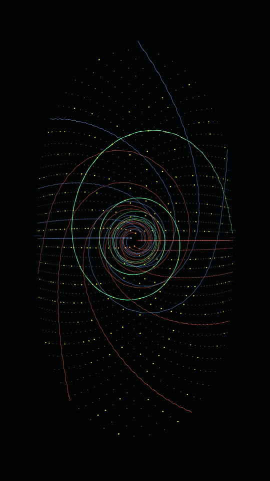
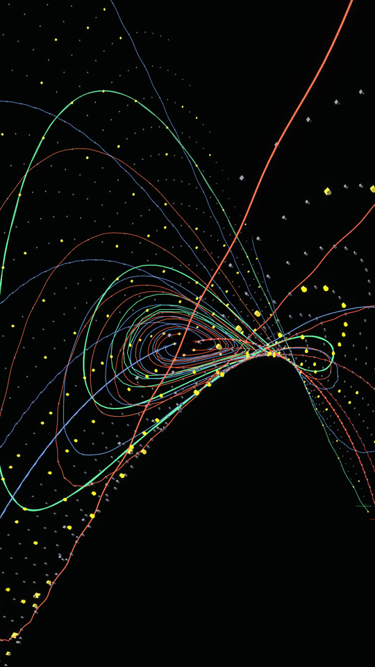

**The crossing law for Euler's line.** The candidate line `E(k) = k² + k + 41` is prime for `k = 0 … 39`. Beyond
that it is cut by the curves, and the cuts come in two exact families (checked for every `k ≤ 120`):

| family | where | what the value is | first cases |
|---|---|---|---|
| I  | `k = 40 + j²` | `E(k) = E(j − 1) · E(j)` — two *neighbouring* values of the same line | 40 (41·41), 41 (41·43), 44 (43·47), 49 (47·53), 56, 65, 76, 89, 104 |
| II | `k = 2i² + i + 81` | `E(k) = E(i) · D(i)` with `D(j) = (2j)² + 163` the *sister line* | 81 (41·163), 84 (43·167), 91 (47·179), 102, 117 |
| II | `k = 2i² + 3i + 82` | `E(k) = E(i) · D(i + 1)` | 82 (41·167), 87 (43·179), 96 (47·199), 109 |

These 18 are *all* the composites with `k ≤ 120`; there is no third family that low. Family I sits on the
curve `C_2j`, family II on curves with `d ≥ 122`, which is why its cuts look like long straight chords coming in
from the sister line.

**Why those and nothing else.** `E(k)` is the norm of `(2k + 1 + √−163)/2` and `D(j)` is the norm of
`2j + √−163` in the ring `Z[(1 + √−163)/2]`, which has unique factorisation (class number one, the reason
Euler's polynomial works at all). A value is composite exactly when its element factors in the ring, and a
product of two elements lands back on Euler's row only when their rows add up to one: row 1 × row 1 with
conjugation (family I), or row 1 × row 2 (family II). So the "cancellation curves" that matter for a
prime-generating line are not arbitrary: they are the multiplication table of one quadratic ring, and the
sister line `D` is that ring's second row. The sister line is itself prime for `j = 0 … 19` (163, 167, 179, 199,
227, …, 1459), for the same reason the Euler line is.

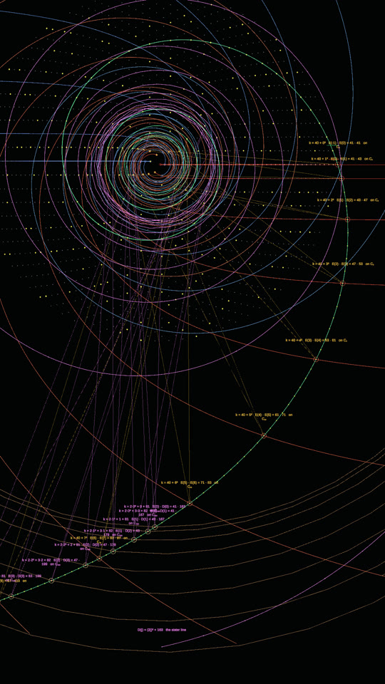
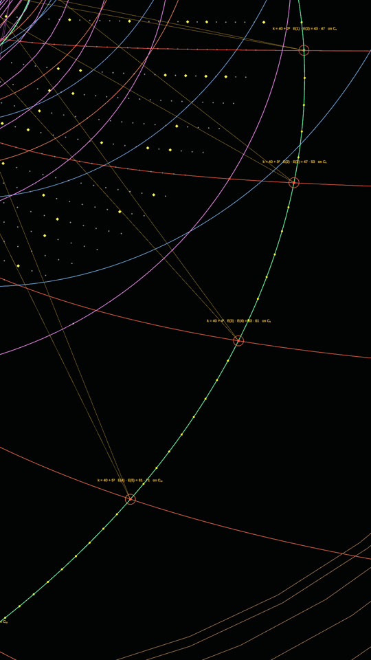

**What this does and does not give you.** Intersections with the curves *are* the composites, by definition, so
"eliminate candidates at the intersections" is the sieve itself, restated geometrically. What is new in the
picture is the bookkeeping: on a line of discriminant `−D` the intersections are indexed by the divisors of
`D + (2j)²`, so the first composites after the initial prime run are predictable without factoring anything
(family I needs no factoring at all: it is a square-indexed rule). It does not give a prime test, because
deciding whether `(2k + 1 + √−163)/2` factors is exactly as hard as factoring `E(k)`.

## A2. The zeta wave along Euler's line

The master wave of the final chapter, `−Σ cos(γ · log n)` over all 10 000 zeros, evaluated along the line
`n = k² + k + 41` instead of along the spiral. The explicit formula says this sum spikes at prime powers and dips
between them; along Euler's line it should therefore be a comb of upward spikes for `k ≤ 39` and show holes at
the family I and II crossings.

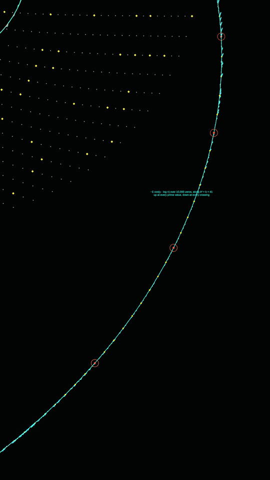

It does: every prime value carries a spike and every composite a trough, with no extra structure. The zeros
know nothing about `√−163`; they simply mark primes, and the line's own algebra decides where the primes stop.
The two descriptions agree point by point, which is the honest content of "the zeros encode the primes".

## C. Composite depth, and whose clock the saddle is

**Depth bars.** A bar at every composite of height proportional to the number of cancellation curves through it
(number of divisors up to `√n`, minus one). Primes are flat. The tall bars collect on the squares ray and the
pronic ray and along the straightened curves, the familiar Sacks "composite lanes".

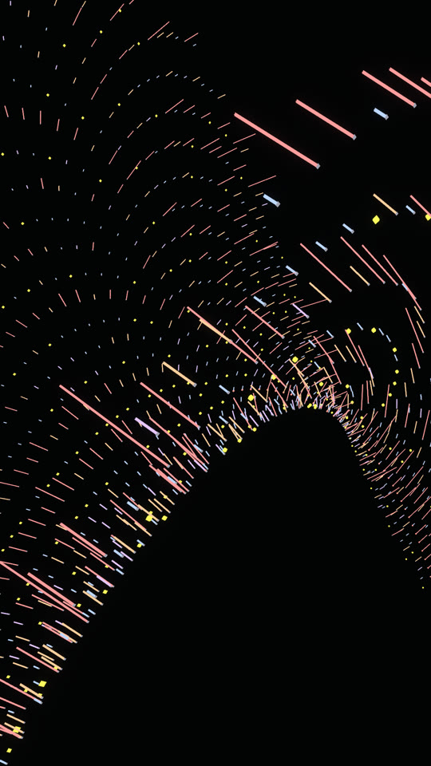

**Voronoi's formula.** Summing the depth over all `n ≤ x` gives the divisor staircase `Σ d(n)`, whose smooth part
is `x log x + (2γ − 1)x` and whose wobble `Δ(x)` has its own explicit formula (Voronoi, 1904):

    Δ(x) ≈ (x^¼ / π√2) · Σ_n d(n) n^(−3/4) cos(4π√(nx) − π/4)

The waves in this formula tick with `√x`, which is exactly the Sacks clock (`2π√n` per turn), the way the prime
staircase's waves `cos(γ log x)` tick with the log clock. The first harmonic alone is `cos(4π√x − π/4)`: two
oscillations per turn of the spiral. The saddle height is `z ∝ x² − y² = r² cos(2φ) = n · cos(4π√n)`: the same
two oscillations per turn, an eighth of a turn ahead in phase and with a steeper envelope. So the saddle the
spiral is bent on is not decoration: up to that phase and envelope it is the leading wave of the divisor
function's explicit formula, the `ζ²` analogue of the master cosine wave.

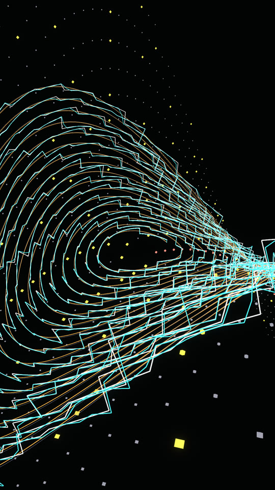
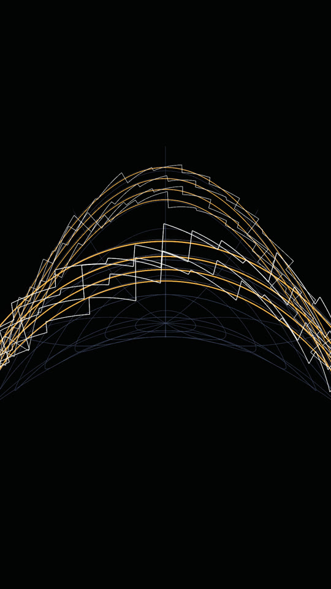

White: the exact `Δ(x)` for `9 ≤ x ≤ 400`. Cyan: 3 000 terms of the Voronoi sum. Orange: the first harmonic.
The second picture keeps only the first harmonic on the three outer turns, over a wire of the saddle, so the
ribbon's two oscillations per turn can be compared with the surface's own. The truncated sum tracks the sawtooth
closely but not exactly (it converges only conditionally; at `x = 400.3` it gives 7.09 against the exact 7.50),
so this is an illustration, not a proof of anything.

## D. The zeros on their own Sacks spiral

The Sacks spiral is an Archimedean spiral in the clock `√n`: whole clock values (the squares) line up on one
ray. The zeros have a clock too, `G = θ(γ)/π + 1` with `θ` the Riemann–Siegel phase; its whole values are the
Gram points. Plotting zero `j` at radius `√G` and angle `2πG` puts the Gram points on a ray, the analogue of the
squares ray.

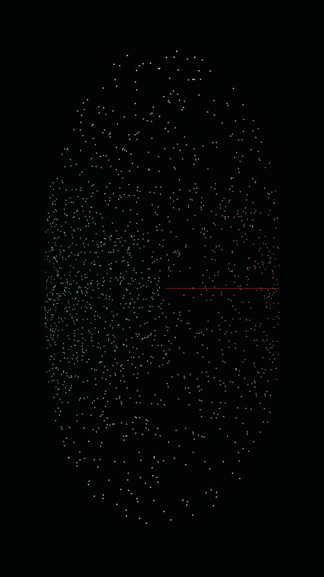

For the first 1 600 zeros the ray is visibly thinner than its surroundings but not empty: the fractional part of
`G` has decile counts (first 4 000 zeros) of 278, 321, 397, 467, 538, 525, 513, 384, 315, 262. Zeros avoid Gram
points about as mildly as primes avoid the neighbourhood of squares, and the 277 Gram-law exceptions among the
first 4 000 zeros are the ones that stray onto the ray. The analogy is real but weak; it does not make the Gram
ray a "cancellation curve" for zeros.

## E. Anatomy of the chain at one dial value

The partial sums `Σ n^(−½−it)` at a fixed `t`, flat, with the structure the dial produces as `n` grows:

* the turn per link is `t/n`; where it is a multiple of `2π` consecutive links align into a straight **spoke**,
  at `n = t/2πk`; where it is an odd multiple of `π` they fold into a **knot**, at `n = t/(2k + 1)π`;
* the spokes are the mirror images of the integers `k` and the knots of the half-integers under the
  Riemann–Siegel reflection `n ↔ t/2πn`; vortex `k` (between spoke `k + 1` and spoke `k`) holds `t/2πk(k + 1)`
  links, an inverse-square count, and turns through `t · log(1 + 1/k)` radians, a logarithm;
* past the last spoke (`n > t/2π`) the links turn less than a full circle each and the chain spirals outward
  around `ζ(½ + it)` itself. At a zero that centre is the origin; between zeros it is off-centre; at a Gram point
  it lies on the real axis.

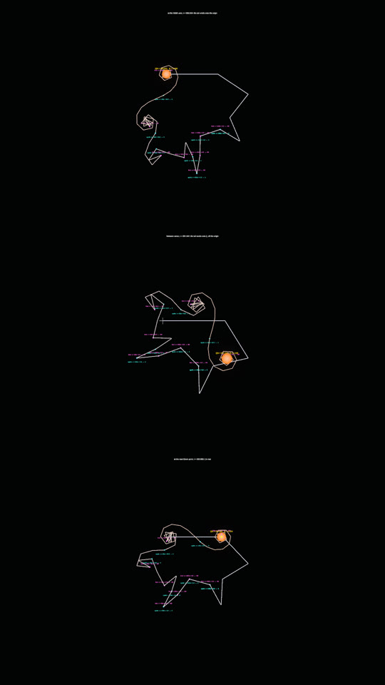

The "inverse squares, logarithms and number of turns" are therefore not three mysteries but one: the chain's
turn per link is `t / r²` where `r = √n` is the Sacks radius of that integer (Kepler's area law with angular
momentum `t`), and integrating `t/r²` over links is what produces the logarithm `t · log n`.

## F. One zero's crests on the spiral

The wave of a single zero, `cos(γ log n)`, crests at `n_k = e^{2πk/γ}`. On the spiral the winding angle of
crest `k` is `φ_k = 2π e^{πk/γ}`: a geometric progression, i.e. the crests are *equally spaced in the logarithm
of the winding angle*, with spacing `π/γ`. Between crests the ribbon makes `γ/(π√n)` oscillations per turn, so at
`n = (γ/πm)²` the crests line up into `m` radial arms (white rings). Those radii form an inverse-square ladder in
`m`, and between rungs the arms twist into spirals, the "vortices" visible in the full interference picture.

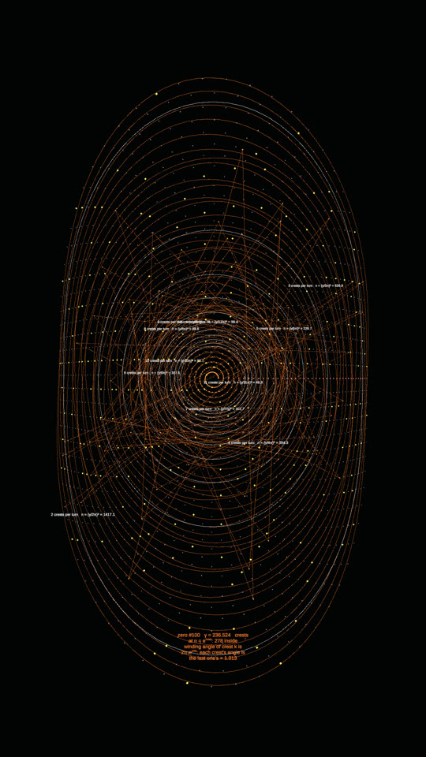
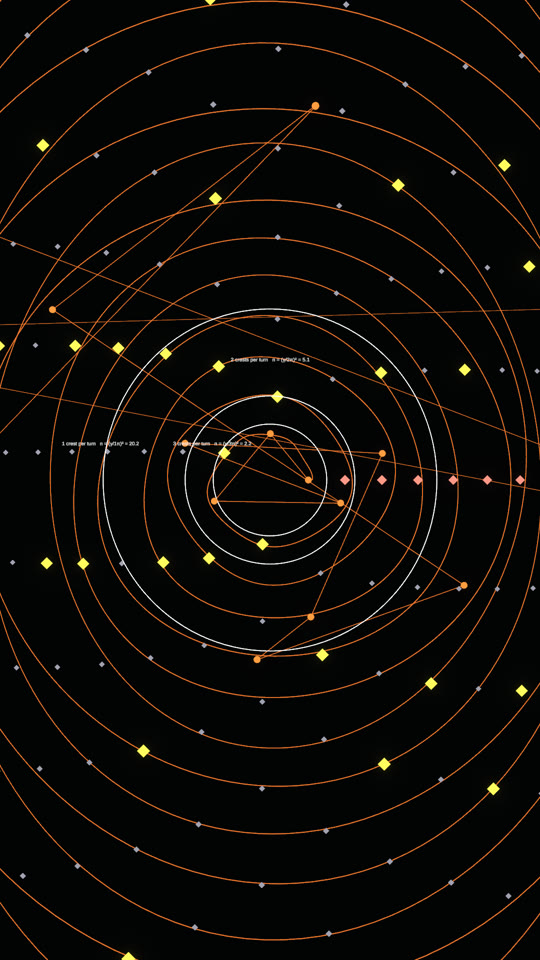

So each zero draws its own set of nested spiral arms on the saddle; the master wave is their superposition.
The arms are a moiré between the spiral's `√n` clock and the zero's `log n` clock. They are real geometry of the
drawing, not of the primes: the primes appear only when thousands of these patterns are added (section G).

## G. The truncated explicit formula on the number field

Every number coloured by `−Σ_{z≤K} cos(γ_z log n)` (gold up, blue down, each disc scaled to its own extreme),
for `K` = 1, 3, 10, 100, 1 000 and 10 000 zeros on the saddle, then nine such discs stacked (flat, so the
layers read as layers).

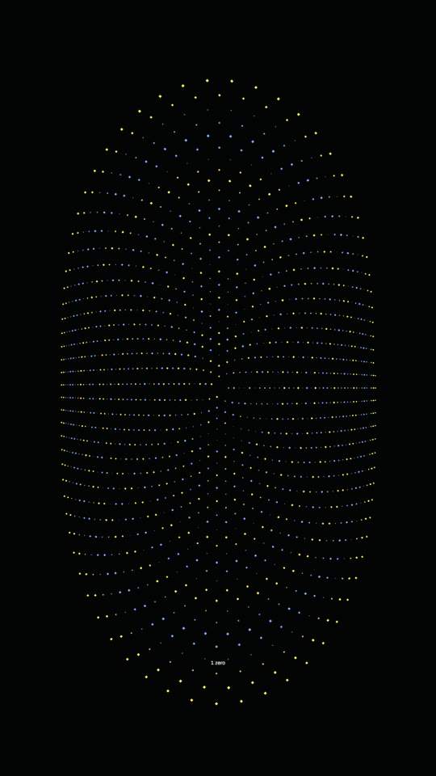
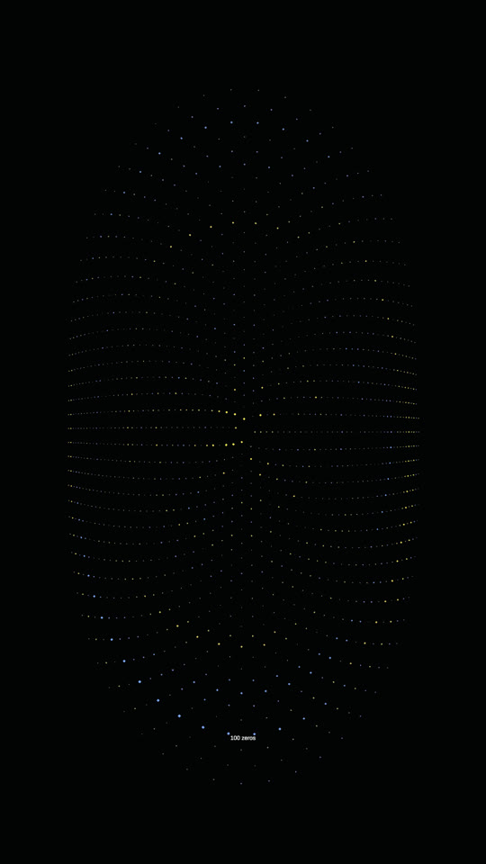
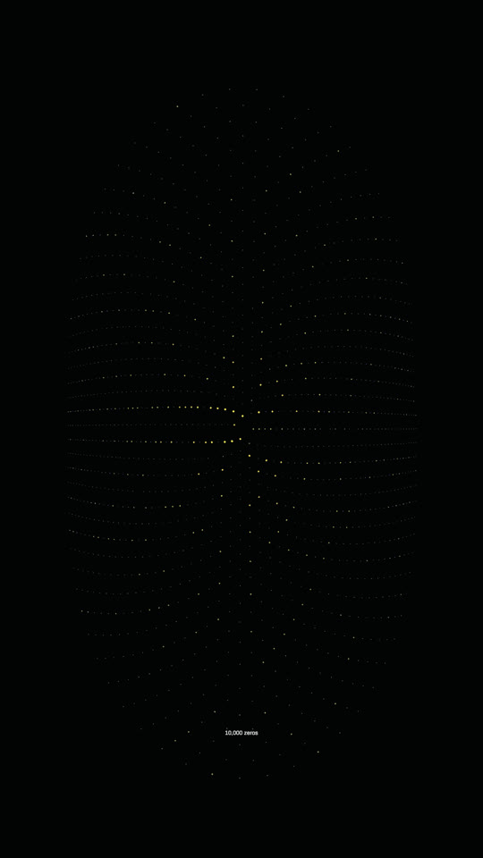
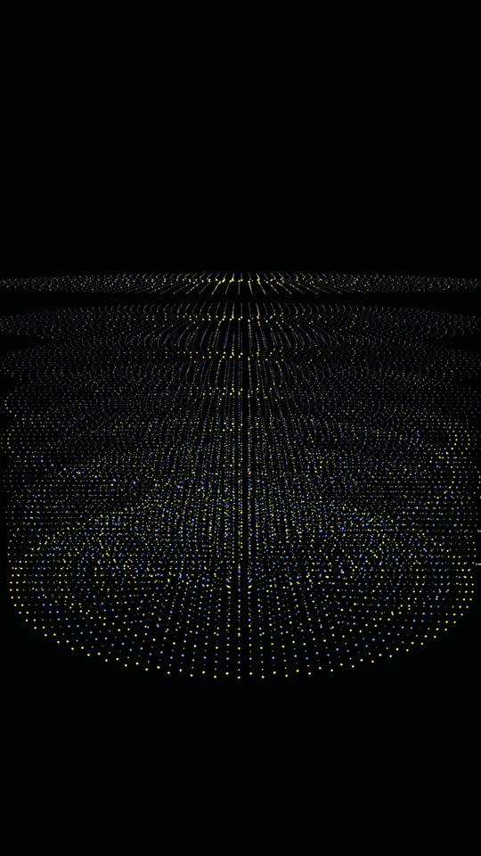

With one zero the field is the moiré of section F; with ten it is a tangle of arms; by a hundred the gold
begins to settle on the prime dots; by ten thousand almost nothing but primes and prime powers is gold. Looking
down the stack is watching the explicit formula converge: the vortex structure is what the first few zeros
know about the primes, and it is erased, arm by arm, by the next ones.

## H. Cross sections of the saddle

*Orientation.* Height is measured toward the trail, the tour's up (`−z`). Seen that way the saddle falls away along
`±x`, where the squares and pronic rays run, and rises along `±y`, where the one-to-four products climb. An earlier
version of this page called the x axis the ridge and the y axis the valley, which is how the surface looks from the
other side (`+z`, the side the tour's saddle wire is labelled from); the pictures here are taken from the trail's side.
The narrated Experiments modules keep the recorded ridge/valley wording, which is the `+z` reading.

The saddle is `z = b · K (x² − y²)` with the bend `b` (1 in the tour, 0 flat). Its sections by the three
coordinate planes are a parabola falling away from the trail (`y = 0`), a parabola rising toward it (`x = 0`), and hyperbolas
(`z = h`), with the two diagonals at `z = 0`. What each plane collects, exactly:

| plane | saddle section | numbers in it | product curves that run along it | zeta trail pierces it at |
|---|---|---|---|---|
| `y = 0` (x axis, falls away) | `z = bKx²` | the squares (`+x`), the pronic numbers (`−x`) | every 1:1 product `u(u + d)` (all the cancellation curves) | the **Gram points** (`ζ` real, `θ = mπ`) and the zeros |
| `x = 0` (y axis, rises) | `z = −bKy²` | `√n ≡ ¼` and `¾`: `u(4u + 1)` on `+y`, `u(4u + 3)` on `−y` | the 1:4 products with odd gap | the **half-Gram points** (`ζ` imaginary, `θ = (m + ½)π`) and the zeros |
| `z = 0` (level) | the diagonals `y = ±x` | `√n ≡ ⅛, ⅜, ⅝, ⅞` | the 1:16 products with odd gap, `u(16u + d)` | the trail's foot, `t = 0` |
| `z = h` (level) | hyperbola `x² − y² = h/bK` | all `n` with `n · cos(4π√n) = h / bKR²`: one contour of the Voronoi harmonic | cut once each, near `n ≈ h/bKR²` on the x axis | one dial value, `t = −4h` (planes above the centre only) |

The general rule behind the middle column: a product `u(q²u + d)` has `√n ≈ qu + d/2q`, so it straightens
along the ray at angle `2π · d/2q`. `q = 1` gives the two x-axis rays, `q = 2` the two y-axis rays, `q = 4` the
four diagonals. The bend does not move any of this (the planes `x = c`, `y = c` cut the same numbers at every
bend); it only decides how steeply the x-axis family falls away and the y-axis family rises, and which contour a level
plane picks: raising the bend from ¼ to 2 pulls the `z = −15` contour in from `n ≈ 1370` to `n ≈ 170`, so a
fixed plane sweeps inward through the one-to-four family and reads off where each curve crosses that height.

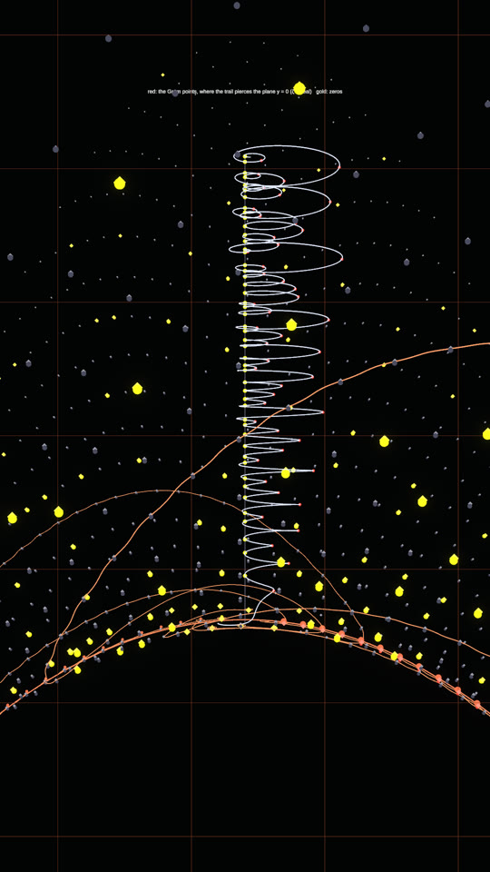
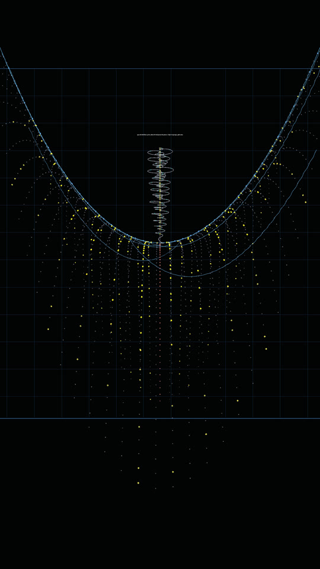
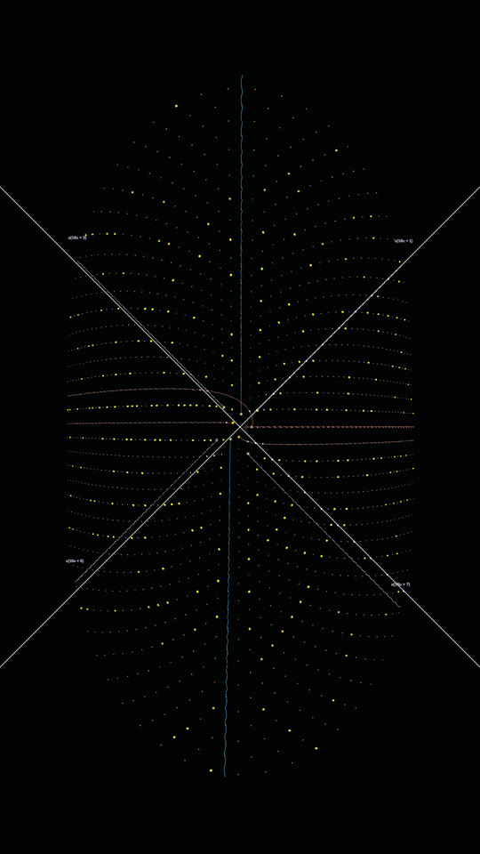

The trail column is the one worth keeping. `ζ(½ + it) = Z(t) e^{−iθ(t)}` with `Z` real, so the trail crosses
the x-axis plane exactly when `sin θ = 0` (the Gram points) and the y-axis plane exactly when `cos θ = 0`. The
coordinate planes of the saddle are therefore the Gram planes of the trail, and the correspondence

| Sacks spiral, clock `√n` | zeta trail, clock `θ/π` |
|---|---|
| squares and pronics: `√n ≡ 0, ½` (x-axis plane) | Gram points: `θ/π ≡ 0` (x-axis plane) |
| `u(4u + odd)`: `√n ≡ ¼, ¾` (y-axis plane) | half-Gram points: `θ/π ≡ ½` (y-axis plane) |
| `u(16u + odd)`: `√n ≡ odd/8` (diagonals) | `θ/π ≡ ±¼`: quarter-Gram points |

is exact, not a metaphor: both are "where the clock reads a whole or half value". Section D is the same
correspondence seen from above.

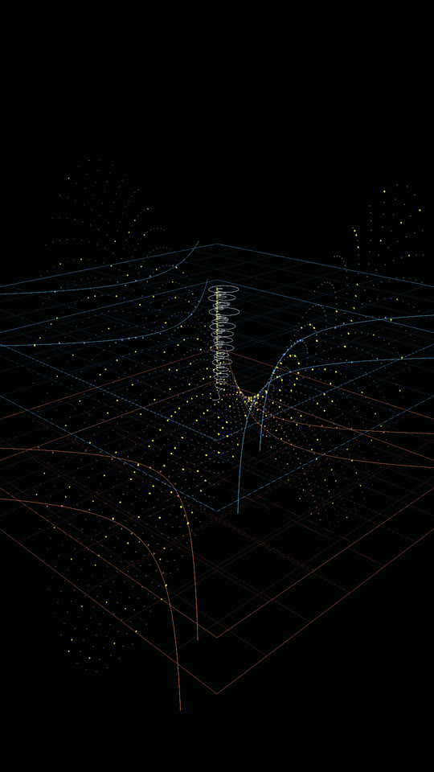
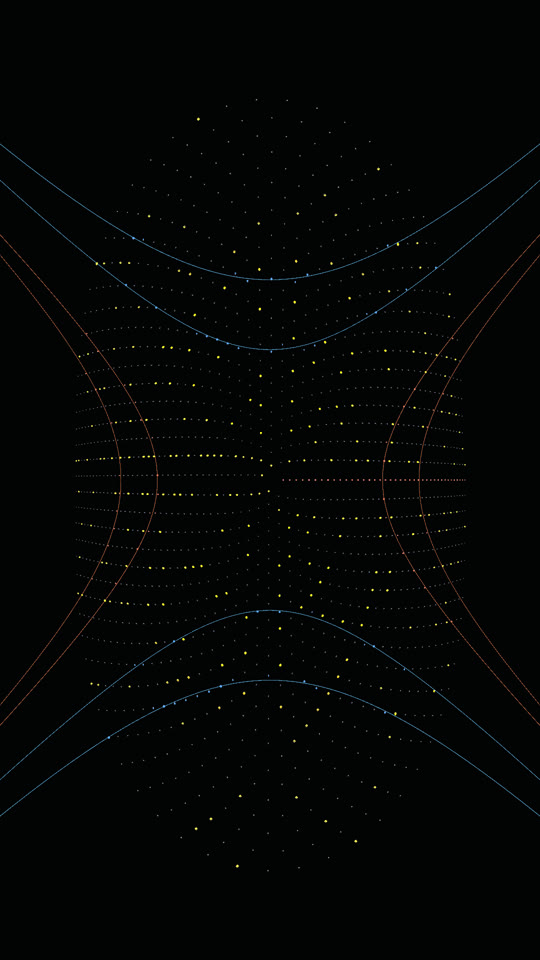
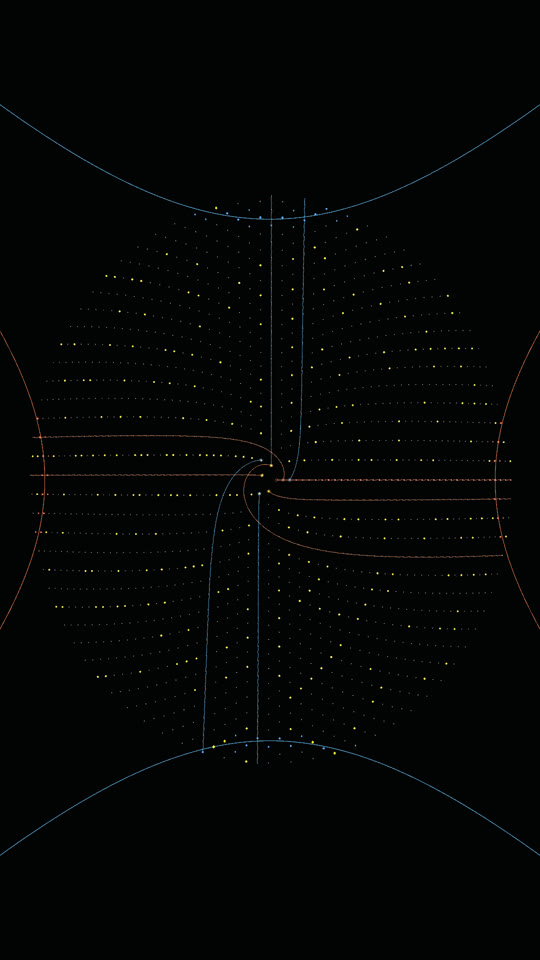
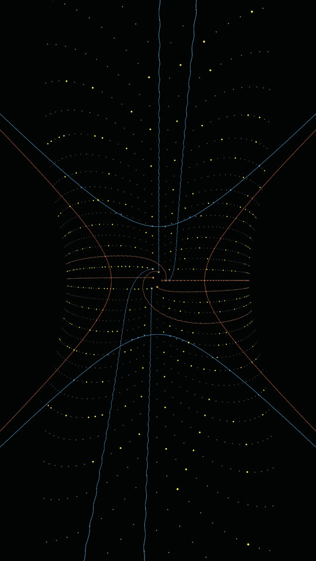

**Unconventional spatial readings that fall out of the sections.**

* *The two clocks as two axes.* Unroll the spiral into a chart with `√n` along `x` (turn count) and the position
  within the turn along `y`. The saddle depends only on `y` (falling away at 0 and ½, rising at ¼ and ¾, horizontal
  stripes); a zero's wave depends only on `x` (its crests are the log-spaced vertical lines); the cancellation
  curves are the `1/u` hyperbolas converging to the stripes at 0 and ½, and Euler's line converges to the pronic
  stripe from above. The primes are the gold points no hyperbola passes through. The chart makes "the √ clock
  and the log clock are orthogonal" literal.

  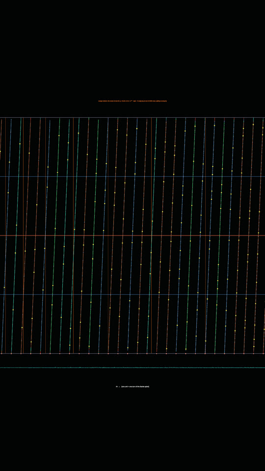

* *The saddle is doubly ruled.* `z = K(x − y)(x + y)`, so every vertical plane `x − y = a` (or `x + y = a`) cuts the
  saddle in a straight line. The sections along the diagonal directions are the only straight ones.
* *The saddle height is a Lorentz invariant.* A hyperbolic rotation of the plane (`x, y → x cosh a + y sinh a,
  x sinh a + y cosh a`) preserves `x² − y²`, so it slides every number along its own level hyperbola without
  changing its height: the level sets of the saddle are boost orbits, and the Voronoi harmonic
  `n cos(4π√n)` is the invariant.
* *Inversion.* Inverting the plane in the unit circle (`r → 1/r`) sends the straightened cancellation curves
  `y = −πd²/4` to circles through the origin of diameter `4/πd²`: an inverse-square family of circles, all tangent
  at the origin, and it puts the integer `n` at radius `1/√n`, which is the length of the chain's `n`-th link. The
  chain's inverse-square-root link lengths and the Sacks radii are the same numbers seen from the two sides of
  the unit circle.

**Double cancellations.** A number on two cancellation curves is more composite, not less, so no intersection
of product curves ever reverts to a prime. But the *bookkeeping* of the sieve does flip sign at intersections,
and that sign is where the zeta function re-enters. Legendre's count of primes strikes every multiple of each
small prime, then restores every number struck twice (two distinct prime factors), strikes again those struck
three times, and so on. The net sign at `n` is the Möbius function `μ(n)`: `−1` on a prime, `+1` on a product of
two distinct primes (struck twice, restored once), `−1` on three, `0` whenever a prime factor repeats. On the
saddle that is a four-colour field (gold, cyan, magenta, dark), and its running total `M(x) = Σ μ(n)` is the
Mertens function, whose size is equivalent to the Riemann hypothesis (`M(x) = O(x^{½+ε})`). Its Dirichlet series
is `1/ζ`: the "restored" numbers are exactly the ones that make the inverse chain converge where the chain
itself diverges. Up to 1 601 the field has 252 primes, 450 cyan restorations (plus 34 numbers with four distinct primes, also
`+1`), 241 magenta triples and 623 dark numbers, and `|M(x)|` never exceeds `√x`.

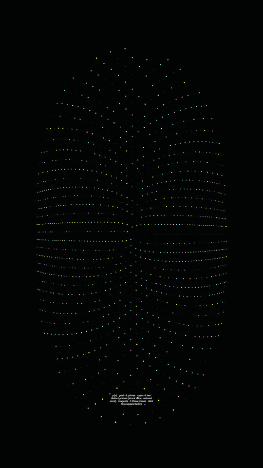
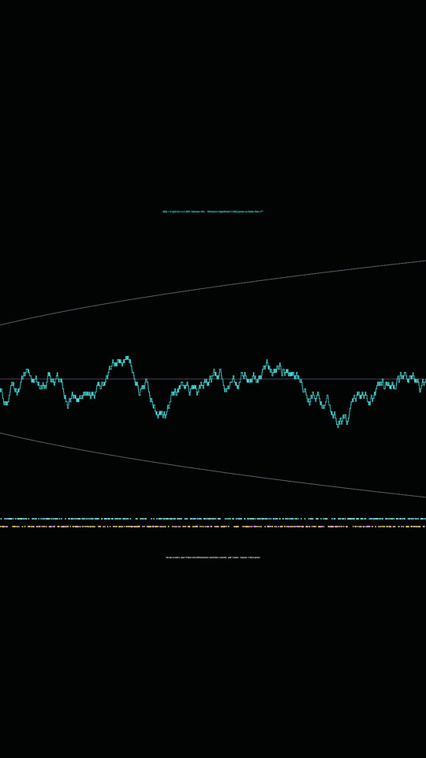
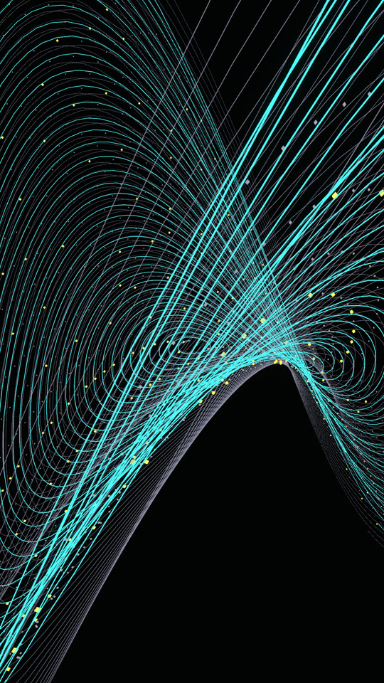

## I. The vortex eyes of the chain, traced through the zero planes

**Detection.** At a dial value `t` the chain's `n`-th link turns by `−t · log(1 + 1/n)`, reduced to `(−π, π]`. The
detector uses nothing else: a *knot* is where that turn flips through `±π` (the chain folds back on itself), a
*spoke* where it flips through `0` (the chain runs straight). Each knot is the eye of one vortex; the vortex's
extent is the stretch between the spokes on either side; its certainty is `1 − e^{−L/6}` with `L` the number of
links in that stretch turning by more than half a radian. A vortex drawn by two links is faded to black, one
drawn by thirty is at full colour. The eye is the mean of the four vertices around the knot. Vortex `k` is the
one whose knot sits near `n = t/(2k + 1)π`; vortex 0 is the tail. This was run at all 10 000 zeros in the table
(199 096 vortices, `k ≤ 12`), and the detector's output is written to `vortices.csv` beside the frames.

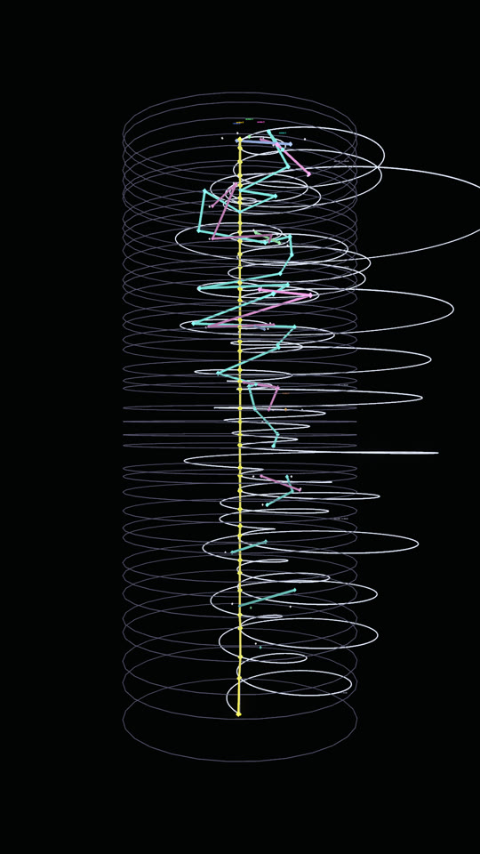
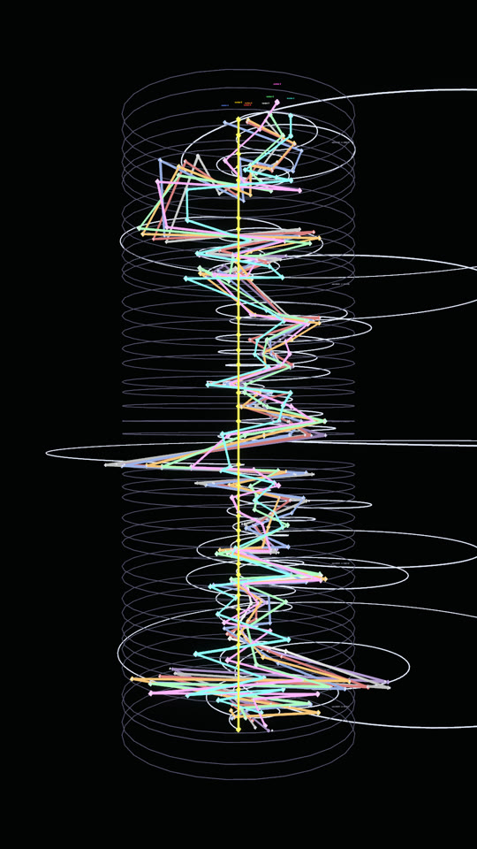

**What the traces do.** Colour is the vortex index, brightness its certainty, each zero is a plane, the white
curve is `ζ(½ + it)` threading the planes through their centres. Vortex 1 (cyan) winds once around the axis per
zero on a circle of radius exactly one; vortex 2 (magenta) rides an epicycle on it; the higher vortices are
dimmer, more erratic, and farther out.

**The law behind it.** The eyes are not new information. At every zero, to the accuracy of the detector,

    eye_k(γ) = −e^{−2iθ(γ)} · conj(S_k(γ)),       S_k = Σ_{n≤k} n^{−½−iγ}

the eye of vortex `k` is the chain's own `k`-th vertex, reflected (conjugated and turned by twice the
Riemann–Siegel phase). Off a zero the same holds with `ζ(½ + it)` added. This is the approximate functional
equation `Σ_{n≤x} n^{−s} ≈ ζ(s) − χ(s) Σ_{m≤t/2πx} m^{s−1}` read at the knots, where the dual cutoff `t/2πx = k + ½`
falls exactly between integers and the equation is at its most accurate. The far end of the chain is the near
end in a mirror, vortex by vortex. Grey diamonds in the pictures are the mirror points; they sit inside the eyes.

| vortex `k` | zeros with `t < 1000`: median distance eye → mirror | zeros with `t ≥ 1000` |
|---|---|---|
| 1 | 0.001 | 0.000 |
| 2 | 0.005 | 0.000 |
| 5 | 0.036 | 0.001 |
| 8 | 0.127 | 0.003 |
| 12 | 0.193 | 0.009 |

The mismatch is entirely a matter of how many links draw the vortex: median 0.052 for vortices drawn by fewer
than three curling links, 0.017 for three to five, 0.002 for twelve to thirty, 0.000 beyond. The certainty
fade is therefore honest: faint eyes are the ones the mirror law places least well.

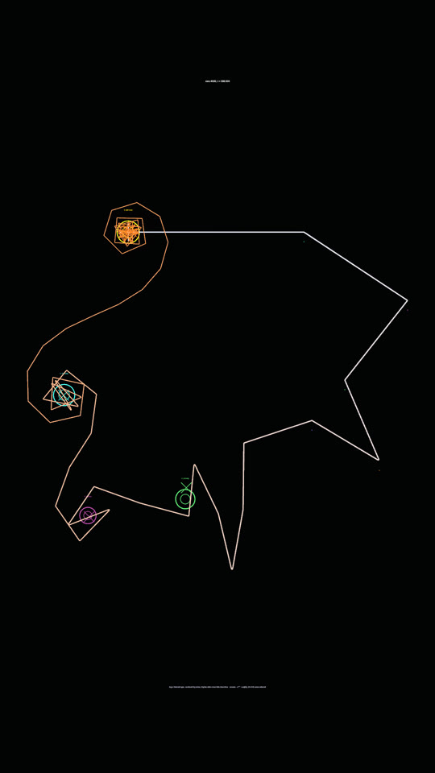
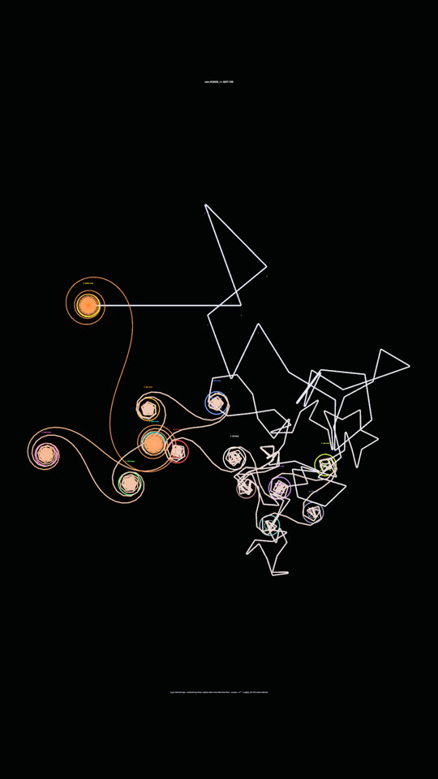

The three views down the axis are all 10 000 zeros at once: plain (every eye of vortices 1 to 12), with the Gram
phase taken out, and the same for vortices 1 to 4 only, where the point `−1`, the circle of radius `1/√2` and the
next epicycle stand out.

**Vortex 1 is the Gram clock.** With `S_1 = 1` the first eye sits at `−e^{−2iθ(γ)}`: on the unit circle (radius
1.000 ± 0.004 over 9 994 zeros, angle residual below 0.001 rad), at angle `π − 2θ(γ)`. Since `θ` advances by
about `π` per zero, the cyan trace is a helix with one turn per zero, and the amount by which its phase slips
from one zero plane to the next is the Gram offset of that zero: the eye angle reads the zero's position within
its Gram interval. Taking the Gram phase out (multiplying every eye by `e^{2iθ}`) collapses the whole tower onto
the chain's own first vertices: vortex 1 to the single point `−1`, vortex 2 to the circle of radius `1/√2` around
it, vortex 3 to an epicycle of radius `1/√3` on that, and so on.

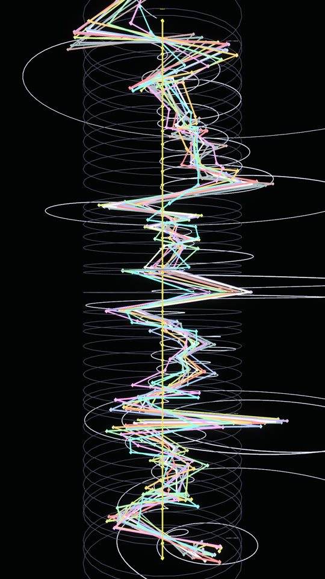
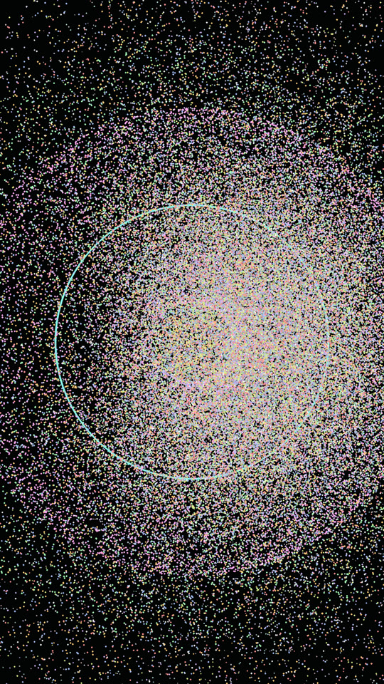
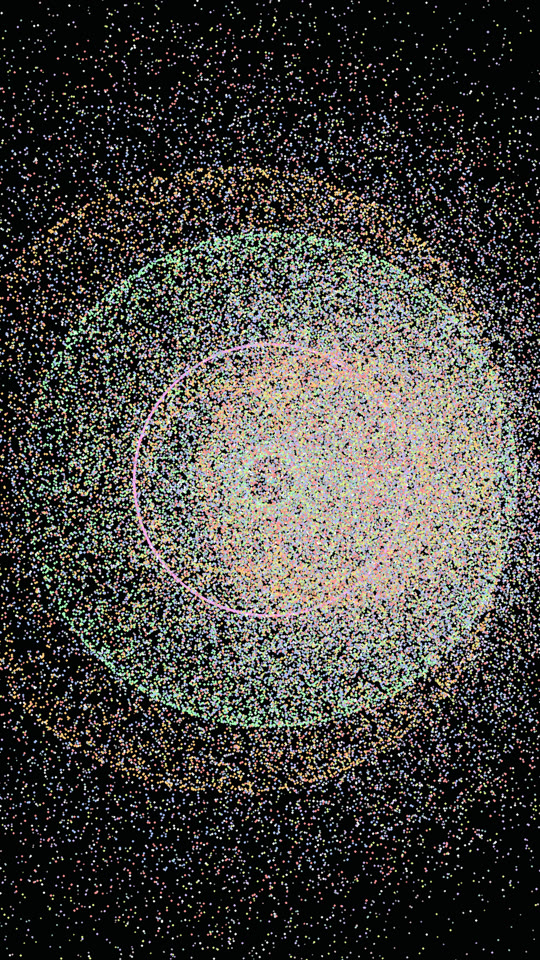
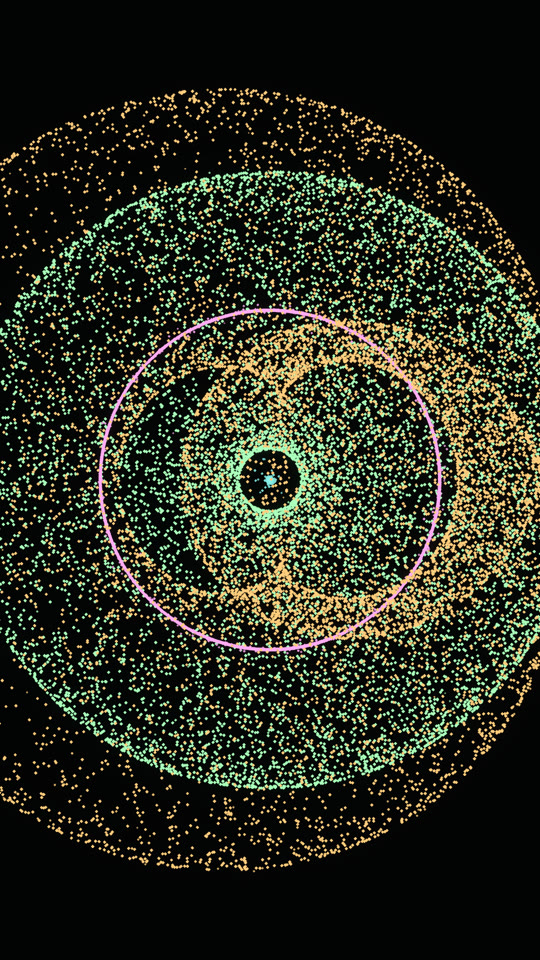

**Predictive structure.** Over the 10 000 zeros:

| correlation | value |
|---|---|
| Gram offset of zero `j` with the offset of zero `j + 1` | +0.02 |
| Gram offset of zero `j` with the spacing to zero `j + 1` (in Gram units) | −0.28 |
| spacing `j` with spacing `j + 1` | −0.37 |

So the eye angle at one zero plane (its Gram offset) says a little about where the next plane is, a zero late in
its Gram interval being followed by a shorter gap, and consecutive gaps alternate, which is the repulsion of the
zeros that random-matrix statistics predict. It says nothing about the next zero's own offset. Everything the
vortex eyes carry is `θ(γ_j)` and the first dozen terms of the chain, which are the same functions of `γ_j` the
chain started from; the picture is a faithful mirror, not an oracle. What it does give is a clean geometric
object: the chain's far end is its near end reflected through the Gram phase, and the helix of the first eye is
the zeros' Gram clock drawn as a curve through the planes.

## J–O. Sections, second round: the discriminant law

**One law organises every section below.** A quadratic `n = q²k² + Bk + C` traces a curve on the Sacks spiral.
Far out, the curve straightens into a line pointing `B/2q` of a turn round, at perpendicular offset

    offset = −πR · Δ / (4q²),        Δ = B² − 4q²C   (the discriminant)

from that ray. Checked numerically at `k = 10⁶` (`R = 1.45`):

| quadratic | Δ | direction (turns) | measured offset | predicted |
|---|---|---|---|---|
| `k² + 1` | −4 | 0 | 4.5557 | 4.5553 |
| `k² − 4` | 16 | 0 | −18.2218 | −18.2212 |
| `k² + k + 41` | −163 | ½ | 185.6290 | 185.6289 |
| `k² + k − 2` (the curve `C₃`) | 9 | ½ | −10.2505 | −10.2494 |
| `4k² + k + 5` | −79 | ¼ | 22.4925 | 22.4918 |
| `9k² + 2k + 7` | −248 | ⅓ | 31.3816 | 31.3810 |

So the direction of a line is set by `B/2q` and its distance from its ray by its discriminant. Three kinds of line
follow:

* **cancellation curves**: `Δ` a perfect square. The quadratic factors over the integers, so every value past the
  birth is composite. These are exactly the product curves `u(q²u + d)`.
* **prime curves**: `Δ` not a square. They carry primes at a rate fixed by `Δ` (below). `Δ < 0` puts them on the
  far side of the ray from the cancellation curves; `Δ > 0` puts them on the same side, in between the cancellation
  curves.
* **un-cancellation curves**: the mirror images of the cancellation curves, section L.

## J. Planes through the centre, rotated

A vertical plane through the centre at angle `α` cuts the saddle in the parabola `z = bK·t²·cos 2α`. The parabola
falls away from the trail for `|α| < 45°`, is a straight line at 45° (one of the saddle's rulings), and rises
beyond. Turning the plane sweeps the parabola from falling to straight to rising.

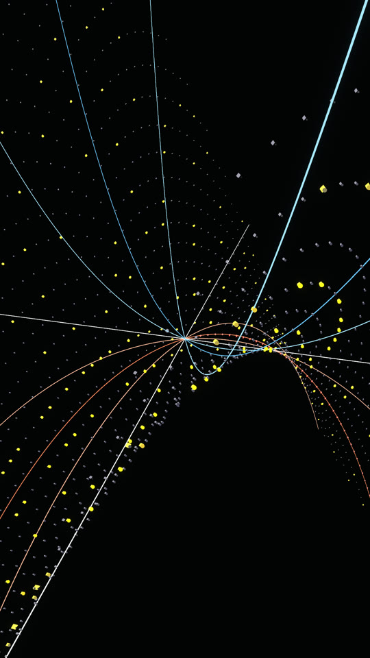
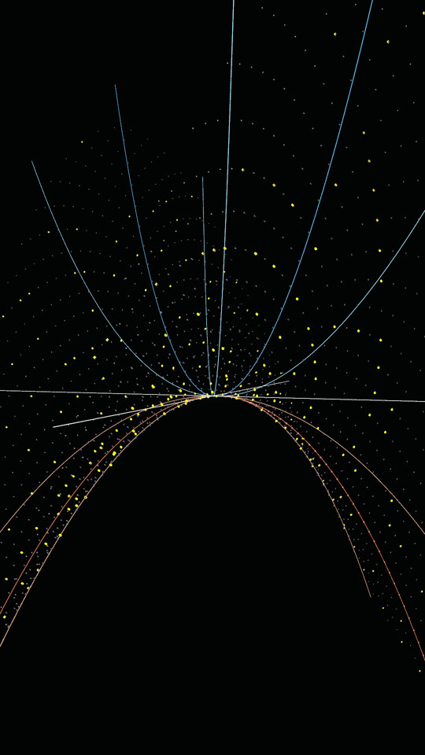

A plane at a rational angle `a/b` of a turn holds, far out, the families of that direction: `q²k² + Bk + C` with
`B/2q ≡ a/b`. At 90° that is `4k² + k + C` (up) and `4k² + 3k + C` (down); at 45° it is `16k² + k + C` and
`16k² + 5k + C`, which lie along the straight section. An irrational angle holds no family at all.

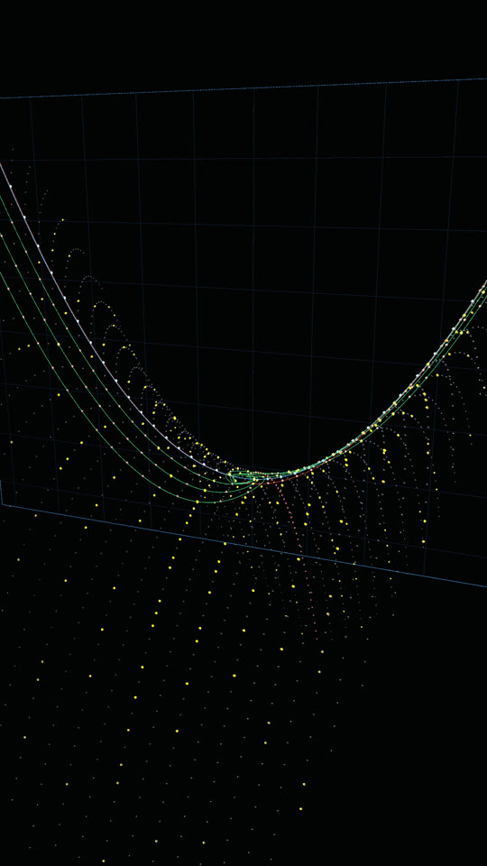
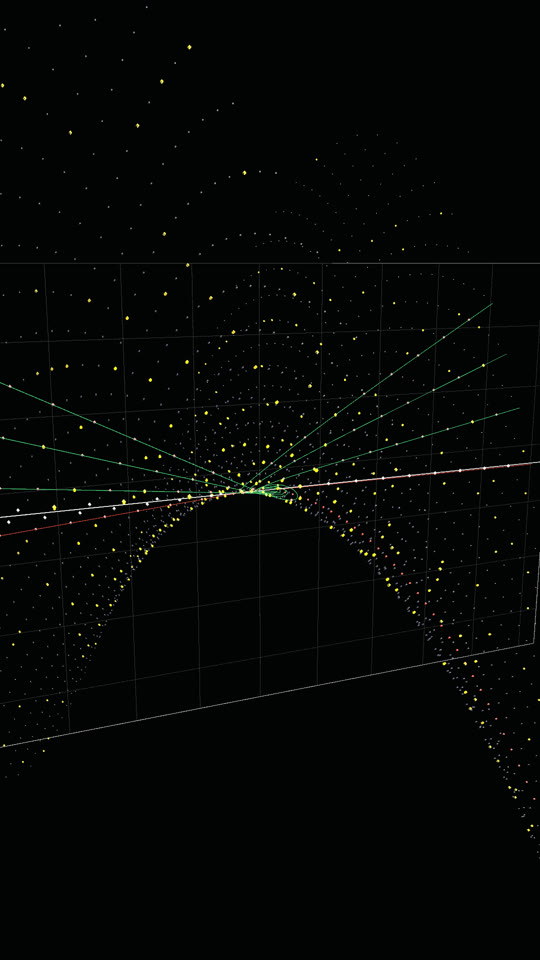

Counting the numbers in a thin strip around each plane (perpendicular half-width `R/2`, all `n ≤ 2·10⁷`):

| direction (turns) | numbers in the strip | primes |
|---|---|---|
| 0 (squares ray) | 4 420 | 0 |
| ¼, ¾ | 2 210 each | 0 |
| ⅓, ⅔ | 1 473 each | 0 |
| ⅛ | 1 105 | 0 |
| ⅙ | 1 473 | 0 |
| ⅕ | 884 | 0 |
| ⅜ | 2 210 | 155 (7.0 %) |
| ⅖ | 884 | 119 (13.5 %) |
| √2 − 1, π − 3, φ − 1 (irrational) | about 1 405 each | 110, 95, 89 (6–8 %) |

The strip at a small-denominator angle holds only the product line `k(q²k + B)`, which sits almost exactly on the
ray, so it holds no primes. At ⅜ and ⅖ a prime curve of the same family also falls inside the strip. An irrational
angle samples the numbers at random and gets the average prime rate. Rotating the plane therefore finds no
prime-rich direction. It finds prime-free rational directions, set by the product lines, and that structure fades
as the strip is widened.

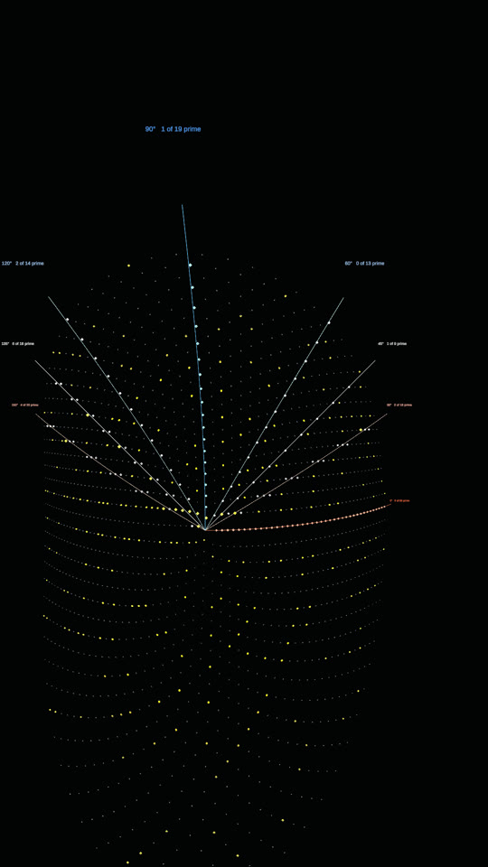

## K. Planes off the axis: the discriminant comb

Vertical planes parallel to the x axis, at `y = πR·C`, each hold **one** quadratic far out. On the `+x` side that is
`k² + C`. On the `−x` side, the plane at `y = −πR(c − ¼)` holds `k² + k + c`. Sliding the plane sideways steps
through the quadratics in order of discriminant. Each plane cuts the saddle in a parabola `z = bK(x² − y²)`
lowered by `bK·y²`, and its quadratic's values climb that parabola. In the pictures, red marks a curve that
factors, blue `Δ > 0`, and green `Δ < 0`.

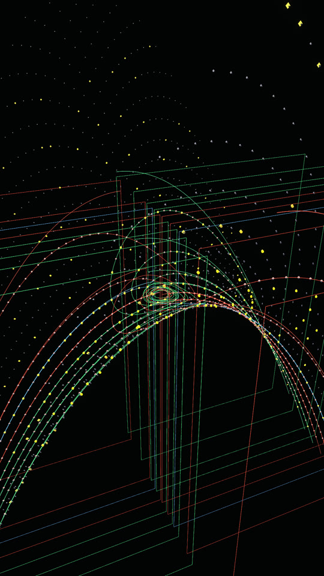
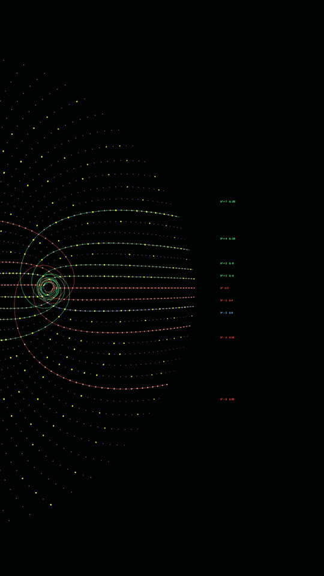
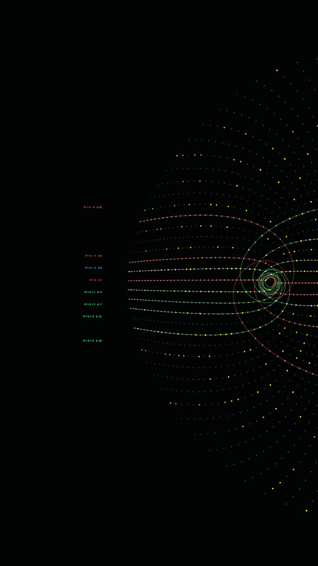

**How many primes each plane holds.** The prime count on every line from `C = −30` to `60`, for `k ≤ 3 000`, is
drawn as a column of bars, one per plane. Each bar is compared with the Hardy–Littlewood constant
`Π_p (1 − w(p)/p)/(1 − 1/p)`, where `w(p)` is the number of roots mod `p`. That constant depends only on the
discriminant through the Legendre symbols `(Δ/p)`.

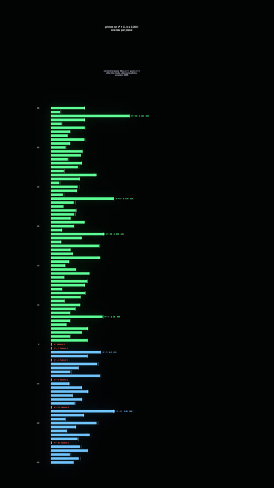
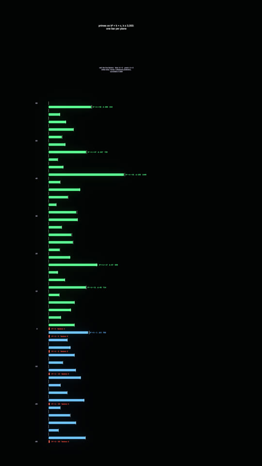

| line | Δ | primes, k ≤ 3 000 | Hardy–Littlewood |
|---|---|---|---|
| `k² + k + 41` (Euler) | −163 | 1 449 | 6.65 |
| `k² + k + 17` | −67 | 938 | 4.17 |
| `k² + k − 1` | +5 | 759 | 3.54 |
| `k² + k + 11` | −43 | 714 | 3.26 |
| `k² + k − 29` | +117 | 711 | 3.23 |
| `k² + 58` | −232 | 651 | 2.97 |
| `k² − 17` | +68 | 528 | 2.36 |
| `k² − 2` | +8 | 413 | 1.85 |
| `k² + 1` (Landau) | −4 | 303 | 1.37 |
| `k² + k + 2` | −7 | 1 (always even) | 0 |
| `k² − 1`, `k² − 4`, `k² + k`, `k² + k − 2`, … | squares | 0 or 1 (the birth) | 0 |

Over the 175 lines that do not factor, the counts and the constants correlate at 0.9995. Three findings,
honestly stated:

1. **Only the square discriminants are prime-free.** Every other plane carries primes, on either side of the ray.
2. **The side of the ray does not decide.** Lines with `Δ > 0` between the cancellation curves average 262–272
   primes, slightly *more* than the `Δ < 0` lines (221–224, whose values are larger). `k² + k − 1` (`Δ = 5`) beats
   Landau's `k² + 1` by 2.5 to 1.
3. **Euler's line is the record**, at the class-number-one discriminant −163. It is followed by −67, −43 and −19.
   This is Rabinowitsch's theorem made visible: `k² + k + c` is prime for all `k ≤ c − 2` exactly when `1 − 4c` is
   one of −3, −7, −11, −19, −43, −67, −163. The lines with an even `c` on the pronic side are always even, which
   is a second, 2-adic way to carry no primes.

## L. The mirror: un-cancellation curves

**Reflecting across the squares ray sends a line of discriminant `Δ` to the line of discriminant `−Δ`.** On the
`+x` side that maps `k² + C` to `k² − C`. The cancellation curves `k² − m² = (k − m)(k + m)` (`Δ = 4m²`) therefore
reflect into `k² + m²` (`Δ = −4m²`), the rows of the Gaussian integers. On the pronic side the mirror image of an
integer line falls between the integers, since an odd `−Δ` is not a discriminant. So only the squares side has
integer mirror images.

These mirror lines earn the name **un-cancellation curves**, because they turn the cancellation test inside out.
Every number has some pairs of them through it, one pair for each proper representation `n = x² + y²` with
`gcd(x, y) = 1`, lying on `k² + y²` at `k = x` and on `k² + x²` at `k = y`.

* **Exactly one pair ⟹ prime (power).** An odd number on exactly one pair is a prime power `pᵏ` with `p ≡ 1 (mod 4)`,
  and every prime `≡ 1 (mod 4)` is on exactly one pair. This is Euler's criterion. It held for every odd
  `n ≤ 200 000`, with no exception.
* **Two pairs ⟹ composite, and the factor falls out.** If `n = a² + b² = c² + d²`, then `gcd(n, ad − bc)` is a proper
  factor. Euler factored `1 000 009 = 1000² + 3² = 972² + 235² = 293 × 3413` this way. Below 1 601, 63 numbers sit on
  two or more pairs:

      1105 = 33² + 4² = 32² + 9² = 31² + 12² = 24² + 23²    gcd(1105, 33·9 − 4·32) = 13    1105 = 13 × 85
       221 = 14² + 5² = 11² + 10²                            gcd(221, 14·10 − 5·11) = 17    221 = 17 × 13
      1601 = 40² + 1²                                        one pair only                   prime

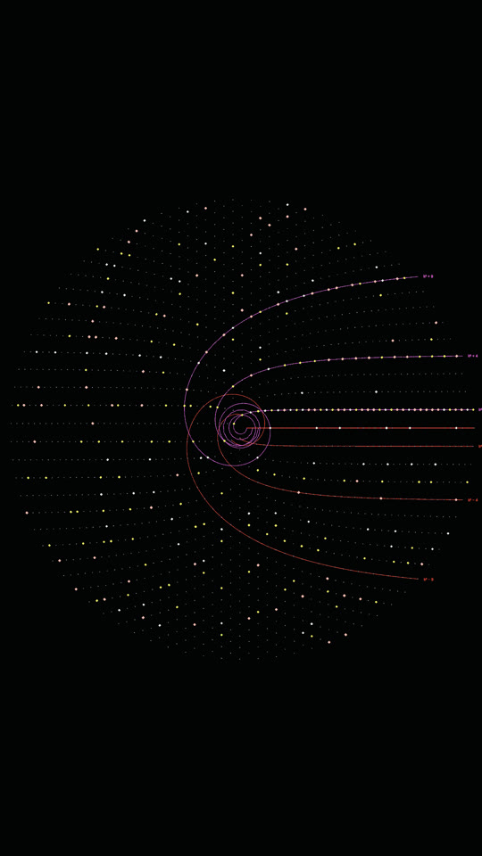
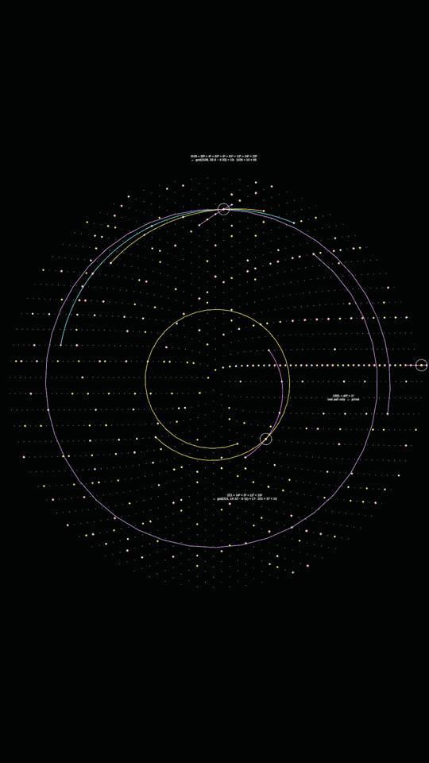

The same holds for the mirror images of `k² − N·m²`, the rows `k² + N·m²`, when `N` is one of Euler's 65 idoneal
numbers. It was checked for `N` = 1, 2, 3, 5, 6, 7 (odd `n ≤ 200 000`) and 1848 (`n ≤ 3 000 000`), with no
exception. It fails as soon as `N` is not idoneal: for `N = 11`, `15 = 2² + 11·1²` is composite with only one
representation, and there are 1 047 such failures below 20 000. Euler used `N = 1848` to prove `18 518 809 =
197² + 1848·100²` prime by finding it on exactly one line. The test is silent on primes that the form does not
represent, such as `p ≡ 3 (mod 4)` for `N = 1`.

**Fermat's method lives on the other side of the mirror.** Writing `n = u·v` puts `n` on the cancellation curve
`C_{v−u}`. Fermat's method starts at `⌈√n⌉` on the squares ray and steps outward until `m² − n` is a square, and
the number of steps is `(u + v)/2 − ⌈√n⌉ ≈ d²/8√n`. That is proportional to how far the curve through `n` sits from
the ray:

| n | factors | curve | Fermat steps |
|---|---|---|---|
| 1591 | 37 × 43 | `C₆` | 0 |
| 1003 | 17 × 59 | `C₄₂` | 6 |
| 1501 | 19 × 79 | `C₆₀` | 10 |

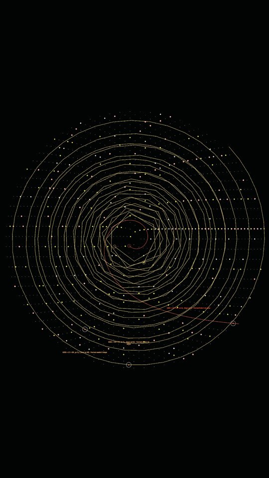

So the two classical factoring methods are the two sides of one mirror. Fermat looks for **one** cancellation curve
through `n`. Euler looks for **two** pairs of un-cancellation curves.

## M. The intersection atlas

Twenty-five curves were drawn: eight cancellation curves (`u ≥ 2`, so every value is composite), eleven prime curves
with `Δ < 0` (from `k² + 1` to Euler's) and six lines with `Δ > 0`. Every number that two of them share up to 1 601
is marked, gold if prime and red if composite.

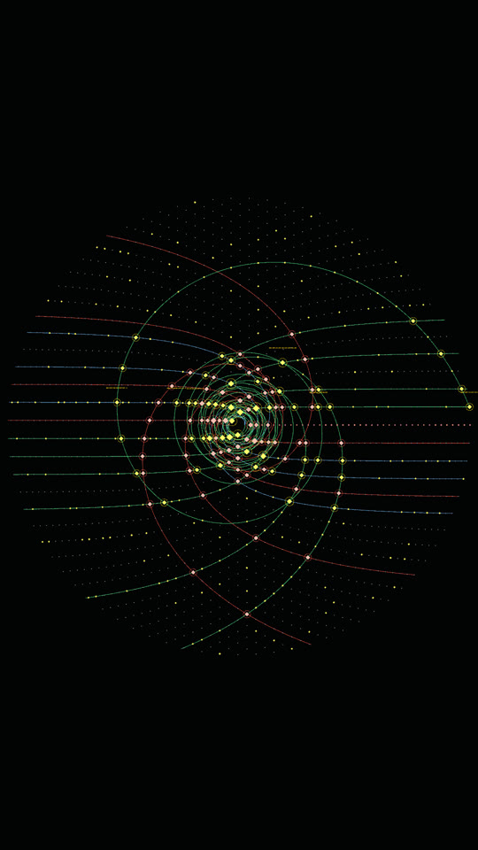
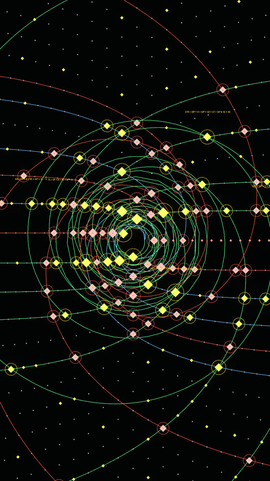

| pair of curves | meetings | prime |
|---|---|---|
| two prime curves (`Δ < 0`) | 72 | 66 |
| one curve that factors | 78 | 0 |
| other pairs (involving `Δ > 0`) | 94 | 74 |

In all there are 118 meeting points, 34 of them where three or more curves meet. **The law for every meeting point:**
two monic curves `f`, `g` share a value once for each factorization

    (2k + B_f − 2m − B_g) · (2k + B_f + 2m + B_g) = Δ_f − Δ_g

so a pair meets only finitely often, at points fixed by the divisors of the difference of their discriminants.

* Euler's line and Landau's `k² + 1`: the difference is `−159 = −3 · 53`, so they meet at exactly **197 and 1601**,
  both prime. 1601 is the last prime of Euler's run and the edge of the tour's spiral.
* Euler and `k² + k + 17` (difference −96): 47 and 173. Euler and `k² + k − 1` (difference −168): 41, 71, 131, 461.
  All are prime, because they fall inside Euler's prime run.
* A cancellation curve `C_{2j}` meets `f(k) = k² + C` exactly where `(u + j − k)(u + j + k) = f(j)`. The composite
  values of a line are coded by factorizations of the line's own values. The trivial factorization gives the
  identity `f(x + f(x)) = f(x)·f(x + 1)`, which holds for every monic quadratic and is family I of section A. For
  Landau's line, the even case is Sophie Germain's `4i⁴ + 1 = (2i² + 2i + 1)(2i² − 2i + 1)`. For Euler's line the
  values factored are `4E(j − ½) = 4j² + 163`, the sister line of section A.

## N. Tilted planes: hyperbolas off the axis

A plane `z = px + qy + d` cuts the saddle in

    bK (x − p/2bK)² − bK (y + q/2bK)² = d + (p² − q²)/4bK

a hyperbola centred **off the axis** at `(p/2bK, −q/2bK)`, with its axes still along x and y. Turning a plane of fixed
slope `s` about the vertical slides that centre round a circle of radius `s/2bK` (14.4 units for `s = 0.6`), and the
hyperbola never turns.

When the right side is zero the plane is tangent, and the hyperbola collapses into **two straight lines**. These are
the two rulings through the point of tangency: the saddle is doubly ruled, with every point on one straight line
in each diagonal direction. At 1601 the two lines pass within 0.9 units of 44 numbers, 5 of them prime, which is
the ordinary rate and nothing special. Far out, the rulings parallel to the diagonals are the homes of the
one-to-sixteen families `16k² + k + C`, at offsets `−πR(1 − 64C)/64` from the diagonal. The saddle's straight lines
carry those quadratics the way the axis planes carry `k² + C`.

## O. Twisting and folding the saddle

The surface was generalised to `z = bK · r² · cos(F·θ − τ·r)`: `F` folds and a twist `τ` per unit of radius. On the
spiral (`r = R√n`, `θ = 2π√n`) this becomes

    z = bK R² · n · cos((2πF − τR) · √n)

so **on the spiral, a twist is a change in the number of folds**: a twist of `τR = 2π(F − F′)` turns an `F`-fold
saddle into the `F′`-fold pattern. A non-integer `F′ = 2√m` is Voronoi's `m`-th harmonic `cos(4π√(mn))`, so the
divisor function's wobble is a sum of twisted saddles. The pictures use half the tour's bend so the twisted
surfaces stay in frame.

* `τR = 2π` (one fold on the spiral): the squares sit on the crests (`cos = 1`) and fall away, while the pronic
  numbers sit in the troughs and rise. The twist pulls apart the two cancellation families that the plain saddle
  keeps together.
* `τR = 4π` (no folds): every number is on a crest, and the whole spiral lies on the single bowl `z = bKR²n`.
* `τR = 4π(1 − √2)`: Voronoi's second harmonic. Its exact crest numbers are `2t²`, and in general `m·t²` for
  squarefree `m`.
* Four folds put the squares, the pronics and both one-to-four families on crests together. Three folds put the
  squares and the one-to-nine products `k(9k + 2)`, `k(9k + 4)` there.

Twisting and folding change which product families share a crest. They do not gather the primes: no surface of this
kind puts the primes on its crests, because the primes are spread over every family at that family's
Hardy–Littlewood rate.

## P. Two counting problems: the saddle and its half-twist

Two classical lattice-point counts both wobble, and each wobble is a sum of waves that tick with the Sacks clock
`√x`. The waves run at different speeds, and that puts the two problems on two different surfaces.

* **Divisors.** `Σ_{n≤x} d(n)` counts the lattice points under the hyperbola `uv = x`, one for each point of a
  cancellation curve. Around `x log x + (2γ − 1)x` it wobbles by `Δ(x)`. Voronoi (1904) wrote `Δ(x)` as a sum of
  waves `d(n) n^(−3/4) cos(4π√(nx) − π/4)` (section C). Each wave goes up and down **twice** per turn of the spiral,
  and the first one is the saddle.
* **Circles.** `N(x) = #{a² + b² ≤ x}` counts the lattice points in a disk, one for each representation
  `n = a² + b²`, which is one for each point of the mirror lines `k² + m²` (section L). Around `πx` it wobbles by
  `P(x)`. Hardy (1915) wrote `P(x) ≈ (x^¼/π) Σ r₂(n) n^(−3/4) cos(2π√(nx) − 3π/4)`. Each wave goes up and down
  **once** per turn, and the first one lives on the saddle twisted half a turn per turn (section O's `τR = 2π`).

The charts plot `√x` from 3 to 20 along the bottom, with one faint line per turn of the spiral. White is the exact
wobble, cyan the sum of 3 000 waves, orange the first wave alone.

| problem | 3 000 waves, correlation with the wobble | first wave alone |
|---|---|---|
| divisors, `Δ(x)` | 0.968 | 0.194 |
| circles, `P(x)` | 0.988 | 0.589 |

The first wave of the circle problem carries much more of its wobble than the divisor problem's first wave does,
because `r₂(1) = 4` while `d(n)` keeps growing.

On the surfaces, the divisor problem's first wave rides the plain saddle, crossing each turn twice. The circle
problem's first wave rides the half-twisted surface, where the squares sit on the crests and the pronic numbers
in the troughs.

**What this is and is not.** It is a pairing of pictures resting on Voronoi's and Hardy's formulas. Divisors and
the cancellation curves go with the saddle; sums of two squares and the mirror lines go with its half-twist. Both
wobbles are conjectured to grow like `x^(¼ + ε)`, and for both problems the best proven exponent is still above
0.31. The pictures do not touch that gap.

## Q. A second set of zeros: the primes of Euler's ring

Euler's `E(k) = k² + k + 41` is the norm of `(2k + 1 + √−163)/2` in the ring `O = Z[(1 + √−163)/2]`, which has
unique factorization. In `O` an ordinary prime `p` **splits** into two primes of norm `p` when `(−163/p) = 1`,
**stays inert** as a prime of norm `p²` when `(−163/p) = −1`, and ramifies when `p = 163`. Only split primes and
163 can divide a value of `E`. Every prime below 41 is inert and 41 is the first that splits, which is why
`E(0) … E(39)` are all prime.

Split primes are counted by the zeros of the Dirichlet L-function `L(s, χ)` with `χ(n) = (n/163)`, just as all
primes are counted by the zeros of `ζ`. Its zeros were computed for this: **10 462 zeros below height 6 000**, the
first at `t = 0.2029`. The program and its checks are in `Tools/LZeros`: values below 1e-12 by mpmath's
independent evaluation, and the zero count within half a zero of `(T/2π) log(qT/2πe)` at every checkpoint.

The wave `−Σ (1 − γ/T) cos(γ log n)` over zeros below `T = 6 000` spikes at prime powers. Rescaled by `√n/log n`,
ζ's version stands at about 1 at every prime and `1/k` at `p^k`. The L-function's version stands at `+1` at split
primes, `−1` at inert primes and `+½` at their squares. Their sum is the explicit formula of the ring's zeta
function `ζ(s)·L(s, χ)`: it spikes at the norms of the ring's prime ideals.

| n ≤ 800 | count | ζ zeros | L zeros | both |
|---|---|---|---|---|
| split primes | 60 | 0.95 | 1.02 | **1.97** |
| inert primes | 78 | 0.96 | −1.02 | **−0.06** |
| 163 | 1 | 0.99 | 0.00 | 0.99 |
| even powers of inert primes (4, 9, 16, 25, 49, …) | 15 | 0.35 | 0.39 | 0.74 |
| odd powers of inert primes | 8 | 0.22 | −0.25 | −0.03 |
| not a prime power | 637 | −0.06 | 0.00 | −0.06 |

The separation is complete up to 800. The lowest split prime stands at 1.92, and every inert prime and every
non-prime-power stays below 0. Below 41 the only spikes left standing are 4, 9, 16 and 25: 4, 9 and 25 are the
norms of the inert primes 2, 3 and 5, and 16 is the norm of 2².

**What this is and is not.** The second set of zeros knows which primes can divide Euler's numbers, and every
crossing of a cancellation curve with his line is built from those spikes. That is exactly the information in one
Legendre symbol `(−163/p)`, written as a wave. It does not say which values `E(k)` are prime: that is the
Bunyakovsky and Hardy–Littlewood question of section K, still open for every quadratic.

## What the sections give, as algorithms

Everything that came out of the sections as an *algorithm* is classical. The saddle draws each one as geometry:

1. **Primality by counting mirror lines (Euler).** An odd number on exactly one pair of the un-cancellation curves
   `k² + N·m²` (`N` idoneal) is a prime power, and one on two pairs is composite and factored by a gcd. This is
   exact but costs about `√n` steps.
2. **Factoring by finding the cancellation curve (Fermat).** It is fast exactly when the curve through `n` is near
   the squares ray, at a cost of about `d²/8√n` steps.
3. **Sieving a line.** Along a quadratic of discriminant `Δ`, the crossings with cancellation curves repeat with
   period `p` at the roots of the quadratic mod `p`, and only for primes with `(Δ/p) = 1`. Marking them is the
   sieve for prime values of the quadratic. How many primes survive on each plane is the Hardy–Littlewood constant
   of `Δ` (correlation 0.9995).
4. **Long prime runs need class number one (Rabinowitsch).** `k² + k + c` is prime for all `k ≤ c − 2` only for
   `c` = 2, 3, 5, 11, 17, 41, a finite list (Heegner, Stark).

A purely algebraic description of all primes does exist. Jones, Sato, Wada and Wiens (1976) wrote down a polynomial
of degree 25 in 26 variables whose positive values are exactly the primes. It re-encodes Wilson's theorem, and it is
useless for finding primes. None of the four methods above beats a modern primality test (Miller–Rabin, ECPP, AKS).
What the saddle sections add is a single picture in which the sieve, Fermat's and Euler's methods, and the
Hardy–Littlewood constants are all one statement about quadratic curves and their discriminants.

## What I would take from this

1. The cancellation curves are the product curves `n = u(u + d)`. For a prime-generating line they are indexed
   by a quadratic ring, and the first composites after the prime run obey the closed rules in section A.
2. The saddle is the first harmonic of Voronoi's formula for the divisor function: the Sacks spiral's `√n` clock
   is the clock of `ζ²`, the spiral's log clock is the clock of `ζ`. The two live together on this surface.
3. The chain's vortices are inverse-square link counts and logarithmic turning, mirror images of the integers
   and half-integers; a zero's wave makes an inverse-square ladder of spiral arms on the saddle.
4. The saddle's coordinate planes are the trail's Gram planes: the x-axis plane holds the squares, the pronics
   and every cancellation curve, and is pierced by the trail at the Gram points; the y-axis plane holds the
   1:4 products and the half-Gram points. The bend is a probe, not a parameter of the arithmetic.
5. Double intersections do not restore primes, but the sieve's sign at them is the Möbius function, whose running
   total is the Mertens function and whose series is `1/ζ`: that is the honest form of "double cancellation".
6. The vortex eyes of the chain at a zero are the chain's first vertices reflected through twice the Gram
   phase; the first eye's helix through the zero planes is the Gram clock, and its phase slips carry only the
   weak next-gap correlation of zero repulsion (−0.28).
7. Every curve on the spiral is a quadratic, and far out it is a straight line whose direction is `B/2q` and whose
   distance from its ray is `−πRΔ/4q²`. Off-axis planes read the quadratics in order of discriminant. Their prime
   yield is the Hardy–Littlewood constant of `Δ` (correlation 0.9995): zero exactly when `Δ` is a square, highest
   at the class-number-one discriminants, and just as high for `Δ > 0` between the cancellation curves as beyond
   them.
8. The mirror across the squares ray turns the cancellation curves into un-cancellation curves. One pair through a
   number certifies a prime power (Euler's criterion), and two pairs factor it. On the cancellation side, Fermat's
   method finds the one curve through a composite, in steps that grow with that curve's distance from the ray.
9. Any two curves meet once per factorization of the difference of their discriminants. Euler's line and
   `k² + 1` meet only at the primes 197 and 1601.
10. Tilted sections are hyperbolas whose centres circle the axis; tangent sections are the saddle's straight lines,
    the homes of the one-to-sixteen quadratics. Twisting the saddle is folding it, as far as the spiral can tell, and
    the divisor function's wobble is a sum of twisted saddles.
11. None of this predicts a prime or a zero that the sieve, the explicit formula or the functional equation does
    not already predict. The algorithms that do come out of the sections (Euler's criterion, Fermat's method, the
    sieve along a line) are classical. What the sections add is one geometry in which they are all the same
    statement about quadratics and their discriminants.

## Surprises, and what is worth exploring next

**What was surprising.**

1. *The un-cancellation idea has an exact classical form, with the logic inverted.* On the mirror side of the
   squares ray a **single** pair of lines through a number proves it prime, and a **second** pair proves it composite
   and hands over a factor (Euler). The test works only for Euler's 65 idoneal numbers: for `N = 11` it fails 1 047
   times below 20 000. Whether intersections decide primality is a question about class groups.
2. *Which side of the ray a line lies on says nothing about its primes.* The visual split into a composite side and
   a prime side is wrong. Lines between the cancellation curves (`Δ > 0`, not a square) are as prime-rich as those
   beyond the ray: `k² + k − 1` beats Landau's `k² + 1` by 2.5 to 1. Only a square discriminant, or a fixed prime
   divisor such as 2, empties a line. At only `k ≤ 3 000` the Hardy–Littlewood constant already predicts each line's
   count with correlation 0.9995.
3. *1601 is a meeting point.* The tour's spiral stops at 1601, chosen as the last prime of Euler's run. Euler's line
   and Landau's `k² + 1` share exactly two values, 197 and 1601.

**Worth exploring.** The first two are now sections P and Q above.

1. **The circle problem lives on the half-twisted saddle.** The number of lattice points in a circle of radius `√x`
   wobbles around `πx`. Hardy's formula writes that wobble as `(x^¼/π) Σ r₂(n) n^(−3/4) cos(2π√(nx) − 3π/4)`, which
   reproduces it with correlation 0.987 at 3 000 terms. Its first harmonic runs at **one** wave per turn of the Sacks
   spiral, the half-twisted surface of section O, against the divisor problem's two. So two pairings appear. The
   cancellation curves count divisors and go with the plain saddle. The mirror lines count sums of two squares and
   go with the half-twist. Rendering both Voronoi sums as stacks of twisted surfaces would put the two lattice-point
   problems side by side.
2. **L-function zeros along a single line.** The crossings of the cancellation curves with a line of discriminant
   `Δ` happen at the primes that split in `Q(√Δ)`. Those primes are governed by the zeros of the Dirichlet
   L-function `L(s, χ_Δ)`, as the primes are by the zeros of `ζ`. A master wave built from the zeros of `L(s, χ_{−163})`
   and run along Euler's line should spike at its crossings. That would join the zeta half of the project to the
   quadratic half.
3. **The class group as families of curves.** For a discriminant with class number `h` there are `h` reduced forms,
   and so `h` families of mirror lines. Drawing all of them would show why Euler's one-pair test works only when each
   genus holds one class, and the class number would appear as a count of curve families on the saddle.

## Explainer modules

The side menu's **Experiments** section plays four directed modules built from these experiments: *Cancellation
curves* (section A), *Level contours* (H10), *The bend as a probe* (H11, with the bend animated from flat to twice
the tour's while a plane at height ±15 sweeps the curves) and *Mirrors, not oracles* (section I). Their lines live
in [`experiments.json`](../../Assets/Resources/Narration/experiments.json); the actions and camera cues are in
[`ExperimentTour.cs`](../../Assets/Tour/ExperimentTour.cs) and `CameraRig.cs`. They are narrated with the tour's
ElevenLabs voice (JohnV4) and record as one vertical video each with
`Tools/render_chapters.py --script experiments --shapes vertical`.

Four more modules are scripted, directed and animated, but not narrated or recorded yet: *Two counting problems*
(section P: the divisor and circle wobbles as charts, their waves added one by one, then the saddle twisting from two
waves per turn to one while the squares slide onto the crests), *Primes of Euler's ring* (section Q: needles built
from ζ's zeros, then the L-function's zeros joining so the inert primes sink and the split primes double), *Mirror
lines* (section L: `k² − m²` swinging into `k² + m²`, 1601 proved prime by one pair, 221 and 1105 factored by two,
Fermat's walk out to 1501) and *The discriminant comb* (section K: a plane sliding across the comb with its prime
count, the yield of every plane, Euler's and Landau's lines meeting at 197 and 1601). Their shots use `fit`, so they
frame the same subject in 16:9 and 9:16.

## Rendering

    ZETA_OUT=/some/dir Unity -batchmode -projectPath . -runTests -testPlatform PlayMode \
        -testFilter ExperimentsRenderTest -testResults /some/dir/results.xml -logFile /some/dir/run.log

`ZETA_EXP_ONLY=AH` renders only the named sections. The frames are 1080 × 1920; the copies in this folder are
scaled to 540 × 960. All numbers quoted above were recomputed in Python before the pictures were drawn
(product-curve crossings by integer arithmetic, the Gram statistics with the Riemann–Siegel theta function,
Voronoi's sum with 3 000 terms, the Möbius counts directly).
