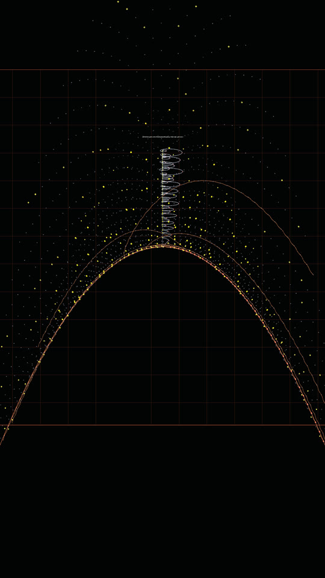

# Experiments on the Sacks saddle

Thought experiments drawn on the saddle-bent Sacks spiral, rendered headlessly from
[`SacksExperiments.cs`](../../Assets/Tour/SacksExperiments.cs) by
[`ExperimentsRenderTest.cs`](../../Assets/Tests/ExperimentsRenderTest.cs). Everything here lives on the
`experiments/sacks-cancellation` branch and touches nothing the tour or the VR build uses: `SacksSpiral` only
became a `partial` class so the experiments can reach its surface helpers.

Each section says what was drawn, what it shows, and what it does *not* show. The numbers were checked
independently in Python (mpmath / plain integer arithmetic) before being drawn.

## A. Cancellation curves and where they cut Euler's line

**Definition.** Every composite is a product `n = u · v` with `2 ≤ u ≤ v`. Write `v = u + d`. For a fixed gap `d`
the numbers `u(u + d)`, `u = 1, 2, 3, …` form one curve on the Sacks spiral, because the spiral puts `n` at
winding angle `2π√n` and `√(u(u + d)) ≈ u + d/2`: stepping `u → u + 1` advances the angle by almost exactly one
turn, so the points line up. These are the *cancellation curves* `C_d`:

* `C_0` is the squares (`u · u`), `C_1` the pronic numbers (`u(u + 1)`), the two routes already in the model.
* `C_d` is born at `u = 1`, i.e. at the number `d + 1` itself (small ring in the pictures), and every point after
  the birth is composite. A prime lies on exactly one cancellation curve, the one born at it.
* Even `d` curves straighten into lines `y = −π d²/4` just below the squares ray; odd `d` curves straighten into
  `y = +π d²/4` just above the pronic ray (in units of the spiral's radius constant). The depth of a composite is
  how many curves pass through it (section C).

**The crossing law for Euler's line.** The candidate line `E(k) = k² + k + 41` is prime for `k = 0 … 39`. Beyond
that it is cut by the curves, and the cuts come in two exact families (checked for every `k ≤ 120`):

| family | where | what the value is | first cases |
|---|---|---|---|
| I  | `k = 40 + j²` | `E(k) = E(j − 1) · E(j)` — two *neighbouring* values of the same line | 40 (41·41), 41 (41·43), 44 (43·47), 49 (47·53), 56, 65, 76, 89, 104 |
| II | `k = 2i² + i + 81` | `E(k) = E(i) · D(i)` with `D(j) = (2j)² + 163` the *sister line* | 81 (41·163), 84 (43·167), 91 (47·179), 102, 117 |
| II | `k = 2i² + 3i + 82` | `E(k) = E(i) · D(i + 1)` | 82 (41·167), 87 (43·179), 96 (47·199), 109 |

These 18 are *all* the composites with `k ≤ 120`; there is no third family that low. Family I sits on the
curve `C_2j`, family II on curves with `d ≥ 122`, which is why its cuts look like long straight chords coming in
from the sister line.

**Why those and nothing else.** `E(k)` is the norm of `(2k + 1 + √−163)/2` and `D(j)` is the norm of
`2j + √−163` in the ring `Z[(1 + √−163)/2]`, which has unique factorisation (class number one, the reason
Euler's polynomial works at all). A value is composite exactly when its element factors in the ring, and a
product of two elements lands back on Euler's row only when their rows add up to one: row 1 × row 1 with
conjugation (family I), or row 1 × row 2 (family II). So the "cancellation curves" that matter for a
prime-generating line are not arbitrary: they are the multiplication table of one quadratic ring, and the
sister line `D` is that ring's second row. The sister line is itself prime for `j = 0 … 19` (163, 167, 179, 199,
227, …, 1459), for the same reason the Euler line is.

**What this does and does not give you.** Intersections with the curves *are* the composites, by definition, so
"eliminate candidates at the intersections" is the sieve itself, restated geometrically. What is new in the
picture is the bookkeeping: on a line of discriminant `−D` the intersections are indexed by the divisors of
`D + (2j)²`, so the first composites after the initial prime run are predictable without factoring anything
(family I needs no factoring at all: it is a square-indexed rule). It does not give a prime test, because
deciding whether `(2k + 1 + √−163)/2` factors is exactly as hard as factoring `E(k)`.

## A2. The zeta wave along Euler's line

The master wave of the final chapter, `−Σ cos(γ · log n)` over all 10 000 zeros, evaluated along the line
`n = k² + k + 41` instead of along the spiral. The explicit formula says this sum spikes at prime powers and dips
between them; along Euler's line it should therefore be a comb of upward spikes for `k ≤ 39` and show holes at
the family I and II crossings.

It does: every prime value carries a spike and every composite a trough, with no extra structure. The zeros
know nothing about `√−163`; they simply mark primes, and the line's own algebra decides where the primes stop.
The two descriptions agree point by point, which is the honest content of "the zeros encode the primes".

## C. Composite depth, and whose clock the saddle is

**Depth bars.** A bar at every composite of height proportional to the number of cancellation curves through it
(number of divisors up to `√n`, minus one). Primes are flat. The tall bars collect on the squares ray and the
pronic ray and along the straightened curves, the familiar Sacks "composite lanes".

**Voronoi's formula.** Summing the depth over all `n ≤ x` gives the divisor staircase `Σ d(n)`, whose smooth part
is `x log x + (2γ − 1)x` and whose wobble `Δ(x)` has its own explicit formula (Voronoi, 1904):

    Δ(x) ≈ (x^¼ / π√2) · Σ_n d(n) n^(−3/4) cos(4π√(nx) − π/4)

The waves in this formula tick with `√x`, which is exactly the Sacks clock (`2π√n` per turn), the way the prime
staircase's waves `cos(γ log x)` tick with the log clock. The first harmonic alone is `cos(4π√x − π/4)`: two
oscillations per turn of the spiral. The saddle height is `z ∝ x² − y² = r² cos(2φ) = n · cos(4π√n)`: the same
two oscillations per turn, an eighth of a turn ahead in phase and with a steeper envelope. So the saddle the
spiral is bent on is not decoration: up to that phase and envelope it is the leading wave of the divisor
function's explicit formula, the `ζ²` analogue of the master cosine wave.

White: the exact `Δ(x)` for `9 ≤ x ≤ 400`. Cyan: 3 000 terms of the Voronoi sum. Orange: the first harmonic.
The second picture keeps only the first harmonic on the three outer turns, over a wire of the saddle, so the
ribbon's two oscillations per turn can be compared with the surface's own. The truncated sum tracks the sawtooth
closely but not exactly (it converges only conditionally; at `x = 400.3` it gives 7.09 against the exact 7.50),
so this is an illustration, not a proof of anything.

## D. The zeros on their own Sacks spiral

The Sacks spiral is an Archimedean spiral in the clock `√n`: whole clock values (the squares) line up on one
ray. The zeros have a clock too, `G = θ(γ)/π + 1` with `θ` the Riemann–Siegel phase; its whole values are the
Gram points. Plotting zero `j` at radius `√G` and angle `2πG` puts the Gram points on a ray, the analogue of the
squares ray.

For the first 1 600 zeros the ray is visibly thinner than its surroundings but not empty: the fractional part of
`G` has decile counts (first 4 000 zeros) of 278, 321, 397, 467, 538, 525, 513, 384, 315, 262. Zeros avoid Gram
points about as mildly as primes avoid the neighbourhood of squares, and the 277 Gram-law exceptions among the
first 4 000 zeros are the ones that stray onto the ray. The analogy is real but weak; it does not make the Gram
ray a "cancellation curve" for zeros.

## E. Anatomy of the chain at one dial value

The partial sums `Σ n^(−½−it)` at a fixed `t`, flat, with the structure the dial produces as `n` grows:

* the turn per link is `t/n`; where it is a multiple of `2π` consecutive links align into a straight **spoke**,
  at `n = t/2πk`; where it is an odd multiple of `π` they fold into a **knot**, at `n = t/(2k + 1)π`;
* the spokes are the mirror images of the integers `k` and the knots of the half-integers under the
  Riemann–Siegel reflection `n ↔ t/2πn`; vortex `k` (between spoke `k + 1` and spoke `k`) holds `t/2πk(k + 1)`
  links, an inverse-square count, and turns through `t · log(1 + 1/k)` radians, a logarithm;
* past the last spoke (`n > t/2π`) the links turn less than a full circle each and the chain spirals outward
  around `ζ(½ + it)` itself. At a zero that centre is the origin; between zeros it is off-centre; at a Gram point
  it lies on the real axis.

The "inverse squares, logarithms and number of turns" are therefore not three mysteries but one: the chain's
turn per link is `t / r²` where `r = √n` is the Sacks radius of that integer (Kepler's area law with angular
momentum `t`), and integrating `t/r²` over links is what produces the logarithm `t · log n`.

## F. One zero's crests on the spiral

The wave of a single zero, `cos(γ log n)`, crests at `n_k = e^{2πk/γ}`. On the spiral the winding angle of
crest `k` is `φ_k = 2π e^{πk/γ}`: a geometric progression, i.e. the crests are *equally spaced in the logarithm
of the winding angle*, with spacing `π/γ`. Between crests the ribbon makes `γ/(π√n)` oscillations per turn, so at
`n = (γ/πm)²` the crests line up into `m` radial arms (white rings). Those radii form an inverse-square ladder in
`m`, and between rungs the arms twist into spirals, the "vortices" visible in the full interference picture.

So each zero draws its own set of nested spiral arms on the saddle; the master wave is their superposition.
The arms are a moiré between the spiral's `√n` clock and the zero's `log n` clock. They are real geometry of the
drawing, not of the primes: the primes appear only when thousands of these patterns are added (section G).

## G. The truncated explicit formula on the number field

Every number coloured by `−Σ_{z≤K} cos(γ_z log n)` (gold up, blue down, each disc scaled to its own extreme),
for `K` = 1, 3, 10, 100, 1 000 and 10 000 zeros on the saddle, then nine such discs stacked (flat, so the
layers read as layers).

With one zero the field is the moiré of section F; with ten it is a tangle of arms; by a hundred the gold
begins to settle on the prime dots; by ten thousand almost nothing but primes and prime powers is gold. Looking
down the stack is watching the explicit formula converge: the vortex structure is what the first few zeros
know about the primes, and it is erased, arm by arm, by the next ones.

## H. Cross sections of the saddle

The saddle is `z = b · K (x² − y²)` with the bend `b` (1 in the tour, 0 flat). Its sections by the three
coordinate planes are a parabola up the ridge (`y = 0`), a parabola down the valley (`x = 0`), and hyperbolas
(`z = h`), with the two diagonals at `z = 0`. What each plane collects, exactly:

| plane | saddle section | numbers in it | product curves that run along it | zeta trail pierces it at |
|---|---|---|---|---|
| `y = 0` (ridge) | `z = bKx²` | the squares (`+x`), the pronic numbers (`−x`) | every 1:1 product `u(u + d)` (all the cancellation curves) | the **Gram points** (`ζ` real, `θ = mπ`) and the zeros |
| `x = 0` (valley) | `z = −bKy²` | `√n ≡ ¼` and `¾`: `u(4u + 1)` on `+y`, `u(4u + 3)` on `−y` | the 1:4 products with odd gap | the **half-Gram points** (`ζ` imaginary, `θ = (m + ½)π`) and the zeros |
| `z = 0` (level) | the diagonals `y = ±x` | `√n ≡ ⅛, ⅜, ⅝, ⅞` | the 1:16 products with odd gap, `u(16u + d)` | the trail's foot, `t = 0` |
| `z = h` (level) | hyperbola `x² − y² = h/bK` | all `n` with `n · cos(4π√n) = h / bKR²`: one contour of the Voronoi harmonic | cut once each, near `n ≈ h/bKR²` on the ridge | one dial value, `t = −4h` (valley side only) |

The general rule behind the middle column: a product `u(q²u + d)` has `√n ≈ qu + d/2q`, so it straightens
along the ray at angle `2π · d/2q`. `q = 1` gives the two ridge rays, `q = 2` the two valley rays, `q = 4` the
four diagonals. The bend does not move any of this (the planes `x = c`, `y = c` cut the same numbers at every
bend); it only decides how steeply the ridge family climbs and the valley family dives, and which contour a level
plane picks: raising the bend from ¼ to 2 pulls the `z = −15` contour in from `n ≈ 1370` to `n ≈ 170`, so a
fixed plane sweeps inward through the valley family and reads off where each curve crosses that height.

The trail column is the one worth keeping. `ζ(½ + it) = Z(t) e^{−iθ(t)}` with `Z` real, so the trail crosses
the ridge plane exactly when `sin θ = 0` (the Gram points) and the valley plane exactly when `cos θ = 0`. The
coordinate planes of the saddle are therefore the Gram planes of the trail, and the correspondence

| Sacks spiral, clock `√n` | zeta trail, clock `θ/π` |
|---|---|
| squares and pronics: `√n ≡ 0, ½` (ridge plane) | Gram points: `θ/π ≡ 0` (ridge plane) |
| `u(4u + odd)`: `√n ≡ ¼, ¾` (valley plane) | half-Gram points: `θ/π ≡ ½` (valley plane) |
| `u(16u + odd)`: `√n ≡ odd/8` (diagonals) | `θ/π ≡ ±¼`: quarter-Gram points |

is exact, not a metaphor: both are "where the clock reads a whole or half value". Section D is the same
correspondence seen from above.

**Unconventional spatial readings that fall out of the sections.**

* *The two clocks as two axes.* Unroll the spiral into a chart with `√n` along `x` (turn count) and the position
  within the turn along `y`. The saddle depends only on `y` (ridge at 0 and ½, valley at ¼ and ¾, horizontal
  stripes); a zero's wave depends only on `x` (its crests are the log-spaced vertical lines); the cancellation
  curves are the `1/u` hyperbolas converging to the ridge stripes, and Euler's line converges to the pronic
  stripe from above. The primes are the gold points no hyperbola passes through. The chart makes "the √ clock
  and the log clock are orthogonal" literal.

  

* *The saddle is doubly ruled.* `z = K(x − y)(x + y)`, so every vertical plane `x − y = a` (or `x + y = a`) cuts the
  saddle in a straight line. The sections along the diagonal directions are the only straight ones.
* *The saddle height is a Lorentz invariant.* A hyperbolic rotation of the plane (`x, y → x cosh a + y sinh a,
  x sinh a + y cosh a`) preserves `x² − y²`, so it slides every number along its own level hyperbola without
  changing its height: the level sets of the saddle are boost orbits, and the Voronoi harmonic
  `n cos(4π√n)` is the invariant.
* *Inversion.* Inverting the plane in the unit circle (`r → 1/r`) sends the straightened cancellation curves
  `y = −πd²/4` to circles through the origin of diameter `4/πd²`: an inverse-square family of circles, all tangent
  at the origin, and it puts the integer `n` at radius `1/√n`, which is the length of the chain's `n`-th link. The
  chain's inverse-square-root link lengths and the Sacks radii are the same numbers seen from the two sides of
  the unit circle.

**Double cancellations.** A number on two cancellation curves is more composite, not less, so no intersection
of product curves ever reverts to a prime. But the *bookkeeping* of the sieve does flip sign at intersections,
and that sign is where the zeta function re-enters. Legendre's count of primes strikes every multiple of each
small prime, then restores every number struck twice (two distinct prime factors), strikes again those struck
three times, and so on. The net sign at `n` is the Möbius function `μ(n)`: `−1` on a prime, `+1` on a product of
two distinct primes (struck twice, restored once), `−1` on three, `0` whenever a prime factor repeats. On the
saddle that is a four-colour field (gold, cyan, magenta, dark), and its running total `M(x) = Σ μ(n)` is the
Mertens function, whose size is equivalent to the Riemann hypothesis (`M(x) = O(x^{½+ε})`). Its Dirichlet series
is `1/ζ`: the "restored" numbers are exactly the ones that make the inverse chain converge where the chain
itself diverges. Up to 1 601 the field has 252 primes, 450 cyan restorations (plus 34 numbers with four distinct primes, also
`+1`), 241 magenta triples and 623 dark numbers, and `|M(x)|` never exceeds `√x`.

## I. The vortex eyes of the chain, traced through the zero planes

**Detection.** At a dial value `t` the chain's `n`-th link turns by `−t · log(1 + 1/n)`, reduced to `(−π, π]`. The
detector uses nothing else: a *knot* is where that turn flips through `±π` (the chain folds back on itself), a
*spoke* where it flips through `0` (the chain runs straight). Each knot is the eye of one vortex; the vortex's
extent is the stretch between the spokes on either side; its certainty is `1 − e^{−L/6}` with `L` the number of
links in that stretch turning by more than half a radian. A vortex drawn by two links is faded to black, one
drawn by thirty is at full colour. The eye is the mean of the four vertices around the knot. Vortex `k` is the
one whose knot sits near `n = t/(2k + 1)π`; vortex 0 is the tail. This was run at all 10 000 zeros in the table
(199 096 vortices, `k ≤ 12`), and the detector's output is written to `vortices.csv` beside the frames.

**What the traces do.** Colour is the vortex index, brightness its certainty, each zero is a plane, the white
curve is `ζ(½ + it)` threading the planes through their centres. Vortex 1 (cyan) winds once around the axis per
zero on a circle of radius exactly one; vortex 2 (magenta) rides an epicycle on it; the higher vortices are
dimmer, more erratic, and farther out.

**The law behind it.** The eyes are not new information. At every zero, to the accuracy of the detector,

    eye_k(γ) = −e^{−2iθ(γ)} · conj(S_k(γ)),       S_k = Σ_{n≤k} n^{−½−iγ}

the eye of vortex `k` is the chain's own `k`-th vertex, reflected (conjugated and turned by twice the
Riemann–Siegel phase). Off a zero the same holds with `ζ(½ + it)` added. This is the approximate functional
equation `Σ_{n≤x} n^{−s} ≈ ζ(s) − χ(s) Σ_{m≤t/2πx} m^{s−1}` read at the knots, where the dual cutoff `t/2πx = k + ½`
falls exactly between integers and the equation is at its most accurate. The far end of the chain is the near
end in a mirror, vortex by vortex. Grey diamonds in the pictures are the mirror points; they sit inside the eyes.

| vortex `k` | zeros with `t < 1000`: median distance eye → mirror | zeros with `t ≥ 1000` |
|---|---|---|
| 1 | 0.001 | 0.000 |
| 2 | 0.005 | 0.000 |
| 5 | 0.036 | 0.001 |
| 8 | 0.127 | 0.003 |
| 12 | 0.193 | 0.009 |

The mismatch is entirely a matter of how many links draw the vortex: median 0.052 for vortices drawn by fewer
than three curling links, 0.017 for three to five, 0.002 for twelve to thirty, 0.000 beyond. The certainty
fade is therefore honest: faint eyes are the ones the mirror law places least well.

The three views down the axis are all 10 000 zeros at once: plain (every eye of vortices 1 to 12), with the Gram
phase taken out, and the same for vortices 1 to 4 only, where the point `−1`, the circle of radius `1/√2` and the
next epicycle stand out.

**Vortex 1 is the Gram clock.** With `S_1 = 1` the first eye sits at `−e^{−2iθ(γ)}`: on the unit circle (radius
1.000 ± 0.004 over 9 994 zeros, angle residual below 0.001 rad), at angle `π − 2θ(γ)`. Since `θ` advances by
about `π` per zero, the cyan trace is a helix with one turn per zero, and the amount by which its phase slips
from one zero plane to the next is the Gram offset of that zero: the eye angle reads the zero's position within
its Gram interval. Taking the Gram phase out (multiplying every eye by `e^{2iθ}`) collapses the whole tower onto
the chain's own first vertices: vortex 1 to the single point `−1`, vortex 2 to the circle of radius `1/√2` around
it, vortex 3 to an epicycle of radius `1/√3` on that, and so on.

**Predictive structure.** Over the 10 000 zeros:

| correlation | value |
|---|---|
| Gram offset of zero `j` with the offset of zero `j + 1` | +0.02 |
| Gram offset of zero `j` with the spacing to zero `j + 1` (in Gram units) | −0.28 |
| spacing `j` with spacing `j + 1` | −0.37 |

So the eye angle at one zero plane (its Gram offset) says a little about where the next plane is, a zero late in
its Gram interval being followed by a shorter gap, and consecutive gaps alternate, which is the repulsion of the
zeros that random-matrix statistics predict. It says nothing about the next zero's own offset. Everything the
vortex eyes carry is `θ(γ_j)` and the first dozen terms of the chain, which are the same functions of `γ_j` the
chain started from; the picture is a faithful mirror, not an oracle. What it does give is a clean geometric
object: the chain's far end is its near end reflected through the Gram phase, and the helix of the first eye is
the zeros' Gram clock drawn as a curve through the planes.

## What I would take from this

1. The cancellation curves are the product curves `n = u(u + d)`. For a prime-generating line they are indexed
   by a quadratic ring, and the first composites after the prime run obey the closed rules in section A.
2. The saddle is the first harmonic of Voronoi's formula for the divisor function: the Sacks spiral's `√n` clock
   is the clock of `ζ²`, the spiral's log clock is the clock of `ζ`. The two live together on this surface.
3. The chain's vortices are inverse-square link counts and logarithmic turning, mirror images of the integers
   and half-integers; a zero's wave makes an inverse-square ladder of spiral arms on the saddle.
4. The saddle's coordinate planes are the trail's Gram planes: the ridge plane holds the squares, the pronics
   and every cancellation curve, and is pierced by the trail at the Gram points; the valley plane holds the
   1:4 products and the half-Gram points. The bend is a probe, not a parameter of the arithmetic.
5. Double intersections do not restore primes, but the sieve's sign at them is the Möbius function, whose running
   total is the Mertens function and whose series is `1/ζ`: that is the honest form of "double cancellation".
6. The vortex eyes of the chain at a zero are the chain's first vertices reflected through twice the Gram
   phase; the first eye's helix through the zero planes is the Gram clock, and its phase slips carry only the
   weak next-gap correlation of zero repulsion (−0.28).
7. None of this predicts a prime or a zero that the sieve, the explicit formula or the functional equation does
   not already predict. It makes the predictions visibly the same picture.

## Explainer modules

The side menu's **Experiments** section plays four directed modules built from these experiments: *Cancellation
curves* (section A), *Level contours* (H10), *The bend as a probe* (H11, with the bend animated from flat to twice
the tour's while a plane at height ±15 sweeps the curves) and *Mirrors, not oracles* (section I). Their lines live
in [`experiments.json`](../../Assets/Resources/Narration/experiments.json); the actions and camera cues are in
[`ExperimentTour.cs`](../../Assets/Tour/ExperimentTour.cs) and `CameraRig.cs`. They are narrated with the tour's
ElevenLabs voice (JohnV4) and record as one vertical video each with
`Tools/render_chapters.py --script experiments --shapes vertical`.

## Rendering

    ZETA_OUT=/some/dir Unity -batchmode -projectPath . -runTests -testPlatform PlayMode \
        -testFilter ExperimentsRenderTest -testResults /some/dir/results.xml -logFile /some/dir/run.log

`ZETA_EXP_ONLY=AH` renders only the named sections. The frames are 1080 × 1920; the copies in this folder are
scaled to 540 × 960. All numbers quoted above were recomputed in Python before the pictures were drawn
(product-curve crossings by integer arithmetic, the Gram statistics with the Riemann–Siegel theta function,
Voronoi's sum with 3 000 terms, the Möbius counts directly).
